<div align="center">

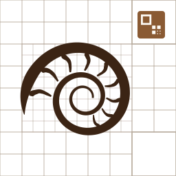

# FOSSIL
#### FOrtran Surfaces, Solids, Immersed boundaries and Level sets

[](https://github.com/szaghi/FOSSIL/tags)
[](https://github.com/szaghi/FOSSIL/issues)
[](https://github.com/szaghi/FOSSIL/actions/workflows/ci.yml)
[](https://app.codecov.io/gh/szaghi/FOSSIL)
[](#copyrights)

> Geometry for simulation codes, in pure Fortran: surfaces and 2-D curves read, repaired, processed and measured;
> signed distances and level sets; immersed-boundary queries and AMR tagging; exact cut cells and their solver support;
> curvilinear blocks and overset assembly; body-fitted grids; moving bodies and collision; on the CPU or bit-exact on
> the GPU.

</div>

| 📂 **STL in, STL out**<br>ASCII or binary, format detected, NaN and Inf rejected with a status; analyze gives the box, volume, centroid, connectivity, shells and bodies. [First surface](https://szaghi.github.io/FOSSIL/manual/tutorial/01-first-surface) | 🩹 **Repair dirty meshes**<br>sanitize removes slivers and duplicates, closes gaps and orients the normals outward; fill_holes patches and fairs the holes left. [Repair](https://szaghi.github.io/FOSSIL/manual/tutorial/02-repair) | 🛠️ **Geometry processing**<br>Exact booleans and self-intersections, decimation, isotropic remeshing, smoothing, alpha wrapping, marching cubes, segmentation. [Processing and analysis](https://szaghi.github.io/FOSSIL/manual/tutorial/12-geometry) |
|:---:|:---:|:---:|
| 🔬 **Geometry analysis**<br>Mass properties, certified deviation and Hausdorff distance, feature edges, local thickness and gaps, curvature, named patches. [Processing and analysis](https://szaghi.github.io/FOSSIL/manual/tutorial/12-geometry) | 📏 **Signed distance**<br>Closest facet on a SAH BVH, bit-exact against brute force; four sign algorithms, the fast winding number for surfaces with holes. [Distance](https://szaghi.github.io/FOSSIL/manual/tutorial/04-distance) | 🌊 **Level sets**<br>A signed-distance field on a stretched grid: exact narrow band, flood-fill signs, fast sweeping, an eikonal diagnostic. [Distance fields](https://szaghi.github.io/FOSSIL/manual/tutorial/06-distance-field) |
| 〰️ **2-D curves**<br>Closed and open polylines for quadtree solvers, with the same queries as the surfaces; sections of any STL by a grid plane. [Curves](https://szaghi.github.io/FOSSIL/manual/tutorial/07-curves) | 🎯 **Immersed-boundary queries**<br>Per point: closest point, feature, pseudo-normal and body; image points and probes; wall distance with cutoff; wall curvature. [IB queries](https://szaghi.github.io/FOSSIL/manual/tutorial/08-ib-queries) | 🧭 **AMR tagging**<br>Blocks and cells classified as cut, near, inside or outside from the tree alone; signed tag bands on a block. [AMR tagging](https://szaghi.github.io/FOSSIL/manual/tutorial/09-amr-tagging) |
| 🧱 **Exact cut cells**<br>Grid-line crossings decided by exact predicates; 2-D and 3-D fluid fractions, apertures and fluid pieces with their own volumes. [Cut cells](https://szaghi.github.io/FOSSIL/manual/tutorial/10-cut-cells) | 🧩 **Cut-cell solver support**<br>Links between pieces, state- and flux-redistribution neighbourhoods, merge targets, moments, quadrature rules and coarse levels. [Solver support](https://szaghi.github.io/FOSSIL/guide/advanced/cut-solver) | 🔄 **Moving bodies**<br>Body-frame queries without a rebuild, an O(N) tree refit, and the swept geometry of a time step: exact swept volumes. [Moving bodies](https://szaghi.github.io/FOSSIL/manual/tutorial/11-moving-bodies) |
| 💥 **Collision detection**<br>Body-body distance with the closest pair; the time of first contact by conservative advancement, with no tunnelling; the first impact among many bodies. [Contact](https://szaghi.github.io/FOSSIL/manual/tutorial/14-contact) | 🕸️ **Structured blocks**<br>Curvilinear blocks: topology detection, certified cell validity, point location by tree or stencil walk, interpolation stencils, quality. [Blocks and overset](https://szaghi.github.io/FOSSIL/manual/tutorial/13-blocks-overset) | 🔗 **Overset assembly**<br>Holes by winding number, hole map or X-rays; donor candidates with their quality; explicit or implicit classification, orphans by cause, connectivity. [Blocks and overset](https://szaghi.github.io/FOSSIL/manual/tutorial/13-blocks-overset) |
| 📐 **Body-fitted grids**<br>Projection constrained to patches, feature curves and corners; 2-D hyperbolic extrusion; a wall-spacing and quality report with y1+. [Body-fitted grids](https://szaghi.github.io/FOSSIL/manual/tutorial/15-body-fitted) | 🚀 **On the GPU, bit for bit**<br>OpenACC kernels shared with the CPU path: distances, rich queries, tagging and posed queries equal the CPU results bit for bit. [GPU](https://szaghi.github.io/FOSSIL/manual/tutorial/16-gpu) | 🆓 **Free and portable**<br>Pure Fortran 2003+, no C; gfortran, ifx, nvfortran; FoBiS or fpm; GPLv3, BSD or MIT. [Installation](https://szaghi.github.io/FOSSIL/guide/installation) |

<!-- gallery:start -->

<p align="center">
<br><sub>A NACA 0012 section pitching and translating through a Cartesian grid, every frame computed by FOSSIL: its exact cut cells and the level sets of its signed distance, with the pose passed to the query instead of rebuilding the tree.</sub></p>

<p align="center">
<br><sub>Grids around bodies: an overset assembly recomputed as the cylinder's O-grid moves through the background, with the orphans that appear where it leaves it, and a body-fitted O-grid marched out of the section by hyperbolic extrusion.</sub></p>

<table>
<tr>
<td align="center" width="33%"><a href="https://szaghi.github.io/FOSSIL/manual/tutorial/01-first-surface">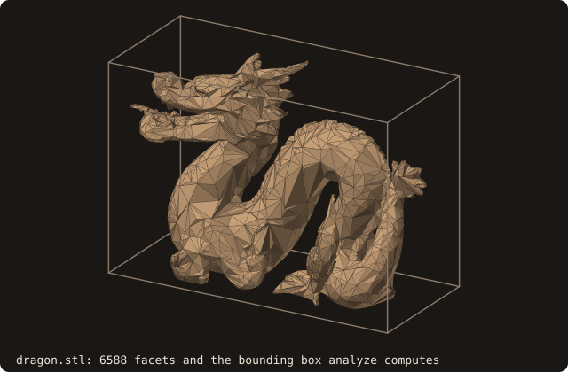</a><br><b>STL in, STL out</b><br><sub>the dragon loaded, 6588 facets, and the box analyze computes</sub></td>
<td align="center" width="33%"><a href="https://szaghi.github.io/FOSSIL/manual/tutorial/02-repair"></a><br><b>Repair dirty meshes</b><br><sub>holes closed one by one by fill_holes, refined and faired</sub></td>
<td align="center" width="33%"><a href="https://szaghi.github.io/FOSSIL/manual/tutorial/12-geometry"></a><br><b>Geometry processing</b><br><sub>a block drilled nine times, each step checked by an independent boolean</sub></td>
</tr>
<tr>
<td align="center" width="33%"><a href="https://szaghi.github.io/FOSSIL/manual/tutorial/12-geometry"></a><br><b>Geometry analysis</b><br><sub>a decimation sweep coloured by its certified distance from the original</sub></td>
<td align="center" width="33%"><a href="https://szaghi.github.io/FOSSIL/manual/tutorial/04-distance">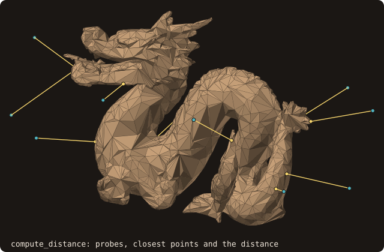</a><br><b>Signed distance</b><br><sub>probes and their closest points on the dragon</sub></td>
<td align="center" width="33%"><a href="https://szaghi.github.io/FOSSIL/manual/tutorial/06-distance-field">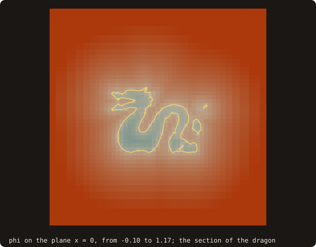</a><br><b>Level sets</b><br><sub>the signed-distance field on a stretched grid</sub></td>
</tr>
<tr>
<td align="center" width="33%"><a href="https://szaghi.github.io/FOSSIL/manual/tutorial/07-curves">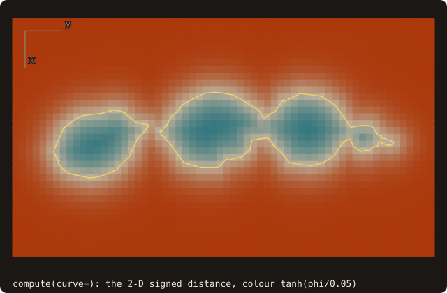</a><br><b>2-D curves</b><br><sub>a section of the dragon and its 2-D signed distance</sub></td>
<td align="center" width="33%"><a href="https://szaghi.github.io/FOSSIL/manual/tutorial/08-ib-queries">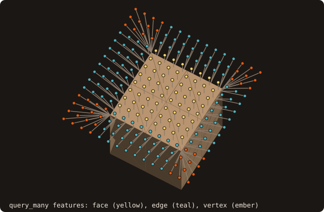</a><br><b>Immersed-boundary queries</b><br><sub>closest points on a face, an edge or a vertex</sub></td>
<td align="center" width="33%"><a href="https://szaghi.github.io/FOSSIL/manual/tutorial/09-amr-tagging">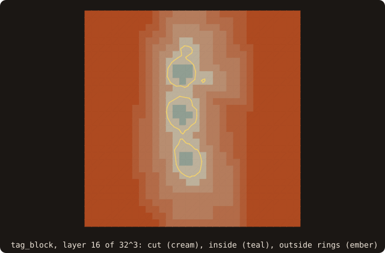</a><br><b>AMR tagging</b><br><sub>cut, inside and outside cells of a block, in signed bands</sub></td>
</tr>
<tr>
<td align="center" width="33%"><a href="https://szaghi.github.io/FOSSIL/manual/tutorial/10-cut-cells">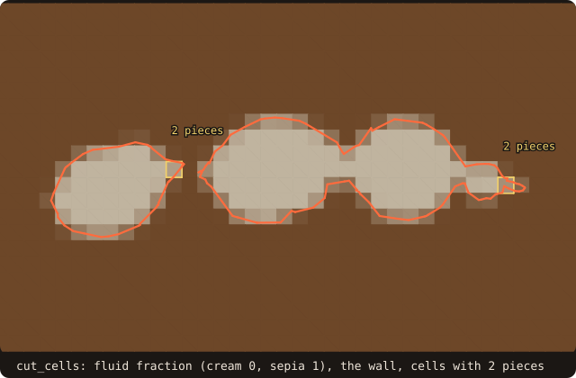</a><br><b>Exact cut cells</b><br><sub>the fluid fraction of the cut cells of a section</sub></td>
<td align="center" width="33%"><a href="https://szaghi.github.io/FOSSIL/guide/advanced/cut-solver"></a><br><b>Cut-cell solver support</b><br><sub>the small pieces of a moving ellipse and their merge targets, every frame</sub></td>
<td align="center" width="33%"><a href="https://szaghi.github.io/FOSSIL/manual/tutorial/11-moving-bodies">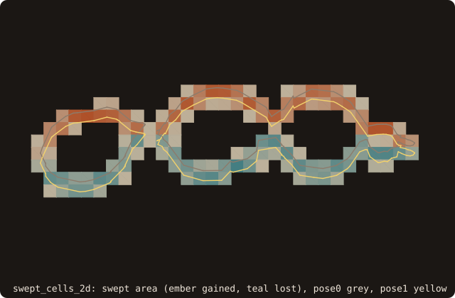</a><br><b>Moving bodies</b><br><sub>the area a moving section sweeps in a time step</sub></td>
</tr>
<tr>
<td align="center" width="33%"><a href="https://szaghi.github.io/FOSSIL/manual/tutorial/14-contact"></a><br><b>Collision detection</b><br><sub>conservative advancement to the time of impact: plain bound, 25 steps; directional, 5</sub></td>
<td align="center" width="33%"><a href="https://szaghi.github.io/FOSSIL/manual/tutorial/13-blocks-overset"></a><br><b>Structured blocks</b><br><sub>points tracked through an O-grid by stencil walks, across its seam</sub></td>
<td align="center" width="33%"><a href="https://szaghi.github.io/FOSSIL/manual/tutorial/13-blocks-overset">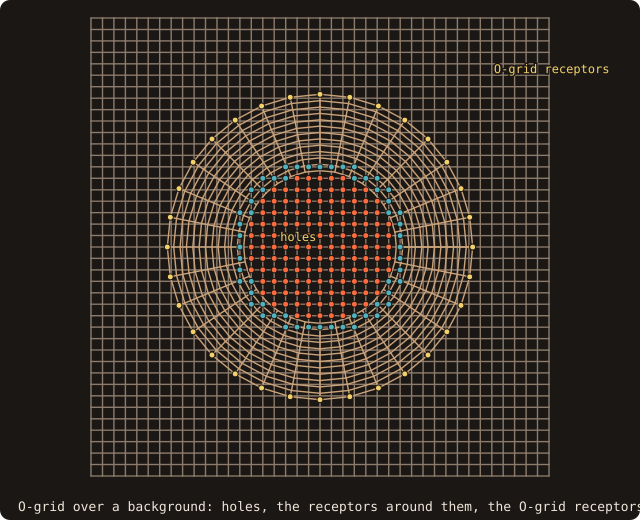</a><br><b>Overset assembly</b><br><sub>an O-grid over a background: the holes, the receptors around them, the O-grid's receptors</sub></td>
</tr>
<tr>
<td align="center" width="33%"><a href="https://szaghi.github.io/FOSSIL/manual/tutorial/15-body-fitted">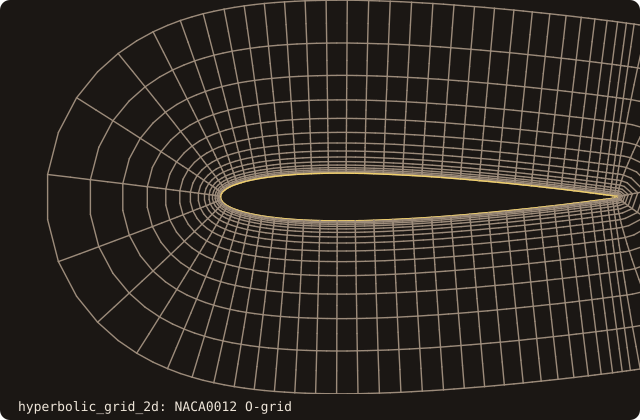</a><br><b>Body-fitted grids</b><br><sub>an O-grid marched out of a NACA 0012 section by hyperbolic extrusion</sub></td>
<td align="center" width="33%"><a href="https://szaghi.github.io/FOSSIL/manual/tutorial/16-gpu">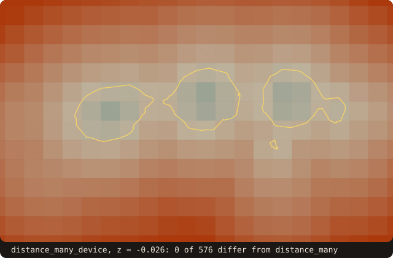</a><br><b>On the GPU, bit for bit</b><br><sub>the device code path on a slice: 0 differences from the host</sub></td>
<td align="center" width="33%"><a href="https://szaghi.github.io/FOSSIL/guide/installation"></a><br><b>Free and portable</b><br><sub>the tutorial programs, run one after the other</sub></td>
</tr>
</table>

<!-- gallery:end -->

>#### [Documentation](https://szaghi.github.io/FOSSIL/)
> The [tutorial](https://szaghi.github.io/FOSSIL/manual/), the [cookbook](https://szaghi.github.io/FOSSIL/manual/cookbook) and the [reference](https://szaghi.github.io/FOSSIL/guide/features) are on the [FOSSIL website](https://szaghi.github.io/FOSSIL/). Every code sample there is a program compiled and run to produce the output shown.

---

## Authors

**[Stefano Zaghi](https://github.com/szaghi)** · stefano.zaghi@cnr.it
> *Chief Yak Shaver, Accidental Research Scientist, and HPC Farmer* — CFD researcher who decided that one more day debugging Fortran build systems was one day too many, opened a Python REPL "just to prototype," and now finds himself maintaining a meshing library, a chimera assembler, an MPI load balancer, and the seven blog tabs he keeps meaning to read.

**[Claude](https://claude.ai)** (Anthropic)
> *Omniscient Code Oracle & Tireless Rubber Duck* — AI pair programmer, responsible for writing the boring parts so humans don't have to.

Contributions are welcome — see the [Contributing](https://szaghi.github.io/FOSSIL/guide/contributing) page.

## Copyrights

This project is distributed under a multi-licensing system:

- **FOSS projects**: [GPL v3](http://www.gnu.org/licenses/gpl-3.0.html)
- **Closed source / commercial**: [BSD 2-Clause](http://opensource.org/licenses/BSD-2-Clause), [BSD 3-Clause](http://opensource.org/licenses/BSD-3-Clause), or [MIT](http://opensource.org/licenses/MIT)

> Anyone interested in using, developing, or contributing to this project is welcome — pick the license that best fits your needs.

---

## Quick start

```fortran
use fossil
use penf, only: R8P
use vecfor, only: ex_R8P
implicit none
type(surface_stl_object) :: surface
real(R8P)                :: d

! Load (ASCII or binary, auto-detected) and run the full repair pipeline.
call surface%load_from_file(file_name='cube.stl', guess_format=.true.)
call surface%sanitize           ! degenerate / duplicate / non-manifold / winding
print '(A)', surface%statistics()

! Signed distance from a point — uses SAH BVH + pseudo-normal sign by default.
d = surface%distance(point=2.0_R8P * ex_R8P, is_signed=.true., is_square_root=.true.)
print '(A,ES12.5)', 'signed distance = ', d

call surface%translate(x=1.0_R8P, y=2.0_R8P, z=0.5_R8P)
call surface%save_into_file(file_name='cube-moved.stl')
```

See [`src/tests/`](src/tests/) for more examples including clipping, distance queries, and validity predicates (`is_watertight`, `is_manifold`, `is_volume`).

For interactive use without writing Fortran, the companion **`fossilizer`** CLI (`src/app/fossilizer.f90`) wraps the library for command-line STL analysis and manipulation.

---

## Install

Upgrading from 2.x: see [Upgrading to 3.0](https://szaghi.github.io/FOSSIL/guide/upgrading-3) for the changes in behaviour.

### FoBiS

**Standalone** — clone, fetch the dependencies into `src/third_party/`, and build:

```bash
git clone https://github.com/szaghi/FOSSIL && cd FOSSIL
fobis fetch                     # fetch the fobos [dependencies]
fobis build --mode static-gnu   # build static library
fobis build --mode tests-gnu && ./scripts/run_tests.sh  # build and run tests
```

**As a project dependency** — declare FOSSIL in your `fobos` and run `fetch`:

```ini
[dependencies]
deps_dir = src/third_party
FOSSIL = https://github.com/szaghi/FOSSIL
```

```bash
fobis fetch              # fetch and build
fobis fetch --update     # re-fetch and rebuild
```

### fpm

```bash
git clone https://github.com/szaghi/FOSSIL && cd FOSSIL
fpm build --profile release     # fpm resolves the dependencies from fpm.toml
```

**As an fpm dependency:**

```toml
[dependencies]
FOSSIL = { git = "https://github.com/szaghi/FOSSIL.git" }
```

FOSSIL ships no CMake or Make build files.
