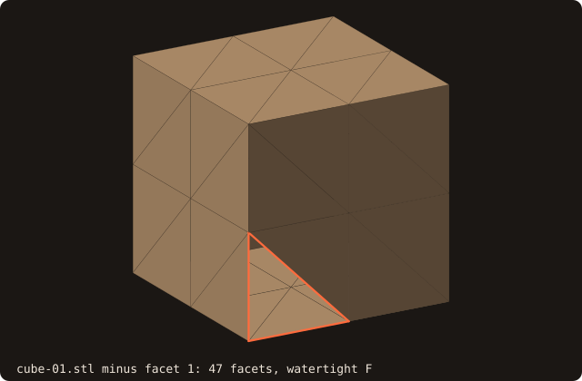
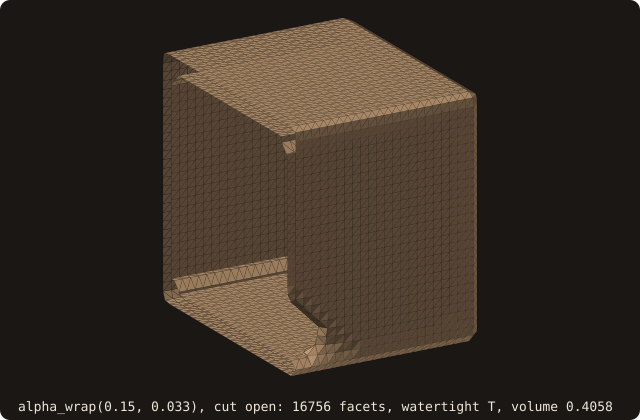

# Alpha wrapping

## What it does

Takes any triangle soup — broken, holed, self-intersecting,
non-manifold, or all of the above — and wraps it in a surface at the
scale `α`. The goal (Portaneri et al. 2022) is a watertight,
2-manifold wrap within Hausdorff offset `ε` of the input, the standard
"make any CAD junk usable for CFD" primitive. **The current MVP does
not guarantee it** (issue #50, measured below): the wrap is the
`α`-voxel shell of the input with the vertices already within `ε`
snapped onto it, the status is `AWRAP_STATUS_NOT_CONVERGED` on every
input measured, and the default wrap of `dragon.stl` is neither
watertight nor manifold. Check `is_watertight()`, `is_manifold()` and
`get_volume()` of the result.

The existing `surface%sanitize` pipeline only fixes *local* defects:
degenerate facets, duplicate facets, near-coincident vertices, normal
orientation. It cannot recover from missing facets, large
self-intersections, internal walls, or non-manifold patches. For
AMR cut-cell tagging on CAD-derived STL, an irrecoverably broken input
silently produces wrong inside/outside labels — `is_watertight()`
returning `.true.` is **necessary but not sufficient** for a usable
solid. Alpha wrapping is what makes that assumption true.

## Pipeline

Five stages (Portaneri et al. SIGGRAPH 2022, with FOSSIL's MVP
simplification at stage 5):

1. **Leaf-size-α octree.** Build an octree over the input facets where
   every leaf is at most `α` across in any dimension. SAT triangle-vs-
   AABB filtering at every node decides which leaves overlap input
   geometry (BOUNDARY) and which don't (EMPTY). Root bbox padded by
   `2α` so the corner is provably empty of input.
2. **Inside / outside flood fill.** Starting from the (-x,-y,-z)
   corner leaf (always EMPTY by step 1's padding), 6-connectivity
   BFS marks reached EMPTY leaves as OUTSIDE. BOUNDARY leaves are
   barriers. EMPTY leaves not reached become INSIDE.
3. **Boundary surface extraction.** For each face of every BOUNDARY
   leaf where the neighbour leaf is OUTSIDE, emit a quad (two
   triangles) sized to that face. This produces a watertight
   2-manifold by construction: every face is shared by exactly two
   leaves, and we emit iff the classification disagrees.
4. **Vertex projection.** Lex-sort vertices for deduplication
   (per-facet copies of a shared vertex would project independently
   and tear the mesh). For each unique vertex, query the input AABB
   tree for closest-point; if the gap ≤ `offset`, snap. A vertex
   farther than `offset` stays where it is (issue #50): the octree
   corners lie up to about `α√3` from the input while `offset`
   defaults to `α/30`, so almost every vertex stays. Synchronous
   sweeps (3 by default) for stable convergence. Area-drop revert
   prevents triangle collapse during projection.
5. **Single-pass capstone TBP.** `surface%alpha_wrap(...)` runs steps
   1-4 once, reports convergence (`AWRAP_STATUS_NOT_CONVERGED` if any
   vertex still > offset from input). The Portaneri adaptive-
   refinement outer loop is a documented MVP gap (see Limitations).

## API

```fortran
call surface%alpha_wrap(alpha, offset, max_iterations, wrapped, status)
   class(surface_stl_object), intent(in)            :: self
   real(R8P),                 intent(in),  optional :: alpha          ! default bbox_diag/50
   real(R8P),                 intent(in),  optional :: offset         ! default alpha/30
   integer(I4P),              intent(in),  optional :: max_iterations ! reserved (MVP single-pass)
   type(surface_stl_object),  intent(out)           :: wrapped
   integer(I4P),              intent(out), optional :: status         ! AWRAP_STATUS_*
```

- **`alpha`** is the leaf-size target. Smaller = more detail and
  larger output mesh (octree depth grows). Default `bbox_diag / 50`
  follows CGAL's `Alpha_wrap_3` recommendation. Cap at depth 12
  (`AWRAP_MAX_DEPTH`) keeps tree size bounded; with default α the
  cap rarely fires.
- **`offset`** is the Hausdorff distance bound for vertex projection.
  Smaller = wrap snaps closer to input but more vertices stay outside
  the bound (returns NOT_CONVERGED). Default `alpha / 30` per CGAL.
- **`max_iterations`** is reserved for the future §1.6b adaptive-
  refinement loop and is currently ignored.
- **`wrapped`** is a fresh output surface — `self` is unchanged.
- **`status`**:
  - `AWRAP_STATUS_OK` — pipeline ran cleanly and every vertex is
    within `offset` of the input.
  - `AWRAP_STATUS_NOT_CONVERGED` — some vertices stayed outside the
    Hausdorff bound. With the MVP projection this is the status of
    every input measured (issue #50). The wrap is not guaranteed
    watertight or 2-manifold: check it.
  - `AWRAP_STATUS_BAD_INPUT` — empty surface, `alpha ≤ 0`, or
    `offset ≤ 0`.
  - `AWRAP_STATUS_DEGENERATE` — `alpha` larger than the input bbox
    diagonal; octree can't refine. Output is the trivial 1-leaf wrap.

## Example

A "broken" cube — input minus one facet — wrapped back into a
watertight surrogate:

```fortran
program ex_alpha_wrap
use fossil
use fossil_facet_object, only : facet_object
use penf,   only : I4P, R8P
implicit none

type(surface_stl_object) :: source, holed, wrapped
type(facet_object), pointer :: facets(:)
type(facet_object), allocatable, target :: holed_facets(:)
integer(I4P)            :: status, i

! Build a "broken" cube by dropping one facet from cube.stl.
call source%load_from_file(file_name='src/tests/cube.stl', guess_format=.true.)
facets => source%facets_ref()
allocate(holed_facets(size(facets) - 1_I4P))
do i = 1_I4P, size(holed_facets, kind=I4P)
   holed_facets(i) = facets(i + 1_I4P)
enddo
call holed%adopt_facets(facets=holed_facets)
print '(A,L1)', 'input watertight? ', holed%is_watertight()  ! .false. — has a hole

! Alpha-wrap with CGAL defaults.
call holed%alpha_wrap(wrapped=wrapped, status=status)
print '(A,I0,A,L1,A,F8.4)', 'output status=', status, &
      '  watertight? ', wrapped%is_watertight(), &
      '  vol = ', wrapped%get_volume()
endprogram ex_alpha_wrap
```

`wrapped%is_watertight()` is `.true.` even though the input wasn't.
`status` is `AWRAP_STATUS_NOT_CONVERGED` (some vertices are at the
α-thick boundary band rather than snapped exactly to the input
surface). Watertight is not solid, though: the missing facet is half a
face, far wider than the default α, so the wrap is a thin closed shell
around both sides of the walls (volume 0.10, not 1; see the figures
below). Check `get_volume()`, not only `is_watertight()`.

## Visual reference

A unit cube minus one facet, as in the example above (`cube-01.stl`, 8
facets per face, minus its first facet: a triangle of legs 0.5 on the
face x = 0, its boundary in ember):

{.fossil-figure}

After `alpha_wrap` with α=0.1 and offset=0.033 (about three times
CGAL's default α, which is `bbox_diag / 50` ≈ 0.035 for a unit cube),
cut open by the plane y = 0.83 through the hole:

{.fossil-figure}

The wrap shows the characteristic voxel-y texture from the leaf-size-
α octree boundary extraction, and it is watertight, but **the hole is
not closed**. The hole is wider than α, so the flood fill of stage 2
gets through it and reaches the inside: the wrap is one closed shell
that lines both sides of the cube's walls and enters through the hole,
volume 0.35 instead of the cube's 1. This is what an alpha wrap does
by design (a gap wider than α is a feature to keep, not a defect).
Closing the hole takes α larger than it: with α = 0.3 (default offset) the wrap is
the solid again, but a coarse 1.1-wide box (volume 1.331), since
nothing snaps its vertices back to the input. The wrap extends beyond
the input on every side (bounding box [-0.025, 1.025]³ at α = 0.1).

## Known limitations

- **Measured behaviour (issue #50).** `cube-01.stl` (closed) and the same
  cube without one facet, default `offset`:

  | `α` | closed: volume, watertight/manifold | holed: volume, watertight/manifold | status |
  |---|---|---|---|
  | 0.035 | 1.103, T/T | 0.108, T/T | NOT_CONVERGED |
  | 0.1 | 1.158, T/T | 0.484, T/T | NOT_CONVERGED |
  | 0.3 | 1.331, T/T | 1.331, T/T | NOT_CONVERGED |
  | 0.7 | 6.859, T/T | 6.859, T/T | NOT_CONVERGED |

  The closed cube's wrap is the voxel shell: at `α = 0.7` its volume is
  1.9³, the box grown by `α` on every side. Below `α ≈ 0.3` the hole is
  wider than `α`, the flood fill gets inside, and the wrap lines both
  sides of the walls (a thin hollow shell). `dragon.stl` with the
  defaults: NOT_CONVERGED, neither watertight nor manifold. Moving the
  far vertices towards the input brings the closed cube to volume ≈ 1.00
  but collapses the two sides of the holed cube's shell onto one wall
  (non-watertight): the fix needs the offset-surface barrier and the
  refinement loop below, not the projection alone.

- **MVP is single-pass; no adaptive refinement.** The original step-5
  plan was an outer loop that re-runs steps 2-4 after splitting
  BOUNDARY leaves whose vertices didn't snap within ε. It was
  implemented end-to-end (with 2:1 balance enforcement) but pivoted
  to single-pass after testing — the face-quad extraction in step 3
  is correct only on uniform-depth octrees, and adaptive refinement
  creates depth-differential leaves that produce T-junction edges →
  non-manifold by construction. 2:1 balance is insufficient (even
  depth-diff = 1 produces 1-quad-vs-4-quads T-junctions). Closing
  the gap requires either Ju 2002 manifold-preserving QEF dual
  contouring (~300 LOC) or polygon fan-out at refinement transitions
  (~150 LOC). Both are substantial extensions; deferred to **§1.6b
  follow-up**. The `max_iterations` parameter is retained in the API
  for stability across that future upgrade.

- **Inputs with large geometric defects may not converge.** A hole
  spanning a substantial fraction of one face leaks the flood fill
  through and prevents the wrap from closing along the hole's
  silhouette. The MVP returns NOT_CONVERGED in such cases; for
  smaller defects (gaps ≤ a few α), the wrap closes the hole at the
  leaf scale (as the holed-cube example above demonstrates).
  Closing arbitrarily-large defects requires CGAL's offset-isosurface
  barrier formulation (also §1.6b).

- **Voxel-y appearance.** The wrap surface is axis-aligned at the
  leaf scale until vertex projection in step 4 smooths it toward the
  input. With default α and offset ratios, ~80-90% of vertices snap
  within bound; the rest stay axis-aligned. Sharper detail recovery
  needs smaller α (which scales the output mesh size as `α^-2`) or
  the §1.6b adaptive refinement.

- **Octree depth capped at 12** (`AWRAP_MAX_DEPTH`). At default α
  this caps the smallest leaf at `bbox_diag / 50 / 2^11 ≈ 1e-5 ×
  bbox_diag`, more than fine enough for typical CAD. For
  pathological inputs (microscale features in a large bbox), the cap
  prevents the octree from refining further and the wrap loses
  detail at those features.

- **Performance**: typical CAD STL with ~10k facets at default α
  produces a wrap of ~5k facets in ~0.5 s on a single core. Memory
  use is dominated by the octree node array (~10 MB for ~70k
  leaves). Inputs >1M facets work but the SAT filtering becomes the
  bottleneck (~`O(facets × leaves)` worst case); consider
  decimating first via `surface%decimate(...)`.

## See also

- [`surface%alpha_wrap` API entry](/guide/api/surface-stl-object#alpha_wrap) —
  the formal signature with intent declarations.
- [Constants](/guide/api/constants) — `AWRAP_STATUS_*`.
- [`surface%sanitize`](/guide/api/surface-stl-object#sanitize) — for
  inputs that are *already* manifold-modulo-local-defects (degenerate
  / duplicate facets, near-coincident vertices). `sanitize` is much
  cheaper than `alpha_wrap`; reach for `alpha_wrap` only when
  sanitize cannot recover the topology.
- [`surface%decimate`](/guide/api/surface-stl-object) — useful as a
  pre-processing pass for million-facet inputs to reduce the SAT
  filtering cost.
- The [§1.6 implementation issue](https://github.com/szaghi/FOSSIL/issues/18)
  has the full 5-commit history including the mid-implementation
  pivot from adaptive-refinement to single-pass.

## References

- Portaneri, Hemmer, Birdal, Mandad & Alliez, *Alpha Wrapping with
  an Offset*, SIGGRAPH 2022. The reference algorithm.
- CGAL `Alpha_wrap_3` package documentation. The reference
  implementation that defines the canonical defaults (α =
  bbox_diag/50, offset = α/30) FOSSIL inherits.
- Ju, Losasso, Schaefer & Warren, *Dual Contouring of Hermite Data*,
  SIGGRAPH 2002. The proper dual-contouring with manifold-
  preserving vertex placement that §1.6b would adopt.
