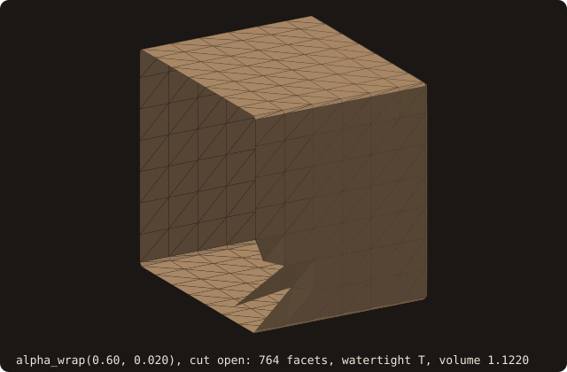

# Alpha wrapping

## What it does

Takes any triangle soup — broken, holed, self-intersecting,
non-manifold, or all of the above — and wraps it in a closed,
2-manifold surface at the scale `α` and the offset `ε` (Portaneri et
al. 2022), the "make any CAD junk usable for CFD" primitive. The wrap
is the boundary of the space a ball of diameter `α` carves from
outside, laid on the surface at distance `ε` from the input:

- a gap wider than about `α + 2ε` lets the ball in, and the wrap lines
  both of its sides (a gap is a feature to keep);
- a narrower gap, a hole or a crack, is closed by a cap where the ball
  stops;
- everywhere the ball reaches the input, the wrap lies on the
  `ε`-offset surface.

The existing `surface%sanitize` pipeline only fixes *local* defects:
degenerate facets, duplicate facets, near-coincident vertices, normal
orientation. It cannot recover from missing facets, large
self-intersections, internal walls, or non-manifold patches. For
AMR cut-cell tagging on CAD-derived STL, an irrecoverably broken input
silently produces wrong inside/outside labels — `is_watertight()`
returning `.true.` is **necessary but not sufficient** for a usable
solid. Alpha wrapping is what makes that assumption true.

## Pipeline

Portaneri et al. carve a 3-D Delaunay triangulation. FOSSIL carves a
uniform grid of cells of size `h` (`α/4` at first) instead, with the
same rule, and puts the vertices on the offset surface (issue #50):

1. **Distance.** The unsigned distance `u` to the input at every cell
   centre, by the input's AABB tree. Blocks of cells far from the
   input are culled.
2. **Flood fill.** Free cells are those where the ball fits outside
   the offset surface, `u > α/2 + ε`. A flood fill from the grid
   corner over free cells gives the reached set: where the ball's
   centre can go from outside. Cavities it cannot reach are filled.
3. **Carving.** A cell is carved if a ball whose centre is reachable
   covers it, which holds within `u(r) − ε` of a reached centre `r`.
   That is an exact power-distance transform, separable like the
   squared distance transform. A cell that touches the input is never
   carved, so the input always lies in solid cells, even a sheet of
   zero thickness carved on both sides. This is the offset-surface
   barrier: the two sides of a wall are separate surfaces and never
   collapse onto each other.
4. **Well-composed.** Carved cells are turned solid until no 2×2
   square has a checkerboard and no 2×2×2 block has an isolated
   diagonal pair. Marching Cubes on such a lattice gives a closed
   2-manifold.
5. **Extraction.** Marching Cubes on the cell centres. Each
   carved–solid edge gets one vertex, computed once:
   - the first point from the carved centre where `u = ε` (sphere
     tracing, which never passes the first root, so it stays on the
     carved side of any wall);
   - if the edge never comes within `ε` of the input, its midpoint
     projected onto the offset surface;
   - on a cap, the point where the carving balls end.
6. **Repair.** A triangle that meets the input, or crosses another
   wrap triangle, has its vertices moved halfway back towards their
   cell faces, where the Marching Cubes surface is embedded, for up to
   6 rounds; a vertex that ends closer than `ε` to the input goes back
   onto the offset surface. A chord across a convex edge of the input, with its ends
   on the offset surface, cuts the input when the cells are larger
   than `ε`. The contact test is exact (`orient3d`); the crossing test
   is in floating point, with the exact test inside a `1e-8` band.
7. **Coarsening.** Edges shorter than `α/2` are collapsed onto one
   of their ends, cheapest first by the quadric error of the planes
   around them (issue #52). A collapse is accepted only if the wrap
   stays a closed 2-manifold and no moved triangle flips, becomes a
   sliver (shape quality below 0.2), meets the input or crosses the
   wrap. The kept end is a wrap vertex, so every vertex stays at `ε` or
   farther. This removes 80% to 95% of the triangles.
8. **Refinement loop.** A level that still has a defect is redone with
   `h/2`, up to `max_iterations` levels (default 5) and `2^23` cells.

## API

```fortran
call surface%alpha_wrap(alpha, offset, max_iterations, wrapped, status)
   class(surface_stl_object), intent(in)            :: self
   real(R8P),                 intent(in),  optional :: alpha          ! default bbox_diag/50
   real(R8P),                 intent(in),  optional :: offset         ! default alpha/30
   integer(I4P),              intent(in),  optional :: max_iterations ! grid levels, default 5
   type(surface_stl_object),  intent(out)           :: wrapped
   integer(I4P),              intent(out), optional :: status         ! AWRAP_STATUS_*
```

- **`alpha`** is the diameter of the carving ball: the scale below
  which gaps are closed. The defaults follow CGAL's `Alpha_wrap_3`.
  The coarsened output has edges up to about `α/2` on flat parts, so
  halving `alpha` roughly quadruples the facet count.
- **`offset`** is the distance from the input at which the wrap lies.
- **`max_iterations`** is the number of grid levels the refinement
  loop may use.
- **`wrapped`** is a fresh output surface; `self` is unchanged.
- **`status`**:
  - `AWRAP_STATUS_OK`: the wrap encloses the input without touching
    it and does not cross itself.
  - `AWRAP_STATUS_NOT_CONVERGED`: the finest level allowed still has a
    triangle that touches the input or crosses the wrap. The wrap of
    that level is returned, still closed and 2-manifold.
  - `AWRAP_STATUS_BAD_INPUT`: empty surface, `alpha ≤ 0`, or
    `offset ≤ 0`.
  - `AWRAP_STATUS_DEGENERATE`: `alpha` at least the input's bounding
    box diagonal. The wrap is empty.

## Example

The unit cube without its first facet: a triangular hole of legs 0.5
(inradius 0.146) on the face x = 0. The input is open, so it is not a
volume:

<<< @/examples/snippets/ref_alpha_wrap-input.f90

Wrapped twice: with a ball wider than the hole, then with one that
passes through it.

<<< @/examples/snippets/ref_alpha_wrap-wrap.f90

The two failures `status` reports before any work is done:

<<< @/examples/snippets/ref_alpha_wrap-status.f90

<<< @/examples/output/ref_alpha_wrap.ansi{ansi}

- **`alpha = 0.6`**: the ball (radius 0.3) does not fit through the
  hole, so the wrap caps it. The result is the cube grown by the offset,
  110 facets and volume 1.0878: less than $(1 + 2\cdot 0.02)^3 = 1.125$
  because of the cap that dips into the hole and of the chords the
  coarse wrap lays across the rounded edges.
- **`alpha = 0.15`**: the ball passes the hole (0.075 + 0.033 <
  0.146), carves the inside too, and the wrap lines both sides of every
  wall. It is watertight and manifold, yet its volume is 0.3951: about
  $2\varepsilon$ times the cube's area 6 (0.396), a hollow shell, not a
  solid. `is_watertight()` alone does not tell the two cases apart;
  `get_volume()` does.
- **`alpha < 0`** gives `AWRAP_STATUS_BAD_INPUT`, and **`alpha` at
  least the bounding-box diagonal** ($\sqrt 3$ here)
  `AWRAP_STATUS_DEGENERATE`, with an empty `wrapped`.
- `self` is `intent(in)`: `holed` is wrapped four times from the same
  input. The cutaways under [Visual reference](#visual-reference) show
  the two wraps.

## Visual reference

A unit cube minus one facet (`cube-01.stl`, 8 facets per face, minus
its first facet: a triangle of legs 0.5 on the face x = 0, its
boundary in ember):

{.fossil-figure}

After `alpha_wrap` with `alpha` 0.15 and `offset` 0.033, cut open by
the plane y = 0.83 through the hole:

{.fossil-figure}

The ball, of diameter 0.15, fits through the hole (inradius 0.146 >
0.075 + 0.033). The wrap is one closed shell: one layer outside each
wall, one inside, 2ε apart, joined around the rim of the hole. The
barrier keeps the two layers apart: a cell touching the wall is never
carved, so each layer's vertices are traced from its own side.

With `alpha` 0.6 (and `offset` 0.02) the ball does not fit, and the
wrap closes the hole with a cap that dips into it:

{.fossil-figure}

## Known limitations

- **Measured behaviour (issues #50, #52).** `cube-01.stl` (closed) and
  the same cube without one facet, default `offset` (`α/30`). Every
  wrap is status OK, watertight and manifold:

  | `α` | closed: volume, facets | holed: volume, facets |
  |---|---|---|
  | 0.035 | 1.007, 18272 | 0.015, 35640 |
  | 0.1 | 1.020, 2382 | 0.050, 4590 |
  | 0.3 | 1.053, 276 | 1.052, 290 |
  | 0.7 | 1.113, 116 | 1.111, 106 |

  The closed cube's volume is the cube grown by the offset,
  `(1 + 2ε)³`, less the rounding of the edges and corners and the
  chords the coarse wrap lays across them: at `α = 0.1` the Minkowski
  sum is 1.0201, at `α = 0.7` it is 1.1438. The hole (inradius 0.146)
  lets the ball in for `α/2 + ε < 0.146`, that is `α < 0.27`, but the
  flood fill needs a cell centre where the ball fits, so on the grid
  the hole closes earlier: open at `α = 0.1` and 0.15, closed at 0.2
  (cells of `α/4`). Below the threshold the wrap is a hollow shell.
  `dragon.stl` with the defaults is status OK, watertight and
  manifold, with 11370 facets and volume 487.5 (the dragon's is
  465.9); 94% of its vertices lie on the offset surface.

- **Output size and time.** The time goes mostly into `analyze` of
  the output, so it follows the facet count: 3.4 s for the closed
  `cube-01` at the default `α` (18272 facets), 11 s for the holed one
  (35640, a shell lining both sides of every wall), 6 s for the dragon
  (11370), single core. Before the coarsening (issue #52) these were
  161k, 309k and 127k facets, in 16 s, 195 s and 13 s.

- **Vertices off the offset surface.** On caps the wrap lies where
  the ball stops, up to about `α/2 + ε` from the input. A vertex the
  repair pass moved lies between the offset surface and its cell face;
  if that is closer than `ε`, it goes back onto the offset surface
  (issue #53). No wrap vertex is ever closer than `ε`: on a coarse
  marching-cubes sphere 98.6% of them lie exactly at `ε`, the rest
  farther. The triangles between them can come closer, as chords of the
  offset surface do.

- **Concave detail below `α`** is not carved, by design. The ball
  does not enter a groove narrower than `α + 2ε`, so the wrap bridges
  it.

## See also

- [`surface%alpha_wrap` API entry](/guide/api/surface-stl-object#alpha_wrap) —
  the formal signature with intent declarations.
- [Marching Cubes](/guide/advanced/marching-cubes) — the extraction
  stage, here on a binary lattice.
- [`surface%sanitize`](/guide/api/surface-stl-object#sanitize) — for
  inputs that are *already* manifold-modulo-local-defects (degenerate
  / duplicate facets, near-coincident vertices). `sanitize` is much
  cheaper than `alpha_wrap`; reach for `alpha_wrap` only when
  sanitize cannot recover the topology.
- [`surface%decimate`](/guide/api/surface-stl-object) — to coarsen the
  wrap.
- Issue [#50](https://github.com/szaghi/FOSSIL/issues/50): the
  diagnosis of the first, voxel-shell implementation and the design of
  this one.

## References

- Portaneri, Hemmer, Birdal, Mandad & Alliez, *Alpha Wrapping with
  an Offset*, SIGGRAPH 2022. The reference algorithm.
- CGAL `Alpha_wrap_3` package documentation. The reference
  implementation that defines the canonical defaults (α =
  bbox_diag/50, offset = α/30) FOSSIL inherits.
- Felzenszwalb & Huttenlocher, *Distance Transforms of Sampled
  Functions*, Theory of Computing 8 (2012). The separable transform
  used for the carving.
- Lorensen & Cline, *Marching Cubes*, SIGGRAPH 1987; Latecki,
  *Discrete Representation of Spatial Objects in Computer Vision*
  (1998), on well-composed sets.
