# Body–body distance

## What it does

`surface%distance_to(other, distance, ...)` gives the distance between two bodies: the minimum over all pairs of their
facets, with the two facets that realize it and the witness points on each, and whether the bodies touch or cross
(issue #67). With several moving bodies the solver needs it for contact detection, lubrication corrections when two
walls come within a few cells, and collision response.

## Method

- **Pair distance** (`fossil_body_distance%tri_tri_distance`): 0 when the exact classification of `fossil_tritri_exact`
  says the two triangles meet (crossing, touching, or overlapping in a common plane, decided by exact `orient2d`);
  otherwise the minimum of the 6 vertex–triangle and 9 edge–edge distances (the closest pair of two disjoint
  triangles is one of these), each the norm of a residual.
- **Best-first descent** of the two AABB trees: a heap of node pairs ordered by the distance between their boxes; a pair
  is dropped when its box distance exceeds the best found; leaf pairs are evaluated in a fixed order. Facet pairs at
  equal distance are tie-broken by the smaller (facet_self, facet_other), so the result, facets and points included,
  is **bit-identical to the brute-force loop** over all pairs (`body_distance_brute`).
- **Poses** (`pose_self=`, `pose_other=`): the bodies are taken where `move` would put them, without refitting either
  tree. Each facet is moved by `to_world` (the bits `move` writes), and each tree node is bounded by the box of its
  eight moved corners, a conservative bound. The result equals the one after `move`, bit for bit.
- **Many bodies:** `proximity_pairs(cutoff, pairs, distances)` gives the pairs of bodies of one surface (its shells,
  `facet_body`) closer than `cutoff`, and `proximity_pairs_of(surfaces, cutoff, ...)` the pairs of a list of surfaces:
  pairs whose bounding boxes are farther than `cutoff` are skipped, the others get `distance_to`.
- **Curves** (2-D twin): `curve%distance_to(other, distance, point_self, point_other, segment_self, segment_other,
  intersecting, pose_self, pose_other)`. Two segments meet when the exact `orient2d` says they cross or touch
  (collinear overlaps included); otherwise their distance is the least of the four endpoint–segment distances. The
  segment pairs are evaluated in order behind a box test, with the same tie rule; poses (`rigid_pose_2d_t`) move the
  endpoints as `move` does, so the result equals the one after `move`, bit for bit.
- CPU only: one query per pair of bodies, not a batch over points.

## Example

```fortran
call a%distance_to(b, distance=d, point_self=pa, point_other=pb, facet_self=fa, facet_other=fb, &
                   intersecting=hit)
call a%distance_to(b, distance=d, pose_self=pose_a, pose_other=pose_b) ! moving bodies, trees as built
```

{.fossil-figure}

Each frame calls `distance_to(..., pose_other=)` with the cube's tree as built (`fig` only moves a copy to draw it);
the program is `docs/examples/src/anim_body_distance.f90`.

## Command line

`fossilizer --distance other.stl` prints, for each input, the distance to the body of `other.stl`, whether they touch
or cross, and the two closest facets and points:

```bash
fossilizer -i a.stl --distance b.stl
```

`src/tests/fossil_test_distance_cli.f90` reads the distance back for a cube against a copy 0.25 away and against itself.

## Validation

`src/tests/fossil_test_body_distance.f90`: cubes apart (exact distance), touching at a vertex, an edge, a face, and
overlapping (0, intersecting), faces 1e-12 apart, and a sphere against a torus at six rigid motions, bit-identical to
brute force. `src/tests/validation/fossil_val_body_distance.f90`: the bunny (20 000 facets) against the dragon (5 000)
under 20 motions, bit-identical to brute force. `src/tests/fossil_test_curve_distance_to.f90`: squares apart (exact
distance), touching at a corner, along a side, and crossing, and a circle against a square at six poses, equal to the
result after `move`.

## API

See [`distance_to`](/guide/api/surface-stl-object#distance-to) and the curve's
[queries](/guide/api/curve-object#queries).
