# Body-fitted grid support

Body-fitted grids are generated by other tools. Those tools, and the solvers that run on their grids, need three
things that are geometry:

- putting grid points on the body without crossing its features;
- measuring a grid's fitness for a wall-bounded solver;
- in 2-D, the simplest generator that needs only a boundary.

Issue #74 (roadmap #68, WP5) adds them in the module `fossil_projection` and as routines on the
[curvilinear blocks](./curvilinear-blocks).

::: info Design and reference (issue #74)
Sources are the llm-wiki bundles `overset-grid-methods` and `turbulence-modelling`, with pages cited by path.
Statements from general knowledge are marked *(gk)*. CPU only: these are set-up computations.
:::

## At a glance

{.fossil-figure}

`hyperbolic_grid_2d` marches 24 layers out of a NACA 0012 section, first height 4e-3 chord, growth 1.15; each frame
shows three more layers of the block, up to 0.7367 chord from the wall, with 0 cells not certified valid
(`anim_hyperbolic.f90`).

## Why projection needs constraints

NASA's overset tool chain marches surface grids and projects them back on the body at each step. It calls surface
grid generation "the most difficult grid generation step" (`overset-grid-methods/wiki/sources/chan-2009.md`).

The closest point on a surface is the wrong target for a grid point near a sharp edge: the point lands on whichever
face is nearer, and a grid line that should run along the edge zig-zags across it. A projection therefore takes a
**constraint** per point:

| Kind | Target | Use |
|---|---|---|
| `PROJ_FREE` | the whole surface | interior points far from features |
| `PROJ_PATCH` | one named patch (#66) | points of a face grid on one patch |
| `PROJ_CURVE` | one constraint curve, or any | grid lines along an edge or a patch boundary |
| `PROJ_CORNER` | one corner, fixed | grid corners on body corners |

## The projection target

A `projection_target_t` is built once from a surface (2-D: a curve) and every query reads it. It holds:

- the triangles with their patch, and one bounding-volume tree per patch;
- the **constraint curves**: the feature edges of #61 (sharp, boundary, non-manifold) and the **patch boundaries**
  (edges between facets of different patches, always included), chained into polylines between corners, with one
  segment tree over them;
- the **corners**: the vertices where the constraint edges meet in a number other than two, or turn by more than
  `corner_angle` (default 30 degrees).

{.fossil-figure}

The wing of the test bodies (188 facets) with its rear facets moved to a patch `flap` has 27 constraint curves and 18
corners (`fig_ref_body_fitted_target.f90`). The patch boundaries are constraint curves although the surface is smooth
across them, so a grid line can be held on the edge of the flap.

In 2-D, a curve's constraint points are its corners (`feature_corners`) and the points where two patches meet. A
`PROJ_CURVE` constraint has no 2-D meaning.

## Projection and classification

`project_points(target, x, y, z, kinds, ids, fx, fy, fz, distances)` gives each point its foot on its target:

- the closest point on a triangle (`closest_on_triangle`, accurate to ~eps L on needles, #69);
- or on a segment (clamped projection);
- or the corner itself.

Ties go to the lowest triangle or segment index, so the result is deterministic. Projecting a foot again moves it by
round-off only.

`classify_points(target, x, y, z, tolerance, kinds, ids)` tags points automatically:

- within `tolerance` of a corner: `PROJ_CORNER`;
- else within it of a constraint curve: `PROJ_CURVE`;
- else `PROJ_PATCH` with the patch of the nearest facet.

`project_block_face(block, face, target)` classifies and projects the vertices of one face of a block in place (2-D:
`project_block_side`). Its corners go to corners, edge vertices to curves, and interior vertices stay on their patch.

{.fossil-figure}

With tolerance 0.07 the 32 boundary vertices of the squircle face are classified `PROJ_CURVE` and land on the rim, the
49 interior ones `PROJ_PATCH` on the cap. With tolerance 0 all 81 are `PROJ_PATCH`, and the boundary row, nearer the
side than the cap, stays on the side at z = 1.95 (`fig_ref_body_fitted_face.f90`).

## The wall-spacing report

Wall-resolved RANS asks for a first-cell height y₁⁺ ~ 1 with finite volumes and ~ 10 with DG. Wall functions sit at
y⁺ ≈ 30-100 (`turbulence-modelling/wiki/methods/rans-wall-function.md`), and LES ranges are in
`results/les-grid-point-requirements.md`. `block_report` measures a block against such a target, per wall vertex (the
faces covered by `TOPO_BOUNDARY` records named `wall`):

- **y₁ along the grid line:** |x₂ − x₁|, the first off-wall vertex along the wall-normal index. With
  `cell_centred=.true.` the report is per wall cell instead: the distance from the centre of the cell's wall face
  (mean of its 4 vertices, 2-D 2) to the centre of the first cell (mean of its 8 vertices, 2-D 4).
- **y₁ to the wall:** the distance of the off-wall point (vertex or cell centre) to the wall cutter (`wall_cutter`, WP3): the true height, which
  differs from the grid-line one when the grid line leaves the wall at an angle.
- **y₁⁺ = y₁ u_τ / ν**, with u_τ given by the caller (a scalar, or one value per wall vertex). Otherwise it is
  estimated from a flat-plate correlation (`utau_flat_plate`: C_f = 0.0576 Re_x^(−1/5), u_τ = U sqrt(C_f/2)
  *(gk: Schlichting)*) and flagged as an estimate. Such estimates can be about 300 % off at a leading edge
  (`turbulence-modelling/wiki/methods/immersed-boundary-method.md`).
- **The wall-normal growth ratio** h_{k+1}/h_k along the grid line.

The report also summarises WP2's metrics over the whole block:
- min, max, mean and the 95th percentile of skewness, orthogonality, aspect and warp;
- the number of cells certified invalid or undetermined.

It gives the fraction of wall vertices above `target_y1p`. `save_block_report` writes the totals and one line per
wall vertex as plain text.

## Hyperbolic extrusion (2-D)

Hyperbolic grids are "one to two orders of magnitude faster" to generate than elliptic ones. They march from one
boundary and cannot place the outer one, which suits overset grids (Chan 2009). Overture re-marches its body-fitted
grids this way for moving bodies (`overset-grid-methods/wiki/software/overture.md`).

`hyperbolic_grid_2d(u, v, spacing, block)` marches layers outward from a closed curve (an O-grid) or an open one,
to the right of the curve's direction (outward for a counter-clockwise closed curve) *(gk: Steger & Chaussee 1980)*.

- **The step.** The two conditions of the hyperbolic system are orthogonality, r_ξ · r_η = 0, and the cell size,
  |r_ξ × r_η| = ΔA. They give at each point a step normal to the current layer (central differences).
- **The mitre length.** Its length is h / cos(β/2), with h the layer's height and β the layer's turning angle at the
  point (capped at 4h). This is the exact offset of a polygon: a layer stays at height h from both sides of a corner.
  A plain h along the bisector makes concave corners lag and their cells fold. From a regular polygon the layers are
  its exact offsets.
- **Smoothing.** The step directions are smoothed by an implicit dissipation, (I − ε_k δ_ξξ) D = n: a periodic or
  plain tridiagonal solve per layer, with ε_k growing linearly to `epsilon` (default 0.5) at the last layer.
- **Validity.** Every generated cell is checked by WP2's quality (scaled certified min J). `invalid` counts the cells
  not certified valid, and status 2 reports them.
- **Measured limit.** The smoothing cures a V-shaped concave corner (a notch 0.15 deep in a unit square folds without
  it, not with it). It does not cure a right-angled concave notch once the marched height passes the point spacing at
  its corners: a structured layer cannot drop the points that the offset of a concave corner swallows. The status
  reports the folds, and the caller limits the height or refines the boundary there.

{.fossil-figure}

The V notch folds 4 cells with `epsilon=0` and none with the default 0.5; the right-angled notch folds 26 cells even
with it, and `status` is 2 (`fig_ref_body_fitted_notch.f90`).

- **Spacing.** `geometric_spacing(h1, ratio, layers)` gives the layer heights. The first height can be set from a y₁⁺
  target with the report's definitions (y₁ = y₁⁺ ν / u_τ).

## Example

The wing of the figure above, with its flap, then an O-grid around a NACA 0012 section and its report. Cookbook
recipes cover the plain cases: [a block face on a cube](/manual/cookbook#put-a-block-face-on-a-body-with-sharp-edges)
and [an O-grid with a given u_τ](/manual/cookbook#extrude-an-o-grid-and-check-its-wall-spacing).

<<< @/examples/snippets/ref_body_fitted.f90

<<< @/examples/output/ref_body_fitted.ansi{ansi}

- **The target.** `projection_target` builds the per-patch trees, the 27 constraint curves and the 18 corners once.
- **Classification.** `classify_points` with tolerance 0.02 tags the four points `PROJ_CORNER` (corner 4, the
  trailing-edge corner at the root), `PROJ_CURVE` (curve 9, the upper trailing-edge line; curve 12, the upper patch
  boundary) and `PROJ_PATCH` (patch 1).
- **Constrained against free feet.** The first three feet sit on the corner, the line and the patch boundary; the free
  feet of the same points land on the faces next to them, nearer (0.00208 against 0.01151 for the first point) but
  off the feature. The fourth point is far from every feature, and both feet agree.
- **One patch.** `PROJ_PATCH` with id 2 keeps (0.45, 0.05, 0.5) on the flap: its foot is the flap's nearest point,
  0.12636 away, at the patch boundary.
- **Extrusion.** `hyperbolic_grid_2d` marches 50 layers from 2e-5 chord with growth 1.15: 130 × 51 vertices (the
  closed curve repeats its first point), every cell certified valid.
- **The report.** Without `u_tau`, `u_inf` and `x_le` select the flat-plate estimate (u_τ = 0.47578 at mid-chord for
  U = 10, ν = 1.5e-5), and the report says so. With `cell_centred=.true.` there is one line per wall cell, 129. The
  two heights differ most at wall cell 1, the trailing edge, where the grid line leaves the wall at an angle: 9.480e-6
  along the line, 6.026e-6 to the wall. `save_block_report` writes the totals as `#` lines, then one line per wall
  cell.

## API

| Routine | Arguments |
|---|---|
| `surface%projection_target(target, angle, corner_angle)` / `curve%projection_target(target, corner_angle)` | build |
| `project_points(target, x, y, z, kinds, ids, fx, fy, fz, distances)` / `project_points_2d` | constrained feet |
| `classify_points(target, x, y, z, tolerance, kinds, ids)` / `classify_points_2d` | automatic constraints |
| `project_block_face(block, face, target, tolerance, moved, kinds, status)` / `project_block_side` | a block face onto the body, in place |
| `block_report(block, cutter, nu, report, u_tau, u_tau_wall, u_inf, x_le, target_y1p, cell_centred, wall_name, status)` / `block_report_2d` | wall spacing and quality (`fossil_block_report`) |
| `save_block_report(report, file_name)`, `utau_flat_plate(u_inf, nu, x)` | the text file, the flat-plate estimate |
| `hyperbolic_grid_2d(u, v, spacing, block, closed, epsilon, invalid, status)`, `geometric_spacing(h1, ratio, layers)` | 2-D extrusion (`fossil_hyperbolic`) |

## Proved and measured

- **Exact by construction:** corners are returned bit for bit; feet on a given constraint are its closest points
  (ties by index); the classification is deterministic.
- **Measured** (`fossil_test_projection*`, `fossil_test_block_report`, `fossil_test_hyperbolic_2d`,
  `fossil_val_body_fitted`):

| Case | Result |
|---|---|
| a point near a cube edge | free projection lands on the wrong face; `PROJ_PATCH` and `PROJ_CURVE` do not |
| projection idempotence | 3.4 ulps on a sphere; 3.5e-13 on the NACA0012 wing (feet on edges of long spanwise triangles) |
| a cylinder rim | feet equal the closest chord point, bit for bit |
| a squircle face under a cylinder cap | boundary on the rim, interior on the cap; unconstrained, the boundary falls on the side |
| NACA0012 wing, a 41 × 21 grid | trailing-edge row on its line, root and tip rows on z = 0 and 1, corners on corners |
| geometric O-grids (2-D, 3-D) | y₁ = h₁ along the line and to the wall to 2e-16, growth ratio q to 1e-12 |
| NACA0012 O-grid, y₁⁺ = 1 by design | every cell valid; y₁⁺ 1.000-1.009 away from the trailing edge, 1.48 at its corner |
| extrusion from a regular 64-gon | its exact offsets, to 7e-16 |
| a V notch 0.15 deep / a right-angled notch | folds without smoothing, none with it / folds reported (26 cells) |
| the bunny (69 451 facets) | target built in 0.06 s; a 101 × 101 grid projected in 0.73 s |

## Left out

- Surface grid generation (marching on surfaces, collar grids at junctions): the projection is the kernel such a
  generator needs.
- Elliptic smoothing; 3-D hyperbolic extrusion, which needs a structured surface grid first.
- Unstructured and prismatic layer meshing; device kernels.
