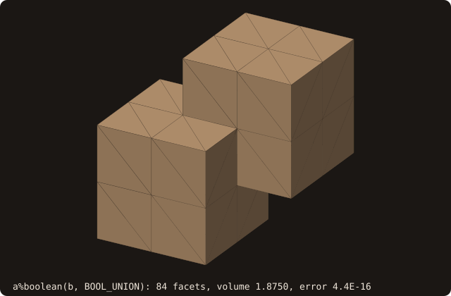
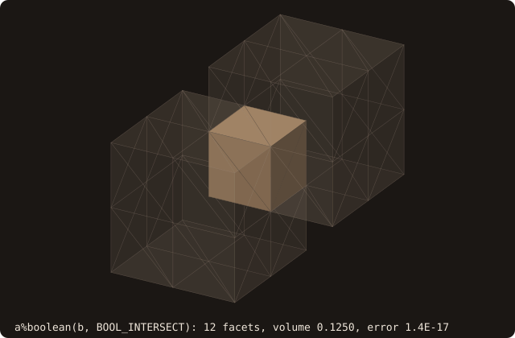
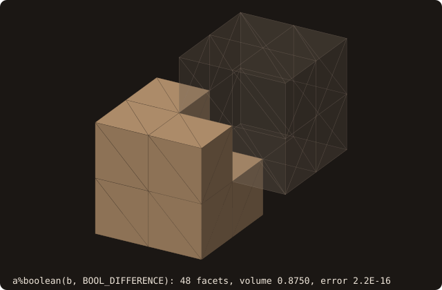
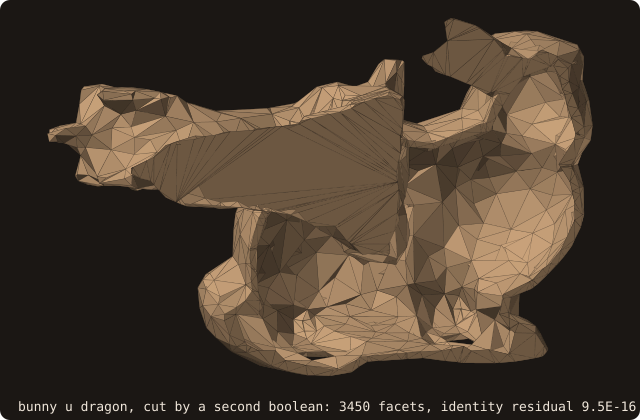

# Boolean operations

## What it does

Combines two surfaces using one of the four standard set operations:
union (`A ∪ B`), intersection (`A ∩ B`), difference (`A \ B`), or
symmetric difference (`A △ B`). The result is a fresh watertight
solid that replaces `self` in place.

This is the single biggest missing primitive for an STL toolkit —
**every meshing pipeline that combines parts needs booleans**. CSG
modelling, cutting holes for cooling channels, removing fixturing from
a part for CFD analysis, building wings from intersecting NACA
sections. FOSSIL's boolean is on par with libigl's `igl::mesh_boolean`
and CGAL's nef-polyhedra-free boolean for the *generic* case.

## Pipeline

The implementation follows Zhou et al. (SIGGRAPH 2016), *Mesh Arrangements for Solid Geometry*, made exact after
Cherchi et al. (2020), *Fast and robust mesh arrangements using floating-point arithmetic* (issue #65). No step uses
a tolerance:

1. **Exact pair classification** (`fossil_tritri_exact%pair_cut`). Both surfaces' AABB trees are walked in lockstep;
   every facet pair whose boxes overlap is classified from exact `orient3d` signs: separated, crossing, touching or
   coplanar. A crossing gives a common segment whose endpoints are **implicit points** (`fossil_implicit_points`): an
   input vertex, the point where an edge meets a plane, or the point where two exactly coplanar edges meet. A point
   is kept as its construction, never rounded while the arrangement is built.
2. **Point registry** (`fossil_arrangement`). One index per geometric point, exactly: points of one construction
   merge, then points of different constructions with the same exact coordinates. Each is rounded once, by one
   formula, so every facet that shares it gets the same bits; two distinct points never share rounded coordinates.
3. **Exact retriangulation** (`fossil_cdt_implicit%cdt_facet`). Each cut facet is triangulated with its cuts as
   constraints. Every validity decision (where a point lies, which edge a constraint crosses, whether a quadrilateral
   is convex) is the exact `orient2d` of implicit points; `incircle` on the rounded coordinates only chooses among
   valid triangulations (quality). A cut point inside a facet edge is also inserted in the facet across it.
4. **Selection by patches** (`fossil_boolean`). The sub-triangles of one surface connected across edges that lie on
   no cut form a patch, all inside or all outside the other surface. Each patch is decided once, exactly, at one of
   its cut edges: the side of the opposite vertex against the facet of the other surface that made the cut (or the
   wedge of the two facets that share it, convex or reflex). A patch without cuts takes the winding number of the
   other surface at one of its large sub-triangles. Sub-triangles inside an exactly coplanar facet of the other
   surface are shared and follow the orientation table below.
5. **Truth-table selection** per operation:

   | Tag       | UNION | INTERSECT | DIFFERENCE (A\B) | SYMDIFF |
   |-----------|:-----:|:---------:|:----------------:|:-------:|
   | (in, in)  | keep  | keep      | drop             | drop    |
   | (in, out) | keep  | drop      | keep             | keep    |
   | (out, in) | keep  | drop      | drop             | keep    |
   | (out, out)| drop  | drop      | drop             | drop    |

6. **Adopt** the surviving sub-triangles into `self` via `adopt_facets` (rebuilds AABB tree, vertex pool,
   connectivity, pseudo-normals).

## API

```fortran
call surface%boolean(other, op, status, weld)
   class(surface_stl_object),  intent(inout)         :: self
   class(surface_stl_object),  intent(in)            :: other
   integer(I4P),               intent(in)            :: op      ! BOOL_*
   integer(I4P),               intent(out), optional :: status  ! BOOL_STATUS_*
   real(R8P),                  intent(in),  optional :: weld    ! opt-in vertex weld distance, default off
```

- **`op`** is one of:
  - `BOOL_UNION` — everything inside either body
  - `BOOL_INTERSECT` — only what's inside both
  - `BOOL_DIFFERENCE` — inside `self` (A) but not inside `other` (B)
  - `BOOL_SYMDIFF` — inside exactly one of `self`, `other`
- **`status`** ∈ `{BOOL_STATUS_OK, BOOL_STATUS_CDT_FAILED,
  BOOL_STATUS_NOT_IMPLEMENTED, BOOL_STATUS_EMPTY_INPUT}`. With the exact
  triangulation, `BOOL_STATUS_CDT_FAILED` means an input the arrangement
  cannot represent: cuts that cross inside a facet (a self-intersecting
  input) or a degenerate facet with cuts. No validation case returns it.
- **`weld`** (opt-in, default off): before the arrangement, every vertex
  of B within `weld` of a vertex of A takes that vertex's coordinates bit
  for bit, when it is the unique nearest, no other vertex of B goes to it,
  and no facet of B becomes degenerate. Inputs that share vertices up to
  round-off (a part and its copy written by another tool) then merge;
  without it they give the exact result, with slivers. It is the only
  snapping that keeps the arrangement exact.

**Pre-conditions for clean output** (enforced by example, not by
runtime check — set them up yourself):

- Both inputs are watertight, manifold solids (`is_volume() ==
  .true.`).
- Both have outward-oriented normals — run `surface%sanitize_normals`
  if you're not sure.
- Neither input intersects itself. Coplanar faces, shared edges and
  touching contacts are handled; see [Known limitations](#known-limitations)
  for the exactness statement.

## Example

Two unit cubes offset diagonally by `(0.5, 0.5, 0.5)` — the canonical
mesh-arrangement test case:

```fortran
program ex_boolean
use fossil
use penf,   only : I4P, R8P
use vecfor, only : vector_R8P
implicit none

type(surface_stl_object) :: a, b
integer(I4P)             :: status

call a%load_from_file(file_name='src/tests/cube.stl', guess_format=.true.)
call b%load_from_file(file_name='src/tests/cube.stl', guess_format=.true.)
call b%translate(delta=vector_R8P(0.5_R8P, 0.5_R8P, 0.5_R8P))
call b%analyze

! In-place boolean: a is replaced by (a OP b).
call a%boolean(other=b, op=BOOL_DIFFERENCE, status=status)
print '(A,I0,A,F8.4)', 'A \ B  status=', status, '  vol=', a%get_volume()
! Expected analytic volume: 1 - 0.5^3 = 0.875
endprogram ex_boolean
```

## Visual reference

Two unit cubes offset diagonally by `(0.5, 0.5, 0.5)` (`cube-01.stl`, the
unit cube with 8 facets per face). From the same input pair, three of the
four boolean ops produce:

**`A ∪ B` — UNION** (volume 1.875 = 2 − 0.125):

{.fossil-figure}

**`A ∩ B` — INTERSECT** (volume 0.125 = 0.5³):

{.fossil-figure}

**`A \ B` — DIFFERENCE** (volume 0.875 = 1 − 0.125):

{.fossil-figure}

All three results match their analytic volume to FP precision (errors
below 5e-16, in the captions).

**Curved bodies.** The Stanford bunny and the dragon, closed by
[`alpha_wrap`](/guide/advanced/alpha-wrap), united, then cut in half by a
second boolean: the union intersected with a box holding the half y < 0.
The flat section is part of the result. The caption gives the volume
identity of the union, V(A ∪ B) + V(A ∩ B) − V(A) − V(B), relative to
V(A) + V(B):

{.fossil-figure}

**A CSG chain.** The unit cube drilled by nine cylinders, one difference
per frame. Each step is checked against an independent boolean: the
volume removed must be that of the cylinder's part inside the original
cube. The caption gives the residual of each step:

{.fossil-figure}

### Coplanar faces

Two unit cubes offset along x only: their y and z faces are coplanar and
overlap. This is the box ∖ body configuration of cut-cell meshing, and it
needs no perturbation:

```fortran
program ex_boolean_coplanar
use fossil
use penf,   only : I4P, R8P
use vecfor, only : vector_R8P
implicit none
type(surface_stl_object) :: a, b
integer(I4P)             :: status

call a%load_from_file(file_name='src/tests/cube.stl', guess_format=.true.)
call b%load_from_file(file_name='src/tests/cube.stl', guess_format=.true.)
call b%translate(delta=vector_R8P(0.5_R8P, 0._R8P, 0._R8P))
call b%analyze
call a%boolean(other=b, op=BOOL_DIFFERENCE, status=status)
print '(A,I0,A,F8.5,A,L1,A,L1)', 'status ', status, '  volume ', a%get_volume(), &
      ' (analytic 0.5)  watertight ', a%is_watertight(), '  manifold ', a%is_manifold()
endprogram ex_boolean_coplanar
```

How the coplanar overlap is handled:

1. Each facet pair is classified exactly (separated, crossing, touching,
   coplanar) from `orient3d` signs, not from floating-point distances. Only
   exactly coplanar faces count as coplanar: faces coplanar by construction
   but off by round-off (after a rotation) cross at a round-off angle, and
   the result keeps the slivers between them (see *Near-degenerate
   configurations*).
2. A coplanar pair cuts each facet along the parts of the other facet's
   edges that lie inside it, so the overlap becomes sub-triangles of its
   own in both facets.
3. Cut endpoints on a facet edge are also inserted in the facet across
   that edge, so no crack (T-junction) is left.
4. A sub-triangle inside an exactly coplanar facet of the other surface
   (all three vertices in it, exact `orient2d`) is classified by the
   shared-face table (same or opposite orientation), not by the winding
   number, which is ill-defined on the surface.

## Validation identities

A boolean result can be checked without knowing the answer: each identity below holds for any pair of closed,
outward-oriented inputs (issue #63, roadmap #58). The test-side module `src/tests/fossil_boolean_harness.f90` runs the
four ops on one pair and checks them all.

| Identity | Check | Tolerance |
|---|---|---|
| Volume | V(A ∪ B) + V(A ∩ B) = V(A) + V(B); V(A − B) = V(A) − V(A ∩ B); V(A △ B) = V(A ∪ B) − V(A ∩ B) | 1e-9 of V(A) + V(B) |
| Second moments | the same identities on $C = \int x\,x^T$ about the centre of the joint box (so on the inertia tensor $\mathrm{tr}(C)\,I - C$): where the volume is, not only how much | 1e-9 of $\lvert C(A)\rvert + \lvert C(B)\rvert$ |
| Area | area(A ∪ B) + area(A ∩ B) = area(A) + area(B), without coplanar overlaps | 1e-9 relative |
| Surface | the result lies on the inputs: its deviation from A and B merged ([surface deviation](/guide/advanced/surface-deviation), sampled lower bound) is 0 to round-off | 1e-9 of the joint diagonal |
| Membership | at fixed-seed points farther than 1e-6 of the diagonal from both inputs, inside(result) = op(inside(A), inside(B)), solid-angle sign | no mismatch |
| Validity | ∪, ∩, − without contact: watertight, manifold, V > 0, no self-intersecting facet pair deeper than a rounding fold | exact; folds ≤ 1e-12 of the diagonal |

The volume and the moments come from signed tetrahedra about a fixed point, so they are defined on the non-manifold
results of contacts and of △ too.

Self-intersections: the exact result keeps the slivers of near-degenerate inputs, and rounding it to doubles can fold
a sliver by an ulp. A pair reported by `find_self_intersections` is first confirmed by the exact `pair_cut` on the
result's doubles (the detector's floating-point test reports false crossings on slivers 1e-10 wide), then measured:
its depth is the smaller of the intersection's length and of the two facets' penetrations through each other's plane.
A fold is short or shallow; a real crossing is both long and deep, of the order of a facet. Validity allows folds up
to 1e-12 of the joint diagonal; the deepest measured anywhere is about 1e-15. The pass criterion is #33's: a result with status OK satisfies every identity that
applies; a non-OK status (`BOOL_STATUS_CDT_FAILED`) is allowed and counted.

`src/tests/validation/fossil_val_boolean_identities.f90` runs the harness on the box cases validated so far against
analytic volumes: the 6 coplanar cases, axis-aligned and rotated, and the 18 regression stress configurations. Its
regression subset, `src/tests/fossil_test_boolean_identities.f90`, runs 3 rotated coplanar cases and one stress
configuration (0.38 s in all, in the debug coverage build). All 30 pairs
pass. Every residual is below 2e-16 and the deviation below 1e-15, with no membership mismatch. As a negative control,
the union with one facet dropped fails: its volume is off by 6 %, its moments by 14 %, its area by 4 %.

### Curved and dense meshes

The bodies are closed marching-cubes surfaces (test-side module `src/tests/fossil_boolean_bodies.f90`): a sphere of
radius 0.5, a torus of radii 0.4 and 0.15, a capped cylinder of radius 0.3 and height 1, each sampled on n³ points of
[-0.65, 0.65]³ and closed by `sanitize(fill_holes=.true.)`, plus the unit cube. The second body of each pair is moved
by a fixed-seed proper rigid motion (random axis and angle, each translation component within ±0.2). `bunny.stl` and `dragon.stl` are
not closed, so they enter through [`alpha_wrap`](/guide/advanced/alpha-wrap) (α = d/50, offset d/500 of their
diagonal d), scaled to a unit diagonal.

| Configurations | Pairs | Status OK | Pass | max volume residual | max moment residual | max deviation |
|---|---|---|---|---|---|---|
| 24³ bodies, all 10 kind pairs × 4 motions | 40 | 40 | 40 | 2.5e-16 | 1.6e-16 | 6.7e-15 |
| 40³ bodies, all 10 kind pairs × 4 motions | 40 | 40 | 40 | 2.1e-16 | 1.8e-16 | 3.5e-14 |
| wrapped bunny (16 280 facets) × wrapped dragon (9 678) × 4 motions | 4 | 4 | 4 | 1.1e-16 | 1.4e-16 | 5.2e-15 |

No membership mismatch on 200 points per pair (`src/tests/validation/fossil_val_boolean_curved.f90`, 66 s at -O2; 244 s at #63).
The regression tier, `src/tests/fossil_test_boolean_curved.f90`, runs two 10³ pairs (sphere × torus, cylinder ×
cube), 0.31 s in the debug coverage build. The first run of this sweep found the defect below.

### Near-degenerate configurations

`src/tests/validation/fossil_val_boolean_degenerate.f90` sets a body against itself, coincident or moved by a tiny
amount, plus nested bodies and contacts. The bodies are the unit cube and a marching-cubes sphere (24³, 2 972 facets).
Translations follow a generic direction; rotations turn about a generic axis through the centre. Outcome per case (✓:
status OK and every identity holds):

| Configuration | 1e-4 | 1e-6 | 1e-8 | 1e-10 | 1e-12 | 1e-14 |
|---|---|---|---|---|---|---|
| cube, translated (of the size) | ✓ | ✓ | ✓ | ✓ | ✓ | ✓ |
| cube, rotated (rad) | ✓ | ✓ | ✓ | ✓ | ✓ | |
| sphere, translated | ✓ | ✓ | ✓ | ✓ | ✓ | ✓ |
| sphere, rotated | ✓ | ✓ | ✓ | ✓ | ✓ | |

Also ✓: the cube and the sphere against themselves, each against itself scaled by 0.5 (nested), the cube against a
half cube sharing part of a face, contacts at a vertex, along an edge and on a face patch, and the sphere against the
same sphere re-facetted (25³). All 31 cases pass, every one required. Before issue #65, 28 passed: the 1e-10 snap of
the classification and the 1e-9 tolerances of the retriangulation disagreed between about 1e-10 and 1e-6, and three
sphere cases came out with holes a few 1e-9 wide (status OK); a copy moved by less than the snap was merged into the
original.

Now a copy moved by any amount is an ordinary crossing, decided exactly. Below about 1e-10 the cuts are thinner than
the facets by ten orders of magnitude: the result is the exact one, with slivers between the two surfaces,
watertight, manifold, with the right volume (for a 10³ sphere and its copy moved by 1e-12, V(A ∪ B) − V(A) = 1.5e-12
V(A): the slivers). The opt-in `weld` gives the merged body instead when the copy's vertices are within the weld
distance of the original's.

**Dense sweep.** `src/tests/validation/fossil_val_boolean_sweep.f90` runs the cube (12 and 192 facets),
the sphere (10³, 24³) and the torus (12³, 24³) against themselves translated along a generic direction or rotated
about a generic axis by v = 1e-4 … 1e-14 in steps of 10^0.5 (21 values), and with the weld for v ≤ 1e-10:

| Body | Facets | Translated (21 + 9 welded) | Rotated (21 + 9 welded) |
|---|---|---|---|
| cube | 12 | 30 / 30 | 30 / 30 |
| cube | 192 | 30 / 30 | 30 / 30 |
| sphere, 10³ | 380 | 30 / 30 | 30 / 30 |
| sphere, 24³ | 2 972 | 30 / 30 | 30 / 30 |
| torus, 12³ | 432 | 30 / 30 | 30 / 30 |
| torus, 24³ | 2 304 | 30 / 30 | 30 / 30 |

360 cases, every status OK, every identity of the four ops (validity included); 775 s at -O2.

One configuration is non-manifold by definition: translated along (1, 2, 3), which is parallel to the marching-cubes
facets of normal (−1, −1, 1), an edge of the 10³ sphere's copy can stay exactly in a facet plane of the original
(rounding keeps it there). The copy then touches the original along that edge without crossing it, and the
difference pinches to zero thickness there, like any contact. The exact topology is right; the sweep uses a generic
direction.

### CSG chains

`src/tests/validation/fossil_val_boolean_csg.f90` runs chains of booleans whose exact volume and second moments
follow from independent booleans (test-side module `src/tests/fossil_boolean_csg.f90`). Every step is checked, so
drift along the chain would show:

- **Drilled block:** the unit cube minus k² disjoint vertical capped cylinders on a k × k grid, each through the
  block. Step j must give V(R_j) = V(R_j−1) − V(cube ∩ C_j), with the intersection computed separately against the
  original cube.
- **Sphere lattice:** the union of k² spheres on a grid, radius 0.6 of the spacing. Neighbours along the rows and
  columns overlap and diagonal ones do not, so step j must add V(S_j) minus the overlaps with its earlier neighbours.

Both use 12³ marching-cubes bodies.

| Chain | Operations | Final facets | Worst step residual (volume, moments) | Final residual (volume, moments) | Time at -O2 |
|---|---|---|---|---|---|
| block − 9 cylinders | 9 | 3 696 | 2.2e-16, 2.5e-16 | 2.2e-16, 1.8e-16 | 0.14 s |
| block − 25 cylinders | 25 | 10 688 | 1.1e-16, 1.1e-15 | 1.1e-16, 1.1e-15 | 1.1 s |
| block − 49 cylinders | 49 | 21 944 | 1.1e-16, 7.0e-16 | 1.1e-16, 7.0e-16 | 4.6 s |
| ∪ 9 spheres | 8 | 5 820 | 1.1e-16, 8.7e-17 | 1.1e-16, 8.7e-17 | 0.37 s |
| ∪ 25 spheres | 24 | 16 300 | 6.3e-16, 7.4e-17 | 6.3e-16, 4.8e-17 | 1.9 s |
| ∪ 49 spheres | 48 | 32 060 | 4.1e-16, 9.0e-17 | 4.1e-16, 4.5e-17 | 6.3 s |

Every status is OK and every intermediate body is watertight and manifold. The residuals stay at round-off and do
not grow with the length: there is no drift. One step costs about N^1.2 in the facets of the running body (0.027 s
at 3 700 facets, 0.22 s at 22 000). Before the fix of *Performance* it was N^1.8 (2.0 s at 22 000), and the 49-step
chains took 35 s and 40 s. The
regression tier, `src/tests/fossil_test_boolean_csg.f90`, runs 4-operation chains of both kinds.

### Performance

`src/tests/validation/fossil_val_boolean_perf.f90` times a boolean (best of 3, -O2) against the facet count:

| Case | Facets (A + B) | Time | µs per facet | #63 | before #63 |
|---|---|---|---|---|---|
| sphere 16³ − small cylinder | 1 656 | 0.013 s | 7.7 | 0.021 s | 0.049 s |
| sphere 32³ − small cylinder | 5 688 | 0.033 s | 5.7 | 0.053 s | 0.18 s |
| sphere 64³ − small cylinder | 22 440 | 0.14 s | 6.2 | 0.19 s | 0.76 s |
| sphere 96³ − small cylinder | 50 808 | 0.34 s | 6.6 | 0.43 s | 1.81 s |
| sphere 16³ − moved copy | 2 680 | 0.015 s | 5.5 | 0.064 s | 0.12 s |
| sphere 32³ − moved copy | 10 744 | 0.047 s | 4.4 | 0.26 s | 0.56 s |
| sphere 64³ − moved copy | 44 248 | 0.24 s | 5.3 | 0.80 s | 2.26 s |
| sphere 96³ − moved copy | 100 984 | 0.55 s | 5.5 | 1.65 s | 5.51 s |
| wrapped bunny − wrapped dragon (each op) | 25 958 | 0.11–0.23 s | 4.4–9.0 | 1.1–1.2 s | 2.7–2.8 s |

The cost per facet is flat in N: the boolean is linear in practice. Since issue #65 the selection makes one decision
per patch instead of one winding-number query per sub-triangle, and the exact arrangement costs less than those
queries did: 1.5–5× faster than #63. The exact predicates run their filters first; the exact stage is reached only
by near-degenerate configurations (near-coplanar facets), where `orient3d` uses error-free products (`ieee_fma`).

### Defects found by the harness

- **Delaunay store overflow** (fixed, issue #63). The constrained triangulation of a cut facet
  (`fossil_dt`) allocated its triangle store once, at 6 (n + 3) entries. Bowyer–Watson keeps the triangles it
  replaces, so the store fills with the sum of the cavity sizes. When the cut points arrive along a curve, as a torus
  cutting a large cube face does, the cavities are large, and the store was overrun: heap corruption, an abort, or a
  silently wrong result. The store now grows by doubling. `src/tests/fossil_test_dt_capacity.f90` covers both the
  triangulation (600 points on an elliptic arc create 27 087 triangles against 3 618 entries) and the boolean that
  failed.
- **Facet edge lost by the retriangulation** (fixed, issue #63). Each cut facet was triangulated with its cuts as
  constraints, but not its own three edges. Bowyer–Watson with a finite super-triangle does not keep a hull edge when
  a point lies close inside it, and the facet across that edge keeps it whole: a crack. The cube against itself
  rotated by 1e-4 rad (cuts 3.5e-5 from the unit edges) lost 28 half-edges, with status OK and a volume off by 9e-6.
  The facet edges are now constraints too.
- **Folded Bowyer–Watson cavity** (fixed, issue #63; the boolean no longer uses `fossil_dt` since issue #65). `incircle` is not exact, and on near-cocircular points (the
  cuts of near-coincident surfaces) the cavity of an inserted point was not star-shaped from it, so the fan of new
  triangles folded. The cube against itself rotated by 1e-8 rad lost 2.3 % of its volume with status OK. A neighbour
  across an edge that the point does not see strictly (exact `orient2d`) now always joins the cavity. That case now
  returns `BOOL_STATUS_CDT_FAILED`, which is allowed.
- **Shared sub-triangles misdetected** (fixed, issue #63). A sub-triangle was "shared" with the other surface (a
  coplanar overlap, kept once) when its centroid lay within 1e-9 L of the closest facet of the other surface and the
  normals were parallel to 0.99, that is within 8°. Sub-triangles a few 1e-9 wide beside a crossing of two facets a
  few degrees apart passed both tests: a marching-cubes sphere against itself translated by 1e-6 cracked. A
  sub-triangle is now shared when it lies inside a facet of the other surface exactly coplanar with its parent (since
  issue #65: its three vertices, exact `orient2d`); the geometric fallback is gone.
- **Snap against tolerances** (fixed, issue #65). The classification snapped vertices within 1e-10 of a plane, and the
  retriangulation merged points within 1e-10 and put points on segments within 1e-9, each in its own frame. Facets
  sharing a point could decide differently, and a curved body against its copy moved by 1e-10 … 1e-6 cracked with
  status OK. The arrangement is now exact (implicit points, exact predicates), with no tolerance left.
- **Sliver classified from its own centroid** (fixed, issue #65). Without the snap, a sliver between two near-coincident
  surfaces has its centroid within round-off of the other surface, and its winding number decides nothing; whole
  patches lying within round-off of the other surface (rotated coplanar boxes) do the same. Selection now decides per
  patch, exactly at a cut edge.
- **Distinct points with the same doubles** (fixed, issue #65). Two exact points less than an ulp apart (the cut points
  of rotated coplanar faces) can round to the same coordinates, and the welded result joined an edge of A with an edge
  of B: four facets on one edge. Distinct registry points now get distinct rounded coordinates (the implicit one moves
  by ulps; an input vertex never moves).
- **Exact predicates too slow without the snap** (fixed, issue #65). Near-coplanar pairs put every `orient3d` in its
  exact stage (68 % of the time). The exact stage now detects a shared coordinate plane, uses the six products of
  exact differences when they are exact, and makes each product of three doubles exact with `ieee_fma` (four
  doubles instead of 64 pieces): the regression tests went from 4.9 s to 0.5 s.

`src/tests/fossil_test_boolean_degenerate.f90` covers the first two with the cube cases, which fail on the code
before the fixes. The third needs a curved body and is too slow for the regression tier, so the validation sweep
gates its case, the sphere translated by 1e-6.

## Known limitations

- **Exactness.** Every decision is the exact sign of a polynomial in the input coordinates (filtered, then exact
  expansion arithmetic), with no tolerance and no snap; the only rounding is the output's: every cut point is rounded
  once, the same bits in every facet that shares it, distinct points to distinct doubles. Two consequences of the
  exact semantics: faces coplanar by construction but off by round-off (after a rotation, a scaling) cross at
  round-off angles, so the result keeps slivers between them (watertight, the right volume; pass `weld` if the
  inputs share vertices up to round-off); and rounding the exact result to doubles can fold such a sliver by an ulp,
  a self-intersecting facet pair about 1e-17 deep (measured ≤ 1e-15 of the diagonal everywhere). Removing those
  folds would need snap rounding of the output, not done.
- **What is validated.** Analytic volumes: box pairs with coplanar overlaps, shared edges and contacts, a 6-case
  matrix of all four ops, axis-aligned and rotated (`fossil_test_boolean_coplanar`), and 416 booleans on snapped
  random box pairs (`fossil_val_boolean_stress`). Identities that hold for any pair (see *Validation identities*):
  curved marching-cubes bodies and the wrapped bunny against the wrapped dragon (84 pairs), 31 near-degenerate
  cases, the dense sweep (360 cases), CSG chains of up to 49 operations. Every result has status OK and
  satisfies every identity.
- **Non-manifold results by definition.** Solids that touch only along an
  edge or at a point give a union (or difference) that is non-manifold
  there, and a symmetric difference whose two pieces `A \ B` and `B \ A`
  touch along the curves where the surfaces cross has four facets at each
  such edge. The volume is right; `is_manifold()` is false, as it should be.

- **Self-intersection in inputs** (each surface intersecting itself)
  produces undefined results. Run
  [`surface%resolve_self_intersections`](/guide/api/surface-stl-object)
  first if you suspect this is your case.

- **CDT failures** (`BOOL_STATUS_CDT_FAILED`): the exact triangulation of
  a facet cannot fail on cuts that meet only at their ends; it fails on
  cuts crossing inside a facet (a self-intersecting input) or on a
  degenerate facet with cuts. None in the validation.

## See also

- [`resolve_self_intersections`](/guide/api/surface-stl-object) —
  self-intersection cleanup, a pre-requisite for clean booleans.
- [winding number](/guide/advanced/winding-number) — decides a patch
  that has no cut edge.
- [Constants](/guide/api/constants) — `BOOL_*` and `BOOL_STATUS_*`.
- [Roadmap issue](https://github.com/szaghi/FOSSIL/issues/18) — full
  multi-commit history of the boolean pipeline.
- [Issue #33](https://github.com/szaghi/FOSSIL/issues/33) — coplanar
  overlaps, exact classification and the validation matrix.
- [Issue #65](https://github.com/szaghi/FOSSIL/issues/65) — the exact
  arrangement (implicit points, no snap) and the opt-in weld.

## References

- Zhou, Grinspun, Zorin & Jacobson, *Mesh Arrangements for Solid
  Geometry*, SIGGRAPH 2016. The reference algorithm.
- Bernstein & Fussell, *Fast, Exact, Linear Booleans*, Symposium on
  Geometry Processing 2009. The "Cork" precursor — historical
  context.
- Cherchi, Livesu, Scateni & Attene, *Fast and robust mesh arrangements
  using floating-point arithmetic*, ACM Transactions on Graphics 39(6),
  2020. The exact arrangement on implicit points.
- Attene, *Indirect predicates for geometric constructions*,
  Computer-Aided Design 126, 2020. Predicates on implicit points.
- Shewchuk, *Adaptive precision floating-point arithmetic and fast robust
  geometric predicates*, Discrete & Computational Geometry 18, 1997.
- Sloan, *A fast algorithm for generating constrained Delaunay
  triangulations*, Computers & Structures 47(3), 1993. The constraint
  recovery of `cdt_facet`.
