# Continuous collision detection

A moving-body code advances its bodies by a time step and needs the instant at which two of them first touch inside
that step. [Body–body distance](./body-distance) answers at one instant. Sampling the step with it can miss a
contact: a thin or fast body passes through the other between two samples (**tunnelling**). Issue #73 (roadmap #68,
WP4) adds the **time of first contact with a guarantee**, in the module `fossil_ccd`.

::: info Design and reference (issue #73)
The llm-wiki bundles have no source on body contact: every "collision" there is a collision term of a kinetic or
Riemann solver. The method is conservative advancement *(gk: Mirtich 1996; Zhang, Redon, Lee & Kim 2006, C2A; the FCL
and Bullet libraries)*. Statements from general knowledge are marked *(gk)*. CPU only: one query per pair is a
sequence of distance queries, and the device gains nothing there.
:::

## At a glance

{.fossil-figure}

A square slides 0.18 above a floor and turns 45 degrees on its way into a wall. Frame k calls
`curve%time_of_impact(..., max_iterations=k)`, whose `toi` is the k-th iterate. The plain bound is held back by the
floor gap and needs 25 steps; `directional=.true.` sees that the sliding does not close that gap and needs 5; both
stop at s = 0.7728 (`anim_ccd.f90`).

## The motion over a step

A step takes each body from a pose P0 = (R0, t0) at s = 0 to a pose P1 = (R1, t1) at s = 1, along the motion of
`pose_interpolate` ([moving bodies](./moving-bodies), issue #41), the same motion as the swept cut-cell geometry:

- the rotation R(s) = Q(s) R0, where Q(s) turns about the fixed unit axis k of R1 R0ᵀ by the angle s θ;
- the translation t(s) = t0 + s Δ, with Δ = t1 − t0.

A body point x_b (body frame) is at x(s) = Q(s) R0 x_b + t(s). The rotation turns about the axis through the
**body-frame origin**, which moves with t(s). This is not Chasles' screw, whose axis is fixed in space. In 2-D,
Q(s) is the in-plane rotation by s θ, with θ ∈ (−π, π].

### The speed bound

The velocity is dx/ds = θ k × y + Δ with y = Q(s) R0 x_b. Q(s) turns about k, so |k × y| = ρ(x_b), the distance of
R0 x_b to the axis through the body origin, does not depend on s. Hence, for every s,

  |dx/ds| ≤ |Δ| + |θ| ρ(x_b).

ρ is a convex function of x_b (a distance to a line), so its maximum over the body (the hull of the vertices) is
reached at a vertex. The bound of a body over the step is

  **μ = |Δ| + |θ| max_v ρ_v**,

and no point of the body moves farther than μ |s2 − s1| between s1 and s2. In 2-D, ρ_v = |x_v| (the axis is the
body origin). A body whose vertices lie far from its own frame origin has a large μ when it turns: it is its real
motion, not slack. Measured in step 2: the bound is attained at the vertex farthest from the axis.

{.fossil-figure}

The end poses alone do not fix the motion: they fix it together with the body frame. With the frame origin at the
rectangle's centre every vertex has ρ = 0.5385 and μ = 2.934; with the origin 1.2 to its left, between the same two
placements, ρ reaches 1.7117 and μ = 5.945 (`fig_ref_collision_bound.f90`). Put the body frame at the centre of a body
that turns, or accept twice the steps.

## Conservative advancement

The distance d(s) between bodies A and B is Lipschitz: each point of A moves at most μ_A δ, each point of B at most
μ_B δ, so

  d(s + δ) ≥ d(s) − (μ_A + μ_B) δ.

From s_k with d_k = d(s_k) > tol, the step

  s_{k+1} = min(1, s_k + (d_k − η tol) / (μ_A + μ_B)),  η = 1/2,

keeps d ≥ η tol on [s_k, s_{k+1}]. The loop stops when d_k ≤ tol (contact at s_k), or at s = 1 with d(1) > tol (no
contact over the step).

**Guarantee (proved by the Lipschitz bound, up to the rounding of the distance query):**

- d ≥ η tol on [0, toi], so toi is no later than the first time the bodies come within η tol, and a fortiori no later
  than the first contact (d = 0);
- d(toi) ≤ tol for a contact;
- no tunnelling, whatever the speed or the thickness: every step is bounded by the distance it starts from;
- at most ⌈(μ_A + μ_B) / ((1 − η) tol)⌉ iterations, since every step with d_k > tol advances at least
  (1 − η) tol / (μ_A + μ_B).

The distance comes from `distance_to(..., pose_self=, pose_other=)` (#67) at the interpolated poses: the trees are
built once in the body frames, and the result is bit-identical to moving the bodies. Its rounding is a few ulps of the
body size, far below the default tolerance.

| Status | Meaning | toi |
|---|---|---|
| `CCD_CONTACT` | the bodies come within `tolerance` | the first iterate with d ≤ tol |
| `CCD_SEPARATE` | no contact over [0, 1] | 1 (d(1) > tol) |
| `CCD_INITIAL_CONTACT` | d(0) ≤ tol | 0 |
| `CCD_NOT_CONVERGED` | the iteration cap (`max_iterations`, default 1000) was hit | the last iterate, still a certified lower bound on the contact time |

The tolerance is optional and defaults to 1e-6 of the larger bounding-box diagonal of the two bodies (the convention
of `deviation`). Grazing approaches, where the bodies close slowly, converge slowly: that is what the cap is for.

{.fossil-figure}

A square of side 0.4 moves by (1.9, 2) and turns a quarter towards a wall, μ = 3.203 for a closing speed of about 2:
`curve%time_of_impact` takes s = 0.5308, 0.7209, 0.8034, ... and stops at contact after 21 steps at s = 0.8764. Each
Lipschitz line stays under d(s). Each step multiplies the distance by about 1 − c/μ, c the closing speed: here
1.7, 0.609, 0.264, 0.122, a little under one half per step (`fig_ref_collision_advance.f90`).

### The directional bound (C2A)

The plain bound assumes the worst direction of motion. Along the unit witness direction n of a convex pair, the
separating plane gives d ≥ n · (x_b − x_a), whose closing rate is bounded by the motion projected on n
(Mirtich) *(gk)*. **This holds for convex sets only**: a body that is not convex can close around the other from a
side the plane does not see. FOSSIL's bodies are not convex, so the bound is applied per triangle pair (segment pair
in 2-D), each of them convex, inside the descent of the two trees, as C2A does with per-node bounds *(gk)*:

- a triangle pair at distance d_ij with witness direction n has the closing rate
  c_ij = n · (Δ_A − Δ_B) + |θ_A| ρ_A(T_a) + |θ_B| ρ_B(T_b), with ρ(T) the largest ρ of its vertices and n
  pointing from T_a to T_b (the gap along a fixed n bounds the pair's distance from below at every s, and its rate
  is at least −c_ij);
- its safe step is (d_ij − η tol) / c_ij (unbounded if c_ij ≤ 0), and the step is the minimum over all pairs;
- a node pair whose plain-bound step (box distance over the node μ) is already above the best is pruned.

`directional=.true.` selects it: the loop takes the larger of the plain and the directional step, both certified, so
it never takes more steps than the plain bound. It is off by default: on large bodies a directional step evaluates
tens of thousands of facet pairs exactly (see Measured). Turn it on when bodies slide along each other: the plain
bound cannot tell tangential motion from approach, and at a gap just above the tolerance it advances by about
(gap − tol/2)/μ per step until the cap.

## Several bodies

`first_impact(surfaces, poses0, poses1, ...)` gives the earliest contact among N bodies and its pair:

- **broad phase:** the box of each body at s = 0 grown by μ contains it over the whole step; grown by tol/2 more, two
  boxes that do not overlap keep their bodies farther than the tolerance, so only pairs of overlapping boxes go on;
- every remaining pair has a lower bound on its time of impact, max(0, box distance at s = 0 − tol) / (μ_A + μ_B)
  (the first advancement step, or 0 when the bodies may start within the tolerance); pairs run in the order of these
  bounds, and the search stops when the next bound exceeds the best contact found;
- ties go to the lexicographically smallest pair, so the result equals the brute force over all pairs, bit for bit.

{.fossil-figure}

Of the 10 pairs, 8 have overlapping grown boxes. `first_impact_2d` runs `time_of_impact` on 7 of them: the last
candidate's lower bound exceeds the contact already found, at s = 0.91342 between squares 1 and 2
(`fig_ref_collision_first.f90`).

## Example

The cookbook recipe [When do my moving bodies first touch?](/manual/cookbook#when-do-my-moving-bodies-first-touch)
shows one contact and a thin plate crossed within a step. This program measures the bound, the case the plain bound
cannot finish, and several bodies.

<<< @/examples/snippets/ref_collision.f90

<<< @/examples/output/ref_collision.ansi{ansi}

- **The bound.** cube-01 spans [0, 1]³, so its frame origin is a corner. For a quarter turn about z and a shift of 1,
  `motion_bound_3d` gives μ = 1 + (π/2) √2 = 3.22144; the same vertices about the centre give 1 + (π/2)(√2/2) =
  2.11072.
- **Sliding.** The cube slides by 4 over the top face of the resting one, 4 tol above it. The plain bound cannot tell
  the sliding from an approach: from s = 0.25, where the moving cube reaches the resting one, each step advances by
  (4 − 1/2) tol / μ = 8.75e-7, and the loop stops at the cap, 1000 steps, with `CCD_NOT_CONVERGED` and s = 0.250874,
  a certified lower bound on any contact. With `directional=.true.` the
  separating planes of the facet pairs see that the gap does not close: 11 steps and 2662 exact pair evaluations
  reach s = 1, `CCD_SEPARATE`.
- **Several bodies.** Four unit cubes 3 apart, their frames at their centres: 1 and 2 close in at 1.5 and 1.4 per
  step, 3 turns in place, 4 moves away. `first_impact` finds cubes 1 and 2 at s = 0.689655 = 2/2.9 (the gap 2 over
  the closing speed 2.9) and runs `time_of_impact` on 3 of the 6 pairs.

## API

| Routine | Arguments |
|---|---|
| `motion_bound_3d(p0, p1, x, y, z)` / `motion_bound_2d(p0, p1, u, v)` | μ of a vertex set |
| `ccd_advance(evaluator, mu, tolerance, toi, status, distance, iterations, max_iterations, directional)` | the loop over an abstract distance evaluator (`ccd_evaluator_t`) |
| `surface%time_of_impact(other, pose_self0, pose_self1, pose_other0, pose_other1, toi, status, ...)` | optional: `tolerance`, `distance`, `point_self`, `point_other`, `facet_self`, `facet_other`, `iterations`, `max_iterations`, `directional`, `pairs` (exact pair evaluations of the directional steps) |
| `curve%time_of_impact(...)` | the 2-D twin (`segment_self`, `segment_other`) |
| `first_impact(surfaces, poses0, poses1, toi, pair, status, tolerance, directional, tested)` / `first_impact_2d` | several bodies (`tested`: pairs that ran `time_of_impact`) |

## Proved and measured

**Proved:** the speed bound, the Lipschitz bound, the guarantee and the iteration bound above (up to the rounding of
the distance query); the directional step per convex pair.

**Measured** (`fossil_test_ccd_*`, `fossil_val_ccd`, tolerance 1e-6):

| Case | Plain steps | Directional steps | Note |
|---|---|---|---|
| translation head-on (cubes, squares) | 1 | 1 | toi in [(1 − tol)/3, 1/3] |
| oblique, 45° to a face | 12 | 1 | |
| quarter turn onto a post | 25 | 25 | toi 1.1e-6 below the analytic angle |
| cube vs cube, turning and translating | 11 | 9-10 | within 1e-7 of the bisected brute force |
| bunny (5 000 facets) vs dragon (2 000), 8 steps | 7-35 | about half | plain 0.51 s, directional 7.5 s in all; 5e4-2e5 exact pairs per query |
| sliding past a face at a gap of 2-256 tol | 1000 (cap) | 7 | plain: `CCD_NOT_CONVERGED`, a certified lower bound |
| a plate 1e-3 thick crossed within one step | 1 | 1 | apart at both end poses |

Every result keeps d ≥ tol/2 at the samples of [0, toi] and d(toi) ≤ tol. Six spheres over 10 sub-steps:
`first_impact` equals the loop over all pairs bit for bit, testing 78 of 150 pairs.

## Left out

- Exact CCD of straight vertex trajectories (vertex-face and edge-edge coplanarity cubics, Brochu, Edwards & Bridson
  2012) *(gk)*: it fits deforming meshes, not rigid rotation.
- Penetration depth and contact response: the solver's.
- Deformable bodies and self-collision over time.
- Device kernels.
