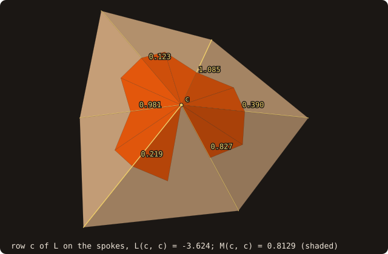
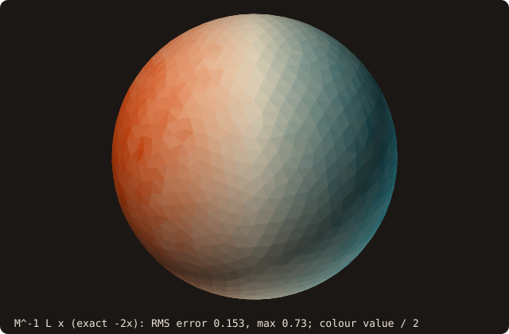

# Cotangent Laplacian + barycentric mass

## What it does

Builds the two **discrete differential operators** that drive most of
discrete differential geometry on a triangle mesh:

- The **cotangent Laplacian** `L` — a sparse symmetric matrix whose action
  on a per-vertex scalar field approximates the surface Laplace–Beltrami
  operator. `L u` gives the discrete "how much does `u` differ from the
  local average of its neighbours" at every vertex.
- The **barycentric mass matrix** `M` — diagonal, with `M_ii =
  (1/3) Σ A_T` summed over triangles `T` incident to vertex `i`. `M`
  represents the area each vertex "owns" on the surface, and it turns
  `L u` from a difference into an *integrated* quantity (`(L u, v)` is
  an inner product on the surface).

Together they unlock the discrete-differential-geometry features in
FOSSIL:

- [mesh smoothing](/guide/advanced/smoothing) (the implicit
  variant — explicit + Taubin use a different Laplacian).
- [per-vertex curvature](/guide/advanced/curvature) (mean curvature
  is literally `(1/2) M⁻¹ L V`).
- §2.2 heat-method geodesics (deferred until a sparse SPD solver is
  bound).

A note on the dependency: `L` is a *populate*, not a *factorise*. A
single per-triangle pass writes into CSR storage and the operator is
ready to use. A sparse solver is only needed when you want to *invert*
`L` (heat method, implicit smoothing). Everything that just
*multiplies* by `L` and `M⁻¹` ships today. A Jacobi-preconditioned
conjugate gradient for symmetric positive-definite CSR systems now exists
(`fossil_linear_solver%cg_solve`, used by the hole fairing); the heat
method and implicit smoothing have not been built on it yet.

{.fossil-figure}

The row of one vertex: six spokes with weights from 0.123 to 1.085, the diagonal L(c, c) = -3.624, their negated sum,
and M(c, c) = 0.8129, the shaded third of the six triangles. The figure is drawn by
`docs/examples/src/fig_ref_cotangent_laplacian_stencil.f90`.

## Pipeline

For each triangle `T` with vertices `(i, j, k)` and the opposite-vertex
angles `(α_i, α_j, α_k)`:

1. **Cotangents from edges, not angles.** Compute cotangents from the
   dot/cross identity

   $$\cot \alpha_k = \frac{\vec{e}_{ki} \cdot \vec{e}_{kj}}{\lVert \vec{e}_{ki} \times \vec{e}_{kj} \rVert}$$

   where `e_ki = p_i - p_k`. This is well-conditioned across the full
   `(0, π)` angle range, including obtuse triangles where
   `cos(α)/sin(α)` via `acos(dot/norms)` would blow up.

2. **Off-diagonal contributions** to `L`:
   - To `L(i,j)` and `L(j,i)` add `(1/2) cot α_k`.
   - To `L(j,k)` and `L(k,j)` add `(1/2) cot α_i`.
   - To `L(k,i)` and `L(i,k)` add `(1/2) cot α_j`.

3. **Diagonal mass contribution** to `M`:
   - To `M(i,i)`, `M(j,j)`, `M(k,k)` add `area(T) / 3`.

4. **Post-pass: enforce `L_ii = -Σ_{j ≠ i} L_ij`.** Done explicitly after
   the per-triangle sweep so the constant-vector kernel `L · 1 = 0` is
   exact in floating point — independent of how cotangents accumulate
   per row.

The result is a CSR-stored `L` (symmetric, sparse, negative-semidefinite
on any mesh, since $-u^T L u$ is the Dirichlet energy of the piecewise-linear
interpolant of `u`; its off-diagonal entries are non-negative only where no
two opposite angles sum above π) and a diagonal `M`. Both are returned to
the caller via `csr_matrix_t` containers; the diagonal `M` is just a
length-N CSR with one entry per row.

{.fossil-figure}

Step 2 on one edge: the acute angle at k gives cot α = 0.500, the obtuse angle at l gives cot β = -0.817, and
`L%get_value(i, j)` returns their half-sum, -0.1583. An obtuse opposite angle can make a weight negative: `L` is then
not an M-matrix, and the discrete maximum principle that non-negative weights give does not hold.

## API

```fortran
call surface%cotangent_laplacian(L, M, status)
   class(surface_stl_object), intent(in)            :: self
   type(csr_matrix_t),        intent(out)           :: L
   type(csr_matrix_t),        intent(out)           :: M
   integer(I4P),              intent(out), optional :: status   ! LAPL_STATUS_*
```

Outputs:

- **`L`** — sparse cotangent Laplacian. Dimensions `n_vertices × n_vertices`.
  `L%get_value(i,j)` is `0` for non-edges, `(cot α + cot β)/2` for shared edges
  (`α, β` are the opposite-vertex angles in the two incident triangles),
  and `-Σ_j L_ij` on the diagonal.
- **`M`** — diagonal barycentric mass. `M%get_value(i,i) = (1/3) Σ A_T` over
  triangles `T` incident to vertex `i`. Off-diagonals are zero.

Status codes:

- `LAPL_STATUS_OK` — operator built successfully.
- `LAPL_STATUS_BAD_INPUT` — empty surface or uninitialised vertex pool.
- `LAPL_STATUS_DEGENERATE_TRIANGLE` — at least one triangle had area
  below the tolerance and was skipped. The operator is still returned;
  `L_ii = -Σ_j L_ij` is enforced on the surviving contributions only.

## Example

Three identities of the operator, checked on `cube-01.stl` (the unit
cube, 8 facets per face): its kernel, its mass, and its quadratic form.

<<< @/examples/snippets/ref_cotangent_laplacian-build.f90

<<< @/examples/snippets/ref_cotangent_laplacian-checks.f90

<<< @/examples/output/ref_cotangent_laplacian.ansi{ansi}

- **Size.** One row per pool vertex (26 for this cube), and 170
  nonzeros: the 26 diagonal entries and two per edge. `is_symmetric`
  with tolerance 0 holds: `L` is assembled symmetric, bit for bit.
- **Kernel.** `L · 1` is zero to the last bit, because the diagonal is
  set to minus the row sum of the off-diagonals. Any constant field is
  harmonic, on any mesh.
- **Mass.** The barycentric masses `M_ii` (a third of the area of every
  incident triangle) partition the area: their sum equals
  `get_area()`, 6.
- **Quadratic form.** For a linear field the cotangent formula is
  exact on every triangle: $-x^T L x = \sum_T A_T\,|\nabla_T x|^2$.
  On the cube, $|\nabla_T x| = 1$ on the four faces parallel to x and 0
  on the two normal to it, so the sum is their area, 4. The form is
  negative semi-definite with this sign convention (positive
  off-diagonals).

The action of `L` on a curved surface, where the coordinate field is no
longer harmonic, is in the figure below.

## Visual reference

The Laplacian itself is a sparse matrix — there is nothing to "see" in
the operator. What *is* worth visualising is its **action**. Below,
`M⁻¹ L x` is mapped onto a unit sphere, where `x` is the per-vertex
x-coordinate field (the remeshed marching-cubes sphere of the
[curvature page](/guide/advanced/curvature), 1305 vertices; each facet
shows the mean of its three vertex values, halved, so that the colour
saturates at ±2):

{.fossil-figure}

The x-coordinate is harmonic in the plane (`Δx = 0`), so on a *flat*
mesh `L · x` would be zero everywhere. On the *curved* sphere it is
not: `x` is an eigenfunction of the Laplace-Beltrami operator, `Δ_S x =
-2x` on the unit sphere, and `M⁻¹ L x` is its discrete version (the
raw `L x` carries the vertex area `M_ii` as a factor, which varies from
vertex to vertex; up to that scaling it is the x-component of the
mean-curvature normal). Hence the dipole aligned with the ±x axis:
`+2` on the −x cap, `−2` on the +x cap, zero on the band x = 0. The
facet-scale speckle is the operator's pointwise error on an irregular
mesh (RMS 0.16 against `-2x`, up to 0.96 at a few vertices: the same
non-convergence discussed on the [curvature
page](/guide/advanced/curvature)), not marching-cubes noise: the
sphere was remeshed. The figure is drawn by
`docs/examples/src/fig_ref_cotangent_laplacian.f90`.

## Known limitations

- **Barycentric mass, not mixed-Voronoi.** Meyer et al. 2003 propose a
  mixed-area scheme that switches to the Voronoi region around vertex `i`
  when the incident triangle at `i` is **non-obtuse at `i`**, and to a
  truncated Voronoi (area / 4 or area / 2 depending on which angle is
  obtuse) otherwise. This is more accurate near obtuse triangulations
  and is a documented follow-up. The barycentric form FOSSIL ships is
  sufficient for all current downstream consumers ([smoothing
  §2.3](/guide/advanced/smoothing), [curvature §2.4](/guide/advanced/curvature))
  on the well-conditioned triangulations produced by `sanitize` and
  [isotropic remeshing](/guide/advanced/isotropic-remesh).
- **Obtuse triangles produce negative off-diagonals.** When one angle
  exceeds π/2, its cotangent is negative, which means at least one
  `L_ij < 0`. The matrix is no longer "weakly diagonally dominant" in
  the M-matrix sense. The constant-kernel still holds (because the
  diagonal post-pass enforces it), and most downstream geometry uses
  are robust to it, but iterative solvers (when §2.2 lands) may converge
  slower. The fix is the mixed-area Voronoi mass above, which is
  designed to make the *effective* operator `M⁻¹ L` an M-matrix.
- **Boundary vertices.** FOSSIL targets closed solids, so boundary
  handling is not a first-class concern. On open meshes (e.g. an STL
  with one facet deleted), boundary vertices have a one-sided cotangent
  sum and the operator is *not* symmetric on the boundary subset. This
  is the standard cot-Lapl behaviour and matches libigl's.

## See also

- [mesh smoothing](/guide/advanced/smoothing) — the implicit
  smoothing variant solves `(M − τL) V_new = M V`; **shipped variants**
  (explicit, Taubin) use a *different* Laplacian (uniform weights, not
  cotangent) for stability reasons.
- [per-vertex curvature](/guide/advanced/curvature) — mean
  curvature is literally `H_i n_i = (1/2) M⁻¹ (L V)_i`, so this page is
  its direct prerequisite.
- [`csr_matrix_t`](/guide/api/constants) — the CSR container returned
  by `cotangent_laplacian`. Has `get(i,j)`, `matvec(x, y)`,
  `get_nrows()`, `get_nnz()`.
- [Constants](/guide/api/constants) — `LAPL_STATUS_*`.

## References

- Pinkall & Polthier, *Computing discrete minimal surfaces and their
  conjugates*, Experimental Mathematics 2(1), 1993. The original
  cotangent formula.
- Meyer, Desbrun, Schröder & Barr, *Discrete differential-geometry
  operators for triangulated 2-manifolds*, VisMath 2003. The
  mixed-Voronoi mass and the obtuse-triangle robustness story.
- Crane, *Discrete Differential Geometry: An Applied Introduction*,
  SIGGRAPH course notes 2013–2023. The canonical pedagogical reference;
  the FOSSIL builder follows Crane's algorithmic skeleton.
- Botsch, Kobbelt, Pauly, Alliez & Lévy, *Polygon Mesh Processing*,
  A K Peters 2010, Chapter 3. The book-length treatment, including the
  CSR-storage discussion that informed the FOSSIL implementation.
