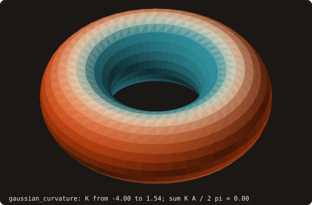
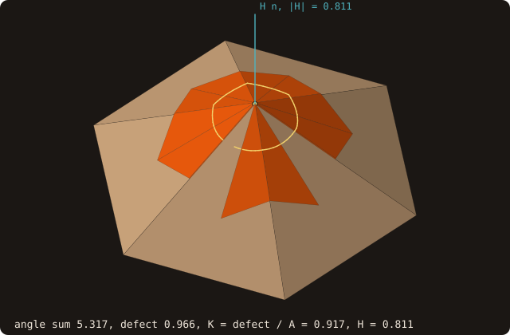
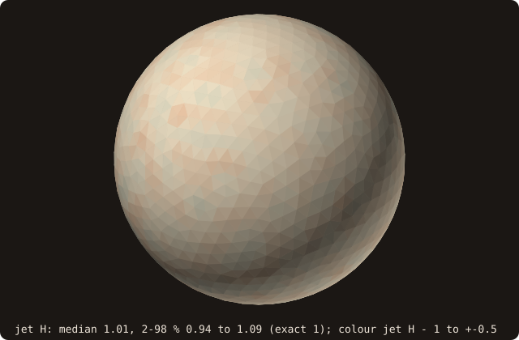

# Per-vertex Gaussian + mean curvature

## What it does

Two TBPs that return scalar curvature fields, one value per vertex of
the surface:

- **`gaussian_curvature(K, status)`** — Gaussian curvature `K_i`
  computed from the **angle defect** at vertex `i`. `K > 0` on
  convex caps (sphere, ellipsoid), `K < 0` on saddles, `K = 0` on
  developable surfaces (cylinder, cone, flat plane).
- **`mean_curvature(H, status)`** — signed mean curvature `H_i` from
  the **mean-curvature normal** identity `H_i n_i = (1/2) M⁻¹ (L V)_i`,
  with sign disambiguated by projection onto the per-vertex pseudo-normal.
  `H > 0` on outward-convex regions (sphere surface, cube corners),
  `H < 0` on saddles / concave-outward regions, `H ≈ 0` on flat regions.

- **`jet_curvature(H, K, status)`** (issue #42) — both, by a local
  polynomial fit: in the frame of the vertex pseudo-normal, a cubic height
  function is fitted to the 2-ring (Cazals & Pouget 2005), and H and K are
  those of the fitted graph.
  - The error is O(h²) pointwise on any sampling: on icospheres the
    maximum relative error falls 0.183 → 0.043 → 0.012 per subdivision.
  - The two operators above stall near 15 % at the valence-5 vertices.
  - Use it when pointwise values matter, as for the wall curvature at a
    foot point (`query_many(curvatures=)`).

The first two build on [cotangent Laplacian + barycentric mass](/guide/advanced/cotangent-laplacian).
The mean variant in particular is a one-liner on top of `(L, M)`:
`L V` is the per-vertex mean-curvature normal scaled by `2 M_ii`;
inverting the diagonal mass and halving gives `H n`.

{.fossil-figure}

A torus shows the three signs: `gaussian_curvature` gives K from -4.003 on the inner equator (exact -4.040) to 1.538 on
the outer one (exact 1.533), and $\sum_i K_i A_i = 0$ to round-off, the Euler characteristic of a torus. The torus is
parametric, 48 × 24 vertices; the figure is drawn by `docs/examples/src/fig_ref_curvature_torus.f90`.

### A correction worth surfacing

The `feat(curvature,surface): per-vertex Gaussian curvature` commit
message claimed that the **mean** variant required a sparse linear
solver. That was wrong. The mass matrix `M` is *diagonal* (barycentric
per §2.1), so `M⁻¹` is per-row scalar division — no factorisation
needed. The mean variant shipped without any external dependency in the
same release as Gaussian. The mean-curvature TBP docstring carries the
retraction inline; this page records it once and moves on.

## Pipeline

### Gaussian — angle defect

For each interior vertex `i`:

$$K_i = \frac{2\pi - \sum_{T \ni i} \theta_i^T}{A_i}$$

where `θ_i^T` is the angle at vertex `i` inside triangle `T`, the sum
runs over all triangles incident to `i`, and `A_i = (1/3) Σ_{T ∋ i} A_T`
is the same barycentric vertex-area used in §2.1's mass matrix.

For boundary vertices the formula is `(π − Σ θ) / A_i` — half the angle
defect, reflecting the fact that the surface doesn't wrap around `i` on
the open side. FOSSIL detects boundary vertices automatically via the
half-edge incidence pool.

The integrated angle defect `Σ_i K_i A_i = 4π χ` (Gauss–Bonnet) for any
closed orientable manifold of Euler characteristic `χ` — `χ = 2` for a
topological sphere, `χ = 0` for a torus. This is a standard regression
oracle for the implementation.

### Mean — mean-curvature normal

For each vertex `i`, compute the action of the cotangent Laplacian on
the coordinate field `V`:

$$(L V)_i = \sum_{j \in N(i)} \frac{\cot \alpha_{ij} + \cot \beta_{ij}}{2} \, (V_j - V_i)$$

then form

$$H_i \, \vec{n}_i = \frac{1}{2 A_i} (L V)_i$$

The magnitude is `H_i = ||H_i n_i||`; the sign is decided by projecting
onto the angle-weighted pseudo-normal computed by `analyze` (this is
the same per-vertex pseudo-normal used by `SIGN_PSEUDO_NORMAL` for
signed-distance queries). Outward-convex projection gives `H > 0`,
inward-concave gives `H < 0`.

Both computations reuse the §2.1 per-triangle cotangent and area
assembly. They run in a single pass over the facet array with O(N)
storage; no sparse matrix is materialised by either TBP — the assembly
is "on the fly" into the output vector.

{.fossil-figure}

Both formulae at the apex of a six-sided cone: the angles sum to 5.317, so the defect is 2π − 5.317 = 0.966; divided by
the barycentric area A_i = 1.054 (shaded) it gives K = 0.917, the value `gaussian_curvature` returns.
`mean_curvature` gives H = 0.811, along the pseudo-normal, +z.

## API

### Gaussian

```fortran
call surface%gaussian_curvature(K, status)
   class(surface_stl_object),  intent(in)            :: self
   real(R8P), allocatable,     intent(out)           :: K(:)
   integer(I4P),               intent(out), optional :: status   ! CURV_STATUS_*
```

Output:

- **`K(1:n_vertices)`** — per-vertex Gaussian curvature. Indexed by
  pool vertex id (`pool%get_vertex_count()` gives `n_vertices`). Boundary
  vertices use the half-defect formula; interior vertices the full
  formula.

### Mean

```fortran
call surface%mean_curvature(H, status)
   class(surface_stl_object),  intent(in)            :: self
   real(R8P), allocatable,     intent(out)           :: H(:)
   integer(I4P),               intent(out), optional :: status   ! CURV_STATUS_*
```

Output:

- **`H(1:n_vertices)`** — per-vertex signed mean curvature. Positive on
  outward-convex regions, negative on saddle / inward-concave, ≈ 0 on
  flat regions.

Shared status codes:

- `CURV_STATUS_OK` — operator built successfully.
- `CURV_STATUS_BAD_INPUT` — empty surface or uninitialised pool.
- `CURV_STATUS_DEGENERATE_TRIANGLE` — at least one triangle had area
  below tolerance and was skipped. The curvature field is still
  returned; degenerate vertices receive 0.

**Pre-condition.** `analyze` must have run (pseudo-normals populated).
Every public construction path on `surface_stl_object` ensures this —
`load_from_file`, `adopt_facets`, and `sanitize` all call `analyze`
internally. The `mean_curvature` sign-disambiguation step is the only
direct consumer of pseudo-normals among the curvature TBPs; Gaussian
does not depend on them.

## Example

A unit sphere and a torus (R = 1, r = 0.45) by
[marching cubes](/guide/advanced/marching-cubes) on 41³ samples of
[-1.5, 1.5]³, cleaned by `sanitize(fill_holes=.true.)`, which drops the
slivers marching cubes leaves (the helper `implicit_body` in the
[full program](#the-whole-program)). On the sphere, the three operators
side by side:

<<< @/examples/snippets/ref_curvature-sphere.f90

The angle defect integrates exactly. With the barycentric areas $A_i$
(the diagonal of the [mass matrix](/guide/advanced/cotangent-laplacian)),
$\sum_i K_i A_i$ is the total angle defect, which the discrete
Gauss-Bonnet theorem fixes at $2\pi\chi$ on any closed mesh:

<<< @/examples/snippets/ref_curvature-bonnet.f90

The principal curvatures follow from H and K pointwise,
$\kappa_{1,2} = H \pm \sqrt{\max(0, H^2 - K)}$ (no separate routine).
On the torus they are known: $1/r$ around the tube and
$(\rho - R)/(r\rho)$ along it, with $\rho$ the distance from the axis:

<<< @/examples/snippets/ref_curvature-principal.f90

<<< @/examples/output/ref_curvature.ansi{ansi}

- **Means against pointwise values.** The angle-defect `K` and the
  cotangent `H` average close to the exact 1 (0.991, 1.046), but their
  per-vertex values spread from 0.085 to 1.943 and from 0.549 to 1.951
  between the 2nd and 98th percentiles. `jet_curvature` keeps H between
  0.931 and 1.045 on the same mesh. See
  [Known limitations](#known-limitations).
- **Gauss-Bonnet.** $\sum_i K_i A_i / 2\pi$ is 2 on the sphere and 0 on
  the torus to 1.5e-13: the angle defects sum to $2\pi\chi$ whatever the
  triangle shapes. A wrong value means a hole, a non-manifold vertex or
  a second shell, not a bad mesh.
- **Principal curvatures.** From the jet fit, both are within 0.08 rms
  of the exact values, with outliers up to 0.40 on 41³ samples. The
  clamp `max(0, ·)` absorbs round-off at umbilical points, where
  $H^2 = K$.
- For the curvature at the foot of a query point instead of at the
  vertices, `query_many(curvatures=)` evaluates the jet fit there: see
  the cookbook's
  [Measure the curvature at a point](/manual/cookbook#measure-the-curvature-at-a-point).

### The whole program

<<< @/examples/snippets/ref_curvature.f90

## Visual reference

A unit sphere by marching cubes (the `|x| - 1` field on 31³ samples of
[-1.5, 1.5]³, cleaned by `sanitize(fill_holes=.true.)`, which drops
the slivers marching cubes leaves), then isotropically remeshed with the defaults
(5436 facets). Each facet is coloured by the mean of its three vertex
values minus the exact value 1 (teal below, ember above; the scale is
in the caption). Gaussian curvature `K` by `gaussian_curvature`:

{.fossil-figure}

Signed mean curvature `H` on the same surface, by `mean_curvature`
(left) and by `jet_curvature` (right), same colour scale:

<div class="fossil-pair">




</div>

**Read these figures honestly.** The means are right (`K` and `H`
average 1.009 and 1.005 over the vertices, the exact value is 1), but the
per-vertex values of the angle-defect and cotangent operators are not:
on this irregular triangulation they scatter over the whole surface, no
cluster or region in particular (2nd-98th percentile: `K` from -0.16 to
2.95, `H` from 0.33 to 1.79). This is the non-convergence described in
[Known limitations](#known-limitations) below, not a rendering bug or a
bug in the curvature TBPs: it is what the discrete formulae genuinely
produce on a mesh whose vertex valences and triangle shapes vary from
vertex to vertex. `jet_curvature` on the same mesh stays within 0.86 to
1.16. Use it when the pointwise value matters; on real CAD STL, run
[§1.7 isotropic remeshing](/guide/advanced/isotropic-remesh) first in
any case. The figures are drawn by
`docs/examples/src/fig_ref_curvature.f90`.

## Known limitations

- **The cotangent / angle-defect operators do not converge pointwise on
  irregular meshes.** On icospheres the maximum relative error stays near
  15 % (0.154, 0.148, 0.124 at 2, 3, 4 subdivisions) at the valence-5
  vertices, although the RMS error decreases. They are exact on some
  structured meshes (a cylinder's rings). `jet_curvature` converges at
  second order everywhere.
- **Discrete curvature is noisy on coarse triangulations.** Both
  formulae carry an `O(h)` discretisation error where `h` is the local
  edge length; on very-coarse meshes (cube with 12 facets, low-res MC)
  the values are dominated by tessellation artefact rather than smooth
  curvature. This is why the §2.4 tests target sphere + bunny rather
  than the cube — sphere has well-behaved curvature, bunny has enough
  vertices to swamp tessellation noise. Use [§1.7 isotropic
  remeshing](/guide/advanced/isotropic-remesh) or [§1.3
  decimation](/guide/advanced/decimate) first if the input is
  pathological.
- **Mean-curvature sign relies on the pseudo-normal.** If the surface
  has inconsistent normal orientation (one patch flipped), the
  per-vertex pseudo-normal may point inward at some vertices and the
  sign of `H` there will flip. Run `sanitize_normals` (or full
  `sanitize`) before `mean_curvature` if the input is dirty. The
  unsigned magnitude `|H|` is robust regardless.
- **Principal curvatures and directions** are *not yet* a TBP — only
  the trace (`H`) and determinant-shadow (`K`) are returned. Computing
  `(κ₁, κ₂, d₁, d₂)` requires either (a) the algebraic combination
  shown in the example above for the eigenvalues, or (b) Rusinkiewicz
  2004 per-vertex 3×3 covariance + `dsyev` LAPACK eigen-decomposition
  for the directions. The follow-up TBP is small but not yet shipped.
- **Discrete curvature is per-*vertex*, not per-*facet*.** If you want
  a per-facet curvature scalar (e.g. for face-based segmentation), the
  standard recipe is to average the three incident vertex values —
  the curvature TBPs do not provide a per-facet helper.

## See also

- [cotangent Laplacian + barycentric mass](/guide/advanced/cotangent-laplacian)
  — the prerequisite operator. Mean curvature is a one-liner on top of
  `(L, M)`.
- [mesh smoothing](/guide/advanced/smoothing) — the shipped
  smoothing variants reduce high-frequency surface noise; running
  `mean_curvature` after a few Taubin passes gives noticeably cleaner
  `H` fields without volume loss.
- [`sanitize_normals`](/guide/api/surface-stl-object#sanitize_normals)
  — ensures the pseudo-normals used by mean-curvature sign
  disambiguation are consistently outward-oriented.
- [Constants](/guide/api/constants) — `CURV_STATUS_*`.

## References

- Meyer, Desbrun, Schröder & Barr, *Discrete differential-geometry
  operators for triangulated 2-manifolds*, VisMath 2003. The reference
  formulation for both `K_i` (angle defect) and `H_i n_i`
  (mean-curvature normal), including the mixed-area mass discussion
  that informs the §2.1 follow-up.
- Rusinkiewicz, *Estimating curvatures and their derivatives on
  triangle meshes*, 3DPVT 2004. The per-vertex 3×3 covariance method
  for principal curvatures and directions — the documented follow-up.
- Crane, *Discrete Differential Geometry: An Applied Introduction*,
  SIGGRAPH course notes 2013–2023. The pedagogical reference covering
  both Gauss–Bonnet on triangle meshes and the `H n = (1/2) M⁻¹ L V`
  identity used by the FOSSIL mean-curvature TBP.
- do Carmo, *Differential Geometry of Curves and Surfaces*,
  Prentice-Hall 1976. The smooth-surface theory the discrete formulae
  approximate — useful when you need to remember why
  `H = (κ₁ + κ₂)/2` and `K = κ₁ κ₂`.
