# Curvilinear structured blocks

Overset assembly, interpolation between grids and body-fitted support all need
geometry on **curvilinear structured blocks**: the cells and whether they are
valid, the topology of the block (periodic seams, C- and O-cuts, poles),
locating a point in a block, and interpolation stencils. Issue #71 (roadmap
#68, WP2) adds a block type for them, `curvilinear_block_t`, and its 2-D twin
`curvilinear_block_2d_t`, in the module `fossil_curvilinear_block`. The old
Cartesian `block_object` stays as it is.

::: info Design and reference (issue #71)
This page fixes the design before the code: the data model, the topology
records, the cell geometry, the validity and location statuses, the stencil
rules, the API, and what is proved against what is measured. Statements from
general knowledge rather than a cited source are marked *(gk)*. Sources are
the llm-wiki bundles `overset-grid-methods` and
`curvilinear-metric-discretization`.
:::

## At a glance

{.fossil-figure}

Three points move through an O-grid and are located frame after frame by
`locate_many(..., walk=.true., start=)`, each walk starting from the cell
found at the previous frame: 3 to 7 cells crossed per frame by the three walks
together, across the seam too, and 0 fallbacks to the robust path
(`anim_block_walk.f90`).

## Principles

1. **Exact where it decides, an honest status elsewhere.** The decisions FOSSIL
   can make exactly, it makes exactly: in 2-D the edges of a bilinear cell are
   straight, so containment and cell validity follow from exact `orient2d`
   signs. The rest returns a status per point or cell (inside, outside,
   warped, degenerate, not converged; valid, invalid, undetermined), never a
   silent guess. Xall/OverSet's donor search, the reference user, relies on
   tolerances (`toll = 1e-4`, boxes inflated by 5 %); FOSSIL does not copy them.
2. **One tie rule.** As for the cut cells ([cut-cell geometry](./cut-cells)), a
   point on a face shared by two cells belongs to the **low side**: cell `i`
   spans the index interval `(i, i + 1]` in each direction, so a point on the
   face between cells `i - 1` and `i` belongs to `i - 1`. Among several cells
   containing a point (a seam, a singular line), the first in the order
   `k`, then `j`, then `i` wins; this order implies the low-side rule.
3. **Plain arrays.** The vertices are stored as structure-of-arrays,
   `x(ni, nj, nk)`, `y`, `z` (2-D: `u(ni, nj)`, `v`), not as `vector_R8P`: the
   batched location runs on the device ([GPU rules](./device-distance)), and
   the solvers that hand FOSSIL their grids store them this way.
4. **No ghost layers.** A solver's ghost cells are its own; topology records
   replace them. Every walk and stencil crosses the records itself.
5. **Deterministic.** Every choice follows a fixed order; the same input gives
   the same output on the CPU and, bit for bit, on the device.

{.fossil-figure}

The 30 points sit exactly on shared edges and vertices of a sheared block (dyadic coordinates, straight edges).
`locate_many` returns all 30 as `LOC_INSIDE`, each in the cell of lower index, with ξ = 1 along every direction it
shares (`fig_ref_curvilinear_blocks_tie.f90`).

## Data model

A block of `ni × nj × nk` vertices has `(ni − 1) × (nj − 1) × (nk − 1)` cells;
cell `(i, j, k)` is spanned by the vertices `i..i+1`, `j..j+1`, `k..k+1`. Its
map from the unit cube is trilinear,

x(ξ, η, ζ) = Σ x_abc (1 − ξ)^(1−a) ξ^a (1 − η)^(1−b) η^b (1 − ζ)^(1−c) ζ^c,

with bilinear faces. The 2-D cell is the bilinear map of the unit square, with
straight edges. Faces of the block are numbered 1 to 6 (−i, +i, −j, +j, −k,
+k; 1 to 4 in 2-D), and a block's **handedness** is the sign of its total
volume: validity means the Jacobian has that sign everywhere.

{.fossil-figure}

The block has 6 × 4 × 3 vertices and 30 cells; cell (4, 1, 2) is spanned by the vertices 4..5, 1..2, 2..3. With i,
j, k along x, y, z it is right-handed: its cell volumes are positive (0.448 for this one), the block's 13.44
(`fig_ref_curvilinear_blocks_numbering.f90`).

## Topology records

Each face of the block carries records, each with a vertex range on that face
and a kind:

| Kind | Meaning |
|------|---------|
| `TOPO_ABUT` | the range coincides vertex by vertex with a range of a face of this block or another one: an O-grid seam, a C-grid wake cut, a block interface |
| `TOPO_PERIODIC` | as `TOPO_ABUT` after a rigid motion: the range moved by `rotation` and `translation` coincides with the donor range |
| `TOPO_SINGULAR` | the face collapses along one of its directions: a polar axis, a pole |

An abutting or periodic record carries the donor block, the donor face, the
two corresponding vertices `begin` and `donor_begin`, and a **transform**
`T(3)` as in CGNS *(gk)*: direction `d` of this block runs along direction
`|T(d)|` of the donor, with the sign of `T(d)`. The vertex `p` maps to

donor(p) = donor_begin + M (p − begin),  M(:, d) = sign(T(d)) e_|T(d)|,

for every `p`, also off the face: `p` one layer outside this block maps to the
donor's first interior layer. That is how walks and stencils cross a record.
The normal direction maps into the donor with the sign that turns this block's
interior into the donor's exterior.

`detect_topology(blocks, tolerance)` proposes the records over a set of blocks:

1. Every boundary vertex is sorted by its coordinates; by default two vertices
   **coincide** when their coordinates are equal (exact), or within
   `tolerance` in the maximum norm when one is given (grids written with
   round-off at their seams).
2. A face is **singular** along one of its directions when every vertex line
   in that direction has coincident vertices.
3. Each still uncovered vertex of a face whose image is unique, with unique
   images of its neighbours on the face, seeds a transform; the record grows
   to the largest rectangle on which every vertex maps onto a coincident one.
   A C-grid's wake cut gives two records on the same face, with the index
   reversal; an O-grid seam one record on each of its two faces.
4. Periodic records are found the same way for each translation passed in
   `translations`, with + and − t on every face; rotational periodicity is
   given by hand (`add_record`). Exact matching needs both x + t and x − t to
   land exactly on the partner (true for dyadic coordinates); grids whose
   periodic faces differ by round-off need a tolerance.

Vertices that match nothing are physical boundary. The user can also give the
records by hand, and every record **round-trips**: mapped vertices coincide.

{.fossil-figure}

`detect_topology_2d` with no tolerance proposes these records (`fig_ref_curvilinear_topology.f90`): on the C-grid,
two `TOPO_ABUT` records on face 3, i = 1..13 onto face 3 from i = 61 and i = 49..61 onto it from i = 13, both with
the transform (−1, −2), the index reversal; on the disc, the seam (face 1 onto face 2 and back) and face 3
`TOPO_SINGULAR`.

## Cell geometry

Geometric layer (`definitions/jacobian.md`,
`properties/geometric-conservation-law.md` in `curvilinear-metric-discretization`):

- **Face area vectors.** A bilinear face with corners `a, b, c, d` (in cyclic
  order) has the exact area vector ∫ x_s × x_t ds dt = ½ (c − a) × (d − b).
  The six vectors of a cell, oriented outward, sum to zero in exact
  arithmetic: the finite-volume geometric conservation law.
- **Volume.** The Jacobian det J of the trilinear map has degree 2 in each
  variable, so the 2-point Gauss rule per direction integrates it exactly: the
  volume is exact up to the rounding of eight determinants. Summed over the
  block it equals the volume enclosed by the block's boundary faces (the
  divergence theorem), which the tests check.
- **Centroid.** ∫ x det J / V has degree 3 per direction, so the same 8 points
  are exact.
- **2-D.** The area of the bilinear quadrilateral is ½ (c − a) × (d − b),
  the edges are straight with normals (Δv, −Δu), the centroid by 2 × 2 Gauss.
- A left-handed block gives negative volumes and inward face vectors,
  consistently; that is a property of the input, not a defect.

{.fossil-figure}

`geometry` on this single cell gives the volume 1.21875 and the six outward face vectors, the top one
(−0.125, −0.375, 1.25): their sum is exactly zero here (`fig_ref_curvilinear_blocks_cell.f90`). The eight Gauss
points are where the volume and centroid rules evaluate det J.

## Cell validity

Map layer. Positive Jacobians at the eight corners do not make a trilinear
cell valid: a twisted cell can fold inside while every corner is positive
*(gk)*. FOSSIL certifies the sign:

- det J of the trilinear map has degree (2, 2, 2), so it has 27 Bernstein
  coefficients on the cell, computed from its values at ξ, η, ζ ∈ {0, ½, 1}.
  Their minimum and maximum bound det J on the cell (the convex-hull property
  of the Bernstein form *(gk)*).
- **Valid** (`CELL_VALID`) when every coefficient has the block's sign by
  more than its floating error bound; **invalid** (`CELL_INVALID`) when det J
  has the opposite sign at a point (a value, not a coefficient) or vanishes on
  a whole box (a flat cell); **singular** (`CELL_SINGULAR`) when the remaining
  coefficients are exact zeros, which coincident vertices produce (a polar
  axis, a collapsed edge: det J ≥ 0 is certified, zero on the collapse);
  otherwise the cell is cut in eight and each part is examined again, down to
  5 levels. A cell where nothing decides is **undetermined**
  (`CELL_UNDETERMINED`). Location treats singular cells as valid.
- **2-D is exact.** The bilinear det J has degree (1, 1), so its Bernstein
  coefficients are its four corner values, and each corner value is the
  orientation of the corner and its two neighbours: `orient2d` decides
  valid, invalid, or singular (a corner value exactly zero, the others
  positive) exactly.
- The certified lower bound of det J is kept for the quality metrics.

{.fossil-figure}

Of the 240 cells, 236 are valid (min J / mean J from 0.5526 to 1), 2 invalid where the pushed vertex folds them, and
2 singular at the collapsed edge: exact zeros, decided by `orient2d` (`fig_ref_curvilinear_validity.f90`).

## Point location

`locate_many` returns, per point, the block, the cell, ξ and a status:

| Status | Meaning |
|--------|---------|
| `LOC_INSIDE` | a valid cell contains the point; ξ inverts its map |
| `LOC_OUTSIDE` | no cell contains it |
| `LOC_WARPED` | only a cell that is not certified valid contains it (the inverse may have several roots) |
| `LOC_DEGENERATE` | only a degenerate or undetermined cell may contain it |
| `LOC_NOT_CONVERGED` | the 3-D inverse did not converge in a cell whose box contains the point |

**Robust path** (`methods/donor-search.md`, `overset-grid-methods`). The
candidates are the cells whose box contains the point, from a bounding volume
hierarchy over the cell boxes (the role of the alternating digital tree of
Roget & Sitaraman). Each candidate in index order is tested:

- **2-D**: containment by the exact orientation of the point against the four
  straight edges of a valid (hence convex) cell, closed; ξ by the bilinear
  inverse in closed form (a quadratic), polished by one Newton step.
- **3-D**: Newton on the trilinear map from the cell centre, stopped on a
  residual below 1e-14 of the cell size; inside when ξ ∈ [0, 1]³ up to
  1e-12. Faces are curved, so this is the one decision that is not exact.

The first candidate that contains the point wins (the tie rule above); a
warped, degenerate or unconverged candidate is reported only if no valid cell
contains the point.

{.fossil-figure}

Of 1147 points, 1025 are `LOC_INSIDE`, 117 `LOC_OUTSIDE` and 5 `LOC_WARPED`: no valid cell contains them, only a
folded one. The point (10, 4.4) has 2 candidate boxes; the cell that contains it, (10, 5), is folded, so its status is
`LOC_WARPED` (`fig_ref_curvilinear_blocks_locate.f90`).

**Fast path** (PEGASUS 5, Lee & Baeder in `methods/donor-search.md`),
`locate_many(..., walk=.true., start=)`. Stencil jumping from a start cell
(the given one, or the previous point's cell): the inverse map of the current
cell gives ξ (in 3-D Newton kept in [−1, 2]³, so even an unconverged ξ points
the way), and the walk moves one cell in the direction of the largest
excursion of ξ outside [0, 1], across the abutting records of the same block.
On a containing cell it settles the tie rule among the cells sharing a vertex
with it, so it returns what the robust path returns, bit for bit. Anything
else hands the point to the robust path: a cell that is not valid, a
neighbour that is not valid, Newton not converged in a containing cell, a
revisited cell, the step limit, a block face without an abutting record to
the same block (a physical boundary, a periodic or singular record, another
block), or a containing cell whose ξ touches the block boundary (a seam point
may lie in a cell far away in index space). The identity holds on blocks that
do not overlap themselves; the tests check it on an O-grid, a C-grid, a polar
grid and a wavy 3-D O-grid. The counts of jumps and fallbacks are returned
(`jumps=`, `fallbacks=`).

**Device.** `locate_many_device` runs the robust path, written once as free
`_oac` procedures on plain arrays (the cell boxes, the tree, the vertices and
the cell validity), so the CPU and the device run the same code and agree bit
for bit (`block location device vs serial mismatches: 0` in the GPU gate).

## Interpolation stencils

`stencils` builds, per located point, a tensor-product Lagrange stencil of
width q per direction on the block's **vertices** (`methods/inter-grid-interpolation.md`,
`results/interpolation-order-requirement.md`). Data stored at cell centres use
a block built from the cell centres.

- The point's index coordinate is s = i + ξ per direction; the stencil takes
  the q vertices around it (centred), shifted one-sided at a physical
  boundary, or reduced to the largest width that fits when asked; a status
  says which.
- Nodes beyond a face with a record are mapped through it, so a stencil across
  a periodic seam equals the one on the unwrapped grid.
- The weights are the 1-D Lagrange weights in index space, multiplied: they
  reproduce polynomials of degree q − 1 in index space exactly.
- **Order-matched ξ** (Sherer & Scott): for q > 2 the trilinear ξ is only
  second-order accurate on a curved grid, which caps the interpolation at
  second order. ξ is recomputed by Newton on the isoparametric map of degree
  q − 1 built from the stencil's own vertices, started from the trilinear ξ.
- **Accuracy requirement** (Chesshire & Henshaw): a scheme of order s needs
  q ≥ 2s + 1 when the overlap shrinks with h, q ≥ s + 1 when the overlap is a
  fixed number of cells. FOSSIL documents the rule; the caller chooses q.

{.fossil-figure}

The point lies in cell (55, 1), on the upper side of the wake cut. Its stencil of width 4 needs a row below j = 1:
the record maps it to the vertices (8, 2), (7, 2), (6, 2), (5, 2) of the lower wake, the row a solver's ghost
layer would hold. Interpolating exp(x) cos(3y) there, width 2 errs by 1.29e-1 and width 4 by 5.23e-3
(`fig_ref_curvilinear_stencil.f90`).

## Quality metrics

The wiki defines none, so FOSSIL defines them *(gk)*, per cell:

| Metric | Definition |
|--------|-----------|
| skewness | equiangle skewness: max over face corners of max((θ − 90°)/90°, (90° − θ)/90°) |
| orthogonality | min over faces of cos(A_f, d_f), d_f from the cell centroid to the neighbour's (to the face centroid on the boundary) |
| aspect ratio | the longest over the shortest of the mean edge lengths in the three index directions |
| warp | max over faces of the angle between the normals of the two triangles each diagonal splits the face into |
| min J | the certified lower bound of det J over the cell, over the mean det J |

{.fossil-figure}

Vertical grid lines over a bump and a wall-normal spacing growing by 1.5 per layer: the skewness peaks at 0.357 in
wall cell (10, 1) on the bump's flank, the orthogonality falls to 0.852 at (15, 1), the aspect ratio reaches 12.48
in the first layer at (11, 1); min J / mean J is at least 0.938
(`fig_ref_curvilinear_blocks_quality.f90`).

## Example

A 3-D block end to end: a wavy annulus with a seam and periodic in z. The cookbook recipe
[Locate a point in a curvilinear block](/manual/cookbook#locate-a-point-in-a-curvilinear-block) locates one point in
a 2-D O-grid.

<<< @/examples/snippets/ref_curvilinear_blocks.f90

<<< @/examples/output/ref_curvilinear_blocks.ansi{ansi}

- **Topology.** The annulus runs clockwise in i, so the block is right-handed (positive volumes). `detect_topology`
  finds the seam (faces 1 and 2, transform (1, 2, 3)) and, with the translation (0, 0, 1), the periodic pair of faces
  5 and 6: the end faces are flat and dyadic (z = 0 and 1), so z + 1 and z − 1 land on the partner exactly.
- **Geometry.** The cell volumes sum to 9.364335457 = 48 sin(π/16), the volume of the prism over the 32-gon annulus
  that bounds the block: the inner vertices moved by the wave change the cells, not the total. The six outward face
  vectors of every cell sum to zero within 1.27e-17.
- **Validity.** The wave keeps every cell valid: 2048 of 2048 certified.
- **Location.** 400 points, all `LOC_INSIDE`. The walk (`walk=.true.`, each point starting from the previous one's
  cell) returns the same cells, ξ and statuses bit for bit, after 7273 jumps, with 1 point handed to the robust path.
- **Stencils.** A node beyond a periodic face is mapped to the vertex one period away, so the field read there must
  be periodic too (here cos(2πz)), or the caller adds its jump. Width 2 errs by 7.91e-2, width 4 by 1.31e-2 at most over
  the 400 points (8 cells per period in z).
- **Quality.** The wave stays mild: skewness at most 0.097, warp 3.71 degrees, certified min J at least 0.915 of the
  mean.

## API

```fortran
type(curvilinear_block_t) :: blocks(2)
call blocks(1)%initialize(x, y, z, name='blade', status=st)   ! vertex arrays (ni, nj, nk)
call detect_topology(blocks, tolerance=t, translations=tau)    ! records on every block (blocks(b)%rec)
call blocks(1)%geometry(volume, centroid, face_i, face_j, face_k) ! exact cell geometry
call blocks(1)%validity(status, min_jacobian)                 ! certified CELL_* per cell
call blocks(1)%build_search()                                 ! validity, orientation, cell-box hierarchy
call blocks(1)%locate_many(px, py, pz, cell, xi, status)      ! robust; walk=.true., start=, jumps=, fallbacks=
call blocks(1)%locate_many_device(px, py, pz, cell, xi, status) ! the robust path on the GPU, bit-identical
call locate_in_blocks(blocks, px, py, pz, block, cell, xi, status)
call blocks(1)%stencils(cell, xi, q, nodes, weights, status)  ! order_matched=, reduce=, xi_matched=
call blocks(1)%quality(skewness, orthogonality, aspect, warp, min_jacobian)
```

The 2-D type has the same procedures with `u, v` (no warp). `cell(:, n)` is the cell index (0 if the point is
outside), `xi(:, n)` its local coordinates; `nodes(:, k, n)` are vertex indices of the block (beyond a face, mapped
through its records to the same block; records to other blocks are left to WP3), `weights(k, n)` their weights
(unused slots of a narrowed stencil have weight 0).

## Proved and measured

| Claim | Kind |
|-------|------|
| 2-D containment, validity and the tie rule | exact (orient2d) |
| face area vectors, volumes and centroids | exact formulas, rounded once per term; GCL and block volume measured to round-off |
| 3-D validity: valid and invalid | certified (Bernstein bounds with error bounds) |
| 3-D containment | Newton with a residual test: measured against analytic inverses |
| fast path equal to robust path | measured on random points (O-grid, C-grid, polar grid) |
| device equal to CPU | measured, bit for bit |
| stencil exactness and order q | exactness proved (Lagrange); order measured by refinement: q = 2, 3, 4 at 1.98, 3.00, 3.97 on a C-grid, q = 4 at 4.04 on a spherical shell; q = 4 with the trilinear ξ stalls at 2.0 |

## Measured

`fossil_val_curvilinear_block` (validation suite, -O2, one core):

- a spherical-shell O-grid of 128 × 64 × 32 cells with both poles collapsed: `detect_topology` finds the seam (two
  records) and the two singular poles; 253 952 cells valid and the 8192 pole cells singular, certified in 0.2 s;
  200 000 points located at about 0.8 million per second (robust) and equal, bit for bit, through the walk;
- a parabolic C-grid of 800 × 200 cells: the wake cut found; 10⁶ points at about 5.8 million per second, the walk
  equal bit for bit;
- interpolation orders (slopes over the refinements): q = 2, 3, 4 at 1.98, 3.00, 3.97 on the C-grid, q = 4 at 4.04
  on the shell.

On the GPU (RTX 4070), 50 000 points in a wavy 3-D O-grid: 12 ms with the copies of the arrays, 16 ms serial on the
CPU, the same answers bit for bit.

## Left out

- Hole cutting, donor selection across blocks, fringes and orphans: WP3.
- Finite-difference metrics of a solver's own stencil: they depend on the
  solver (`turbulence-modelling/wiki/properties/geometric-conservation-law.md`).
- Grid generation: WP5 decides.
