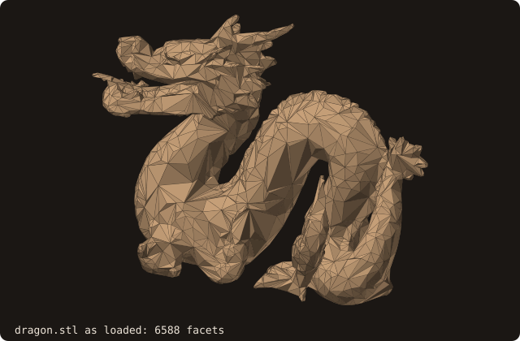
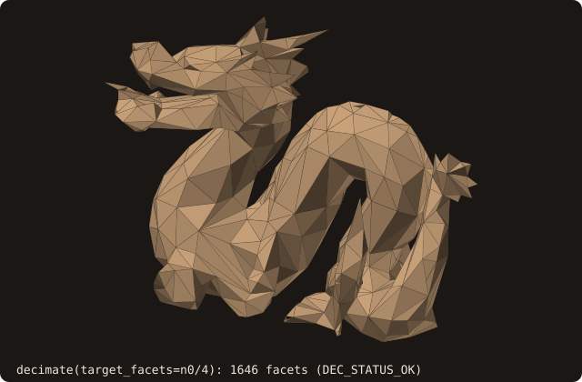

# Mesh decimation (QEM)

## What it does

Reduces the number of triangles in a surface while preserving its
overall shape. Iteratively collapses the edge that introduces the
smallest geometric error, as measured by the **quadric error metric**
(Garland & Heckbert 1997).

Complementary to [isotropic remeshing](/guide/advanced/isotropic-remesh):
decimation reduces facet *count* and is shape-preserving (silhouette
priority); isotropic remeshing equalizes edge *length* without
changing the count. Reach for decimation when "this 2 M-facet STL
needs to fit in 100 k facets for cut-cell tagging." Reach for remesh
when "the tessellation is irregular and tripping AABB query balance."

## Pipeline

1. **Per-vertex 4×4 quadrics**. For each vertex, accumulate
   $Q_v = \sum_{p \in \text{incident planes}} K_p$ where $K_p = p\,p^T$
   for plane equation $p = (a, b, c, d)$ with normal $(a,b,c)$ and
   offset $d$. The quadric measures squared distance to all incident
   facet planes.
2. **Per-edge optimal collapse target**. For each edge $(u, v)$, the
   minimizer of $v^T (Q_u + Q_v) v$ is the optimal collapse position.
   3×3 Cramer's-rule solve; midpoint fallback if singular.
3. **Min-heap**, keyed on collapse cost. Decrease/increase-key
   supported (~80 LOC inline) so neighbour edges can have their costs
   re-evaluated after each collapse without rebuilding the heap.
4. **Iterative collapse** with **three safety checks** per candidate:
   - **Normal-flip rejection**: if any incident triangle's normal would
     flip, the collapse is skipped.
   - **Duplicate-vertex rejection**: if the collapse would merge two
     vertices that already exist on the same facet (creating a
     degenerate triangle), skipped.
   - **Non-manifold-edge rejection**: if the collapse would create an
     edge with > 2 incident facets, skipped.
   When all remaining edges fail one of these checks, the algorithm
   returns `DEC_STATUS_NO_PROGRESS` — the smallest count it could
   safely reach.

## API

```fortran
call surface%decimate(target_facets, status)
   class(surface_stl_object), intent(inout)         :: self
   integer(I4P),              intent(in)            :: target_facets
   integer(I4P),              intent(out), optional :: status   ! DEC_STATUS_*
```

- **`target_facets`** is the **upper bound** on the output facet
  count. The algorithm collapses edges until it reaches this count or
  cannot safely collapse any more.
- **`status`**:
  - `DEC_STATUS_OK` — reached `target_facets`: the count is at or just
    below it (a collapse removes two facets, so an odd target can end
    one below: the dragon's 6588 / 4 = 1647 ends at 1646).
  - `DEC_STATUS_NO_PROGRESS` — couldn't reach the target; surface is
    at the smallest count the safety checks allowed.
  - `DEC_STATUS_BAD_INPUT` — the input surface has no facets.
    `target_facets <= 0` is not rejected: it collapses everything and
    returns `DEC_STATUS_OK` with an empty surface.

After return, `self`'s AABB tree, vertex pool, connectivity, and
pseudo-normals are all rebuilt — no further user action needed before
calling `distance`, `winding_number`, `boolean`, or any other query.

## Example

The cookbook's [Decimate a mesh](/manual/cookbook#decimate-a-mesh)
reduces the dragon once. Here the question is how far each level moves
the surface, on a body whose shape is known: a unit sphere by
[marching cubes](/guide/advanced/marching-cubes) (41³ samples of
[-1.5, 1.5]³, cleaned by `sanitize`):

<<< @/examples/snippets/ref_decimate-sphere.f90

Three levels, each a quarter of the previous, measured against the
input by the certified [Hausdorff distance](/guide/advanced/surface-deviation):

<<< @/examples/snippets/ref_decimate-levels.f90

<<< @/examples/output/ref_decimate.ansi{ansi}

- **Count.** Each level reaches its target with `DEC_STATUS_OK`. An odd
  target ends one below (103 asked, 102 given): a collapse removes two
  facets.
- **Distance.** The Hausdorff interval brackets the true distance to
  the input: 0.0033 to 0.0068 for a quarter of the facets, 0.0585 to
  0.0619 for 1/64. It grows about 4× per level, as the sagitta of a
  chord, $e^2/8$ for an edge $e$ on a unit sphere, does when the facet
  area quadruples.
- **Volume.** It drifts down level after level: 0.2 %, 1.1 % and
  4.5 % below the input's (see
  [Known limitations](#known-limitations)).
- **Topology.** Every level stays watertight and manifold on this
  input. Check it on yours: on flat regions the safety checks can miss
  a pinch (below).

## Visual reference

The example's bunny (69 451 facets) is too heavy for a figure; the
same call on the dragon (`dragon.stl`), 6588 facets as loaded:

{.fossil-figure}

After `decimate(target_facets=n0 / 4)` (1646 facets, from the same
camera):

{.fossil-figure}

The silhouette is preserved; per-facet area roughly quadruples (each
remaining facet covers roughly 4× the area of an original). The
thin features (horns, claws, the tail's crest) are preserved because
those regions have high quadric error per edge, so the heap keeps them
out of the collapse queue until the budget forces it; the smooth body
takes most of the collapses.

## Known limitations

These are the **documented gaps** from §1.3's implementation issue,
deliberately surfaced here so the user knows what they're getting.
Production-grade quality requires fixing all four:

- **No tie-breaking heuristic.** On perfectly flat inputs (a flat
  cube face, an axis-aligned rectangle) every edge has cost ≈ 0 and
  the algorithm picks arbitrarily. Result: degenerates on
  cube-shaped inputs, where any collapse produces equally-valid (or
  equally-bad) output.
- **No volume-preservation term.** Collapses pull vertices inward,
  so volume drifts down monotonically with iteration. The
  marching-cubes sphere of the [Example](#example) (6632 facets)
  decimated to 1/4, 1/16 and 1/64 of its facets loses 0.2 %, 1.1 % and
  4.5 % of its volume. Lindstrom-Turk 1998 adds a volume-
  preservation Lagrange multiplier; deferred.
- **No boundary preservation.** Edges on a mesh boundary (open
  shells) are treated like interior edges; the boundary moves
  during collapse. Irrelevant for closed solids (the typical CFD
  case); breaks open shell decimation.
- **No link condition.** Some edge collapses produce non-manifold
  edges even when the per-edge safety checks pass. `cube-01.stl`
  (48 facets, watertight) decimated to 36 facets keeps its area and
  volume exactly but has 2 non-manifold edges and 2 shells; the curved
  sphere of the [Example](#example) stays manifold at every level.
  Check `is_manifold()` after decimating inputs with flat regions.

## See also

- [isotropic remeshing](/guide/advanced/isotropic-remesh) — the
  complementary primitive for tessellation regularity.
- [`surface%get_facets_number`](/guide/api/surface-stl-object) — read
  the count before/after decimation.
- [Constants](/guide/api/constants) — `DEC_STATUS_*`.

## References

- Garland & Heckbert, *Surface Simplification Using Quadric Error
  Metrics*, SIGGRAPH 1997. The reference algorithm.
- Lindstrom & Turk, *Fast and memory efficient polygonal
  simplification*, IEEE Visualization 1998. Adds the volume-
  preservation term that addresses the documented sphere drift.
- Hoppe, *New quadric metric for simplifying meshes with appearance
  attributes*, IEEE Visualization 1999. Generalization to colored
  meshes; not relevant to FOSSIL's per-vertex-coordinate-only API.
