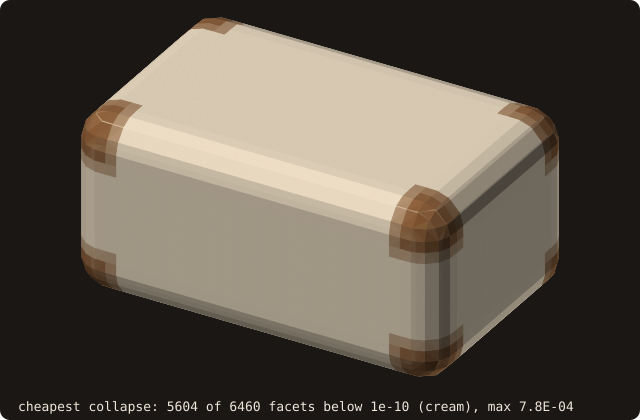
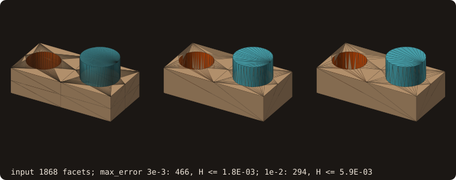

# Mesh decimation (QEM)

## What it does

Reduces the number of triangles in a surface while preserving its
overall shape. Iteratively collapses the edge that introduces the
smallest geometric error, as measured by the **quadric error metric**
(Garland & Heckbert 1997).

Complementary to [isotropic remeshing](/guide/advanced/isotropic-remesh):
decimation reduces facet *count* and is shape-preserving (silhouette
priority); isotropic remeshing equalizes edge *length* without
changing the count. Reach for decimation when "this 2 M-facet STL
needs to fit in 100 k facets for cut-cell tagging." Reach for remesh
when "the tessellation is irregular and tripping AABB query balance."

A rounded box (half-sides 0.8, 0.45, 0.3, corner radius 0.15) by marching
cubes, 6460 facets, decimated to a sixteenth: 402 facets, the volume
1.971 to the printed digits. The flat faces are left with a few large
triangles; the rounded edges and corners keep the small ones:

{.fossil-figure}

## Pipeline

1. **Per-vertex 4×4 quadrics**. For each vertex, accumulate
   $Q_v = \sum_{p \in \text{incident planes}} K_p$ where $K_p = p\,p^T$
   for plane equation $p = (a, b, c, d)$ with normal $(a,b,c)$ and
   offset $d$. The quadric measures squared distance to all incident
   facet planes.
2. **Per-edge optimal collapse target**. For each edge $(u, v)$, the
   minimizer of $v^T (Q_u + Q_v) v$ is the optimal collapse position.
   3×3 Cramer's-rule solve; midpoint fallback if singular.
3. **Min-heap**, keyed on collapse cost. Decrease/increase-key
   supported (~80 LOC inline) so neighbour edges can have their costs
   re-evaluated after each collapse without rebuilding the heap.
4. **Iterative collapse** with **three safety checks** per candidate:
   - **Link condition** (Dey, Edelsbrunner, Guha, Nekhayev 1999): the
     edge $(a, b)$ collapses only if $\mathrm{Lk}(a) \cap \mathrm{Lk}(b) =
     \mathrm{Lk}(ab)$: the only common neighbours of $a$ and $b$ are the
     apexes of the edge's two facets, and no tetrahedron $(a, c, d)$,
     $(b, c, d)$ closes over it. On an open surface the links include a
     dummy vertex joined to the boundary, so two boundary vertices merge
     only along a boundary edge. A manifold stays a manifold of the same
     topology: no non-manifold edge, no pinched shell.
   - **Normal-flip rejection**: if any incident triangle's normal would
     flip, or the triangle would collapse to zero area, the collapse is
     skipped. A zero-area triangle puts two vertices at one place, which
     the rebuilt vertex pool merges into a pinch: on flat faces, where
     every collapse costs 0, this gave `cube-01.stl` decimated to 36
     facets 2 non-manifold edges and 2 shells with `DEC_STATUS_OK`.
   - **Degenerate-facet rejection**: if a surviving facet would get two
     equal vertices, skipped.
   When all remaining edges fail one of these checks, the algorithm
   returns `DEC_STATUS_NO_PROGRESS` with the smallest valid surface it
   reached.
5. **Patch rules** (see [Patches](#patches)): an edge that touches a
   patch rim has a constrained target. The heap holds the free
   optimum, a lower bound of the constrained cost, and an edge is
   re-costed when it reaches the top; on a surface with one patch
   nothing changes, bit for bit.
6. **Optional cost ceiling** `max_error` (see
   [A cost ceiling](#a-cost-ceiling)).

Stages 1 and 2 computed on the rounded box above (by the figure program,
from the facet planes and the vertex ids of the pool): each facet
coloured by its cheapest edge, the cost $\bar m^T (Q_u + Q_v) \bar m$ at
the edge midpoint. On 5604 of the 6460 facets it is below 1e-10: on the
flat faces, and along the cylindrical edges, where a collapse along the
axis moves no vertex off its planes. Only the corners, curved both ways,
cost up to 7.8e-4. The heap takes the cream edges first:

{.fossil-figure}

Decimated to targets halved one after the other (each a fresh call on the
input), the box loses its flat-face triangles first and the corners last;
the volume moves by 2e-14 down to 806 facets, by -1.1 % at 100:

{.fossil-figure}

## API

```fortran
call surface%decimate(target_facets, max_error, rim_collapses, status)
   class(surface_stl_object), intent(inout)         :: self
   integer(I4P),              intent(in)            :: target_facets
   real(R8P),                 intent(in),  optional :: max_error     ! cost ceiling, a distance
   logical,                   intent(in),  optional :: rim_collapses ! default .true.
   integer(I4P),              intent(out), optional :: status        ! DEC_STATUS_*
```

- **`target_facets`** is the **upper bound** on the output facet
  count. The algorithm collapses edges until it reaches this count or
  cannot safely collapse any more.
- **`status`**:
  - `DEC_STATUS_OK` — reached `target_facets`: the count is at or just
    below it (a collapse removes two facets, so an odd target can end
    one below: the dragon's 6588 / 4 = 1647 ends at 1646).
  - `DEC_STATUS_NO_PROGRESS` — couldn't reach the target; surface is
    at the smallest count the safety checks allowed, or the cheapest
    collapse exceeded `max_error`.
- **`max_error`** (optional, a distance): stop when the cheapest
  admissible collapse costs more than `max_error**2` (see
  [A cost ceiling](#a-cost-ceiling)). Absent: no ceiling.
- **`rim_collapses`** (optional, default `.true.`): patch rims coarsen
  along themselves; `.false.` locks them (see [Patches](#patches)).
  - `DEC_STATUS_BAD_INPUT` — the input surface has no facets, or
    `target_facets <= 0`; the surface is left untouched.

After return, `self`'s AABB tree, vertex pool, connectivity, and
pseudo-normals are all rebuilt — no further user action needed before
calling `distance`, `winding_number`, `boolean`, or any other query.

## Example

The cookbook's [Decimate a mesh](/manual/cookbook#decimate-a-mesh)
reduces the dragon once. Here the question is how far each level moves
the surface, on a body whose shape is known: a unit sphere by
[marching cubes](/guide/advanced/marching-cubes) (41³ samples of
[-1.5, 1.5]³, cleaned by `sanitize`):

<<< @/examples/snippets/ref_decimate-sphere.f90

Three levels, each a quarter of the previous, measured against the
input by the certified [Hausdorff distance](/guide/advanced/surface-deviation):

<<< @/examples/snippets/ref_decimate-levels.f90

<<< @/examples/output/ref_decimate.ansi{ansi}

- **Count.** Each level reaches its target with `DEC_STATUS_OK`. An odd
  target ends one below (103 asked, 102 given): a collapse removes two
  facets.
- **Distance.** The Hausdorff interval brackets the true distance to
  the input: 0.0033 to 0.0068 for a quarter of the facets, 0.0585 to
  0.0619 for 1/64. It grows about 4× per level, as the sagitta of a
  chord, $e^2/8$ for an edge $e$ on a unit sphere, does when the facet
  area quadruples.
- **Volume.** It drifts down level after level: 0.2 %, 1.1 % and
  4.5 % below the input's (see
  [Known limitations](#known-limitations)).
- **Topology.** Every level stays watertight and manifold: the link
  condition keeps the input's topology on any manifold input.

## Patches

Every facet keeps its [patch](/guide/advanced/patches). A vertex shared
by facets of two patches is on a *rim*, and the target of an edge that
touches a rim is constrained (issues #66, #81):

- **One end on a rim**: the collapse goes to the rim vertex, which
  stays where it is.
- **Both ends on a rim**: only along a rim edge (its two facets in
  different patches), to the cheaper of its two endpoints, so a rim
  coarsens as a curve whose vertices are a subset of the input rim's,
  bit for bit. A *corner*, a rim vertex with other than two rim edges
  (three or more patches meet there), never moves: an edge from a
  corner goes to the corner, and two corners never merge. Any other
  edge between two rim vertices is not collapsed, nor is the last
  facet of a patch.
- **Constraint planes**: each rim edge adds to the quadrics of its two
  ends the plane through it perpendicular to the mean normal of its
  facets (the boundary constraint of Garland & Heckbert), so a rim
  lying in a plane is not straightened for free.

`rim_collapses=.false.` locks the rims instead (the rule before #81):
two rim vertices never merge, and the rim vertices are the input ones
exactly.

The bracket of [tutorial 12](/manual/tutorial/12-geometry) built with
128-sided prisms (1868 facets, three rims of 128 vertices), each frame a
fresh call on the input. To 1000, 600 and 300 facets it reaches the
target with `DEC_STATUS_OK` and moves the volume by -6.0e-6, 2.2e-5
and 2.4e-4; the rims thin out along the prisms. With the rims locked,
asked for 600, it stops at 1580 facets with `DEC_STATUS_NO_PROGRESS`
and 42 % of the volume gone: once the cheap collapses are spent, the
loop takes costly ones (the box sheared along its edges) until none
passes the checks. With `max_error = 1e-2` it stops at 294 facets:

{.fossil-figure}

The validation `fossil_val_decimate_bracket` asserts it: OK, valid,
the patches kept and every output rim vertex an input one, |dV/V| ≤
1e-4; the regression `fossil_test_decimate_rims` takes `cube-01` with
a patch per face to the 12-facet cube (8 corners kept, before:
`NO_PROGRESS` at 36) and a 64-gon prism with three patches, every
vertex on a rim, to 64 facets (before: no collapse at all).

## A cost ceiling

The cost of a collapse is the sum of the squared distances of the new
vertex to the planes it carries (unit normals, weight 1): the facet
planes merged into its two ends and the constraint planes. With
`max_error`, the loop stops with `DEC_STATUS_NO_PROGRESS` when the
cheapest admissible collapse has $\sqrt{\text{cost}} > $ `max_error`:
no new vertex lies farther than `max_error` from any of those planes.
With `max_error`, the open edges of the input (one facet) get
constraint planes too (through the edge, perpendicular to its facet):
without them a vertex of an open edge slides along its plane for free
(the NACA 0012 wing, asked for 1e-3 of its diagonal, had a tip vertex
moved 1.65 along the span; now its Hausdorff distance is 1.03e-3 for a
max_error of 1.42e-3). Without `max_error`, open edges stay
unconstrained, as before.

It is a bound on planes, not on the surface: see
[Known limitations](#known-limitations). The certified
[Hausdorff distance](/guide/advanced/surface-deviation) measured below
`max_error` on closed bodies:

| Body | `max_error` | Facets | Certified Hausdorff ≤ |
| --- | --- | --- | --- |
| bracket (1868 facets) | 3e-3, 1e-2 | 458, 294 | 1.8e-3, 6.3e-3 |
| 64-gon prism, 3 patches (252) | 2e-2 | 102 | 1.26e-2 |
| marching-cubes sphere, 32³ (2252) | 1e-3, 3e-3, 1e-2, 3e-2 | 1804, 1604, 1260, 664 | 6.6e-4, 2.2e-3, 4.4e-3, 1.7e-2 |

The bracket and its decimations with `max_error = 3e-3` and `1e-2` (target 4: as few facets as the
ceiling allows), the Hausdorff distances certified to a quarter of `max_error`:

{.fossil-figure}

The cookbook's [Decimate to a tolerance](/manual/cookbook#decimate-to-a-tolerance)
decimates the wing to 0.1 % of its diagonal and checks the result.

## Visual reference

The example's bunny (69 451 facets) is too heavy for a figure; the
same call on the dragon (`dragon.stl`), 6588 facets as loaded:

{.fossil-figure}

After `decimate(target_facets=n0 / 4)` (1646 facets, from the same
camera):

{.fossil-figure}

The silhouette is preserved; per-facet area roughly quadruples (each
remaining facet covers roughly 4× the area of an original). The
thin features (horns, claws, the tail's crest) are preserved because
those regions have high quadric error per edge, so the heap keeps them
out of the collapse queue until the budget forces it; the smooth body
takes most of the collapses.

## Known limitations

These are the **documented gaps** from §1.3's implementation issue,
deliberately surfaced here so the user knows what they're getting:

- **No tie-breaking heuristic.** On perfectly flat inputs (a flat
  cube face, an axis-aligned rectangle) every edge has cost ≈ 0 and
  the algorithm picks arbitrarily among the valid collapses.
  `cube-01.stl` (48 facets) decimated to 36 facets stays watertight,
  manifold and one shell with the unit volume; asked for 4 facets, it
  ends at a tetrahedron of volume 0.158.
- **No cost ceiling by default.** Without `max_error` the loop
  collapses the cheapest edge until the target is met or no edge
  passes the checks, whatever the cost: a target too low for the shape
  is met by distorting it (the bracket with locked rims above, 42 % of
  its volume gone). Pass `max_error`, or compare the volume before and
  after.
- **`max_error` is not a certificate.** It bounds the distance of each
  new vertex from the input planes it carries, not from the input
  surface, and says nothing of the input points a collapse leaves
  behind (a small spike flattened costs little against its own
  planes). On the closed bodies of [A cost ceiling](#a-cost-ceiling)
  the certified Hausdorff distance stays below it; on `bunny.stl` at
  1e-3 of its diagonal (2.5e-4) the input lies up to 3.1e-4 to 3.7e-4
  from the result, on `dragon.stl` at 2.67e-2 up to 0.11 (the result
  lies within 2.2e-2 to 2.8e-2 of the input). Check with `hausdorff`
  when the bound matters.
- **No volume-preservation term.** Collapses pull vertices inward,
  so volume drifts down monotonically with iteration. The
  marching-cubes sphere of the [Example](#example) (6632 facets)
  decimated to 1/4, 1/16 and 1/64 of its facets loses 0.2 %, 1.1 % and
  4.5 % of its volume. Lindstrom-Turk 1998 adds a volume-
  preservation Lagrange multiplier; deferred.
- **No boundary preservation by default.** Edges on a mesh boundary
  (open shells) are treated like interior edges; the boundary moves
  during collapse (the link condition keeps it one loop per hole).
  With `max_error` they get constraint planes (see
  [A cost ceiling](#a-cost-ceiling)). Irrelevant for closed solids
  (the typical CFD case).

## See also

- [isotropic remeshing](/guide/advanced/isotropic-remesh) — the
  complementary primitive for tessellation regularity.
- [`surface%get_facets_number`](/guide/api/surface-stl-object) — read
  the count before/after decimation.
- [Constants](/guide/api/constants) — `DEC_STATUS_*`.

## References

- Garland & Heckbert, *Surface Simplification Using Quadric Error
  Metrics*, SIGGRAPH 1997. The reference algorithm.
- Dey, Edelsbrunner, Guha & Nekhayev, *Topology preserving edge
  contraction*, Publ. Inst. Math. (Beograd) 66, 1999. The link
  condition.
- Lindstrom & Turk, *Fast and memory efficient polygonal
  simplification*, IEEE Visualization 1998. Adds the volume-
  preservation term that addresses the documented sphere drift.
- Hoppe, *New quadric metric for simplifying meshes with appearance
  attributes*, IEEE Visualization 1999. Generalization to colored
  meshes; not relevant to FOSSIL's per-vertex-coordinate-only API.
