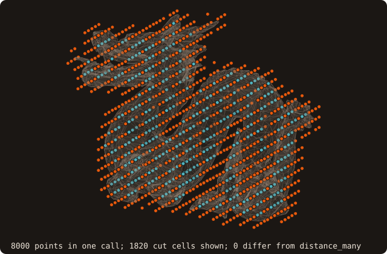
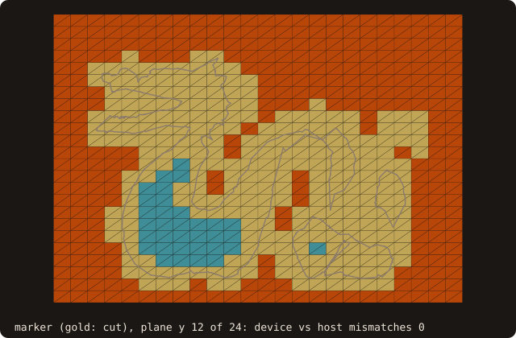

# GPU-offloaded distance queries

::: warning Scope: SAH BVH only, two sign algorithms
The device path runs **only on surfaces built with the SAH BVH**
(`AABB_TREE_SAH_BVH`, the default tree kind). An octree-backed surface
(`AABB_TREE_OCTREE`) stays CPU-only: `enter_device` refuses it with a
stderr diagnostic and leaves the surface on the host. Two signs run on the
device: the Bærentzen–Aanæs pseudo-normal (`SIGN_PSEUDO_NORMAL`, the
default) and the fast winding number (`SIGN_FAST_WINDING_NUMBER`). The
ray-cast and solid-angle signs have no device port, and the call refuses
them. The reasons, and what an octree port would cost, are under
[Known limitations](#known-limitations).
:::

## What it does

`distance_many_device` is the GPU version of `distance_many`, the batch
query that returns one distance per point against a static surface. It is
the access pattern of an immersed-boundary (IB) marker pass on a Cartesian
grid, where every cell centre needs its signed distance to the body to
decide whether the cell is inside, outside, or cut by the surface. The loop
over query points is an OpenACC `parallel loop`, one GPU thread per point,
and each thread runs the same best-first BVH traversal and sign test as the
CPU path.

The sign test is either the pseudo-normal at the closest point (the
default, cheap, exact on closed outward surfaces) or the fast winding
number (robust on surfaces with holes and gaps, at a higher cost; see
[Performance](#performance)).

The surface's search structures (the flat BVH node array, the flat
triangle payload, the per-facet pseudo-normals and the per-node winding
number cache) are copied to the GPU **once**, by `enter_device`, and stay there for as many query calls as the
caller makes. Each `distance_many_device` call moves only the query points
in and the distances out.

The results are **bit-exact** against the serial CPU path on every case
validated so far (nvfortran 26.9, RTX 4070, see [Performance](#performance)).

{.fossil-figure}

One call signs the 8000 cell centres of a 20³ block around the open dragon. The 1820 within half a cell diagonal of
the surface are the cut cells (603 of them inside); 0 distances differ from those of `distance_many`. Built with
gfortran, as here, the device loop runs on the host (see the [Example](#example)). The figure is drawn by
`docs/examples/src/fig_ref_device_distance_batch.f90`.

## Pipeline

1. **Residency** (`enter_device`, once per surface). `!$acc enter data
   copyin` of four flat arrays, all built by `analyze`:
   - the BVH nodes (`aabb%node`);
   - the triangle metrics (`aabb%payload`);
   - the per-facet pseudo-normals (`pnormal_payload`, 7 vectors per facet);
   - the per-node winding-number cache (`wn_payload`: dipole, second
     moment, expansion centre and size of each node).

   Only those member arrays are mapped, never the `surface_stl_object`
   itself.
2. **Launch** (`distance_many_device`, per batch). A host-side check refuses
   the call if the surface is not resident or the sign algorithm has no
   device port; then one `parallel loop` over the points, with
   `present(...)` on the four arrays, `copyin(points)` and
   `copyout(distances)`.
3. **Traversal** (per thread). `bvh_distance_node_with_region_oac`: the
   same best-first descent with d² pruning as on the CPU, written with an
   explicit stack instead of recursion (recursion inside an `!$acc routine`
   costs per-thread call stacks). It returns the best d², the winning facet
   and its payload index.
4. **Sign** (per thread, only with `is_signed=.true.`). The closest point and
   its Voronoi region (face, edge or vertex) on the winning triangle are
   recomputed, then:
   - `SIGN_PSEUDO_NORMAL`: take the matching pseudo-normal from
     `pnormal_payload` and sign the distance by its dot product with
     `point - closest`;
   - `SIGN_FAST_WINDING_NUMBER`: a second traversal,
     `bvh_winding_number_oac`, sums the solid angle of the surface over the
     BVH. A far node counts by its second-order expansion from
     `wn_payload`, a near leaf by the exact solid angles of its triangles.
     The point is inside when the winding number exceeds 0.5. It is the
     routine the CPU path calls, with the same constants (β = 2).
5. **Release** (`exit_device`, once). `!$acc exit data delete` of the four
   arrays.

{.fossil-figure}

Step 4 on 64 points above a corner of the unit cube, through `query_many_device`, which runs the same loop body and
also returns the region: 16 closest points lie in the top face, 32 on an edge, 16 at the vertex. Each region has its
own pseudo-normal (red for the edges and the vertex; a face's is its normal), and the sign is that of its dot
product with `point - closest`.

## API

### Make the surface resident

```fortran
call surface%enter_device()
   class(surface_stl_object), intent(inout) :: self
```

Call it after the surface is final: after `load_from_file`, `sanitize` and
any transform. The call is idempotent (a second call is a no-op) and returns
without acting on an empty surface. On an octree surface it writes
`enter_device: refused -- device path requires AABB_TREE_SAH_BVH.` to
stderr; a later `distance_many_device` then refuses too (see below).

### Query

```fortran
call surface%distance_many_device(points, distances, is_signed, sign_algorithm, is_square_root, status)
   class(surface_stl_object), intent(inout), target   :: self
   type(vector_R8P),          intent(in)              :: points(:)
   real(R8P),                 intent(out)             :: distances(:)  ! caller-allocated, size(points)
   logical,                   intent(in),  optional   :: is_signed       ! default .false.
   integer(I4P),              intent(in),  optional   :: sign_algorithm  ! SIGN_PSEUDO_NORMAL (default) or SIGN_FAST_WINDING_NUMBER
   logical,                   intent(in),  optional   :: is_square_root  ! default .false. (d²)
   integer(I4P),              intent(out), optional   :: status          ! STATUS_OK / STATUS_INVALID_INPUT
```

The arguments mirror `distance_many`, so a caller switches between host
and device by changing the call name. As for `distance_many`, the default
result is the **squared** distance; pass `is_square_root=.true.` for the
Euclidean one.

Choosing the sign:

- `SIGN_PSEUDO_NORMAL` (default) is the cheap one, and exact on closed
  surfaces with consistently outward normals: call `sanitize` first.
- `SIGN_FAST_WINDING_NUMBER` is the one to use on surfaces that are not
  closed (holes, gaps, missing facets): the winding number degrades
  gracefully where the pseudo-normal is undefined. On the GPU it costs 3.5
  to 10 times the pseudo-normal query (see [Performance](#performance)).

{.fossil-figure}

On the open dragon of the [example](#example) the two device signs differ at 129 of the 13824 cell centres, with
the same magnitudes: the pseudo-normal of a facet next to a hole points the wrong way for some far points. The
figure shows the plane where they differ most.

`status = STATUS_INVALID_INPUT`, with `distances` left untouched, when:

- `size(distances) /= size(points)`;
- the surface is not resident (the call also writes `surface not on
  device -- call enter_device first.` to stderr);
- `sign_algorithm` is neither of the two above (the call writes `refused
  -- sign_algorithm must be SIGN_PSEUDO_NORMAL or SIGN_FAST_WINDING_NUMBER
  on the device.` to stderr). `distance_many` on the CPU accepts all four
  sign algorithms.

### Release

```fortran
call surface%exit_device()
   class(surface_stl_object), intent(inout) :: self
```

Idempotent. **`destroy` does not call it**: `destroy` is `elemental`, and
`!$acc exit data` is not allowed in an `elemental` procedure. Call
`exit_device` yourself before the surface is destroyed or goes out of scope,
otherwise the device allocations stay registered against host addresses that
no longer exist.

### Building

The device code is compiled only by nvfortran with `-acc`, through the
`static-nvidia` mode (library) or `tests-nvidia` mode (the distance
benchmark):

```bash
fobis build --mode static-nvidia --varset local_nvf
```

The `local_nvf` varset sets the GPU compute capability (`$NVF_CC`, default
`cc89`; use `cc80` for A100). nvfortran **26.9 or newer** is required. See
[Installation](/guide/installation).

Under every other build (gfortran, Intel) the OpenACC directives are inert
comments: the three procedures still exist, `enter_device` only sets the
residency flag, and `distance_many_device` runs its loop **serially on the
host** with the same results. Code written against the device API therefore
builds and runs everywhere, and only goes faster where nvfortran is used.

## Example

An IB marker pass: the cell centres of a 24³ block around the dragon (its box grown by 10 %), classified inside,
outside or cut (the surface within half a cell diagonal), with one device call for the whole block. The dragon has
holes, so the sign is the winding number; the pseudo-normal is run too, to compare. The
[GPU tutorial chapter](/manual/tutorial/16-gpu) runs the same check on the repaired dragon; here the surface is
open, and the second part shows the calls the device path refuses.

<<< @/examples/snippets/ref_device_distance-marker.f90

<<< @/examples/snippets/ref_device_distance-refusals.f90

<<< @/examples/output/ref_device_distance.ansi{ansi}

{.fossil-figure}

- The docs are built with gfortran: `enter_device` only sets the residency flag and `distance_many_device` runs its
  loop on the host. The program is the one that runs on the GPU when built with nvfortran (`static-nvidia`).
- `enter_device` once, two batches (winding number, pseudo-normal), `exit_device` before anything else touches the
  surface. Of the 13824 cells, 404 are inside, 2714 cut and 10706 outside.
- `device vs host ... mismatches 0`: `distance_many` with the same sign gives the same bits.
- The two signs disagree at 129 cells, the magnitudes nowhere: the distance does not depend on the sign algorithm,
  and on an open surface the pseudo-normal is not the one to trust (see [Choosing the sign](#query)).
- Each refusal returns `status = STATUS_INVALID_INPUT`: a surface not entered, a sign without a device port
  (`SIGN_SOLID_ANGLE`), `size(distances) /= size(points)`, and an octree surface, which `enter_device` refuses, so
  the query after it finds the surface not resident. All but the size mismatch also write one line to stderr,
  shown in the output above.
- The block stays resident across calls in a real marker pass (one call per AMR block or per time step on a moving
  grid); `enter_device` is paid once.

## Performance

Measured with `fossil_test_distance_bench` (`tests-nvidia`, nvfortran 26.9,
NVIDIA RTX 4070, `cc89`), signed Euclidean distance, query points on an
N³ grid. Baseline: the serial CPU loop on **one core**.

| Mesh | Query grid | Speedup vs 1 CPU core | max \|d_device − d_cpu\| |
|---|---|---|---|
| bunny | 16³ | 3.05× | 0 |
| bunny | 32³ | ~8.8× (7.1–8.9× over 5 runs) | 0 |
| bunny | 48³ | 12.6× | 0 |
| cube-01 | 32³ | 4.77× | 0 |
| dragon-fine (24k facets) | 32³ | 8.6× | 0 |

How to read these numbers:

- The device time is **one call** with no warm-up: it includes the
  point/distance transfers and the launch, and excludes `enter_device`.
- The baseline is one core. Against `distance_many` built with OpenMP on a
  multi-core CPU the GPU margin is smaller, and on small batches it can
  vanish: the speedup grows with the number of query points because the
  fixed launch and transfer cost is amortized.
- The RTX 4070 is a consumer GPU, with an FP64 rate of 1/64 of FP32. The
  kernel is FP64 throughout, so a data-centre GPU (A100, H100) should do
  better. That has not been measured.

### Fast-winding-number sign

Same benchmark and hardware, `sign_algorithm=SIGN_FAST_WINDING_NUMBER`.
Times are the median of three single-shot runs; the serial baselines are
one CPU core.

| Mesh | Query grid | Serial PN | Device PN | Serial FWN | Device FWN | Device FWN vs serial FWN | max \|d_device − d_cpu\| |
|---|---|---|---|---|---|---|---|
| bunny | 32³ | 443 ms | 50 ms | 590 ms | 203 ms | 2.9× | 0 |
| bunny | 48³ | 1458 ms | 118 ms | 1960 ms | 412 ms | 4.8× | 0 |
| dragon-fine | 32³ | 234 ms | 30 ms | 590 ms | 310 ms | 1.9× | 0 |

Also bit-exact, with no sign mismatch, on bunny 16³, cube-01 32³ and a
holed cube (cube-02 with one facet removed).

The winding number gains far less from the GPU than the distance does.
Near the surface its traversal opens many nodes, and how many differs from
one point to the next, so the threads of a warp diverge; each node it reads
is a 136-byte record. On the GPU the FWN query costs 3.5 to 10 times the
pseudo-normal one, against 1.3 to 2.5 times on the CPU. Use it where the
surface is open; on a closed, sanitized surface the pseudo-normal gives
the same signs for a fraction of the cost.

### A moving-body time step

`fossil_val_device_chain` (issue #100; the manual mode `tests-nvidia-chain`) runs the time step of a moving-body
cut-cell solver.

**The chain, in order:**
1. **Move** the body to its new pose.
2. **Tag** one box per cell with `box_classify_many(_device)`.
3. **Cut** the cells and compute their piece links: `cut_cells_3d(_device)(..., links=)`, or in 2-D
   `cut_cells(_device)` with `cut_links_2d(_device)`.
4. **Sweep:** the swept geometry between the two poses (`swept_cells_3d(_device)` / `swept_cells_2d(_device)`).
5. **Map** (issue #105, Gauss motion only): the same swept call with `map=`, the
   [piece map](/guide/advanced/moving-bodies#piece-map) of the step.

**Three modes:**
- the CPU;
- the device with every output copied back;
- the device with the cut and the links left resident.

At every step each device output equals the CPU's bit for bit (`device chain vs serial mismatches: 0`), the map
included (every field of `piece_map_3d_t` / `piece_map_2d_t`), and the swept geometry of the call with `map=` equals
that of the call without.

The map has its own GPU bench lines, which must be 0: `piece map 3-D device vs serial mismatches` in
`fossil_test_distance_bench` (sphere and cone at 32³: exact translation, exact rotation, Gauss, Gauss + `refine`) and
`piece map 2-D device vs serial mismatches` in `fossil_test_curve_bench` (ellipse: translation, Gauss, Gauss +
`refine`; NACA 0012 rotating).

Measured on an RTX 4070 (`full` run, 3 steps; the step-0 sizes of issue #100). Times are seconds per step, the best of 3. The swept
geometry is Gauss-Legendre nq = 4 under a rotation of 2° plus a translation per step, unless the motion says
"translation" (the exact path):

| body | cells | motion | CPU | copied back | resident | speed-up |
|---|---|---|---|---|---|---|
| sphere (marching cubes) | 32³ | Gauss | 1.21 | 0.317 | 0.312 | 3.8–3.9× |
| sphere | 64³ | Gauss | 6.42 | 1.10 | 1.09 | 5.8–5.9× |
| sphere | 128³ | Gauss | 50.9 | 5.67 | 5.49 | 9.0–9.3× |
| cone | 32³ | Gauss | 0.354 | 0.193 | 0.192 | 1.8× |
| cone | 64³ | Gauss | 2.07 | 0.381 | 0.365 | 5.4–5.7× |
| cone | 128³ | Gauss | 15.1 | 2.29 | 2.16 | 6.6–7.0× |
| sphere | 32³ | translation | 5.92 | 3.18 | 3.24 | 1.8–1.9× |
| cone | 32³ | translation | 1.18 | 0.383 | 0.417 | 2.8–3.1× |
| ellipse (2-D) | 256² | Gauss | 0.326 | 0.379 | 0.368 | 0.86–0.89× |
| NACA 0012 (2-D) | 256² | Gauss | 0.303 | 0.360 | 0.346 | 0.84–0.88× |
| ellipse (2-D) | 1024² | Gauss | 5.07 | 5.04 | 5.04 | 1.01× |
| NACA 0012 (2-D) | 1024² | Gauss | 4.74 | 4.68 | 4.68 | 1.01× |

How to read these numbers:

- **In 3-D on the CPU** the swept geometry is 74–84 % of the cone's step. On the marching-cubes sphere the tags take
  41–72 % (36.9 of 50.9 s at 128³: a winding-number sign at two million box centres on a dense mesh) and the swept
  geometry 23–55 %.
- **On the device:**
  - **The swept geometry** is 37–85 % of the step at 64³–128³. It is bound by the host sections and walks of its
    batched launch ([moving bodies](/guide/advanced/moving-bodies#on-the-device)).
  - **The tags** come next: 3.3 s for the sphere at 128³. Each call uploads the cell boxes, about 100 MB at 128³.
  - **Cut + links** is 3–18 % of the step. Keeping it resident saves 0.15–0.18 s per step at 128³ (sphere 0.33 →
    0.15 s); the other stages are the same in both device modes.
- **In 2-D there is no gain.** The swept faces are host algorithms and 82–96 % of the step. Resident cut + links is
  12× the CPU at 1024² (9.3 against 113 ms), but under 1 % of the step. The device tags are slower than the host's:
  the curve kernel takes a full signed distance at every box centre not cut, and the boxes are uploaded every call.
- **The exact translation** is bound by the host work of the swept geometry: 1.8–3.1× at 32³.
- **Double work in the chain:** the swept routines recompute the cut cells at both end poses, which the chain already
  has (alpha0 and alpha1 equal the cut alphas bit for bit).

**With the map.** The default run (the gate: 3 steps in 3-D, 5 in 2-D, Gauss motion) times the map at 32³ and 256²;
`full` times it at every size. Both swept calls, without and with `map=`, run in every step, so the map column is the
median over the repetitions of their difference (paired: the same steps), with the spread of those differences (twice
their median absolute deviation); a median not above its spread is printed `unresolved` (see
[how the map is timed](/guide/advanced/moving-bodies#the-map-on-the-device)). On the device the call with `map=` also
cuts the end poses in full in 3-D, and on the host in 2-D. The step is move + tag + cut + links + the swept call with
`map=`. Seconds per step, 3 repetitions (the other columns are the best), RTX 4070 and CPU shared with other jobs:
indicative. The 3-D rows come from a run that timed the map at every size, the 2-D rows from the default run; the map
on the device is the copied-back mode (the map has no resident form), and the 2-D speed-up is the copied-back step's.

| body | cells | swept, CPU | map, CPU | map, device | step, CPU | step, copied back | step, resident | speed-up |
|---|---|---|---|---|---|---|---|---|
| sphere (marching cubes) | 32³ | 0.667 | 0.327 | 0.168 | 1.56 | 0.484 | 0.482 | 3.2× |
| sphere | 64³ | 2.14 | unresolved | 0.578 | 7.57 | 1.68 | 1.65 | 4.6× |
| cone | 32³ | 0.301 | 0.643 | 0.556 | 0.995 | 0.655 | 0.682 | 1.5× |
| cone | 64³ | 1.52 | 5.54 | 3.89 | 6.55 | 4.27 | 4.30 | 1.5× |
| ellipse (2-D) | 256² | 0.320 | 0.053 | 0.083 | 0.392 | 0.469 | – | 0.84× |
| NACA 0012 (2-D) | 256² | 0.313 | 0.109 | 0.141 | 0.437 | 0.454 | – | 0.96× |

- **The map is the largest device stage of the cone's step:** 85–91 % of it, against 34–35 % on the sphere. Its
  device passes are a small part: the plan stays on the host (candidates, events, poses, Gauss nodes; the events of the
  rotation were 24–85 % of the host map on this path when measured for issue #105), so the device map is 1.2–1.9× the
  host's in 3-D (the sphere's host map at 64³ is not resolved: its paired differences spread by 2 s), and the cone's
  step with the map gains 1.5× where it gained 1.8–5.7× without.
- **In 2-D** the map is 14–25 % of the CPU step and slower on the device (0.64–0.77×): about a thousand of 65,536
  cells are evaluated per step, too few to pay for the copies.
- **What remains:** the host plan on the 3-D Gauss path ([the map on the device](/guide/advanced/moving-bodies#the-map-on-the-device)).

### Surface deviation

`surface%deviation(other, ..., device=.true.)` (issue #60) runs its batched closest-point queries through
`query_many_device` on `other`, entered with `enter_device`: certified Hausdorff bounds bit-identical to the CPU, the
branch and bound on the host. See [surface deviation](/guide/advanced/surface-deviation#on-the-device).

## Known limitations

- **SAH BVH only.** The octree is not supported on the device. The original
  obstacle is gone: the octree allocates all 8 child slots per level but
  populates only the refined ones, and the "empty slot, skip it" signal used
  to be `allocated(node%aabb) == .false.`. Making the node device-mappable
  stored the AABB by value, so that signal is now an explicit
  `is_present` flag on `aabb_node_object` (`is_allocated()` returns it, and
  every octree call site reads it unchanged).

  **What an octree port still needs:**
  1. A flat payload for octree leaves. BVH leaves own a contiguous slice of
     the `facet_distance_payload` array (`payload_first` / `payload_count`);
     octree leaves have `payload_count = 0` and keep their facet ids in an
     allocatable `list_id_object`, which is not mapped to the device.
  2. A device traversal over 8 implicit children
     (`first_child = 8 * parent + 1`, skipping slots with `is_present`
     false) next to the 2-child BVH one.
  3. `enter_device` accepting `AABB_TREE_OCTREE`, and the benchmark gate
     run on an octree surface.

  The work is left out on purpose: the octree is opt-in, the default is the
  BVH, and on dragon-fine the octree is about 110× slower than the BVH even
  on the CPU, so a device octree would have no user.
- **Two sign algorithms.** `SIGN_RAY_INTERSECTIONS` and
  `SIGN_SOLID_ANGLE` have no device port: the first needs a ray traversal,
  the second is an O(N) sum per point that the fast winding number
  supersedes. The pseudo-normal sign needs consistently outward normals:
  call `sanitize` before `enter_device`. The fast winding number does not,
  but it is approximate far from the surface (β = 2, the CPU default; not
  adjustable on the device). Its measured error at β = 2 is at most
  8.7e-3 (bunny), so it can flip a sign only where the exact winding number
  is within that margin of 0.5: on the surface itself, or across a hole.
- **Distances only.** `compute_distance`'s richer outputs (closest facet,
  edge, vertex), ray queries and the winding-number value itself have no
  device version: the winding number is used only for the sign.
- **No automatic coherence.** The device copy is a snapshot taken by
  `enter_device`, and nothing checks that it is still current. Operations
  that rebuild the tree (`analyze` and the procedures that call it:
  `sanitize`, `clip`, `merge_solids`, `adopt_facets`, `load_from_file`)
  reallocate the host arrays behind the device mapping. The transforms
  (`translate`, `rotate`, `mirror`, `resize`) do not rebuild the tree at
  all, so after them the tree is stale on the host as well, until `analyze`
  runs. In both cases: `exit_device`, change the surface, `analyze` if
  needed, `enter_device` again.
- **`destroy` does not release the device copy** (see
  [Release](#release)).
- **Bounded tree depth.** The traversal uses a fixed stack of 128 entries
  (`MAX_TRAVERSAL_STACK`), and a binary BVH of depth D needs D + 1 of them.
  The SAH builder therefore stops splitting at depth 127 and makes the rest
  of that subtree one leaf. Real meshes never get near it (12 levels on
  bunny, 13 on dragon-fine): reaching it takes facet sizes spread over
  roughly 600 binary orders of magnitude. A mesh that does reach it stays
  exact, only slower on the capped subtree. The CPU path shares the
  traversal and the cap.
- **Validated on one GPU.** Bit-exactness and the timings above come from
  one consumer GPU (RTX 4070) with nvfortran 26.9. Bit-exactness means
  against the CPU path of the same nvfortran build; a gfortran build of
  the CPU path is not compared bit for bit. The device build is not
  part of CI (no GPU runner): it is validated manually with
  `fossil_test_distance_bench`, which fails unless the device result
  matches the serial CPU result bit for bit.
- **No FMA contraction.** The NVIDIA modes compile with `-gpu=nofma -Mnofma`:
  host and device contract multiply-adds differently, and with contraction
  the device distances moved by 1 ulp, which flipped signs and closest-facet
  ids at near-ties (1504 of the sign benchmark's queries; nvfortran 26.9,
  2026-11-04). Without it every device check is bit-exact again; the
  device kernels are 15-30 % slower than the timings above, which were
  measured with contraction on (dragon-fine 32³: distance 29.9 → 35.9 ms,
  FWN 299 → 390 ms). A new kernel stays bit-exact only if it uses no
  operation the two sides round differently.

## See also

- [Distance and point-in-polyhedron queries](/guide/features#distance-and-point-in-polyhedron-queries):
  the CPU `distance` / `distance_many` API and the sign algorithms.
- [AABB acceleration](/guide/features#aabb-acceleration): the BVH and octree tree kinds.
- [Installation](/guide/installation): the `static-nvidia` / `tests-nvidia`
  modes and the nvfortran version requirement.
- [Generalized winding number](/guide/advanced/winding-number): the CPU
  winding number and its error at β = 2.
- [Issue #20](https://github.com/szaghi/FOSSIL/issues/20): the
  implementation plan, the device-code rules and the validation history.
- [Issue #30](https://github.com/szaghi/FOSSIL/issues/30): the
  fast-winding-number sign on the device.

## References

- Bærentzen & Aanæs, *Signed Distance Computation Using the Angle Weighted
  Pseudonormal*, IEEE TVCG 11(3), 2005. The sign test.
- Barill, Dickson, Schmidt, Levin & Jacobson, *Fast Winding Numbers for
  Soups and Clouds*, ACM TOG 37(4), 2018. The hierarchical winding number.
- Wald, *On Fast Construction of SAH-based Bounding Volume Hierarchies*,
  IEEE Symposium on Interactive Ray Tracing, 2007. The bucketed SAH build.
- OpenACC-Standard.org, *The OpenACC Application Programming Interface*,
  version 3.4, 2025. Data clauses (§2.6–2.7) and `routine` (§2.15).
