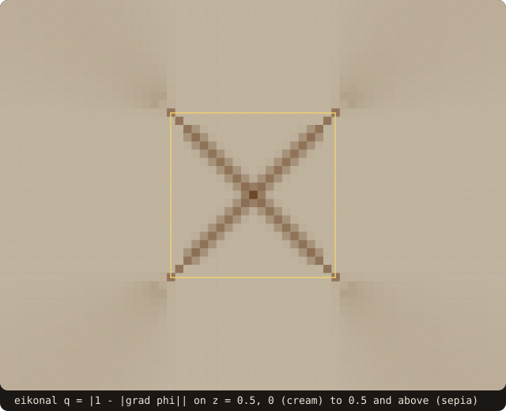

# Signed-distance field

## What it does

`distance_field_object` computes the signed distance from every point of a
rectilinear grid to a surface: the level-set field an immersed-boundary (IB)
solver needs to tell solid cells from fluid cells, or a turbulence model
needs as wall distance. The grid is given by three strictly increasing 1D
coordinate arrays, so it may be stretched along each axis, as far-field
grids usually are.

Computing the exact distance at every cell is wasteful far from the body,
where nothing needs the last digit. The field is built in three stages:

- **exact** distances in a narrow band around the surface;
- **signs** outside the band by a flood fill that the band cannot leak
  through;
- **magnitudes** outside the band by the Fast Sweeping Method, which solves
  |∇φ| = 1 from the band outward.

Every cell ends up holding a distance, including the far field of a
stretched grid. `fossil_ib_generator` is built on it.

{.fossil-figure}

On the torus the band holds 12804 of the 50653 nodes; the flood fill signs the rest with no point query, and 24
directional sweeps fill the magnitudes out to the stretched far field.

In 2-D, `initialize(x, y)` without `z` makes a field for a
[`curve_object`](/guide/advanced/2d-geometry): `compute(curve=...)` runs the
same three stages (4-connected flood fill, 4 sweep directions). A quadtree
block that does not see the curve gets an empty band and one point query.

With `store_closest=.true.` the band batch runs through `query_many` and the
field keeps `closest`, `closest_id` and `closest_normal` on band cells: a
[vector level set](/guide/advanced/ib-queries), exact image points without ∇φ.

## Pipeline

1. **Band** (`compute_band`). The candidates are found by rasterizing each
   facet's bounding box, inflated by the band width, onto the index space,
   with a binary search on the 1D coordinates, so stretched grids cost the
   same as uniform ones. One `surface%distance_many` batch (OpenMP when
   enabled) gives their exact signed distances, or one
   `surface%distance_many_device` batch with `use_device=.true.` (the point
   queries of the sign stage then run on the device too). The
   candidates with |d| ≤ band become band cells; the band values are
   bit-exact against a per-cell `surface%distance`.

   The default band is twice the largest grid spacing over the index box
   that covers the surface's bounding box. With it, both ends of every grid
   edge that crosses the surface are band cells, which is what the next
   stage needs. The far-field stretching does not widen it.
2. **Signs** (`compute_signs`). The non-band cells are split into
   6-connected components, and each component takes:
   - the sign of the band cells it touches, when they agree;
   - one point query, when it touches no band cell (a block that does not
     see the surface, a cavity thinner than the band);
   - one point query per cell, when it touches band cells of both signs.
     This happens when the surface has holes wider than the band: inside and
     outside are then one component.

   A band thinner than the largest spacing near the surface could leak
   across the surface while touching band cells of one sign only, so in
   that case every non-band cell gets a point query: correct, but at the
   cost of one distance query per cell.
3. **Far field** (`sweep`). The Fast Sweeping Method (Zhao 2005) with a
   Godunov upwind update that uses the non-uniform one-sided spacings of
   each axis; band cells stay fixed, magnitudes only decrease, signs are
   kept. Each of the 8 directional sweeps visits the hyperplanes
   i' + j' + k' = s in order (Detrixhe, Gibou & Min 2013): a cell's
   neighbours lie on the planes s − 1 and s + 1, so the cells of one plane
   are independent. They are updated in parallel with OpenMP, and the result
   is the serial one bit for bit, for any number of threads. The sweeps stop
   when a full cycle of 8 changes no magnitude by more than `tol` times the
   domain diagonal.

`compute` runs the three stages. Called one by one on a 2-D field (an L and a disc, 39 × 39 nodes, uniform spacing
0.125 then stretched by 1.3), each stage kept in a copy:

<<< @/examples/snippets/anim_ref_distance_field_sweeps-stages.f90

`sweep(max_sweeps=k)` stops after k directional sweeps, so a copy of the signed field swept with k = 1, 2, 3, 4
shows what each direction adds:

<<< @/examples/snippets/anim_ref_distance_field_sweeps-partial.f90

![a 2-D field of an L-shaped body and a disc on a stretched 39 by 39 grid, one frame per stage: compute_band gives 311 exact nodes along the two outlines and leaves the rest blank; compute_signs marks the 38 unknown nodes inside the L by dots; sweep 1 (x and y increasing) fills the nodes up and to the right of the band, 530 still unknown; sweep 2 (x decreasing) the left, 273 unknown; sweep 3 (y decreasing) the rest, the field then 1.06 off its converged values; sweep 4 brings it to 2.7e-5; converged after 12 sweeps](../../examples/images/anim-ref-distance-field-sweeps.svg){.fossil-figure}

<<< @/examples/output/anim-ref-distance-field-sweeps.ansi{ansi}

- Each directional sweep carries the information one way: a node is updated only from neighbours already known, so
  sweep 1 fills what lies up and to the right of the band, and the first three directions together reach every node.
- The values are not final when every node is known: after sweep 3 the field is still 1.06 off, where the first
  sweeps reached nodes along monotone paths longer than the straight line. The fourth direction brings it to 2.7e-5;
  the sweeps then stop at the end of the third cycle of 4, when no node changed by more than `tol` times the domain
  diagonal.

## API

```fortran
type(distance_field_object) :: field

call field%initialize(x, y, z, ng, status)
   real(R8P),    intent(in)            :: x(:), y(:), z(:) ! strictly increasing, halo included
   integer(I4P), intent(in),  optional :: ng               ! halo layers per side (default 0)
   integer(I4P), intent(out), optional :: status           ! STATUS_OK / STATUS_INVALID_INPUT

call field%compute(surface, band, is_signed, sign_algorithm, use_device, tol, max_sweeps, sweeps, fallback_cells, &
                   store_closest, status)
   type(surface_stl_object), intent(inout), target :: surface
   real(R8P),    intent(in),  optional :: band           ! default: 2 x the largest spacing near the surface
   logical,      intent(in),  optional :: is_signed      ! default .true.
   integer(I4P), intent(in),  optional :: sign_algorithm ! default SIGN_PSEUDO_NORMAL
   logical,      intent(in),  optional :: use_device     ! band batch on the GPU (default .false.)
   real(R8P),    intent(in),  optional :: tol            ! sweep tolerance, relative (default 1e-12)
   integer(I4P), intent(in),  optional :: max_sweeps     ! directional sweeps (default 400)
   integer(I4P), intent(out), optional :: sweeps         ! directional sweeps done
   integer(I4P), intent(out), optional :: fallback_cells ! cells signed by a point query
   logical,      intent(in),  optional :: store_closest  ! keep closest, closest_id, closest_normal on the band
   integer(I4P), intent(out), optional :: status
```

The stages are also callable one by one: `compute_band(surface, band,
is_signed, sign_algorithm, use_device, status)`, `compute_signs(surface,
fallback_cells, status)` and `sweep(tol, max_sweeps, sweeps, max_change,
status)`.

The result is the public array `field%phi(i, j, k)`, the signed distance of
the point `(x(i), y(j), z(k))`: negative inside, positive outside, as
`surface%distance`. `field%in_band` marks the band cells, whose values are
exact. Accessors: `get_dims`, `get_band_width`, `get_band_cells`,
`default_band(surface)`.

Notes on the arguments:

- The surface is `intent(inout), target` because of the device path, which
  makes it resident for the call (and releases it after, unless it was
  already resident).
- `use_device` accepts only the device sign algorithms
  (`SIGN_PSEUDO_NORMAL`, `SIGN_FAST_WINDING_NUMBER`); anything else returns
  `STATUS_INVALID_INPUT` with an empty band, rather than running silently on
  the host. See [GPU distance queries](/guide/advanced/device-distance).
- With `is_signed=.false.` the field is the unsigned distance and the sign
  stage does nothing.

### Blocks and halos

FOSSIL has no MPI. A solver with a block decomposition builds one field per
local block, with `ng` halo layers per side in the coordinate arrays. Halo
cells are never computed: `sweep` reads them as fixed neighbour values. The
caller fills them from the neighbouring blocks and sweeps again until the
global change is small:

```text
call field%compute(surface=body, ...)        ! band, signs, local sweeps
do
   exchange the ng halo layers of field%phi with the neighbours (MPI)
   call field%sweep(max_sweeps=8, max_change=change)
   global_change = MPI_Allreduce(change, MPI_MAX)
   if (global_change <= tol_abs) exit
enddo
```

On two blocks split along x, this reproduces the single-block field to
3e-14 in 4 exchanges (`fossil_test_distance_field_fsm`).

### From the command line

`fossil_ib_generator` writes the field of a Cartesian block (body-close grid,
frame, and extension cells growing by 1.1) as a VTK structured grid, and as
Xall `.grd` / `.ib` files when there are no extension cells. The written
field is positive inside the body (Xall convention).

```bash
fossil_ib_generator --stl body.stl --ni 128 --nj 128 --nk 128 --ei 20 20 \
                    --sign_algorithm pseudo_normal --band 0.01 --sweep_tol 1e-12 --out body
```

`--device` computes the band and the sign point queries on the GPU
(nvfortran build, sign `pseudo_normal` or `fast_winding_number`). On bunny
at 64³ with extension cells, the field takes 1.33 s with `--device` against
5.52 s on the host of the same nvfortran build, with byte-identical output.

## Example

The unit cube on a stretched grid, against the exact distance of a box. [Tutorial chapter
6](/manual/tutorial/06-distance-field) builds the field of the dragon, and the cookbook computes
[the field of a cube on a uniform grid](/manual/cookbook#compute-the-signed-distance-on-a-whole-grid); here the
exact answer is known everywhere, so the band, the swept far field, the stored closest points and the eikonal
diagnostic can each be checked.

<<< @/examples/snippets/ref_distance_field-grid.f90

- Each axis is a uniform core of spacing 0.05 around the cube and 12 nodes per side growing by 1.15, so the far nodes
  are 1.87 from the cube.

<<< @/examples/snippets/ref_distance_field-compute.f90

- `store_closest=.true.` keeps `closest`, `closest_id` and `closest_normal` on the band cells (the vector level set).
- `fallback_cells` counts the cells signed by their own point query; on a closed surface it is 0.

<<< @/examples/snippets/ref_distance_field-check.f90

<<< @/examples/snippets/ref_distance_field-eikonal.f90

- `gradient_diagnostic` returns q = |1 − |∇φ|| at every node (see
  [IB queries](/guide/advanced/ib-queries#wall-distance-and-field-diagnostic)), −1 where a neighbour is unknown;
  `flagged` counts the nodes with q above the threshold, 0.05 by default.

<<< @/examples/output/ref_distance_field.ansi{ansi}

- The band holds 11438 nodes within 0.1, twice the core spacing. Its values match the exact distance to 1.1e-16, and
  the stored closest points to 5.6e-17: the band is exact.
- Outside the band the sweeps (16, two cycles of 8 directions) give a far-field error of 0.178, below the largest
  spacing, 0.268.
- 6479 nodes have q > 0.05. 2395 of them are inside the cube, on its medial axis, where φ has a kink and q is large
  by nature; 980 are band nodes, where that medial axis meets the cube's edges and corners. The rest are outside the
  band, where the swept field is approximate (figures under [Accuracy](#accuracy)).

## Accuracy

The band values are exact. Outside the band, the error measured on the unit
cube on [−1, 2]³ (`fossil_test_distance_field_fsm`):

| Points per axis | h | Far-field max error | Mean error | Sweeps |
|---|---|---|---|---|
| 25 | 0.125 | 0.137 (1.10 h) | 0.046 | 16 |
| 49 | 0.0625 | 0.090 (1.44 h) | 0.030 | 16 |
| 97 | 0.03125 | 0.056 (1.80 h) | 0.019 | 16 |

The error goes like **h |log h|**, not h: the observed order is 1.03 and 1.00
against h |log h| for the two pairs, and 0.61 and 0.68 against h. This is
the Fast Sweeping Method's bound near point-like features (Zhao 2005): a
box's corners and edges are such features, and most of its exterior lies in
the fans they emit, so the mean error behaves the same way. On a 1.15-
stretched grid reaching 2.5 body lengths out, the far-field max error stays
below the largest spacing (0.23 against 0.35).

{.fossil-figure}

{.fossil-figure}

On the plane of the [example](#example) the error is 0 in the band and grows with the spacing, fastest along the
diagonal fans of the corners. The eikonal diagnostic picks out the medial axis inside, where |∇φ| is not 1 by
nature, and the same fans outside: mask the first with the band or the inside, and the second is where a wider band
pays.

## Performance

`fossil_ib_generator` on the body's bounding box with a 2-cell frame (n³
body-close cells), pseudo-normal sign, field time only (load and `sanitize`
excluded). The old generator computed the exact distance at every cell,
serially. Measured on a 16-thread WSL machine (gfortran 16.2, `-O2`) and an
RTX 4070 (nvfortran 26.9).

| Mesh | n³ | Exact per cell, 1 core | Field, 1 core | Field, OpenMP 16 threads | Field, GPU band + queries | Point-query cells | Max error |
|---|---|---|---|---|---|---|---|
| bunny (open) | 64 | 2.34 s | 3.01 s | 0.39 s | 1.10 s | 263 833 of 314 432 | 0.90 h |
| bunny (open) | 128 | 16.0 s | 20.1 s | 2.52 s | 5.50 s | 2 097 204 of 2 299 968 | 1.07 h |
| bunny, holes filled | 64 | 2.29 s | 0.68 s | | | 0 | 0.90 h |
| bunny, holes filled | 128 | 15.7 s | 4.48 s | | | 0 | 1.07 h |
| dragon-fine | 64 | 1.41 s | 1.96 s | 0.25 s | 0.84 s | 230 523 of 314 432 | |
| dragon-fine | 128 | 9.24 s | 13.4 s | 1.78 s | 4.74 s | 1 948 545 of 2 299 968 | 0.91 h |

How to read it:

- "Exact per cell" is the old generator (open rows) or one `distance_many`
  over every cell (filled rows): the cost of exact distances everywhere.
  "Max error" is the field against those exact values, in units of the
  grid spacing h; band cells match them to 1e-12.
- On a surface whose band separates inside from outside (bunny with its
  holes filled by `sanitize(fill_holes=.true.)`), the field costs about
  3.5 times less than exact distances on one core, and the gap grows with
  the share of cells far from the surface.
- On the open meshes as given, most cells are point queries (see
  [Known limitations](#known-limitations)), and the field on one core is
  slower than exact distances everywhere: it does the same queries plus
  the band and the sweeps. Its value there is the far field of
  extension cells, which the old generator did not compute, and the
  parallel paths. Filling the holes did not help dragon-fine, whose
  connectivity problem (it has non-manifold edges) is not a fillable hole.
- The GPU column comes from an nvfortran build, whose host path is slower
  than gfortran's (bunny 128³: 30.5 s on one core); the GPU field matches
  that host field bit for bit. Single runs, no warm-up.

## Known limitations

- **Far-field accuracy O(h |log h|).** See [Accuracy](#accuracy). Cells
  where the last digits matter belong in the band: widen it with `band`.
- **Open surfaces fall back to point queries.** On a surface with holes
  wider than the band (bunny and dragon-fine are both open), the inside and
  outside regions connect through the holes, the component touches band
  cells of both signs, and every cell in it is signed by its own point
  query. The result is correct for the chosen sign algorithm, but the cost
  approaches that of a per-cell query. Use `SIGN_FAST_WINDING_NUMBER` on
  such surfaces for robust signs, and `sanitize(fill_holes=.true.)` where
  the holes are defects.
- **The band must be thick enough.** A band thinner than the largest
  spacing near the surface makes every non-band cell a point query (see
  [Pipeline](#pipeline)). The default band avoids it.
- **The device covers the distance queries only.** `use_device` moves the
  exact-distance batch of the band and the point queries of the sign stage
  to the GPU; the flood fill and the sweeps run on the host.
- **Closest data on the band only.** `store_closest=.true.` keeps the
  closest point, facet and normal on band cells; swept cells hold
  `FAR_VALUE`, 0 and 0.
- **`block_object%extrapolate_distances` is deprecated.** It copies boundary
  values outward, which are not distances.

## See also

- [GPU distance queries](/guide/advanced/device-distance): the device batch
  behind `use_device`.
- [Generalized winding number](/guide/advanced/winding-number): the robust
  sign on open surfaces.
- [Hole filling](/guide/advanced/hole-filling): closing small holes before
  building the field.
- [Issue #32](https://github.com/szaghi/FOSSIL/issues/32): the implementation
  plan.

## References

- H. Zhao, *A fast sweeping method for Eikonal equations*, Mathematics of
  Computation 74(250), 2005. The method and its O(h |log h|) bound.
- M. Detrixhe, F. Gibou, C. Min, *A parallel fast sweeping method for the
  Eikonal equation*, Journal of Computational Physics 237, 2013. The
  hyperplane ordering.
- S. Osher, R. Fedkiw, *Level Set Methods and Dynamic Implicit Surfaces*,
  Springer, 2003. Narrow-band level sets.
