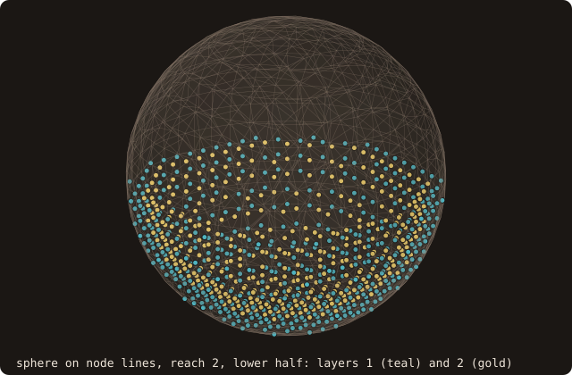

# Finite-difference wall closure

## What it does

A high-order finite-difference solver on a Cartesian or rectilinear block treats an immersed wall with a sharp
closure: image points, inverse Lax–Wendroff along grid lines, wall models. Every one of these closures starts from the
same set: the **ghost points**, the solid points that a fluid point's stencil reaches. FOSSIL finds them from the
geometry alone, on the solver's own point lines, with the exact inside/outside decisions of the
[cut cells](/guide/advanced/cut-cells), on the CPU or on the device.

| Query | 3-D (`surface_stl_object`) | 2-D (`curve_object`) |
|---|---|---|
| Ghost points of a block: indexes, coordinates, direction masks, steps to the fluid | `ghost_points_3d(surface, x, y, z, reach, gp)` | `ghost_points_2d(curve, x, y, reach, gp)` |
| The same on the device, bit for bit | `ghost_points_3d(..., device=.true.)` | `ghost_points_2d(..., device=.true.)` |
| Wall curvature at the feet: principal curvatures and directions (2-D: curvature, tangent), CPU or device | `build_curvature`, `query_many(_device)(principal_curvatures=, principal_directions=)`, `normal_curvature` | same |

{.fossil-figure}

With a stencil half-width of 3 (the seven-point stencil of a sixth-order scheme) every solid point within three steps
of the fluid along a grid line is a ghost: three layers along the wall, 304 of the 1280 cell centres around the
section. The layers come from the steps to the first fluid point that every ghost carries:

<<< @/examples/output/figref-fd-closure.ansi{ansi}

{.fossil-figure}

In 3-D the calls are the same with a third line `z(:)`: on a sphere of radius 0.5 and node spacing 0.05, 1788 of the
15 625 points are ghosts for a half-width of 2, in two shells.

The wall curvature at the foot of each ghost point, for the curvature condition of a slip wall, comes from the
principal curvatures and directions of the wall ([Wall curvature](#wall-curvature)). This page will grow with the rest
of the closure table of [roadmap #109](https://github.com/szaghi/FOSSIL/issues/109): foot points, normals, probes
along the normal with their visibility and the grid-line crossings of inverse Lax–Wendroff, per ghost point.

## Definitions

- **Point lines.** The solver passes its point coordinates per axis, `x(:)`, `y(:)` and in 3-D `z(:)`: cell centres
  or nodes, uniform or stretched, strictly increasing, at least two per axis. The points are the tensor product.
- **Solid point.** A point inside the body by the exact node states of the cut cells (next section).
- **Reach.** `reach(a) >= 1`, the stencil half-width along axis a: the number of ghost layers the scheme needs.
- **Ghost point.** A solid point with a fluid point within `reach(a)` steps along the grid line of axis a through it,
  in either direction, inside the block. Solid points that are not ghosts are not listed.
- **Direction mask.** Per ghost, a bit per direction: bit 2(a − 1) when the −a side sees fluid within reach, bit
  2a − 1 for the +a side. The named constants are `GHOST_XM`, `GHOST_XP`, `GHOST_YM`, `GHOST_YP`, `GHOST_ZM`,
  `GHOST_ZP` (1, 2, 4, 8, 16, 32); in 2-D x, y are the curve's (u, v).
- **Steps.** Per ghost and direction, `steps(2a − 1, g)` for −a and `steps(2a, g)` for +a: the steps to the first
  fluid point that way, 1 .. reach(a), or 0 when there is none within reach. An inverse Lax–Wendroff closure reads the
  grid lines with a nonzero entry; the smallest nonzero entry is the ghost's layer.
- **Order.** The ghosts are listed in lexicographic order of their indexes, i fastest: `gp%ijk(:, g)`,
  `gp%points(:, g)`, `gp%mask(g)`, `gp%steps(:, g)`.

{.fossil-figure}

The ghosts of the upper side near x = −0.1 all see the fluid in +v, at 1, 2 or 3 steps. A ghost near the nose also
sees it in −u, and its mask has both bits.

## The low-side rule

The inside flags are the exact perturbed node states of the cut cells (issues #69 and #70): the point
(x_i, y_j, z_k) is taken at (x_i + ε₁, y_j + ε₂, z_k + ε₃), and its flag is the parity of the exact crossings of its
grid line before it (3-D: the z line, `cut_cells_3d_nodes`; 2-D: the row, `node_flags`). No tolerance enters, so a
point exactly on the wall still gets one answer: the side the perturbation pushes it to. This is the rule of the cut
cells, whose cells are (x_i, x_{i+1}]: a wall on the plane x = x_i bounds the cells above it, and the point x_i belongs
with them.

{.fossil-figure}

On lines through the sides of the unit square, the points on u = 0 and v = 0 are solid and the points on u = 1 and
v = 1 fluid: 16 solid points, {0, 1/4, 1/2, 3/4}², of which the 12 on the border of that block are ghosts for a reach
of 1. The cut cells see the same square: the cells (−1/4, 0] are fluid, the cells (3/4, 1] solid. When the solver's
points are the nodes of its cut-cell grid, the flags are the cut's `node_in` bit for bit, so the ghost points, the
cut cells and the device agree on every point, ties included.

## The solver's own point lines

A finite-difference solver stores its unknowns at cell centres or at nodes, and its stencil runs along the lines of
those points. The ghost set depends on that choice, so FOSSIL takes the points from the solver instead of deriving
them from a cut-cell grid.

{.fossil-figure}

The same circle on node lines and on cell-centre lines of the same spacing gives 16 ghosts each for a reach of 1, at
different places: a solver that reads the ghosts of the wrong lattice reads values at points it does not store.

## Wall curvature

A slip wall carries no shear stress. With the velocity tangent to the wall (v·n = 0) and n the normal into the fluid,
the tangential traction of a Newtonian fluid vanishes when

$$\partial_n \mathbf{v}_t = S\,\mathbf{v}_t,$$

S the wall's shape operator (its Weingarten map: ∇_t n = S t). The term comes from ∇vᵀ n: along the wall v·n stays
0, so (∂_t v)·n = −v·∂_t n. In 2-D, or along a principal direction, it reads ∂ₙv_t = κ v_t: v_t / R on a circle of
radius R, positive on a convex wall seen from the fluid. A rigid rotation satisfies it exactly, a flat-wall closure
(∂ₙv_t = 0) does not.

{.fossil-figure}

FOSSIL returns S at the foot of each ghost point as its principal curvatures and directions (k₁ ≥ k₂, d₁, d₂; see
[principal curvatures and directions](/guide/advanced/curvature#principal-curvatures-and-directions)), and in 2-D the
curvature and the tangent. `build_curvature` stores them per vertex once per geometry (before `enter_device` for the
device); `query_many` or `query_many_device` with `principal_curvatures=` and `principal_directions=` evaluates them
at the feet, `normal_curvature(k, d, t)` gives κₙ = k₁ (t·d₁)² + k₂ (t·d₂)² along a tangent t. The solver applies
the condition in the closure it uses: an image-point closure that extrapolates along the normal line through the foot,
v_t(η) = v_t(0) (1 + κ η) + O(η²) (η the signed distance, positive in the fluid), sets each component along a
principal direction from the image I to the ghost G as

$$v_i(G) = v_i(I)\,\frac{1 + k_i\,\eta_G}{1 + k_i\,\eta_I}, \qquad i = 1, 2,$$

with η_G < 0 and η_I > 0 the signed distances `query_many` returns; an inverse Lax–Wendroff closure uses
∂ₙv_t = S v_t as the boundary value of the normal derivative.

<<< @/examples/snippets/fig_ref_fd_closure_curvature-2d.f90

<<< @/examples/snippets/fig_ref_fd_closure_curvature-3d.f90

<<< @/examples/output/figref-fd-closure-curvature.ansi{ansi}

- **2-D.** At the feet of the 172 ghosts of the ellipse the curvature runs from 1.25 on the flanks to 9.86 at the
  ends (exact 1.25 and 10), within 4.3·10⁻⁴ of the exact value at each foot.
- **3-D.** A spheroid of semi-axes 0.5, 0.5, 0.3 spinning about its axis: v = Ω × x is rigid, so stress-free, and
  along the parallels ∂ₙv_t / v_t = n_ρ / ρ (n_ρ the radial part of the normal, ρ the distance from the axis). At the
  feet of its 1340 ghost points `normal_curvature` along v_t gives it within 0.18 %; the device query returns the
  same bits.
- The spheroid is a unit icosphere of 5 subdivisions scaled, so its vertices lie on it: the jet fit wants vertices on
  the surface (a marching-cubes mesh of it gave 17 %: see the
  [curvature limitations](/guide/advanced/curvature#known-limitations)).

## Example

The NACA 0012 section (the wing cut at z = 0.5, chord from −0.25 to 0.75) on cell-centred lines of spacing chord/64,
reach 3; then a sphere on node lines in 3-D, checked against the device path.

<<< @/examples/snippets/ref_fd_closure-2d.f90

<<< @/examples/snippets/ref_fd_closure-3d.f90

<<< @/examples/output/ref_fd_closure.ansi{ansi}

- The section is symmetric, so as many ghosts see the fluid below as above (174 each).
- The first ghost, at (−0.0703, −0.0547), is below the nose: its mask `0101` sets −u and −v, one step each.
- On the sphere, 978 ghosts have the fluid one step away along some axis; the 810 others only at two steps.
- The device path returns the same list (`T`).

The [cookbook](/manual/cookbook#find-the-ghost-points-of-a-finite-difference-stencil) has the shortest program.

## Design: host and device paths

Both paths compute the inside flags first, then classify every point with the same `!$acc routine seq` kernels:
`ghost_mask_oac` (the mask, 0 for a fluid point or a solid point that sees no fluid within reach) and
`ghost_fill_oac` (the mask and the steps), both built on `ghost_side_oac` (the walk along one direction).

- **Host:** a count pass, then a fill pass in lexicographic order.
- **Device** (`device=.true.`): the flags on the device (3-D: `cut_cells_3d_nodes_device`, one thread per z line; 2-D:
  `node_parity` per point over the rows of `node_rows`), then one thread per point counts its ghost (0 or 1), an
  exclusive prefix sum of the counts (`links_scan_dev`) gives every ghost its slot, and one thread per point fills its
  slot. The output is copied back.

The outputs are integers and copied coordinates, so the two paths agree bit for bit; built without OpenACC the device
loops run on the host in order, and the tests compare the two (`fossil_test_ghost_points_3d`, `_2d`). The 3-D device
path needs the surface's SAH BVH (the default tree); an octree surface is refused with `STATUS_INVALID_INPUT`, the
host path accepts both.

## API

```text
call ghost_points_3d(surface, x, y, z, reach, gp [, status] [, device])
call ghost_points_2d(curve, x, y, reach, gp [, status] [, device])
```

| Argument | Meaning |
|---|---|
| `x(:)`, `y(:)`[, `z(:)`] | The solver's point lines, strictly increasing, at least two points each (2-D: u, v) |
| `reach(d)` | Stencil half-width per axis, `>= 1` (d = 3 or 2 entries) |
| `gp` | `ghost_points_t`, reset first: `n`, `dims`, `ni`, `nj`, `nk` (1 in 2-D), `reach(3)`, `ijk(dims, n)`, `points(dims, n)`, `mask(n)`, `steps(2 dims, n)` |
| `status` | `STATUS_OK`; `STATUS_INVALID_INPUT` on bad lines or reach, or (device, 3-D) a surface without a SAH BVH: `gp%n = 0` |
| `device` | Device path (default `.false.`), the same output bit for bit |

`ghost_points_reset(gp)` releases a set. A surface without facets or a curve without vertices has no ghost. The
routines are free procedures of the module `fossil_ghost_points`, re-exported by `use fossil`.

## Limitations

- **No residency yet.** The device path returns the ghosts to the host; the 3-D node states go to the host and back
  between the two device stages. The closure table of the next step keeps them on the device.
- **One block.** A ghost needs its fluid point inside the block: across a block boundary the solver's halo exchange,
  not FOSSIL, decides. Points of other blocks are not seen.
- **Open surfaces.** The flags are parities of crossings; on an open surface they are as meaningful as the cut cells'
  (`pieces = -1` there): check `is_watertight` first.
