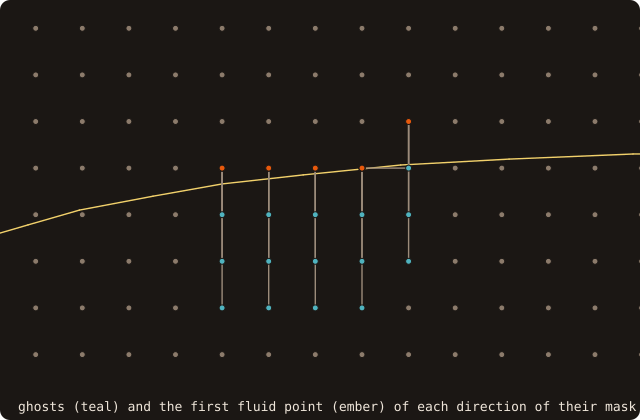
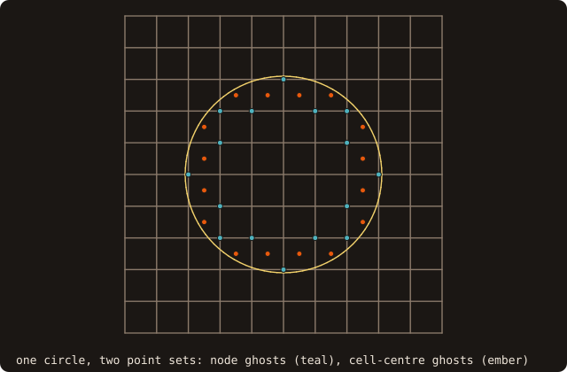
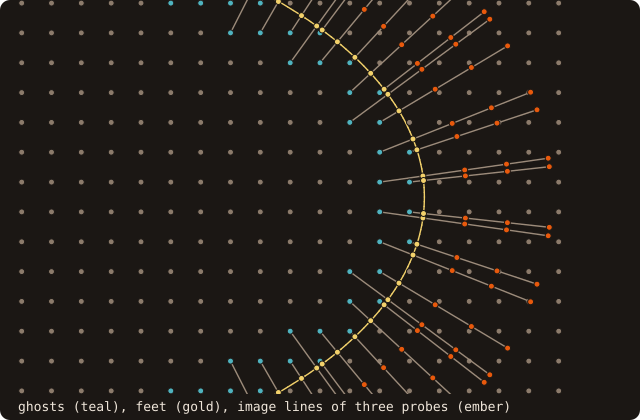
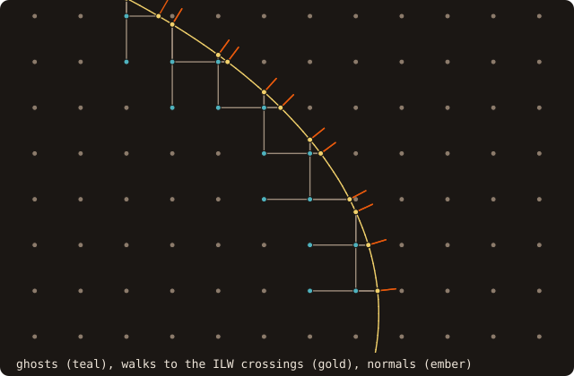
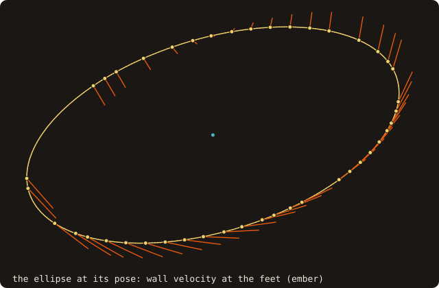
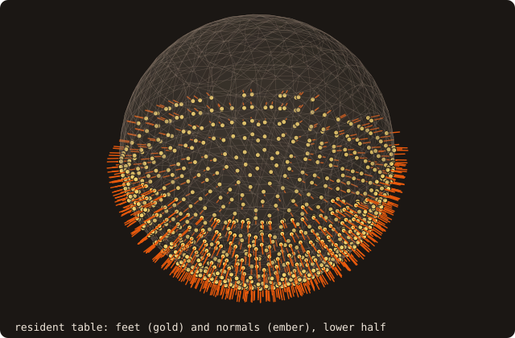
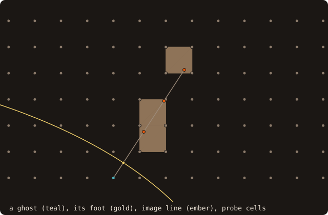

# Finite-difference wall closure

## What it does

A high-order finite-difference solver on a Cartesian or rectilinear block treats an immersed wall with a sharp
closure: image points, inverse Lax–Wendroff along grid lines, wall models. Every one of these closures starts from the
same set: the **ghost points**, the solid points that a fluid point's stencil reaches. FOSSIL finds them from the
geometry alone, on the solver's own point lines, with the exact inside/outside decisions of the
[cut cells](/guide/advanced/cut-cells), on the CPU or on the device.

| Query | 3-D (`surface_stl_object`) | 2-D (`curve_object`) |
|---|---|---|
| Ghost points of a block: indexes, coordinates, direction masks, steps to the fluid | `ghost_points_3d(surface, x, y, z, reach, gp)` | `ghost_points_2d(curve, x, y, reach, gp)` |
| The same on the device, bit for bit | `ghost_points_3d(..., device=.true.)` | `ghost_points_2d(..., device=.true.)` |
| Wall curvature at the feet: principal curvatures and directions (2-D: curvature, tangent), CPU or device | `build_curvature`, `query_many(_device)(principal_curvatures=, principal_directions=)`, `normal_curvature` | same |
| The closure table in one call: ghosts, wall data, probes, curvature, wall velocity, ILW crossings | `fd_closure_3d(surface, x, y, z, reach, table)` | `fd_closure_2d(curve, x, y, reach, table)` |
| The same on the device, bit for bit, or left resident there | `fd_closure_3d(..., device=.true.)`, `resident=.true.` | same |

{.fossil-figure}

With a stencil half-width of 3 (the seven-point stencil of a sixth-order scheme) every solid point within three steps
of the fluid along a grid line is a ghost: three layers along the wall, 304 of the 1280 cell centres around the
section. The layers come from the steps to the first fluid point that every ghost carries:

<<< @/examples/output/figref-fd-closure.ansi{ansi}

{.fossil-figure}

In 3-D the calls are the same with a third line `z(:)`: on a sphere of radius 0.5 and node spacing 0.05, 1788 of the
15 625 points are ghosts for a half-width of 2, in two shells.

The wall curvature at the foot of each ghost point, for the curvature condition of a slip wall, comes from the
principal curvatures and directions of the wall ([Wall curvature](#wall-curvature)). One call gathers everything per
ghost point into the closure table of [roadmap #109](https://github.com/szaghi/FOSSIL/issues/109)
([The closure table](#the-closure-table)): foot point, normal, probes along the normal with their visibility and their
cells, curvature, wall velocity and the grid-line crossings of inverse Lax–Wendroff, on the CPU or resident on the
device. FOSSIL gives the geometry; the solver picks the closure and interpolates its own flow.

## Definitions

- **Point lines.** The solver passes its point coordinates per axis, `x(:)`, `y(:)` and in 3-D `z(:)`: cell centres
  or nodes, uniform or stretched, strictly increasing, at least two per axis. The points are the tensor product.
- **Solid point.** A point inside the body by the exact node states of the cut cells (next section).
- **Reach.** `reach(a) >= 1`, the stencil half-width along axis a: the number of ghost layers the scheme needs.
- **Ghost point.** A solid point with a fluid point within `reach(a)` steps along the grid line of axis a through it,
  in either direction, inside the block. Solid points that are not ghosts are not listed.
- **Direction mask.** Per ghost, a bit per direction: bit 2(a − 1) when the −a side sees fluid within reach, bit
  2a − 1 for the +a side. The named constants are `GHOST_XM`, `GHOST_XP`, `GHOST_YM`, `GHOST_YP`, `GHOST_ZM`,
  `GHOST_ZP` (1, 2, 4, 8, 16, 32); in 2-D x, y are the curve's (u, v).
- **Steps.** Per ghost and direction, `steps(2a − 1, g)` for −a and `steps(2a, g)` for +a: the steps to the first
  fluid point that way, 1 .. reach(a), or 0 when there is none within reach. An inverse Lax–Wendroff closure reads the
  grid lines with a nonzero entry; the smallest nonzero entry is the ghost's layer.
- **Order.** The ghosts are listed in lexicographic order of their indexes, i fastest: `gp%ijk(:, g)`,
  `gp%points(:, g)`, `gp%mask(g)`, `gp%steps(:, g)`.

{.fossil-figure}

The ghosts of the upper side near x = −0.1 all see the fluid in +v, at 1, 2 or 3 steps. A ghost near the nose also
sees it in −u, and its mask has both bits.

## The low-side rule

The inside flags are the exact perturbed node states of the cut cells (issues #69 and #70): the point
(x_i, y_j, z_k) is taken at (x_i + ε₁, y_j + ε₂, z_k + ε₃), and its flag is the parity of the exact crossings of its
grid line before it (3-D: the z line, `cut_cells_3d_nodes`; 2-D: the row, `node_flags`). No tolerance enters, so a
point exactly on the wall still gets one answer: the side the perturbation pushes it to. This is the rule of the cut
cells, whose cells are (x_i, x_{i+1}]: a wall on the plane x = x_i bounds the cells above it, and the point x_i belongs
with them.

{.fossil-figure}

On lines through the sides of the unit square, the points on u = 0 and v = 0 are solid and the points on u = 1 and
v = 1 fluid: 16 solid points, {0, 1/4, 1/2, 3/4}², of which the 12 on the border of that block are ghosts for a reach
of 1. The cut cells see the same square: the cells (−1/4, 0] are fluid, the cells (3/4, 1] solid. When the solver's
points are the nodes of its cut-cell grid, the flags are the cut's `node_in` bit for bit, so the ghost points, the
cut cells and the device agree on every point, ties included.

## The solver's own point lines

A finite-difference solver stores its unknowns at cell centres or at nodes, and its stencil runs along the lines of
those points. The ghost set depends on that choice, so FOSSIL takes the points from the solver instead of deriving
them from a cut-cell grid.

{.fossil-figure}

The same circle on node lines and on cell-centre lines of the same spacing gives 16 ghosts each for a reach of 1, at
different places: a solver that reads the ghosts of the wrong lattice reads values at points it does not store.

## Wall curvature

A slip wall carries no shear stress. With the velocity tangent to the wall (v·n = 0) and n the normal into the fluid,
the tangential traction of a Newtonian fluid vanishes when

$$\partial_n \mathbf{v}_t = S\,\mathbf{v}_t,$$

S the wall's shape operator (its Weingarten map: ∇_t n = S t). The term comes from ∇vᵀ n: along the wall v·n stays
0, so (∂_t v)·n = −v·∂_t n. In 2-D, or along a principal direction, it reads ∂ₙv_t = κ v_t: v_t / R on a circle of
radius R, positive on a convex wall seen from the fluid. A rigid rotation satisfies it exactly, a flat-wall closure
(∂ₙv_t = 0) does not.

{.fossil-figure}

FOSSIL returns S at the foot of each ghost point as its principal curvatures and directions (k₁ ≥ k₂, d₁, d₂; see
[principal curvatures and directions](/guide/advanced/curvature#principal-curvatures-and-directions)), and in 2-D the
curvature and the tangent. `build_curvature` stores them per vertex once per geometry (before `enter_device` for the
device); `query_many` or `query_many_device` with `principal_curvatures=` and `principal_directions=` evaluates them
at the feet, `normal_curvature(k, d, t)` gives κₙ = k₁ (t·d₁)² + k₂ (t·d₂)² along a tangent t. The solver applies
the condition in the closure it uses: an image-point closure that extrapolates along the normal line through the foot,
v_t(η) = v_t(0) (1 + κ η) + O(η²) (η the signed distance, positive in the fluid), sets each component along a
principal direction from the image I to the ghost G as

$$v_i(G) = v_i(I)\,\frac{1 + k_i\,\eta_G}{1 + k_i\,\eta_I}, \qquad i = 1, 2,$$

with η_G < 0 and η_I > 0 the signed distances `query_many` returns; an inverse Lax–Wendroff closure uses
∂ₙv_t = S v_t as the boundary value of the normal derivative.

<<< @/examples/snippets/fig_ref_fd_closure_curvature-2d.f90

<<< @/examples/snippets/fig_ref_fd_closure_curvature-3d.f90

<<< @/examples/output/figref-fd-closure-curvature.ansi{ansi}

- **2-D.** At the feet of the 172 ghosts of the ellipse the curvature runs from 1.25 on the flanks to 9.86 at the
  ends (exact 1.25 and 10), within 4.3·10⁻⁴ of the exact value at each foot.
- **3-D.** A spheroid of semi-axes 0.5, 0.5, 0.3 spinning about its axis: v = Ω × x is rigid, so stress-free, and
  along the parallels ∂ₙv_t / v_t = n_ρ / ρ (n_ρ the radial part of the normal, ρ the distance from the axis). At the
  feet of its 1340 ghost points `normal_curvature` along v_t gives it within 0.18 %; the device query returns the
  same bits.
- The spheroid is a unit icosphere of 5 subdivisions scaled, so its vertices lie on it: the jet fit wants vertices on
  the surface (a marching-cubes mesh of it gave 17 %: see the
  [curvature limitations](/guide/advanced/curvature#known-limitations)).

## The closure table

`fd_closure_3d(surface, x, y, z, reach, table)` and `fd_closure_2d(curve, x, y, reach, table)` find the ghost points
of the lines (as `ghost_points_3d` / `_2d`) and fill an `ib_closure_t` with, per ghost g:

| Field | Shape | Meaning |
|---|---|---|
| `ijk`, `points`, `mask`, `steps` | `[d, n]`, `[d, n]`, `[n]`, `[2d, n]` | The ghost, as in `ghost_points_t` |
| `distance` | `[n]` | Signed distance to the wall, negative inside |
| `foot`, `normal` | `[d, n]` | Closest point; pseudo-normal of the closest feature, outward (into the fluid) |
| `element`, `feature`, `body`, `patch` | `[n]` | Closest facet (2-D segment, by its first vertex); 3-D `FEATURE_FACE` / `_EDGE` / `_VERTEX`, 2-D the closest vertex (0 inside a segment); body; patch |
| `lengths`, `probe`, `visible`, `probe_cell` | `[m]`, `[d, m, n]`, `[m, n]`, `[d, m, n]` | Probe k at `foot + lengths(k) normal`; the open segment foot–probe crosses no element; the enclosing cell per axis |
| `kappa`, `direction` | `[d-1, n]`, `[d, d-1, n]` | Principal curvatures and directions at the foot (2-D: curvature and tangent), when `build_curvature` ran |
| `velocity` | `[d, n]` | Rigid wall velocity at the foot, when velocities are given |
| `ilw_t`, `ilw_element`, `ilw_normal`, `ilw_kappa`, `ilw_direction` | `[2d, n]`, ... | Per direction slot, the crossing of the grid line with the wall ([ILW crossings](#ilw-crossings)) |

d is 3 or 2 (`table%dims`), m the number of probes (`table%m`). Arrays not asked for are allocated with a zero last
extent, so a table always has every component.

- **Probe lengths** are absolute and signed (positive outward, along the normal from the foot), the same m lengths
  for every ghost: an image line of spacing l is `lengths = [l, 2 l, 3 l]`. The mirror image of a ghost is at length
  −`distance`, ghost by ghost: `2 foot − point`.
- **Enclosing cell** by the low-side rule on the solver's own lines: x(i) < p ≤ x(i+1) gives i; a probe outside the
  block, or on its first line, gives 0. The solver interpolates there with its own stencil; FOSSIL gives no weights.

{.fossil-figure}

<<< @/examples/snippets/ref_fd_closure_table-2d.f90

<<< @/examples/output/ref_fd_closure_table.ansi{ansi}

- The ellipse, turned by 0.3 rad and spinning at its pose, has 168 ghosts for a half-width of 2; all 504 probes of
  spacing √2 h are visible from their feet (a convex body).
- The third probe of the first ghost lies below the block (−0.3): its v cell is 0.
- The device path returns the same table (`ib_closure_mismatches` counts every differing entry, reals by bits).

## ILW crossings

An inverse Lax–Wendroff closure works along the grid lines: it needs, for each ghost and each direction that reaches
the fluid, the point where that grid line leaves the solid. With `ilw=.true.` every direction slot whose `steps` is
s > 0 gets the crossing of the grid line with the wall between the last solid point (s − 1 steps away) and the first
fluid point (s steps): `ilw_t` its coordinate along the axis, `ilw_element` the facet or segment, `ilw_normal` the
pseudo-normal of the crossing point (a closest-point query of it) and, with the curvature built, `ilw_kappa` and
`ilw_direction` there. Slots without a crossing hold zeros and element 0.

{.fossil-figure}

The crossings are the cut cells' own: the exact crossings of the line (`line_crossings`, its device kernel), placed
against the perturbed points with the exact `line_crossing_before`. The node states being the parities of the same
crossings, the segment between a solid and a fluid point holds an odd number of them on a watertight wall; the
table takes the one nearest the fluid point (ties by element index). When the solver's points are the nodes of its
cut-cell grid, the crossing lies on the cell edge the cut cells cut, and gives its fluid fraction of
`cut_cells_3d(edges=.true.)` bit for bit (`fossil_test_fd_closure_3d`; 2-D, the apertures of `curve%cut_cells`).

## Wall velocity

A moving body passes its pose (`pose=`: the body frame is the surface or curve as given) and, for the boundary
condition of a no-slip or slip wall, its rigid velocity: `linear_velocity` V, `angular_velocity` ω and the `centre`
c (default: the pose's translation, the body origin in the world; the world origin without a pose). At every foot

$$\mathbf{v} = \mathbf{V} + \boldsymbol{\omega} \times (\mathbf{x}_f - \mathbf{c}),$$

the exact velocity field of the rigid motion at that instant (in 2-D ω is a scalar, ω × r = ω (−r_v, r_u)).

{.fossil-figure}

With a pose the ghosts and the ILW crossings are those of the body moved by the pose (the geometry the cut cells of
the moved body see), and every query (foot, normal, probes, visibility, curvature, the ILW normals) runs in the body
frame and is mapped back, as `query_many(pose=)`. The surface is not moved: in 3-D the call places the facet vertices
by `to_world` and refits a copy of the surface's SAH BVH to them, as `move` places and refits (on the device path both
are built on the device, nothing is copied in); min and max are exact, so the node states and crossings are those of
a moved copy bit for bit (`fossil_test_fd_closure_3d`). In 2-D the vertices are placed by `to_world`, as `curve%move`
places them. A pure rotation about the centre is tangent to the wall up to the facet's tilt from the smooth
normal (`fossil_test_fd_closure_3d`, `_2d`).

## Resident use on the device

A GPU solver keeps its flow on the device; the table should stay there too. With `device=.true.` (the surface or
curve mapped by `enter_device`, after `build_curvature` if it is built) every stage runs on the device in one
pipeline: the node states, the ghost count, scan and fill, the body-frame points, the closest-point queries, the
wall data, the probes and their visibility, the curvature, the ILW crossings and their queries. Nothing goes back to
the host between the stages. With `resident=.true.` the table is left mapped (`table%on_device`): a device solver
reads its arrays with `present`, through pointer aliases of the members.

{.fossil-figure}

<<< @/examples/snippets/ref_fd_closure_table-3d.f90

The resident pattern is the cut cells': `update_host` copies the table back (the arrays stay mapped), `exit_device`
releases the device copies, `enter_device` maps a host table; `ib_closure_reset` releases and resets. Every call
that writes a table takes it `intent(inout)` and releases it first. A copy `b = a` of a resident table is not mapped:
`device_key` (the host address of `points`) tells, and `update_host` on the copy warns and drops the flag. Call
`exit_device` (or `ib_closure_reset`) before a resident table goes out of scope.

How long a table takes (`FOSSIL_CLOSURE_TIMING=N fossil_test_distance_bench`, `fossil_test_curve_bench`; reach 3, three
probes, curvature, ILW; best of 5 after a warm-up, each path timed in a row; nvfortran 26.9 `-O2 -gpu=nofma`, one
RTX 4070 that no other job was using, one core of an i9-13900KF; indicative, one machine):

| Body, lines | Ghosts | CPU [s] | Device, copied back [s] | Device, resident [s] |
|---|---:|---:|---:|---:|
| dragon-fine (24k facets), 16³ | 535 | 0.026 | 0.030 (0.9×) | 0.027 (1.0×) |
| dragon-fine, 32³ | 3 969 | 0.142 | 0.034 (4.1×) | 0.034 (4.2×) |
| dragon-fine, 64³ | 23 039 | 0.645 | 0.072 (9.0×) | 0.069 (9.4×) |
| dragon-fine, 128³ | 112 001 | 2.56 | 0.217 (11.8×) | 0.184 (13.9×) |
| bunny, 128³ | 93 594 | 1.79 | 0.143 (12.5×) | 0.115 (15.6×) |
| NACA 0012 (2000 vertices), 1024² | 3 112 | 0.016 | 0.0061 (2.6×) | 0.0056 (2.8×) |
| disc with a hole (1100 vertices), 1024² | 7 524 | 0.035 | 0.0046 (7.6×) | 0.0039 (8.9×) |

In 3-D the resident call is bound by its kernels: at 128³ the probes and their visibility take 39 % of it, the two
closest-point queries (ghosts and ILW crossings) 28 %, the ILW crossings 23 % and the node states 9 % (Nsight
Systems); everything else, the refitted tree of a posed body included, under 1 % (a posed call costs 0-7 % more, with
other ghosts). These are double-precision traversals with exact predicates, and the RTX 4070 runs FP64 at 1/64 of its
FP32 rate (data-centre GPUs at 1/2). Copying the table back (122 MB at 128³) adds about 30 ms. At 16³ the GPU is not
faster: 535 ghosts give too few threads, and each one walks the tree alone. In 2-D the kernels take under 1 ms of a
1024² call; the rest is host work and transfer latency, so the device wins from 256² lines (the disc, 2.6×) and is
slower at 64².

## How a solver uses the table

{.fossil-figure}

**Image-line closure** (Funada & Imamura 2023; Chaudhuri 2011). Ask for the m probes of an image line
(`lengths = [l, 2 l, ...]`); the solver interpolates its flow at each probe in `probe_cell`, imposes the wall value
at the foot (`velocity` for the no-slip condition) and extrapolates along the normal to the ghost at `distance` (< 0).
A probe that is not `visible` lies behind another part of the wall: shorten the line or switch the closure there.
Two samples per ray (wall-modelled LES, van Noordt 2022) are the same table with m = 2.

**ILW closure and the curvature condition** (Tan & Shu 2010; Liu 2025). `ilw_t` gives the wall point on each grid line
through the ghost, `ilw_normal` the normal there: the solver converts the normal derivatives of its boundary
condition to derivatives along that line. A slip wall adds the curvature condition ∂ₙv_t = S v_t
([Wall curvature](#wall-curvature)): `ilw_kappa` and `ilw_direction` give S at the crossing, `kappa` and `direction`
at the foot.

**Wall fields.** A wall value that varies along the wall (a temperature or a deformation per vertex, a value per facet)
is read at the feet and the ILW crossings by `transfer_to_closure`: [Surface loads](/guide/advanced/surface-loads#moving-fields-between-the-wall-and-the-grid).

**First step: an eikonal extension fed by exact geometry.** A solver that extends its fluid values into the solid by
an eikonal equation along the normal needs the signed distance and the normal at the ghosts: `distance` and `normal`
(or `foot`) replace a level set computed on the grid, with no other change to the solver.

## What accuracy to expect

The table is exact for the faceted wall: its foot, normal and distance are those of the planar facets, not of the
smooth body they sample. How much accuracy a closure keeps is therefore a question about the facets, answered by the
validation program `fossil_val_fd_closure` (a geometry study, no flow solve). A circle and a sphere of radius
R = 0.5 (vertices on them: a regular polygon of N segments, an icosphere) sit on uniform point lines of spacing h
(h halved from level to level: R/8 to R/1024 in 2-D, R/4 to R/64 in 3-D), reach 2. At every ghost an image-line
closure rebuilds the smooth field u = cos(1.1 x − 0.7 y + 0.3) e^{0.5 x} + sin(0.9 y) (3-D: e^{0.6 z} and sin(0.9 y + 1.2 z)) from m probes at
l, 2 l, …, m l (l = √2 h), interpolated from the grid values from their `probe_cell` (tensor Lagrange on 4 points per
axis, 5 for m = 3), and one wall datum at the foot; the polynomial of degree m along the normal is evaluated at the
ghost's `distance`. The wall data are those of the true wall: u (Dirichlet) or ∂ₙu (Neumann, along the table's normal)
at the point of the circle or sphere nearest the foot. The error is the largest |u_ghost − u(ghost)| over the ghosts,
in three regimes:

- **exact geometry:** the same ghosts with the foot, normal and distance of the circle or sphere: the closure's own
  error, of design order m + 1;
- **h_s = c h:** facets refined with the grid (longest edge h_s about 1.05 h in 2-D, 1.3 h in 3-D);
- **h_s frozen:** the coarsest of those meshes at every level.

The circle with three probes, five levels (a docs program on other point lines than the validation's, so other ghosts
and errors, the same orders), and the loop that builds the ghost values from the table:

{.fossil-figure}

<<< @/examples/snippets/fig_ref_fd_closure_accuracy-closure.f90

<<< @/examples/output/figref-fd-closure-accuracy.ansi{ansi}

The sphere, from the validation (Dirichlet; the observed order of the two finest levels in the last row):

| h | ghosts | exact, m = 1 | m = 2 | m = 3 | h_s = c h, m = 1 | m = 2 | m = 3 | frozen, m = 1 | m = 2 | m = 3 |
|---|---|---|---|---|---|---|---|---|---|---|
| R/4 | 219 | 6.7e-2 | 1.5e-2 | 4.9e-3 | 8.0e-2 | 3.3e-2 | 5.6e-2 | 8.0e-2 | 3.3e-2 | 5.6e-2 |
| R/8 | 1 112 | 1.7e-2 | 2.1e-3 | 3.3e-4 | 2.2e-2 | 1.3e-2 | 2.1e-2 | 4.0e-2 | 5.4e-2 | 7.7e-2 |
| R/16 | 4 892 | 5.0e-3 | 3.5e-4 | 2.1e-5 | 6.0e-3 | 3.2e-3 | 4.9e-3 | 3.4e-2 | 5.2e-2 | 7.3e-2 |
| R/32 | 20 490 | 1.3e-3 | 4.1e-5 | 1.3e-6 | 1.5e-3 | 8.6e-4 | 1.3e-3 | 3.2e-2 | 5.3e-2 | 7.8e-2 |
| R/64 | 83 830 | 3.2e-4 | 5.3e-6 | 8.0e-8 | 4.0e-4 | 2.4e-4 | 3.6e-4 | 3.6e-2 | 5.9e-2 | 8.5e-2 |
| order | | 2.03 | 2.96 | 4.03 | 1.96 | 1.85 | 1.83 | −0.14 | −0.15 | −0.13 |

- **The closure is exact to its order.** With the exact geometry the Dirichlet and Neumann errors fall at orders
  2.00–2.03, 2.96–3.02 and 3.97–4.03 for m = 1, 2, 3 (design 2, 3, 4), in 2-D and 3-D: the probes, their cells and
  the extrapolation along the normal carry no hidden error.
- **Planar facets cap the Dirichlet closure at second order.** The faceted foot lies inside the true wall by up to
  the sag s of its facet (h_s²/(8R) for a chord, about h_s²/(6R) for a triangle), so the wall datum is imposed at the
  wrong place: an error Λ_m |∂ₙu| s at the ghost, Λ_m the weight of the wall datum in the extrapolation (2.4, 4.1, 6.0
  for m = 1, 2, 3 at reach 2). With h_s = c h that is O(h²) whatever m (orders 1.83–1.99): m = 2 and 3 converge no
  faster than m = 1, their error is the facets' (m = 3 above m = 2 by its larger Λ_m, a factor 1.4–1.5), and m = 1
  is close to its own truncation error.
- **Frozen facets give a floor, not a slower rate.** The Dirichlet error stops (orders −0.15 to 0.01) at 0.85–0.89
  of the estimate Λ_m |∂ₙu|_max s (2-D: s = 1.07·10⁻³ for N = 48, floors 3.6·10⁻³ to 8.7·10⁻³; 3-D: 320 facets,
  s = 8.9·10⁻³, floors 3.6·10⁻² to 8.5·10⁻²).
- **The Neumann closure degrades more gently.** Its datum enters with a weight of order h, so the normal tilt of a
  facet, O(h_s/R), costs O(h h_s/R): first order with frozen facets (orders 0.98–1.23, no floor), second order with
  h_s = c h (the max-norm orders scatter from level to level: 1.45–1.64 between R/32 and R/64 in 3-D, 1.85 between
  R/512 and R/1024 in 2-D).
- **What it means for a solver.** To keep a Dirichlet closure of order m + 1 the facets must shrink faster than the
  grid: Λ_m |∂ₙu| h_s²/(8R) below the closure's own error C h^{m+1}, so h_s = O(h^{(m+1)/2}) (h_s ∝ h^{3/2} for
  order 3, h_s ∝ h² for order 4). On a body of fixed resolution, refining the grid past the point where Λ_m |∂ₙu| s
  dominates buys nothing.
- **Curvature and wall velocity.** At the feet of the h_s = c h tables the principal curvatures of the sphere are
  within 8.4·10⁻², 2.2·10⁻², 5.8·10⁻³, 1.5·10⁻³, 3.7·10⁻⁴ of 1/R (order 2), the circle's 1/R to round-off. The wall
  velocity of a spinning body at a pose is the rigid field at the faceted foot to the last bit, and differs from the
  rigid field at the true wall point by at most |ω| s (attained in 2-D).

## Example

The NACA 0012 section (the wing cut at z = 0.5, chord from −0.25 to 0.75) on cell-centred lines of spacing chord/64,
reach 3; then a sphere on node lines in 3-D, checked against the device path.

<<< @/examples/snippets/ref_fd_closure-2d.f90

<<< @/examples/snippets/ref_fd_closure-3d.f90

<<< @/examples/output/ref_fd_closure.ansi{ansi}

- The section is symmetric, so as many ghosts see the fluid below as above (174 each).
- The first ghost, at (−0.0703, −0.0547), is below the nose: its mask `0101` sets −u and −v, one step each.
- On the sphere, 978 ghosts have the fluid one step away along some axis; the 810 others only at two steps.
- The device path returns the same list (`T`).

The [cookbook](/manual/cookbook#find-the-ghost-points-of-a-finite-difference-stencil) has the shortest program;
[another recipe](/manual/cookbook#build-the-closure-table-of-a-finite-difference-wall-closure) builds the closure
table.

## Design: host and device paths

Both paths compute the inside flags first, then classify every point with the same `!$acc routine seq` kernels:
`ghost_mask_oac` (the mask, 0 for a fluid point or a solid point that sees no fluid within reach) and
`ghost_fill_oac` (the mask and the steps), both built on `ghost_side_oac` (the walk along one direction).

- **Host:** a count pass, then a fill pass in lexicographic order.
- **Device** (`device=.true.`): the flags on the device (3-D: `cut_cells_3d_nodes_device`, one thread per z line; 2-D:
  `node_parity` per point over the rows of `node_rows`), then one thread per point counts its ghost (0 or 1), an
  exclusive prefix sum of the counts (`links_scan_dev`) gives every ghost its slot, and one thread per point fills its
  slot. The output is copied back.

The closure table runs the same way (`fossil_fd_closure`, free routines: the module uses the surface, curve,
ghost-point and cut-cell modules). The host path calls `ghost_points_3d` / `_2d`, `query_many`, `probe_many`,
`line_crossings` and the ILW selection kernel `ilw_select_oac`; the device path runs the ghost kernels, the kernel of
`query_many_device` on present arrays (`query_points_present`; curves: `query_present`, `probes_present`,
`curvature_present`), the probe kernel `bvh_segment_blocked_oac`, `foot_principal_oac` and the ILW kernels (3-D: one
traversal per direction slot into a private buffer of 16 crossings, sorted and selected; a slot with more takes a
count, scan and exact-size fill; 2-D: one walk of the row or column bucket; then a compacted query of the crossings):
the same routines, so the same bits (`fossil_test_fd_closure_3d`, `_2d`; bench lines `closure device vs serial mismatches`).

The ghost outputs are integers and copied coordinates, so the two paths agree bit for bit; built without OpenACC the device
loops run on the host in order, and the tests compare the two (`fossil_test_ghost_points_3d`, `_2d`). The 3-D device
path needs the surface's SAH BVH (the default tree); an octree surface is refused with `STATUS_INVALID_INPUT`, the
host path accepts both.

## API

```text
call ghost_points_3d(surface, x, y, z, reach, gp [, status] [, device])
call ghost_points_2d(curve, x, y, reach, gp [, status] [, device])
call fd_closure_3d(surface, x, y, z, reach, table [, status] [, lengths] [, pose] [, linear_velocity] &
                   [, angular_velocity] [, centre] [, ilw] [, device] [, resident])
call fd_closure_2d(curve, x, y, reach, table [, status] [, lengths] [, pose] [, linear_velocity] &
                   [, angular_velocity] [, centre] [, ilw] [, device] [, resident])
call table%enter_device ; call table%update_host ; call table%exit_device ; call ib_closure_reset(table)
n = ib_closure_mismatches(a, b)
```

| Argument | Meaning |
|---|---|
| `x(:)`, `y(:)`[, `z(:)`] | The solver's point lines, strictly increasing, at least two points each (2-D: u, v) |
| `reach(d)` | Stencil half-width per axis, `>= 1` (d = 3 or 2 entries) |
| `gp` | `ghost_points_t`, reset first: `n`, `dims`, `ni`, `nj`, `nk` (1 in 2-D), `reach(3)`, `ijk(dims, n)`, `points(dims, n)`, `mask(n)`, `steps(2 dims, n)` |
| `status` | `STATUS_OK`; `STATUS_INVALID_INPUT` on bad lines or reach, or (device, 3-D) a surface without a SAH BVH: `gp%n = 0` |
| `device` | Device path (default `.false.`), the same output bit for bit |
| `table` | `ib_closure_t`, released and reset first ([The closure table](#the-closure-table)) |
| `lengths(m)` | Probe lengths, absolute, + outward (default: no probe) |
| `pose` | `rigid_pose_t` (2-D `rigid_pose_2d_t`): the body at the pose |
| `linear_velocity(d)`, `angular_velocity(3)` (2-D scalar), `centre(d)` | Rigid wall velocity ([Wall velocity](#wall-velocity)) |
| `ilw` | ILW crossings (default `.false.`) |
| `resident` | Leave the table mapped on the device (implies `device`) |

`fd_closure_*` return `STATUS_INVALID_INPUT` (and an empty table) on bad lines or reach, a velocity or centre of the
wrong size, or on the device path a surface or curve not mapped, or with its curvature built but not mapped (a stderr
message).

`ghost_points_reset(gp)` releases a set. A surface without facets or a curve without vertices has no ghost. The
routines are free procedures of the module `fossil_ghost_points`, re-exported by `use fossil`.

## Limitations

- **Ghost points alone are not resident.** `ghost_points_3d(device=.true.)` returns its ghosts to the host (the 3-D
  node states go to the host and back between its stages); the closure table keeps everything on the device.
- **A pose costs O(facets) per call in 3-D.** The posed vertices and the refitted tree are built for each call (on
  the device on the device path); a solver that calls the table several times per pose pays it each time. An octree
  surface (host path only) still takes a moved copy (`move` rebuilds the octree).
- **The ILW normal is the pseudo-normal of the crossing point** (a closest-point query of it): at a crossing within
  round-off of an edge it is the edge's pseudo-normal.
- **One block.** A ghost needs its fluid point inside the block: across a block boundary the solver's halo exchange,
  not FOSSIL, decides. Points of other blocks are not seen.
- **Open surfaces.** The flags are parities of crossings; on an open surface they are as meaningful as the cut cells'
  (`pieces = -1` there): check `is_watertight` first.
