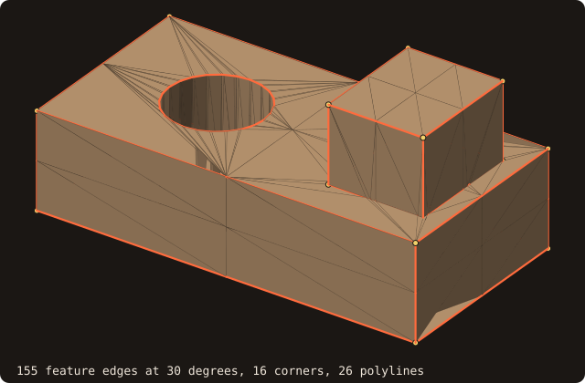
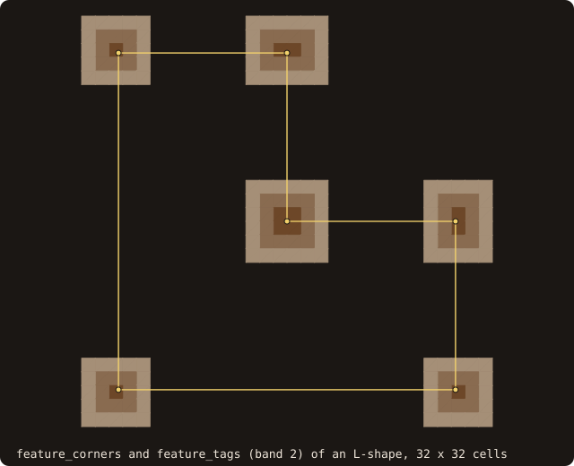

# Feature edges

## What it does

Finds the edges an immersed-boundary grid must resolve (issue #61, roadmap #58):

- **sharp edges**, where the two facets meet at more than an angle (30° by default);
- **boundary edges**, with one facet: the rims of holes and open surfaces;
- **non-manifold edges**, with three or more facets;
- the **corners**, where feature edges meet or turn sharply;
- the **polylines** that chain the edges from corner to corner.

IB methods smear sharp corners and edges unless the grid is refined there. This is the output that drives
feature refinement in CFD meshers (OpenFOAM's `surfaceFeatureExtract` feeds snappyHexMesh with it).

{.fossil-figure}

The part is built with [`boolean`](/guide/advanced/booleans): a block, united with a boss, minus a 24-sided hole. Its
12 block edges, 8 boss edges and 4 edges where the boss meets the block are sharp, which gives 16 corners and 24
polylines. The hole's two rims are closed polylines without corners: the hole's facets meet at 15°, below the
threshold, so the hole wall itself has no features.

## Method

- **Edges.** The half-edges of all facets are sorted by (lower vertex, higher vertex, facet) with a stable merge sort,
  so the result is deterministic. Each unique edge records its number of facets and its first two.
- **Sharp.** A two-facet edge is sharp when the unit normals of its facets make an angle above `angle`:
  $n_1 \cdot n_2 < \cos(\text{angle})$. The normals come from the vertex order, so the facets must be consistently
  oriented, as [`sanitize`](/guide/usage) leaves them. A facet of zero area has no normal. Its edges are not
  classified as sharp, and are counted in `degenerate`.
- **Corners.** A feature vertex is a corner when it has a number of feature edges other than 2, or exactly 2 that
  turn by more than `corner_angle` (30° by default).
- **Polylines.** From every corner, each unused feature edge is followed through the other feature vertices until the
  next corner. The edges left form closed loops, and each loop starts and ends at the same vertex.
- **Shared with the remesher.** `isotropic_remesh(preserve_features=.true.)` locks its features with the same sharp
  predicate and the same 30° threshold (`is_sharp_dihedral`, `feature_cos` in `fossil_feature_edges`), so the two
  cannot drift apart. Its results are unchanged, bit for bit.

{.fossil-figure}

Both thresholds on one part. The walls of the round end meet at 22.5°, and the flat sides meet the round at 11.25°:
not sharp. The rims meet the walls at 90°: sharp. Along the round, the rim turns by 22.5° at each vertex, below
`corner_angle`, so the only corners are the four back vertices, with three feature edges each: 24 edges, 4 corners
and 6 polylines. The figure is drawn by `docs/examples/src/fig_ref_feature_edges_method.f90`.

## API

```fortran
call surface%feature_edges(edges, kinds, corners, polyline_start, polyline_vertices, angle, corner_angle, &
                           include_boundary, include_nonmanifold, degenerate, status)
   integer(I4P), allocatable, intent(out), optional :: edges(:,:)           ! [2, ne] vertex-pool ids
   integer(I4P), allocatable, intent(out), optional :: kinds(:)             ! FEATURE_EDGE_SHARP / _BOUNDARY / _NONMANIFOLD
   integer(I4P), allocatable, intent(out), optional :: corners(:)           ! vertex-pool ids
   integer(I4P), allocatable, intent(out), optional :: polyline_start(:)    ! [np + 1], CSR offsets
   integer(I4P), allocatable, intent(out), optional :: polyline_vertices(:) ! polyline p: start(p) .. start(p+1)-1
   real(R8P),                 intent(in),  optional :: angle, corner_angle  ! degrees, default 30
   logical,                   intent(in),  optional :: include_boundary     ! default .true.
   logical,                   intent(in),  optional :: include_nonmanifold  ! default .true.
   integer(I4P),              intent(out), optional :: degenerate           ! edges skipped for a zero-area facet
   integer(I4P),              intent(out), optional :: status               ! STATUS_OK, STATUS_INVALID_INPUT
```

- Vertex ids index the vertex pool: `surface%get_vertex_pool()`, `pool%coord(id)`.
- Edges are listed in increasing (low id, high id) order.
- `status = STATUS_INVALID_INPUT` on an empty surface, or an angle outside [0°, 180°].

## Refinement along the features

The feature edges drive AMR refinement through a tree of their segments, built once:

```fortran
call surface%build_features(angle, corner_angle, include_boundary, include_nonmanifold, status)
call surface%box_feature_many(lo, hi, touched, status)          ! lo(3, n), hi(3, n): which boxes touch a feature edge
call surface%box_feature_many_device(lo, hi, touched, status)   ! the same on the device (build, then enter_device)
call surface%tag_block(x, y, z, band, tags, ..., feature_band=fb, feature_tags=ft)   ! Chebyshev cells to the features
```

- **`build_features`** stores the feature edges as segments in a bounding-volume hierarchy (median split, at most 4
  segments per leaf, `fossil_feature_bvh`). The queries take the surface `intent(in)`, so the tree is built
  explicitly, as `enter_device` is. `analyze` (any geometry change) and `move` drop it. Asking before building returns
  `STATUS_INVALID_INPUT`.
- **`box_feature_many`** is a separating-axis test of each segment against the box inflated by `box_tolerance`, the
  same conservative inflation as the box–triangle test of [AMR tagging](/guide/advanced/amr-tagging): a contact is
  never missed. The test checks the 3 box axes and the 3 cross products of the segment direction with them. The CPU
  loop and the device loop call the same routine, `feature_box_touch_oac`, so their results are bit-identical.
- **`tag_block(feature_band=, feature_tags=)`** adds, alongside the signed surface tags, the Chebyshev cell distance to
  the nearest cell touched by a feature, capped at `feature_band + 1`. A solver refines where `feature_tags` is small,
  as it does near the wall with `tags`.

{.fossil-figure}

On blocks of 8, 16 and 32 cells per side, 118 (23 %), 260 (6 %) and 532 (2 %) cells touch a feature edge: the
features are a set of curves, so the tagged fraction halves with each refinement.

## Distance to the nearest feature

```fortran
call surface%query_many(points, distances, ..., feature_distances=fd)         ! and query_many_device
```

`feature_distances(i)` is the distance from `points(i)` to the nearest feature edge: a depth-first descent of the
feature tree, pruning nodes farther than the best so far, with the exact distance to each segment (clamped projection
on the segment). A ghost-cell or image-point closure can switch its stencil near a corner where this distance is below
a few cells. It works with `pose=` (body-frame points, as the other outputs). The device twin runs the same routine,
`feature_point_distance_oac`, and gives the same bits. `build_features` must come first (and `enter_device` for the
device), else `STATUS_INVALID_INPUT`.

![the unit cube's 12 feature edges in ember and a plane of query points at mid-height, z = 0.5, over [-0.5, 1.5]^2, coloured by the distance to the nearest feature edge: light where the plane crosses the four vertical edges, darkening towards the plane's corners and the cube's axis, from 0.029 to 0.678](../../examples/images/ref-feature-distance.svg){.fossil-figure}

On the unit cube at mid-height the nearest feature is a vertical edge almost everywhere: the field is the distance to
the closest of the four lines where the plane crosses them, light around them and darkest at the plane's corners and
on the cube's axis, 0.71 from every edge.

## 2-D: corners

For a [curve](/guide/advanced/2d-geometry) the features are its corners:

```fortran
call curve%feature_corners(corners, angle, status)                       ! turning above angle, ends of open loops
call curve%tag_block(x, y, band, tags, ..., feature_band=fb, feature_tags=ft, feature_angle=a)
call curve%query_many(points, distances, ..., feature_distances=fd, feature_angle=a)   ! and query_many_device
```

- **Corners.** A vertex of a closed loop is a corner when the angle between its incoming and outgoing segments exceeds
  `angle` (30° by default). Both ends of every open loop are corners too.
- **No build step.** The corners take O(n) to find, so the curve procedures compute them at each call; there is no
  `build_features` in 2-D.
- **`feature_tags`** is the Chebyshev cell distance to the nearest cell holding a corner. A corner on a cell edge marks
  both cells.
- **`feature_distances`** is the distance from each point to the nearest corner. On the device it runs as an OpenACC
  loop with the same arithmetic, so it gives the same bits.

{.fossil-figure}

The L-shape has 6 corners; with `feature_band=2`, 171 cells lie within two cells of one.

## Example

<<< @/examples/snippets/ck_feature_edges.f90

<<< @/examples/output/ck_feature_edges.ansi{ansi}

The dragon as loaded has 5104 sharp edges at 30°: its scan is coarse, and neighbouring facets often meet at steep
angles. It has no boundary edge: its 62 duplicated facets (removed by `sanitize`, tutorial chapter 2) put three or more
facets on 61 edges, which count as non-manifold. Raising the angle to 60° and excluding the other kinds keeps 2508
creases.

## Output for inspection

```fortran
call surface%save_features_into_file(file_name, angle, corner_angle, include_boundary, include_nonmanifold, status)
```

The file is legacy ASCII VTK `POLYDATA`, which ParaView opens directly:

- the feature vertices are `POINTS`;
- every corner is a `VERTEX`;
- every feature edge is a 2-point `LINE`;
- a cell scalar `kind` is 0 on the corners and the `FEATURE_EDGE_*` code on the edges.

From the command line:

```bash
fossilizer -i part.stl --features part-features.vtk [--feature_angle 45]
```

```text
feature edges at   30.00 degrees
  sharp 24  boundary 0  non-manifold 0
  corners 8  polylines 12
  written to part-features.vtk
```

(the output for `cube-01.stl`). `src/tests/fossil_test_features_cli.f90` reads the summary and the VTK file back: 20
points, 8 vertices, 24 lines and 32 cell scalars.

## Validation

`src/tests/fossil_test_feature_edges.f90`:

| Case | Expected |
|---|---|
| `cube-01` (48 facets) | 24 sharp edges, all on the cube's 12 edges, of total length 12; the 8 cube corners; 12 polylines |
| A 32-sided cylinder, caps fanned | the two cap rims (64 sharp edges), no corners, two closed polylines of 32 edges |
| `cube-01` without one facet | 3 boundary edges; none with `include_boundary=.false.` |
| Three triangles sharing one edge | 1 non-manifold edge, 6 boundary edges |
| `dragon.stl`, sanitized | the same count after a translation; non-increasing as the angle goes 10°, 20°, 30°, 45°, 60° |

`src/tests/fossil_test_feature_tagging.f90`:

| Case | Expected |
|---|---|
| Before `build_features` | `box_feature_many`, `tag_block(feature_tags=)`: `STATUS_INVALID_INPUT` |
| `cube-01`, a block of 14³ cells | the touched cells equal a brute force over every segment with the same predicate (448 of 2744) |
| `tag_block(feature_band=2)` | the feature tags equal `cell_bands` of the brute-force set; the surface tags unchanged |
| `box_feature_many_device` (host build: device code, directives inert) | equal to the CPU |
| After `analyze` | the tree is dropped: `STATUS_INVALID_INPUT` |
| A face centre, a cube edge | not touched, touched |

`src/tests/fossil_test_feature_distance.f90`:

| Case | Expected |
|---|---|
| Before `build_features` | `STATUS_INVALID_INPUT` |
| `cube-01`: below an edge, at a face centre, beyond a corner, on an edge | 0.5, 0.5, √0.29, 0 (to 1e-15) |
| 500 random points | equal bit for bit to a brute force over every segment |
| `pose=` | equal to the query of the body-frame points (6e-16) |
| `query_many_device` (host build: device code, directives inert) | equal to the CPU |

The GPU check (`fossil_test_distance_bench`) prints `feature device vs serial mismatches`, over the touched cells of a
block of 24³ cells and the feature distances of their centres, required 0.

`src/tests/fossil_test_curve_features.f90`, the 2-D twin:

| Case | Expected |
|---|---|
| A unit square; a regular 64-gon; the 64-gon at 1° | 4 corners; none (5.6° per vertex); all 64 |
| A NACA 0012 of 200 points | the trailing edge only |
| An open polyline with a 10° bend | its two ends |
| Corner tags of the square on 10 × 10 cells | equal to a brute force |
| Corner distances | √0.5 and 1 at closed-form points, 0 at a corner; the device path equal to the CPU |

The curve bench (`fossil_test_curve_bench`, the `tests-nvidia-curve` gate) prints `feature device vs serial mismatches`
for the corner distances of a 64² grid.

`fossil_test_isotropic_remesh` gives the same output as before the shared predicate (compared line by line against a
build of the previous commit).

## See also

- [Isotropic remeshing](/guide/advanced/isotropic-remesh): `preserve_features` locks these edges.
- [AMR tagging](/guide/advanced/amr-tagging): the grid the features are meant for.
