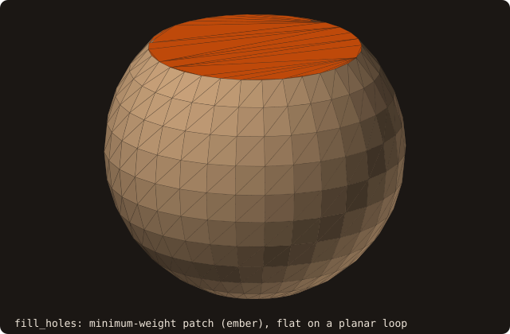
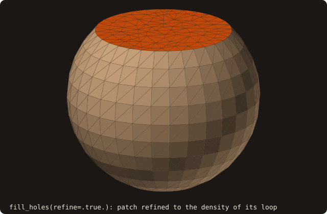
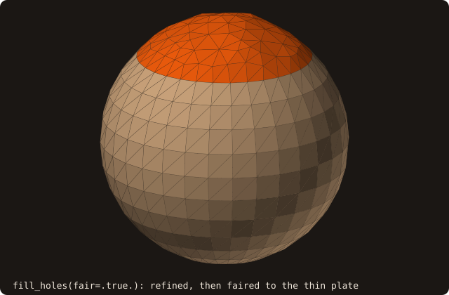

# Hole filling

## What it does

`surface%fill_holes` closes the small holes of a triangulated surface: gaps
left by a CAD export, a missing facet, a cut that was never capped. A hole is
a closed loop of **boundary edges**, facet edges with no neighbouring facet.
Each loop that is small enough is triangulated with a minimum-weight patch.
The patch is oriented like the surrounding surface and reuses its vertices
exactly, so after the fill the surface is connected across it.

For immersed-boundary preprocessing this matters because the default
pseudo-normal sign and the per-shell orientation are exact only on closed
surfaces. A filled surface can also be checked with `is_watertight()`.
Genuine open boundaries (a sheet, an inlet cut, a symmetry plane) are left
open by two size thresholds.

## Pipeline

1. **Boundary loops.**
   - After `analyze`, every facet edge without a neighbour (`fcon_edge == 0`)
     is a boundary edge. Edges are matched on the welded vertex pool, so
     coincident coordinates count as one vertex.
   - Each boundary edge is reversed with respect to its facet: a patch
     triangle sharing it must traverse it the other way to keep the surface
     consistently oriented.
   - Edges are chained into closed walks. A walk that passes a vertex twice (a
     **pinch**, where two holes touch at a corner) is split there into simple
     loops, so no angle heuristic is needed.
   - Edges that cannot close a walk (inconsistent winding, non-manifold
     boundaries) are reported as `open_edges` and left alone.
2. **Selection.** A loop is filled only if both hold:
   - it has at most `max_hole_edges` edges (default 200; the triangulation is
     O(n³));
   - its bounding-box diagonal is at most `max_hole_size` times the surface's
     (default 0.1).

   Larger loops are counted in `holes_skipped`.

   {.fossil-figure}
3. **Triangulation.** Liepa's minimum-weight dynamic programming over the
   loop's sub-polygons. The weight is compared lexicographically:
   - first the largest dihedral angle between a patch triangle and its
     neighbours, both inside the patch and across the loop edges to the
     existing facets;
   - then the total area.

   Flat holes therefore get flat patches, and a hole wrapping an edge of the
   body follows that edge.
4. **Refinement** (optional, `refine=.true.`). The patch is refined to the
   edge density of its loop (Liepa 2003):
   - each loop vertex gets the mean length of its two loop edges as target
     scale, a new vertex the mean scale of the triangle it splits;
   - a triangle is split into three at its centroid c when √2 |c − v| exceeds
     max(scale at c, scale at v) for each of its vertices v;
   - interior edges are flipped when the two opposite angles sum to more than
     π (not locally Delaunay), if the flip keeps the patch's orientation;
   - split and relax alternate to a fixed point. Loop vertices never move.
5. **Fairing** (optional, `fair=.true.`, implies refinement). The patch's
   interior vertices move to the thin-plate surface spanned by the loop and
   its 1-ring in the mesh: with the uniform Laplacian
   (L x)ᵥ = Σ_{u∼v} (xᵤ − xᵥ), the equations (L (L x))ᵢ = 0 at the interior
   vertices, with the loop and its ring fixed, form a symmetric
   positive-definite system, solved by conjugate gradient
   (`fossil_linear_solver`) once per coordinate. A hole in a curved surface
   gets a curved patch with matching tangents. The ring is feature-aware:
   only mesh facets within 60° of the patch's own normal at a loop vertex
   carry tangents, so a hole along a sharp edge keeps the crease and a
   planar hole stays planar.
6. **Re-analysis.** The patches are appended and the surface is re-analysed
   with the same AABB tree kind and refinement.

The three stages on a unit sphere of 32 × 16 longitude-latitude facets (volume 4.12194) with the cap z > 0.7
removed, filled with `max_hole_size=1` (the program is `docs/examples/src/fig_ref_hole_filling.f90`):

{.fossil-figure}

{.fossil-figure}

{.fossil-figure}

<<< @/examples/output/figref-hole-filling.ansi{ansi}

The loop is a planar ring, so the minimum-weight patch is flat and refinement keeps it flat: both enclose 3.88616.
Fairing raises it to the thin plate through the loop and its ring: the patch centroids lie within 0.035 of the
sphere, against 0.255 for the flat patch. The thin plate is not the sphere: the faired volume, 4.14567, is more
than the closed polyhedron's 4.12194 and less than the sphere's 4π/3 = 4.18879.

Inside `sanitize` (with `fill_holes=.true.`) the fill runs **after**
orientation: loops are chained along consistently wound edges, and on mixed
winding they would not close. If anything was filled, orientation runs once
more, because a closed hole can turn an open part into a closed shell, which
is then oriented by its nesting parity.

## API

```fortran
call surface%fill_holes(max_hole_edges, max_hole_size, holes_filled, holes_skipped, open_edges, status, refine, fair)
   class(surface_stl_object), intent(inout)         :: self
   integer(I4P),              intent(in),  optional :: max_hole_edges ! default 200
   real(R8P),                 intent(in),  optional :: max_hole_size  ! default 0.1 (of the bbox diagonal)
   integer(I4P),              intent(out), optional :: holes_filled
   integer(I4P),              intent(out), optional :: holes_skipped  ! loops over the thresholds
   integer(I4P),              intent(out), optional :: open_edges     ! boundary edges not forming a loop
   integer(I4P),              intent(out), optional :: status         ! STATUS_OK
   logical,                   intent(in),  optional :: refine         ! default .false.
   logical,                   intent(in),  optional :: fair           ! default .false.; implies refine

call surface%sanitize(fill_holes=.true., max_hole_edges=..., max_hole_size=..., refine_holes=..., fair_holes=...)
```

The surface must be analysed: `load_from_file`, `adopt_facets` and
`sanitize` all do it. `sanitize` fills nothing unless `fill_holes=.true.`,
so existing pipelines are unchanged.

From the command line:

```bash
fossilizer -i part.stl --sanitize --fill_holes --max_hole_size 0.05 --output part-closed
fossilizer -i part.stl --sanitize --fill_holes --fair_holes --output part-closed   # refined and faired patches
```

If the fairing solve fails (it should not on a valid patch), the refined
patch is used unfaired and a warning is written to stderr.

## Example

[Tutorial 2](/manual/tutorial/02-repair) closes a hole in the dragon with `sanitize(fill_holes=.true.)`, and the
cookbook [closes the open top of a box](/manual/cookbook#close-the-holes-of-a-surface). This program makes three
holes in the unit cube `cube-01.stl`, whose faces are 2 × 2 grids of quads split in two, and lets the size threshold
decide which are filled:

<<< @/examples/snippets/ref_hole_filling-cut.f90

<<< @/examples/snippets/ref_hole_filling-fill.f90

<<< @/examples/output/ref_hole_filling.ansi{ansi}

- **The holes.** The face z = 0 is removed whole: one loop of 8 edges around the square. On the face z = 1 two
  facets are removed that touch only at the centre of the face: their boundary is one walk through that vertex
  twice, which the pinch rule splits into two loops of 3 edges. Three loops in all, none of them leftover
  `open_edges`.
- **The size threshold.** The cube's bounding-box diagonal is √3. The triangles' loops have a diagonal of
  0.5√2 = 0.41 of it, the square's √2 = 0.82: the default 0.1 skips all three, 0.5 fills the two triangles, 1 fills
  the square. Each call works on the loops still open, so the counts are per call.
- **The result.** The two triangles take one facet each (the original facets again, since a 3-edge loop has one
  triangulation) and the square six: 38 + 2 + 6 = 46 facets, watertight, volume 1 to the printed digits.

## Known limitations

- **O(n³) triangulation.** The dynamic program costs O(n³) time and O(n²)
  memory in the loop length, hence `max_hole_edges` (default 200). Larger
  holes are skipped, not triangulated badly.
- **Fairing approximates, it does not reconstruct.** The thin plate with
  uniform weights is a smooth surface with matching tangents, not the shape
  that was cut away: a sphere is not a thin plate. On a unit icosphere with
  the cap z > 0.75 removed, the faired patch's largest distance from the
  sphere is 0.100 (plain patch 0.141), its largest dihedral angle 30.5°
  (plain 35.1°), and the enclosed volume 3.987 against 4.047 for the closed
  polyhedron (plain 3.949). The patch is only as dense as its loop.
- **Feature angle.** The 60° threshold decides which surrounding facets give
  the tangents. A curved hole whose surroundings turn by more than that
  relative to the patch (a hole covering most of a hemisphere) gets fewer
  tangent constraints and a flatter patch.
- **Orientation comes from the mesh.** Patches follow the winding of the
  surrounding facets. Around a hole whose neighbourhood is inconsistently
  wound, the loop does not close and is reported in `open_edges`. Run
  `sanitize` first, or use `sanitize(fill_holes=.true.)`, which orients
  before filling.
- **Thresholds are relative to the whole surface.** `max_hole_size` compares
  the hole with the surface's bounding box. On a small part, or with holes
  as large as the unit-cube example, set it explicitly.
- **Self-intersecting patches are not checked.** A patch over a strongly
  non-planar or twisted hole can intersect nearby facets. Run
  `find_self_intersections` if that matters.

## See also

- [`sanitize`](/guide/api/surface-stl-object#sanitize): the repair pipeline that can call this.
- [Self-intersection](/guide/advanced/self-intersection): detection and resolution.
- [Alpha wrapping](/guide/advanced/alpha-wrap): a watertight surrogate for inputs too broken to repair.

## References

- P. Liepa, *Filling Holes in Meshes*, Eurographics Symposium on Geometry
  Processing, 2003. The minimum-weight triangulation and its weight.
- G. Barequet, M. Sharir, *Filling Gaps in the Boundary of a Polyhedron*,
  Computer Aided Geometric Design 12(2), 1995. Dynamic programming for
  polygon triangulation in 3D.
