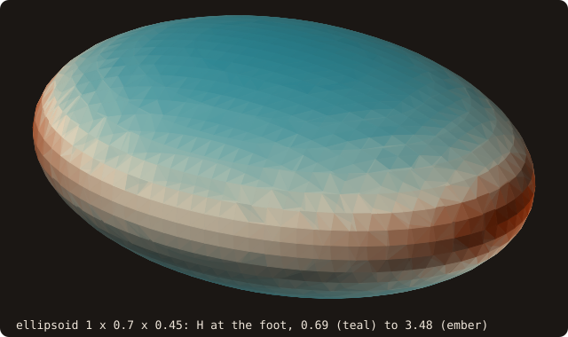
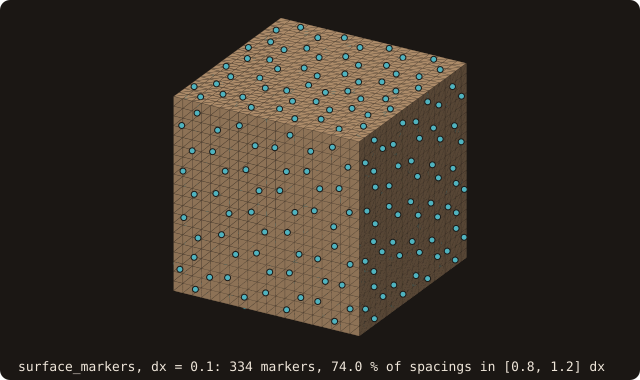

# Immersed-boundary queries

## What it does

Image-point, inverse Lax–Wendroff and wall-model closures of an
immersed-boundary (IB) solver need more than the signed distance φ. They
need:

- the **wall intercept**: the closest point;
- the **wall normal**;
- **which body** the wall belongs to;
- **image or probe points**, with the guarantee that the stencil does not
  reach through another wall.

A normal from ∇φ by finite differences degrades at sharp edges and near the
medial axis (Wang et al. 2022). FOSSIL computes these quantities exactly, in
batches, on the CPU or the device, for surfaces (3-D) and
[curves](/guide/advanced/2d-geometry) (2-D).

| Query | 3-D (`surface_stl_object`) | 2-D (`curve_object`) |
|---|---|---|
| Rich batch: distance, closest point, closest facet or segment, feature, normal, body | `query_many`, `query_many_device` | `query_many`, `query_many_device` |
| One point | `query_point`, `compute_distance(..., closest_point=, normal=)` | `compute_distance(..., normal=, body=)` |
| Probe along the normal, with visibility; m probes per point (image lines) | `probe_many`, `probe_many_device` | same |
| Mirror through the closest point, with visibility | `image_points`, `image_points_device` | same |
| Several foot points (medial axis, thin gaps) | `query_many(..., ambiguous=, second_foot_points=)` | same |
| Wall curvature at the foot: principal curvatures and directions, CPU or device (after `build_curvature`) | `query_many(_device)(..., principal_curvatures=, principal_directions=)` | same (curvature, tangent) |
| Bodies | `get_bodies_number`, `facet_body`, `get_shells_number`, `facet_shell` | `get_bodies_number`, `loop_body` |
| Vector level set | `distance_field_object%compute(..., store_closest=.true.)` | same, 2-D field |

{.fossil-figure}

<<< @/examples/snippets/fig_ref_ib_queries_rich-query.f90

<<< @/examples/output/figref-ib-queries-rich.ansi{ansi}

One `query_many` batch on a curve of two bodies returns, per point, the distance, the foot, the closest vertex (0 inside
a segment), the normal and the body. Of the 388 points within 0.3 of a wall, 316 have their foot inside a segment,
where x − foot = φ n to 2.26·10⁻¹⁶. The other 72 have their foot on a vertex, 32 of them at the square's corners: there
the points fan out around one foot and the normal is the vertex bisector, not x − foot.

## Example

Two unit cubes 0.2 apart, loaded as one surface: the smallest case where a stencil can reach through another wall.
[Tutorial chapter 8](/manual/tutorial/08-ib-queries) runs the same calls on the ghost points of a grid around the
dragon; the cookbook has the one-point [closest point](/manual/cookbook#find-the-closest-point-and-its-normal),
[wall distance](/manual/cookbook#compute-the-wall-distance-up-to-a-cutoff) and
[curvature](/manual/cookbook#measure-the-curvature-at-a-point) recipes. This example covers what those skip: two
bodies, a stencil that reaches through the other wall, and a point with two foot points.

<<< @/examples/snippets/ref_ib_queries-bodies.f90

- `merge_solids` appends the second cube's facets, and `analyze` rebuilds the connectivity: two shells, neither inside
  the other, so two bodies.

<<< @/examples/snippets/ref_ib_queries-probes.f90

- `probe_many` places each probe 0.3 along the outward normal from the wall point; `image_points` mirrors each ghost
  point through it. `visible` is false when the segment from the wall point to that point crosses a facet.

<<< @/examples/snippets/ref_ib_queries-gap.f90

- `ambiguous` and `second_foot_points` are optional outputs of the same batch, CPU only. The second foot point is the
  wall point itself where the point is not ambiguous.

<<< @/examples/snippets/ref_ib_queries-wall.f90

<<< @/examples/snippets/ref_ib_queries-markers.f90

<<< @/examples/output/ref_ib_queries.ansi{ansi}

- The ghost point 0.05 inside the first cube has its probe at x = 1.3, inside the second cube: not visible. Its image
  at x = 1.05 is in the gap, visible. The ghost point 0.25 deep has its image at x = 1.25, inside the second cube:
  not visible. The third point is nearer the top face, so its probe and image go up, into free space.
- At mid-gap, x = 1.1, the two cubes are equally far: `ambiguous` is true and the second foot point is on the first
  cube's face, x = 1. At x = 1.05 the first cube is closer by 0.1 and the point is not flagged.
- `wall_distance_many` with cutoff 0.3: the cube centre is 0.5 from every wall and the point (1.7, 0.5, 1.6) is 0.6
  above the second cube, so both get the cutoff and body 0. The point at x = 1.3 is 0.1 from the second cube, body 2.
- `surface_markers` on one cube: 334 markers whose areas sum to the cube's area, 6, with 74.0 % of the
  nearest-neighbour spacings in [0.8, 1.2] Δx (256 markers and 60.5 % before
  [roadmap #92](https://github.com/szaghi/FOSSIL/issues/92) WP5, when the crease vertices kept the spacing of the
  splits).
- The vector level set, `distance_field_object%compute(store_closest=.true.)`, stores the same closest point and
  normal on the band cells of a [distance field](/guide/advanced/distance-field).

The same calls on a moving body, in 2-D: a NACA 0012 section pitches by up to 15 degrees while it plunges across a
fixed grid of spacing 0.05. At each step `move` places the curve (its segment tree refitted, not rebuilt),
`query_many` classifies the grid nodes, and `image_points` mirrors the ghost nodes (inside, with a fluid neighbour)
through the wall.

{.fossil-figure}

<<< @/examples/output/anim-ref-ib-queries-ghosts.ansi{ansi}

## Definitions

- **Normal.** The angle-weighted pseudo-normal of the closest feature
  (Bærentzen–Aanæs): the facet normal, or an edge or vertex pseudo-normal.
  It is the same vector the sign test uses, and it is the reconstruction
  direction at edges that Seshadri & De (2020) recommend. In 2-D it is the
  segment normal or the vertex bisector.
- **Feature.** In 3-D: `FEATURE_FACE`, `FEATURE_EDGE` or `FEATURE_VERTEX`,
  with the local edge or vertex index. In 2-D: the segment, plus the vertex
  when the closest point is one.
- **Body.**
  - In 3-D, a **shell** is a set of edge-connected facets. A shell at even
    nesting depth starts a body; a shell at odd depth (a cavity) joins the
    body that contains it; an island inside a cavity is a body of its own.
  - In 2-D: an outer loop with its holes; open loops are bodies of their
    own.
  - Containment is tested only where one bounding box contains another, so
    scattered particles cost nothing.
- **Image point.** The mirror through the closest point, 2·foot − x.
- **Probe.** The point at a given distance along the normal from the foot
  point: positive outward, negative inward.
- **Visibility.** Whether the segment from the foot point to the image or
  probe point crosses the geometry. One kernel decides it on the CPU and
  the device (see [image lines and probes on the device](#image-lines-and-probes-on-the-device)).
  - **3-D:** the exact crossings of the ray queries (issue #82) along the
    segment from the foot point. Crossings within 10⁻⁹ of the box diagonal
    are ignored: those are the facets containing the foot point.
  - **2-D:** exact, with `orient2d`, skipping the segments that contain the
    foot point.

{.fossil-figure}
- **Ambiguous foot point.** Another facet or segment whose closest point is
  separate from the foot point (by more than `foot_tolerance`, default
  10⁻⁹ of the box diagonal) lies within (1 + `rel_tolerance`) of the minimum
  distance (default 10⁻⁶). This happens on the medial axis and in thin gaps.
  FOSSIL reports the second foot point and the caller decides; the
  literature gives no rule.

{.fossil-figure}

On a grid of spacing 0.05 the flagged points trace the medial axis: the diagonals inside each cube and the mid-plane
of the gap, which continues past the cubes because beyond their edges the two nearest features are still one edge of
each cube.

## Wall distance and field diagnostic

- **`wall_distance_many(points, distances, bodies, cutoff)`** (surface, with
  a device twin; curve) returns the unsigned distance to the nearest wall
  and the body it belongs to (issue #42). Turbulence models and overset
  assembly need it (Oh et al. 2024).
  - The tree traversal starts at the cutoff, so every node farther away is
    pruned.
  - Points with no wall closer than the cutoff get the cutoff and body 0.
  - CPU and device give the same results bit for bit.
- **`distance_field_object%gradient_diagnostic(q, flagged, threshold)`**
  returns q = |1 − |∇φ|| per node.
  - ∇φ is the three-point non-uniform difference, exact on linear fields on
    stretched grids.
  - Nodes with an unknown neighbour get q = −1.
  - `flagged` counts the nodes above the threshold (default 0.05, Matsushita
    & Aoki).
  - q is large by nature on the medial axis.

![two panels over the same grid of spacing 1/16 around a unit square and a 24-gon. Left: the wall distance capped at 0.4, cream on the walls to sepia at the cutoff, with the 576 cells beyond the cutoff left empty (the square's centre among them) and a teal staircase midway between the bodies where the nearest body changes. Right: the signed field, teal inside and cream outside, with the 233 nodes where the gradient diagnostic exceeds 0.05 in ember: the square's diagonals, the 24-gon's centre, the line midway between the bodies and four patches off the square's corners](../../examples/images/ref-ib-queries-wall.svg){.fossil-figure}

<<< @/examples/snippets/fig_ref_ib_queries_wall-calls.f90

<<< @/examples/output/figref-ib-queries-wall.ansi{ansi}

On the left the bodies come from the same batch as the distances: 777 points are nearest to the square, 467 to the
24-gon, 576 lie beyond the cutoff. On the right the diagnostic flags 233 of 1820 nodes. 28 of them lie in the band of
exact distances: at the square's corners, where the diagonals start, and at a few 24-gon vertices. The other 205 lie
in the far field the sweep filled: the medial axis inside the bodies, the line midway between them, and four patches
just outside the band off the square's corners, where the circular fronts around a convex corner are filled by the
first-order sweep, not by exact distances.

## Curvature at the foot point

Curved slip walls need the wall curvature where the image point projects
(∂ₙv_t = v_t / R_c; Funada & Imamura, Ciallella et al.). `query_many`
returns it as an optional output (issue #42, CPU):

- **Surfaces: `curvatures(2, n)` = (H, K).** These are the mean curvature
  (k₁ + k₂)/2 and the Gaussian curvature k₁k₂.
  - Both come from the per-vertex `jet_curvature`, interpolated with the
    foot's barycentric weights. `jet_curvature` fits a cubic height
    function over each vertex's 2-ring (Cazals & Pouget 2005). It is
    rebuilt once per call, at O(facets) cost.
  - The error is O(h²) pointwise, on any sampling.
  - Near-coincident ring vertices are merged before the fit (issue #91).
    Where a vertex fit stays rank deficient (`jet_curvature` returns
    `CURV_STATUS_FIT_FAILED`), its values are NaN, and so are the
    curvatures of the feet on its facets: test with `ieee_is_nan`.
  - H > 0 where the surface is convex seen from the side the normals point
    to: a sphere gives (1/R, 1/R²), a cylinder (1/(2R), 0).
- **Curves: `curvatures(n)`.** Each vertex gets its turning angle over the
  mean length of its two segments, and the value is interpolated along the
  segment.
  - It is positive on outer loops and negative on holes.
  - It is 0 at the ends of an open loop.

Both work with `pose=`, since curvature is invariant under rigid motion.

- **Principal curvatures and directions (roadmap #109, CPU and device).** After `build_curvature`, which stores the
  per-vertex shape operator of the same jet fit once, `query_many` and `query_many_device` return
  `principal_curvatures(2, n)` = (k₁, k₂), k₁ ≥ k₂, and `principal_directions(3, 2, n)` = (d₁, d₂), unit, tangent to
  `normals=`: the vertex tensors interpolated with the foot's barycentric weights, then eigen-decomposed in the
  tangent plane, by one routine shared by the host and the device (bit for bit). The normal curvature along a tangent
  t is `normal_curvature(k, d, t)`, the factor of ∂ₙv_t = κₙ v_t. Curves: `curve%build_curvature`, then
  `principal_curvatures(1, n)` (O(h²) on any spacing) and `principal_directions(2, 1, n)`, the tangent. Without
  `build_curvature` the call returns `STATUS_INVALID_INPUT`. See
  [principal curvatures and directions](/guide/advanced/curvature#principal-curvatures-and-directions) and the
  [wall curvature of a finite-difference closure](/guide/advanced/fd-closure#wall-curvature).

{.fossil-figure}

The exact values are 0.684 at the ends of the short axis, (c/a² + c/b²)/2, and 3.49 at the ends of the long axis,
(a/b² + a/c²)/2.

## Grid-adapted markers

Wall models evaluated at surface points (van Noordt et al.) and
direct-forcing force integration need markers spaced like the grid. Direct
forcing needs a spacing of 0.8–1.2 Δx (Cheylan et al. 2023).

- **`surface%surface_markers(dx, centroids, areas, normals, spacing_fraction,
  spacings, iterations, preserve_features)`** remeshes a copy of the
  surface with `isotropic_remesh` and returns the facet centroids, areas
  and unit normals. The surface itself is not changed.
  - The target edge is √3 Δx: centroids of two equilateral neighbours are
    then Δx apart.
  - One calibration pass rescales that target by Δx over the measured mean
    spacing, because the remesher's edges come out short.
  - `spacing_fraction` reports the fraction of nearest-neighbour spacings
    inside the window.
  - Pass `preserve_features=.true.` on bodies with sharp edges. The
    remesh then keeps the creases and moves the vertices of their straight
    runs along them (see
    [isotropic remeshing](/guide/advanced/isotropic-remesh)), so the
    markers on the faces are spaced like the grid up to the creases.
  - Across a sharp crease the spacing is the distance in space between
    two centroids: two equilateral facets of edge √3 Δx on a 90° crease
    edge have centroids 0.707 Δx apart, below the window, by construction.
    They are a share of about 3 Δx of the facets of a unit cube, so even an
    ideal marker set (equilateral, rows along the creases) has a fraction
    of about 1 − 3 Δx, 0.70 at Δx = 0.1. The fraction on a body with
    creases measures the faces and the creases together; the markers next
    to a crease sit at 0.6–0.9 Δx.
- **`curve%curve_markers(dx, centroids, lengths, normals, spacing_fraction,
  spacings)`** resamples every loop exactly along the polyline into
  nint(L/Δx) pieces of equal arc length. The markers sit at the piece
  midpoints, on the polyline.

{.fossil-figure}

## Image lines and probes on the device

An image line (Chaudhuri et al. 2011; Funada & Imamura 2023) samples N + 1 points along the normal of each ghost point,
and a two-point wall model (van Noordt et al. 2022) samples two. `probe_many` takes all the lengths of a point at once
(WP1 of [roadmap #109](https://github.com/szaghi/FOSSIL/issues/109)):

- **`lengths(m, n)`**, m per point, signed (+ outward), gives `probe_points(3, m, n)` (2-D: `(2, m, n)`) and
  `visible(m, n)`, from one closest-point query per point. `lengths(n)` keeps the one-probe form; both are the one
  generic `probe_many`, and the one-length form equals the m-length form column by column.
- **`probe_many_device`** and **`image_points_device`** (surface and curve) take the arguments of their host twins
  after `enter_device`, else `STATUS_INVALID_INPUT`. The foot points and normals come from `query_many_device`, the
  samples and their visibility from one device loop over the (sample, point) pairs.
- **`pose=`** (host and device): the points are in the world frame and the body at the pose. The query runs in the
  body frame and the samples, foot points and normals are mapped back, as for `query_many`.

{.fossil-figure}

<<< @/examples/output/figck-probes-device.ansi{ansi}

<<< @/examples/output/ck_probes_device.ansi{ansi}

The visibility is one any-hit kernel, shared by the CPU and the device (`fossil_segment_visibility`):

- **3-D, `bvh_segment_blocked_oac`.** A traversal of the SAH BVH that stops at the first facet crossed at
  tol < t ≤ |length| from the foot point. Each crossing is the exact ray-facet decision of the ray queries
  (`fossil_ray_kernel`, issue #82), on the ray prepared as `intersect_ray_all` prepares it. The answer is therefore
  the former ray query's: 0 differences over the 1 500 probes and images of the dragon in the twin test, and over
  600 000 on six meshes (bunny, both dragons, the NACA wing, two cube files) in a one-off check. A node is skipped when the ray misses its padded box (the slab test of the ray queries) or when the whole
  padded box projects beyond |length| + pad on the ray: a crossing point lies in its facet's box, so neither skip
  drops a crossing the filter keeps. An octree surface keeps the ray query on the host; the device needs the BVH.
- **2-D, `curve_segment_blocked_oac`.** The exact segment test of before (`orient2d`, candidates from the segment
  BVH, the segments at the foot skipped), now a device routine.

The probe points, foot points, normals, patches, images and visibility of the device equal the host's bit for bit.
The [cookbook recipe](/manual/cookbook#image-lines-and-probes-on-the-gpu) runs both paths.

## Placement rules from the literature

All of them are lengths for `probe_many`, one per point or several at once (`lengths(m, n)`):

| Rule | Length |
|---|---|
| Image point with a complete interpolation stencil (Wang et al. 2022) | √2 Δx |
| Image line of order N + 1 (Funada & Imamura 2023) | ≥ √d Δx (d = 2, 3) |
| Second image layer (Constant et al. 2024) | H + 2 √d Δx |
| Fixed-distance probe that sidesteps the small-cell problem (van Noordt et al. 2022) | fixed |

## Results

| Case | Result |
|---|---|
| `query_many` vs `compute_distance`, cube and bunny (1728 points each, pseudo-normal and FWN signs) | every output bit for bit |
| `query_many_device` vs `query_many`, cube and bunny (3456 points each) | bit for bit (device path run on the host) |
| curves: NACA 0012, annulus with island, open square (3000 points) | bit for bit, CPU and device path |
| vector level set: bunny, cube, 256-gon | band values = `query_many`; \|φ\| = \|x − closest\| |
| cube ghost points in face regions (1100) | closest + \|φ\| n = 2·closest − x |
| two cubes 0.2 apart | a probe into the other cube, or an image inside it, is reported not visible |
| visibility kernel vs the ray query of issue #82: dragon, 1 500 probes and images (twin test); 600 000 on six meshes (one-off check) | 0 differences |
| `probe_many_device` / `image_points_device` vs the host, dragon (300 points × 4 lengths, posed too), two cubes | bit for bit (device path run on the host) |
| 2-D: ellipse with a hole and an island, 400 points × 4 lengths, vs a brute-force exact test | 0 differences; device = host bit for bit |
| cube centre, diagonal plane, mid-gap, L-shape medial points | flagged; generic points not |
| foot curvature, icospheres R = 2 (2, 3, 4 subdivisions) | maximum relative error 0.183, 0.043, 0.012 (cotangent / angle-defect operators: 0.154, 0.148, 0.124) |
| foot curvature, cylinder R = 1/2 (16, 32, 64 sectors) | maximum error 0.21, 0.046, 0.011 |
| foot curvature, flat faces | 0 exactly |
| foot curvature, regular N-gons R = 1 | (π/N)/sin(π/N) exactly: the error against 1/R falls by 4.0 per halving of h |
| principal curvatures at the foot, icospheres R = 2 (2, 3, 4 subdivisions) | maximum relative error 0.098, 0.023, 0.0059; (d₁, d₂, n) orthonormal to 6·10⁻¹⁶ |
| principal curvatures at the foot, cylinder R = 1/2 (16, 32, 64 sectors) | maximum error 0.32, 0.074, 0.018; d₂ along the axis within 4·10⁻⁷ |
| principal curvatures at the foot, device path vs host, posed too (ellipsoid; ellipse) | bit for bit (device path run on the host) |
| curve vertex curvature, ellipse with alternating spacing (64, 128, 256 vertices) | 2.9·10⁻², 7.2·10⁻³, 1.8·10⁻³ (the circle through three vertices: 9.7·10⁻², 4.8·10⁻², 2.4·10⁻²) |
| markers, unit icosphere, Δx = 0.06 | 2030 markers, area within 0.5 %, 97 % of spacings in [0.8, 1.2] Δx |
| markers, unit cube, Δx = 0.1, features kept | area 6 to round-off, 73 % of spacings in the window (53 % before roadmap #92 WP5) |
| remesh of that cube at L = √3 Δx, features kept | every cube edge 7 or 8 vertices, every crease spacing in [4L/5, 4L/3] (0.807 L to 1.019 L); before, 9 vertices at 0.722 L |
| curve markers, square and 64-gon | on the polyline (distance ≤ 6.6e-17), equal lengths summing to the perimeter |

## Limitations

- **GPU validation is manual.** The device paths (`query_many_device`,
  `probe_many_device`, `image_points_device`, 3-D and 2-D) run bit-exact on
  the host in `tests-gnu`; on the GPU they are checked by the manual gate
  (`rich`, `rich id`, `probe` and `curvature device vs serial mismatches` lines of the
  benches, 0 on an RTX 4070 with nvfortran 26.9), not by CI.
- **Multiple foot points and `curvatures=` are CPU only.** The principal curvatures and directions run on both.
- **3-D foot curvature needs a resolved surface.** The cubic fit spans the
  2-ring, so the surface must be smooth over about two edge lengths. On
  coarse meshes the error is large: 18 % on an icosphere with 320 facets.
  Across sharp edges the value is meaningless.
- **Marker spacing follows the remesher.** Most spacings land inside
  [0.8, 1.2] Δx on a smooth body (97 % on a sphere), fewer with sharp
  edges kept (53 to 61 % on a cube: the locked edge vertices keep the
  spacing of their splits, and the spacings next to them gather near
  1.25 Δx). `spacing_fraction` reports how many do.
- **3-D visibility skips the first 10⁻⁹ of the box diagonal.** The
  crossings are decided exactly, but a crossing that close to the foot point
  is taken for the facets at the foot and ignored, whatever facet it is.
  The 2-D test is exact.

## Distance to the nearest feature edge

`query_many(..., feature_distances=)` (and the device twin) adds the distance from each point to the nearest sharp,
boundary or non-manifold edge, after `surface%build_features` (issue #61). Image-point and ghost-cell closures degrade
at corners; this distance tells a solver where to switch. See
[feature edges](/guide/advanced/feature-edges#distance-to-the-nearest-feature).

{.fossil-figure}

<<< @/examples/snippets/fig_ref_ib_queries_feature-features.f90

<<< @/examples/output/figref-ib-queries-feature.ansi{ansi}

The cylinder's only feature edges at the default 30 degrees are its 96 rim edges: the side turns by 7.5 degrees per
seam. Halfway up the side wall, a point 0.0208 from the wall is 0.4796 from the nearest feature: there the wall is
smooth, and a solver can keep its regular closure.

