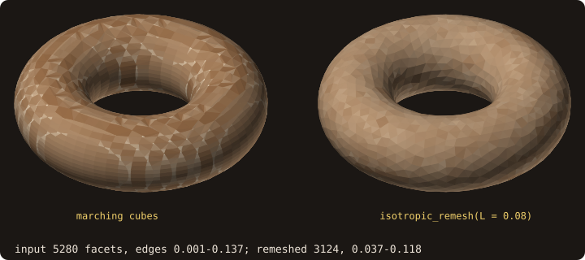
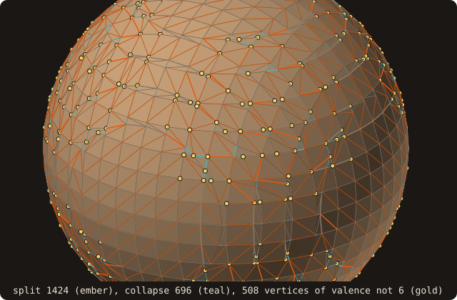
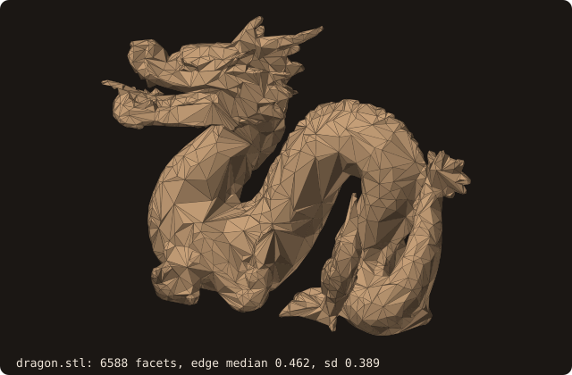
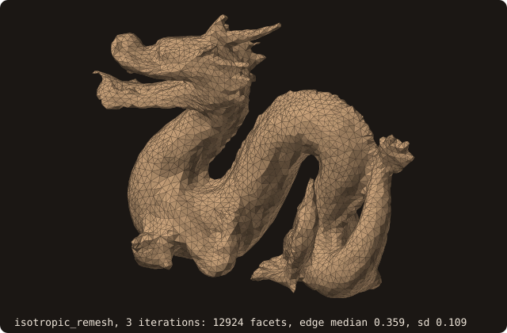

# Isotropic remeshing

## What it does

Equalizes **edge length** across a triangulated surface while preserving
its geometry. CAD-exported STL routinely mixes 0.01 mm and 10 mm
triangles on the same body — perfectly fine for visualization, **fatal**
for AABB-tree query balance and for cut-cell quality near refinement
bands. Isotropic remeshing rewrites the tessellation driving every edge
towards the band `(4L/5, 4L/3)` about a target length `L`, producing a
mesh whose facets have roughly the same shape and size (the band is a
goal, not a bound: on the dragon below, after 3 iterations at `L = 0.46`,
90 % of the edges lie in 0.16–0.52).

Complementary to [decimation (§1.3)](https://github.com/szaghi/FOSSIL/issues/18):
decimation reduces facet *count* while preserving the silhouette;
isotropic remeshing equalizes edge *length* without preferring either
direction. Use decimation to make a million-facet model tractable; use
isotropic remeshing to make any model's tessellation regular.

A torus by marching cubes on cells 2.75 times flatter than wide, so its
triangles are stretched (edges 0.001 to 0.137, 5280 facets), remeshed
with `L = 0.08`, 3 iterations (edges 0.013 to 0.114, 6938 facets):

{.fossil-figure}

## Pipeline

Each outer iteration runs four passes (Botsch & Kobbelt 2004):

1. **Split** edges longer than `4L/3`. New vertex at the midpoint;
   incident triangles re-triangulated.
2. **Collapse** edges shorter than `4L/5`. Reuses §1.3's safety
   predicates: reject the collapse if it would flip a triangle's
   normal, create a duplicate vertex, or open a non-manifold edge.
3. **Flip** interior edges to drive vertex valence toward 6 (the
   regular-triangulation ideal). Rejects flips that would create a
   duplicate edge or a degenerate triangle.
4. **Tangential relaxation**: move each vertex toward the area-weighted
   centroid of its one-ring, then **project** back onto the original
   surface via the AABB tree's closest-point query. Without projection
   the mesh would shrink toward its volumetric centroid.

Three to five outer iterations is typical. Connectivity is rebuilt from
scratch between passes — chosen after the first attempt's packed-array
incremental design produced uncatchable heap corruption; the
"rebuild every pass" approach trades speed for debuggability.

What the first iteration acts on, on the sphere of the [Example](#example)
(marching cubes on 25³ samples, `L = 0.1`): 1424 edges longer than
`4L/3` to split, 696 shorter than `4L/5` to collapse, 508 of the 1158
vertices with a valence other than 6 for the flips:

{.fossil-figure}

The same classes after each of five calls of one iteration. The long
edges go: 1424, 143, 8, 1, 1, 0. The short ones do not: 696, 2017, 2382,
2380, 2389, 2405, because the splits halve edges just above `4L/3` into
edges just below `4L/5` and the collapse pass does not remove them (it
does not coarsen; see [Known limitations](#known-limitations)). The facet
count grows from 2312 to 4228 and settles:

{.fossil-figure}

**Feature preservation** is optional and off by default. When enabled,
edges with dihedral angle > 30° are flagged as **sharp**, and their
endpoint vertices are **locked**: collapse skips them, flip skips any
edge with a locked vertex, relaxation skips them entirely. The features
are detected again after every split pass, so the midpoints inserted on a
sharp edge are locked like its endpoints (before issue #42 they were not,
and relaxation chamfered every edge: a unit cube remeshed to edge 0.17
lost 10 % of its volume). This is what keeps the 12 edges of a cube sharp
through remeshing, with volume and area unchanged to round-off; without
it, the cube rounds out into a ball over a few iterations.

## API

```fortran
call surface%isotropic_remesh(target_length, iterations, preserve_features, status)
   real(R8P),    intent(in), optional :: target_length     ! ≤ 0 → median input edge
   integer(I4P), intent(in), optional :: iterations        ! default 5
   logical,      intent(in), optional :: preserve_features ! default .false.
   integer(I4P), intent(out), optional :: status
```

- **`target_length`**: desired uniform edge length. Pass `≤ 0` (or
  omit) to use the input's *median* edge length — a remesh at the
  input's scale that evens the distribution (on an input with a long
  tail of long edges, such as the dragon below, the splits outnumber
  the collapses and the facet count grows). Pass a smaller
  value to densify, larger to coarsen (on closed meshes the collapse
  pass does not coarsen: see [Known limitations](#known-limitations)).
- **`iterations`**: outer-loop count. Default `5`. Convergence is
  typically visible after 3 passes; further iterations smooth the edge-
  length distribution further but also accumulate the inward Laplacian
  bias (see Limitations).
- **`preserve_features`**: lock vertices on edges with dihedral > 30°.
  **Essential for mechanical CAD inputs**; should usually be `.true.`
  on anything that isn't an organic shape.

Mutates `self` in place.

## Example

The cookbook's
[Remesh to a uniform edge length](/manual/cookbook#remesh-to-a-uniform-edge-length)
remeshes the cube once. Here, what `preserve_features` changes on it,
then a curved body watched one iteration at a time.

The unit cube (`cube-01.stl`, edges 0.5 and 0.71) remeshed to
`L = 0.2`, without and with feature preservation:

<<< @/examples/snippets/ref_isotropic_remesh-cube.f90

A unit sphere by [marching cubes](/guide/advanced/marching-cubes) on 25³
samples, whose edges range over an order of magnitude, remeshed to
`L = 0.1` by three calls of one iteration each (the state carries over
from call to call), then measured against the input by the certified
[Hausdorff distance](/guide/advanced/surface-deviation):

<<< @/examples/snippets/ref_isotropic_remesh-sphere.f90

<<< @/examples/output/ref_isotropic_remesh.ansi{ansi}

- **Features off.** The relaxation moves the vertices of the cube's
  edges and corners like any other, and the projection puts them back
  on the nearest face: the edges are chamfered. Area 4.969 and volume
  0.891 instead of 6 and 1.
- **Features on.** The 12 edges (dihedral 90°, above 30°) are locked,
  the midpoints inserted on them too: area and volume stay 6 and 1 to
  the printed digits.
- **Sphere.** The splits raise the facet count from 2312 to 4224 and
  the shortest edge from 0.0173 to 0.034; the longest falls from 0.20
  to 0.13, below `4L/3`. Each iteration costs volume: 0.28 %, 0.15 %,
  0.09 % (see [Known limitations](#known-limitations)). The remeshed
  surface is within 0.0100 of the input.

## Dragon remesh — visual reference

Input dragon (`dragon.stl`, 6588 facets; the 69k-facet bunny is too heavy
for an inline figure), its tessellation mixing long slivers and small
triangles:

{.fossil-figure}

After 3 iterations of `isotropic_remesh` at the default target (the
median input edge):

{.fossil-figure}

The silhouette is preserved; the per-facet edge-length distribution
tightens (standard deviation 0.389 → 0.109, 3.6×). Remeshing isn't
decimation, but neither does it keep the facet count: the dragon's
edges have a long tail above the median (5 % are longer than 1.32,
2.9× the median), every edge above `4L/3` is split, and the count
roughly doubles (6588 → 12924), the median dropping below `L`
(0.462 → 0.359). The thin features (horns, claws) are smoothed: the
area falls by 10 % (742 → 666), the volume by 1.7 %.

## Known limitations

- **Inward Laplacian bias on convex regions.** The area-weighted
  Laplacian centroid of a vertex's one-ring sits *inside* the surface
  by ~`r · (1 - cos θ)` per relax step on a region of radius `r` with
  half-aperture `θ`. The projection step after relaxation pulls the
  vertex back toward the input surface but doesn't fully compensate.
  **Net effect**: the marching-cubes sphere of the [Example](#example)
  loses 0.28 %, 0.15 % and 0.09 % of its volume in its first three
  iterations, even with projection enabled. For convex inputs where preservation
  matters, run fewer iterations (2-3) or use the `target_length`
  parameter conservatively. Tighter preservation requires
  normal-direction projection or scaled-step heuristics; deferred to a
  future refinement.
- **Feature preservation uses a hard 30° dihedral cutoff.** Edges below
  the threshold get smoothed even if they were intended as features
  (subtle creases on a fillet). The cutoff isn't user-tunable in the
  current API; if your input has sub-30° features that must survive,
  pre-sharpen them by inserting a tiny fillet before remeshing.
- **`target_length` is a guideline, not a contract.** The split (`>
  4L/3`) and collapse (`< 4L/5`) thresholds let edges in `[0.8L,
  1.33L]` survive untouched. Ratio fixed in the literature; not a
  parameter.
- **Connectivity is rebuilt every pass**, not incrementally maintained.
  Per-pass cost is `O(N log N)` instead of `O(δ_changed)`. Acceptable
  for typical inputs; a 70k-facet remesh runs in ~1 s. For million-
  facet meshes consider running fewer iterations.
- **Volume drift compounds across iterations.** It shrinks per
  iteration (see the first item) but does not stop: verify it with
  `surface%get_volume()` before and after. Do not use the remesh in
  volume-critical pipelines without an explicit post-remesh
  volume-restoration pass.
- **The collapse pass does not coarsen closed meshes.** Its
  non-manifold check also rejects the two apexes the edge's own facets
  share, so on a closed manifold mesh almost no collapse passes: the
  sphere of the [Example](#example) keeps its 2312 facets at
  `L = 0.2`, 0.4 and 0.8, and `cube-01.stl` its 48 at `L = 1`. A
  larger `target_length` does not reduce the count; use
  [`decimate`](/guide/advanced/decimate) for that.

## See also

- [`decimate`](/guide/api/surface-stl-object) (facet count
  reduction; complementary primitive).
- [`statistics`](/guide/api/surface-stl-object#statistics) — print
  edge-length distribution before and after to verify the remesh
  worked.
- The [§1.7 implementation issue](https://github.com/szaghi/FOSSIL/issues/18)
  has the full multi-commit history and design notes (rectangular vs.
  packed connectivity, the heap-corruption pivot, the relax-bias
  diagnosis).

## References

- Botsch & Kobbelt, *A Remeshing Approach to Multiresolution Modeling*,
  Symposium on Geometry Processing 2004. The four-pass pipeline.
- Botsch et al., *Polygon Mesh Processing*, AK Peters 2010, Chapter 6.
  Textbook treatment with implementation guidance.
- Alliez, Cohen-Steiner, Devillers, Lévy, & Desbrun, *Anisotropic
  Polygonal Remeshing*, SIGGRAPH 2003. The anisotropic
  generalization (out of FOSSIL scope; for surfaces with directional
  feature preservation requirements).
