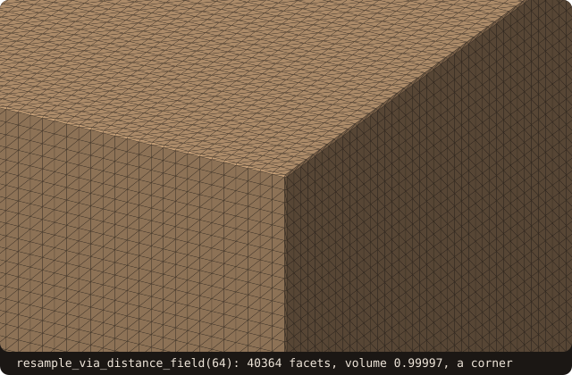

# Marching cubes / isosurface extraction

## What it does

Two related entry points sharing one engine:

- **`extract_isosurface(values, bmin, bmax, iso, surface, status)`**
  — module-level subroutine. Given a 3D scalar field on a regular
  grid, extract the iso=`iso` surface as a `facet_object` array.
- **`surface%resample_via_distance_field(resolution, surface_out, status)`**
  — TBP. Sample `self`'s signed distance on a regular grid spanning
  the bbox, then call `extract_isosurface` at iso=0. Closes the
  **SDF → STL** loop: any FOSSIL surface can be re-tessellated through
  its own distance field.

The marching cubes algorithm itself is well-known (Lorensen & Cline
SIGGRAPH 1987); FOSSIL embeds Bourke's canonical 256-entry case-table
data. The engineering interest is the second TBP: it turns FOSSIL
into a level-set repair tool. Sample SDF, extract iso=0, get a
watertight triangulation whose distribution is determined by the grid
spacing (not the input's noisy tessellation).

## Pipeline

For each grid cell with corners `(i..i+1, j..j+1, k..k+1)`:

1. **Classify each corner** as inside (`value < iso`) or outside.
   The 8 corners give an 8-bit case index in `[0, 255]`.
2. **Look up triangulation pattern** in Bourke's case table — up to
   5 triangles per cell, with edges identified by their endpoint
   cube-edge index.
3. **Linearly interpolate** each triangle vertex along its cube edge:
   `t = (iso - v_a) / (v_b - v_a)` is the fractional position
   between corner `a` and corner `b`. Position is `bmin + (i, j, k +
   offsets) * cell_size` in world coordinates.
4. **Append** the resulting triangles to a flat output buffer.

After extraction, adjacent cubes share edge-vertices that get emitted
twice (once per cube). When the result is adopted into a
`surface_stl_object`, `analyze` runs `connect_nearby_vertices` which
dedupes them via the vertex pool, producing a watertight mesh.

## API

### `extract_isosurface` (module function)

```fortran
use fossil, only : extract_isosurface

call extract_isosurface(values, bmin, bmax, iso, surface, status)
   real(R8P),                       intent(in)            :: values(:, :, :)
   type(vector_R8P),                intent(in)            :: bmin, bmax
   real(R8P),                       intent(in)            :: iso
   type(facet_object), allocatable, intent(out)           :: surface(:)
   integer(I4P),                    intent(out), optional :: status
```

`surface` is a flat array of triangles; pass it to
`surface_stl_object%adopt_facets` to turn it into a queryable surface.

### `resample_via_distance_field` (TBP)

```fortran
call self%resample_via_distance_field(resolution, surface_out, status)
   class(surface_stl_object), intent(in)            :: self
   integer(I4P),              intent(in)            :: resolution
   type(surface_stl_object),  intent(out)           :: surface_out
   integer(I4P),              intent(out), optional :: status
```

- **`resolution`** is the grid-corner count along the **longest** bbox
  axis; the other two scale proportionally so cells stay cubic.
- A 5 % bbox-diagonal margin is added around the source to make sure
  the geometry doesn't touch the grid boundary.
- `surface_out` must be **distinct** from `self` — aliasing them
  would consume `self%facet` mid-loop.

## Example

`extract_isosurface` on the signed distance of the unit sphere, sampled
on [-1.5, 1.5]³ with the spacing `h` halved twice, measured against the
exact volume $4\pi/3$:

<<< @/examples/snippets/ref_marching_cubes-sphere.f90

`resample_via_distance_field` on `cube-01.stl`, at three resolutions:

<<< @/examples/snippets/ref_marching_cubes-resample.f90

<<< @/examples/output/ref_marching_cubes.ansi{ansi}

- **Watertight.** Every extraction is closed once `adopt_facets` has
  merged the vertices that neighbouring cells emit twice: no `sanitize`
  is needed on these smooth fields.
- **Second order.** The sphere's volume error falls by 3.97 and 4.02
  when `h` halves: the linear interpolation along the cell edges puts
  the vertices on the sphere to O(h²), and the chords between them cut
  inside it by O(h²). The facet count grows as $1/h^2$ (1064, 4280,
  17192).
- **Corners and edges.** On the cube, the distance is linear across
  every face, so the faces come out flat and exact; the deficit comes
  from the cells across the 12 edges and 8 corners, where the chords
  cut them. How much depends on where the faces fall inside the cells
  (the grid spans the box plus a 5 % margin), so it does not fall
  smoothly with the resolution: 1.43e-2, 1.20e-2, 2.41e-3.
- **Count.** 1196 to 21164 facets for a body of 48:
  [`decimate`](/guide/advanced/decimate) brings the count back down
  when it matters.

## Visual reference

Sphere extracted from analytic SDF at 64³ grid resolution (9452 facets,
volume 4.179 vs analytic 4.189):

![the unit sphere extract_isosurface draws from its analytic signed distance on a 64^3 grid over [-2, 2]^3: 9452 facets, volume 4.179](../../examples/images/ref-mc-sphere.svg){.fossil-figure}

Cube resampled through its own SDF at resolution=64 (40 364 facets,
volume 0.99997: close, not bit-exact, the deficit is 3.4e-5); a corner,
zoomed (the whole surface is too heavy to draw):

{.fossil-figure}

The resampled cube has **far more triangles than the input** (12 →
40 k) because MC tessellates by grid cell, not by silhouette. Run
[`decimate`](/guide/advanced/decimate) afterwards if the count matters.

## Known limitations

- **Lorensen-Cline ambiguity on cases 105 / 150**. The standard 256-
  entry MC table doesn't disambiguate the diagonally-opposite-
  corners-inside cases — the same case index can produce surfaces
  with topologically-different connectivity at adjacent cubes,
  occasionally leaving small holes. **MC33** (Chernyaev 1995) is the
  documented upgrade path; for typical AMR-CFD use cases (smooth SDF,
  well-resolved grid), the ambiguity rarely fires.
- **`resample_via_distance_field`'s `surface_out` cannot alias
  `self`**. Passing the same surface for both consumes
  `self%facet` mid-loop and produces an empty output. Always use a
  distinct destination surface.
- **Output triangle count grows as `resolution²`** (surface area /
  cell-face area). 32³ resolution typically gives a few thousand
  facets; 128³ gives hundreds of thousands. Plan for `decimate` after
  if downstream cares about count.
- **The output isn't *exactly* watertight by construction** — MC's
  per-cell triangulation can create tiny T-junctions at refinement
  transitions of the input SDF. `adopt_facets`'s
  `connect_nearby_vertices` filters most of these; the rest are
  closed by `sanitize` if needed.

## See also

- [`surface%distance`](/guide/api/surface-stl-object#distance) — the
  signed-distance query that `resample_via_distance_field` samples
  internally.
- [`decimate`](/guide/advanced/decimate) — the natural follow-up if the
  MC output is denser than the downstream pipeline can handle.
- [`alpha_wrap`](/guide/advanced/alpha-wrap) — the heavyweight
  alternative for inputs too dirty for SDF resampling to repair.

## References

- Lorensen & Cline, *Marching Cubes: A High Resolution 3D Surface
  Construction Algorithm*, SIGGRAPH 1987. The reference algorithm.
- Bourke, *Polygonising a scalar field*, 1994 (online article). The
  canonical 256-entry case table FOSSIL embeds.
- Chernyaev, *Marching Cubes 33: Construction of Topologically
  Correct Isosurfaces*, GVG technical report 1995. The
  topology-correct upgrade path (MC33) that closes the ambiguity gap.
