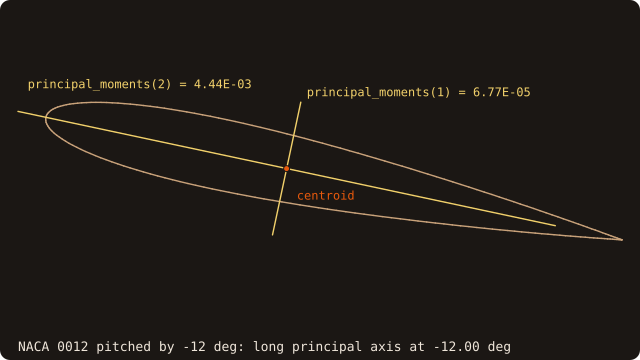

# Mass properties

## What it does

Computes, for the closed body bounded by a surface:

- the **mass** and the **centre of mass**;
- the **inertia tensor**, about the centre of mass or about any given point;
- the **principal moments** and **principal axes**.

The results come from exact polyhedral integrals: the only error is floating-point round-off. A body moved by the
fluid (6-DOF fluid–structure interaction) needs them to integrate the Newton–Euler equations, alongside the prescribed
kinematics of [moving bodies](/guide/advanced/moving-bodies) (issue #59, roadmap #58).

{.fossil-figure}

The figure shows a body with no symmetry: the union of a tilted ellipsoid and an off-centre ball, from marching
cubes. It is drawn with its centre of mass, its principal axes and the *equivalent inertia ellipsoid*. That is the
uniform ellipsoid with the same mass and inertia tensor, drawn as its three principal sections. Its longest semi-axis
lies along the axis of the smallest moment.

## Method

Each facet (a, b, c) and a reference point o form a signed tetrahedron. With a, b, c taken relative to o and
$D = a \cdot (b \times c)$ (six times the signed volume), the divergence theorem gives:

$$
V = \sum \frac{D}{6}, \qquad
\int x \, dV = \sum \frac{D}{24} (a + b + c),
$$

$$
\int x_i x_j \, dV = \sum \frac{D}{120} \Big[ \sum_{p} v_{p,i} v_{p,j} + \Big(\sum_p v_{p,i}\Big)\Big(\sum_p v_{p,j}\Big) \Big],
$$

where $p$ runs over the three vertices. This is the covariance form of Tonon (2004); Mirtich (1996) and Eberly
give the same integrals. With $C$ the second-moment matrix about the centre of mass (moved there by the
parallel-axis theorem), the inertia tensor is

$$
I = \rho \, \big( \operatorname{tr}(C) \, \mathbf{1} - C \big).
$$

The principal moments and axes are the eigenvalues and eigenvectors of $I$, from a cyclic Jacobi solve of the
symmetric 3×3 matrix.

**Choices that keep it exact in practice**

- **The reference point is the bounding-box centre**, not the origin. Far from the origin the sums would cancel: a
  box at $10^6$ from the origin loses its tensor entirely with o = 0 (relative error 36 in the test), and keeps it to
  round-off with o = the box centre.
- **Only the vertices enter**, in their stored order, as for the volume. A stale stored facet normal cannot change the
  result.
- **The sums are compensated** (Neumaier) and run in a fixed order. The error stays O(ε) instead of O(N ε), and the
  result does not depend on the thread count.
- **The principal axes are orthonormal and right-handed** (det = +1). The moments are sorted ascending. The sign
  convention is fixed: in axes 1 and 2 the largest-magnitude component is positive, and axis 3 = axis 1 × axis 2.
  With repeated moments (a sphere, a cube) the axes are not unique, and any orthonormal set returned is valid.

{.fossil-figure}

The reference point need not be inside the body. For a torus, the box centre o lies in the hole, and the facets of
the inner side, which face it, give D < 0. The positive tetrahedra sum to 3.568, the negative ones to -0.510, and the
total, 3.058, is the volume `mass_properties` returns (the smooth torus has 2π²Rr² = 3.158). The figure is drawn by
`docs/examples/src/fig_ref_mass_properties_method.f90`.

## API

```fortran
call surface%mass_properties(mass, center, inertia, principal_moments, principal_axes, density, about, volume, status)
   class(surface_stl_object), intent(in)            :: self
   real(R8P),                 intent(out), optional :: mass                 ! density * volume
   real(R8P),                 intent(out), optional :: center(3)            ! centre of mass
   real(R8P),                 intent(out), optional :: inertia(3,3)         ! about center, or about `about`
   real(R8P),                 intent(out), optional :: principal_moments(3) ! ascending
   real(R8P),                 intent(out), optional :: principal_axes(3,3)  ! columns, right-handed
   real(R8P),                 intent(in),  optional :: density              ! uniform, default 1
   real(R8P),                 intent(in),  optional :: about(3)             ! point of the tensor
   real(R8P),                 intent(out), optional :: volume               ! enclosed volume
   integer(I4P),              intent(out), optional :: status               ! STATUS_OK, STATUS_INVALID_INPUT
```

- The surface must be **watertight** with a **positive enclosed volume** (outward orientation). Otherwise `status` is
  `STATUS_INVALID_INPUT` and every output is zero: never a silently wrong tensor. Run
  [`sanitize`](/guide/usage), with `fill_holes=.true.` if needed, first.
- **Voids are fine.** An inner shell wound inward subtracts its volume and its moments.
- `principal_moments` and `principal_axes` always refer to the tensor about the centre of mass, whatever `about` is.
- The procedure does not modify the surface and needs no extra memory beyond a few scalars.

## Frames and poses

The tensor is computed in the frame of the surface's coordinates (the body frame of
[moving bodies](/guide/advanced/moving-bodies)). Two free functions, exported by `fossil`, change frame:

```fortran
inertia_w = inertia_to_world(inertia, pose)       ! type(rigid_pose_t): R I R^T
frame     = principal_frame(center, principal_axes) ! rigid_pose_t: principal coordinates -> body coordinates
```

- `inertia_to_world` gives the tensor of the body placed at `pose` (x_world = R x_body + t): R I Rᵀ. The translation
  does not enter, because the tensor is about a point that moves with the body (the centre of mass). The body moved by
  `move(pose)` gives the same tensor to round-off (5e-16 in the test).
- `principal_frame` is the pose whose rotation is the principal axes and whose origin is the centre of mass: in its
  coordinates the tensor is diagonal (off-diagonal 1e-16 of the largest moment in the test). Compose it with a
  world pose to place a body integrated in its principal frame, as the animation below does.

{.fossil-figure}

The animation is a T-handle spinning about its intermediate principal axis, the tennis-racket (Dzhanibekov) effect.
The program (`docs/examples/src/anim_mass_properties.f90`) does three things:

- it takes the principal moments and axes from `mass_properties`;
- it integrates Euler's equations $I \dot\omega = (I\omega) \times \omega$ in the principal frame together with the
  orientation, using RK4 with a fixed step;
- it draws the body at each pose with `principal_frame` and `move`.

The angular velocity is drawn in ember from the centre of mass; the line of the angular momentum, fixed in space, in
gold. A spin about the intermediate axis is unstable: the handle flips over twice in 6 s. Over the whole run the
kinetic energy and the angular momentum drift by 3e-12 and 2e-11 relative, which is the integrator's error.

## 2-D: curves

`curve%mass_properties` gives the same quantities, per unit depth, for the region bounded by a closed
[curve](/guide/advanced/2d-geometry). Green's theorem over each segment $(u_i, v_i) \to (u_j, v_j)$, with
$c = u_i v_j - u_j v_i$, gives:

$$
A = \sum \frac{c}{2}, \qquad \int u \, dA = \sum \frac{c}{6}(u_i + u_j), \qquad
\int u^2 \, dA = \sum \frac{c}{12}(u_i^2 + u_i u_j + u_j^2),
$$

$$
\int u v \, dA = \sum \frac{c}{24}(2 u_i v_i + u_i v_j + u_j v_i + 2 u_j v_j).
$$

The sums are taken about the bounding-box centre and compensated, as in 3-D. Holes, wound clockwise, subtract.

```fortran
call curve%mass_properties(mass, center, second_moments, polar_moment, principal_moments, principal_angle, &
                           density, about, area, status)
```

- `second_moments = [I_uu, I_vv, I_uv]` $= \rho \, [\int (u-p_u)^2, \int (v-p_v)^2, \int (u-p_u)(v-p_v)] \, dA$ about
  p = the centroid (or `about`). These are the second moments of the region, not of inertia about the axes:
  $I_{vv} = \int v^2 dA$ is the beam engineer's second moment of area for bending about the u axis.
- `polar_moment` $= I_{uu} + I_{vv}$ is the inertia per unit depth for a rotation in the plane: the $I_{zz}$ of the
  extruded body divided by its depth (checked against the 3-D path to round-off).
- `principal_moments(2)` are the eigenvalues of the 2×2 matrix of second moments, ascending, and `principal_angle`
  (radians, in (−π/2, π/2]) is the direction of the axis of the larger one: the long axis of the section.
- Every loop must be closed and the enclosed area positive; otherwise `status = STATUS_INVALID_INPUT`.

{.fossil-figure}

A NACA 0012 section of unit chord pitched by −12° (200 points). Its area is 0.0817, its centroid is at 0.42 chord,
and `principal_angle` returns the pitch, −12.00°.

<<< @/examples/snippets/ck_mass_properties_2d.f90

<<< @/examples/output/ck_mass_properties_2d.ansi{ansi}

## Example

<<< @/examples/snippets/ck_mass_properties.f90

<<< @/examples/output/ck_mass_properties.ansi{ansi}

The block is 0.1 × 0.2 × 0.3 m, so $I_{xx} = m (0.2^2 + 0.3^2)/12 = 47.1 \cdot 0.13/12 = 0.51025$ kg m², as printed.
About a corner, the parallel-axis term adds $m (0.1^2 + 0.15^2) = 1.53075$ to it.

## Command line

`fossilizer --mass_properties` prints the mass properties of each input after the other operations, with an
optional uniform `--density` (default 1). A surface that is not closed is reported, not measured:

```bash
fossilizer -i cube-02.stl --mass_properties --density 2
```

```text
mass properties, density   2.000000000000000E+00
  mass                  2.000000000000000E+00
  centre of mass        5.000000000000000E-01  5.000000000000000E-01  5.000000000000000E-01
  inertia tensor about the centre of mass:
                        3.333333333333334E-01 -1.355252715606881E-19 -1.355252715606881E-19
                       -1.355252715606881E-19  3.333333333333334E-01  1.355252715606881E-19
                       -1.355252715606881E-19  1.355252715606881E-19  3.333333333333334E-01
  principal moments     3.333333333333333E-01  3.333333333333361E-01  3.333333333333361E-01
  principal axes (columns):
  ...
```

The cube's three moments are equal, so its principal axes are any orthonormal set (the printed ones are one).
`src/tests/fossil_test_mass_cli.f90` reads these lines back.

## Validation

`src/tests/fossil_test_mass_properties.f90`, against closed-form results:

| Case | Checked | Measured error |
|---|---|---|
| Box a×b×c, density 2 | mass, centre, tensor; tensor about a corner | 0 (exact) |
| L-shaped prism (one shell) | the two boxes' tensors moved to the common centre | 2.4e-16 |
| Hollow box (inner shell reversed) | outer minus inner | 1.7e-16 |
| The box under a rotation R | R I Rᵀ, principal moments, axes = R's columns up to sign | 3.2e-16, 1.1e-15, 0 |
| The box at 10⁶ from the origin | tensor about the centre unchanged | 0 |
| `cube-04.stl` (3072 facets) | volume 1, centre 0.5, tensor = `get_volume()`, `get_centroid()` | 2.3e-14, 0, 1.7e-16 |
| Marching-cubes unit sphere, 3 grids | mean moment → 2/5 m r² | observed order 2.01 |
| Open box, inside-out box | `STATUS_INVALID_INPUT` | |
| `symmetric3_eigen`, 200 random matrices | A v = w v, det v = 1, vᵀv = 1 | < 1e-13 |
| The L prism moved by `move(pose)` | tensor = `inertia_to_world`, centre = `to_world` | 5.5e-16, 1.5e-16 |
| `principal_frame` | Rᵀ I R diagonal, the principal moments on it | 1.2e-16, 8.5e-16 |

`src/tests/fossil_test_curve_mass_properties.f90`, the 2-D path:

| Case | Checked | Measured error |
|---|---|---|
| Rectangle away from the origin, density 3 | area, centroid, A a²/12, A b²/12, 0 | 0 |
| Right triangle | centroid (a/3, b/3), A a²/18, A b²/18, −A a b/36 | 7.4e-17 |
| L-shape | the two rectangles moved to the common centroid | 1.2e-16 |
| Annulus of regular N-gons, N = 64, 128, 256 | the polygon formula of each loop; J → π(R⁴ − r⁴)/2 | 1.4e-16; order 2.00 |
| Ellipse polygon | I_vv → π a b³/4 | order 2.00 |
| The L rotated by 0.6 rad | R M Rᵀ, polar moment, principal values and angle | 3.6e-16 |
| The rotated L moved by 10⁶ | the same rounded polygon moved back exactly | 1.8e-16 |
| Open loop, clockwise outer loop | `STATUS_INVALID_INPUT` | |
| The L extruded to a 3-D prism | mass A d, I_zz = d J, I_xx = d I_vv + A d³/12, I_xy = −d I_uv | 0 |

The sphere converges at second order because the marching-cubes surface is a second-order approximation of the
sphere: the integrals over that polyhedron are exact.

## See also

- [Moving bodies](/guide/advanced/moving-bodies): poses, body-frame queries, swept geometry.
- [`surface_stl_object`](/guide/api/surface-stl-object): `get_volume`, `get_centroid` (the same volume integrals).

## References

- G. Bashein, P. R. Detmer, *Centroid of a polygon*, Graphics Gems IV, 1994 (the polygon area moments).
- B. Mirtich, *Fast and accurate computation of polyhedral mass properties*, Journal of Graphics Tools 1(2), 1996.
- F. Tonon, *Explicit exact formulas for the 3-D tetrahedron inertia tensor in terms of its vertex coordinates*,
  Journal of Mathematics and Statistics 1(1), 2004.
- D. Eberly, *Polyhedral Mass Properties (Revisited)*, Geometric Tools, 2002.
- A. Neumaier, *Rundungsfehleranalyse einiger Verfahren zur Summation endlicher Summen*, ZAMM 54, 1974.
