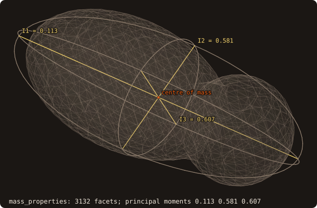

# Mass properties

## What it does

Computes, for the closed body bounded by a surface:

- the **mass** and the **centre of mass**;
- the **inertia tensor**, about the centre of mass or about any given point;
- the **principal moments** and **principal axes**.

The results come from exact polyhedral integrals: the only error is floating-point round-off. A body moved by the
fluid (6-DOF fluid–structure interaction) needs them to integrate the Newton–Euler equations, alongside the prescribed
kinematics of [moving bodies](/guide/advanced/moving-bodies) (issue #59, roadmap #58).

{.fossil-figure}

The figure shows a body with no symmetry: the union of a tilted ellipsoid and an off-centre ball, from marching
cubes. It is drawn with its centre of mass, its principal axes and the *equivalent inertia ellipsoid*. That is the
uniform ellipsoid with the same mass and inertia tensor, drawn as its three principal sections. Its longest semi-axis
lies along the axis of the smallest moment.

## Method

Each facet (a, b, c) and a reference point o form a signed tetrahedron. With a, b, c taken relative to o and
$D = a \cdot (b \times c)$ (six times the signed volume), the divergence theorem gives:

$$
V = \sum \frac{D}{6}, \qquad
\int x \, dV = \sum \frac{D}{24} (a + b + c),
$$

$$
\int x_i x_j \, dV = \sum \frac{D}{120} \Big[ \sum_{p} v_{p,i} v_{p,j} + \Big(\sum_p v_{p,i}\Big)\Big(\sum_p v_{p,j}\Big) \Big],
$$

where $p$ runs over the three vertices. This is the covariance form of Tonon (2004); Mirtich (1996) and Eberly
give the same integrals. With $C$ the second-moment matrix about the centre of mass (moved there by the
parallel-axis theorem), the inertia tensor is

$$
I = \rho \, \big( \operatorname{tr}(C) \, \mathbf{1} - C \big).
$$

The principal moments and axes are the eigenvalues and eigenvectors of $I$, from a cyclic Jacobi solve of the
symmetric 3×3 matrix.

**Choices that keep it exact in practice**

- **The reference point is the bounding-box centre**, not the origin. Far from the origin the sums would cancel: a
  box at $10^6$ from the origin loses its tensor entirely with o = 0 (relative error 36 in the test), and keeps it to
  round-off with o = the box centre.
- **Only the vertices enter**, in their stored order, as for the volume. A stale stored facet normal cannot change the
  result.
- **The sums are compensated** (Neumaier) and run in a fixed order. The error stays O(ε) instead of O(N ε), and the
  result does not depend on the thread count.
- **The principal axes are orthonormal and right-handed** (det = +1). The moments are sorted ascending. The sign
  convention is fixed: in axes 1 and 2 the largest-magnitude component is positive, and axis 3 = axis 1 × axis 2.
  With repeated moments (a sphere, a cube) the axes are not unique, and any orthonormal set returned is valid.

## API

```fortran
call surface%mass_properties(mass, center, inertia, principal_moments, principal_axes, density, about, volume, status)
   class(surface_stl_object), intent(in)            :: self
   real(R8P),                 intent(out), optional :: mass                 ! density * volume
   real(R8P),                 intent(out), optional :: center(3)            ! centre of mass
   real(R8P),                 intent(out), optional :: inertia(3,3)         ! about center, or about `about`
   real(R8P),                 intent(out), optional :: principal_moments(3) ! ascending
   real(R8P),                 intent(out), optional :: principal_axes(3,3)  ! columns, right-handed
   real(R8P),                 intent(in),  optional :: density              ! uniform, default 1
   real(R8P),                 intent(in),  optional :: about(3)             ! point of the tensor
   real(R8P),                 intent(out), optional :: volume               ! enclosed volume
   integer(I4P),              intent(out), optional :: status               ! STATUS_OK, STATUS_INVALID_INPUT
```

- The surface must be **watertight** with a **positive enclosed volume** (outward orientation). Otherwise `status` is
  `STATUS_INVALID_INPUT` and every output is zero: never a silently wrong tensor. Run
  [`sanitize`](/guide/usage), with `fill_holes=.true.` if needed, first.
- **Voids are fine.** An inner shell wound inward subtracts its volume and its moments.
- `principal_moments` and `principal_axes` always refer to the tensor about the centre of mass, whatever `about` is.
- The procedure does not modify the surface and needs no extra memory beyond a few scalars.

## Example

<<< @/examples/snippets/ck_mass_properties.f90

<<< @/examples/output/ck_mass_properties.ansi{ansi}

The block is 0.1 × 0.2 × 0.3 m, so $I_{xx} = m (0.2^2 + 0.3^2)/12 = 47.1 \cdot 0.13/12 = 0.51025$ kg m², as printed.
About a corner, the parallel-axis term adds $m (0.1^2 + 0.15^2) = 1.53075$ to it.

## Validation

`src/tests/fossil_test_mass_properties.f90`, against closed-form results:

| Case | Checked | Measured error |
|---|---|---|
| Box a×b×c, density 2 | mass, centre, tensor; tensor about a corner | 0 (exact) |
| L-shaped prism (one shell) | the two boxes' tensors moved to the common centre | 2.4e-16 |
| Hollow box (inner shell reversed) | outer minus inner | 1.7e-16 |
| The box under a rotation R | R I Rᵀ, principal moments, axes = R's columns up to sign | 3.2e-16, 1.1e-15, 0 |
| The box at 10⁶ from the origin | tensor about the centre unchanged | 0 |
| `cube-04.stl` (3072 facets) | volume 1, centre 0.5, tensor = `get_volume()`, `get_centroid()` | 2.3e-14, 0, 1.7e-16 |
| Marching-cubes unit sphere, 3 grids | mean moment → 2/5 m r² | observed order 2.01 |
| Open box, inside-out box | `STATUS_INVALID_INPUT` | |
| `symmetric3_eigen`, 200 random matrices | A v = w v, det v = 1, vᵀv = 1 | < 1e-13 |

The sphere converges at second order because the marching-cubes surface is a second-order approximation of the
sphere: the integrals over that polyhedron are exact.

## See also

- [Moving bodies](/guide/advanced/moving-bodies): poses, body-frame queries, swept geometry.
- [`surface_stl_object`](/guide/api/surface-stl-object): `get_volume`, `get_centroid` (the same volume integrals).

## References

- B. Mirtich, *Fast and accurate computation of polyhedral mass properties*, Journal of Graphics Tools 1(2), 1996.
- F. Tonon, *Explicit exact formulas for the 3-D tetrahedron inertia tensor in terms of its vertex coordinates*,
  Journal of Mathematics and Statistics 1(1), 2004.
- D. Eberly, *Polyhedral Mass Properties (Revisited)*, Geometric Tools, 2002.
- A. Neumaier, *Rundungsfehleranalyse einiger Verfahren zur Summation endlicher Summen*, ZAMM 54, 1974.
