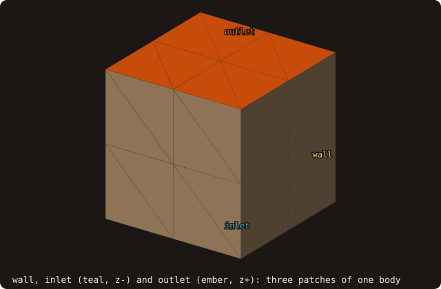
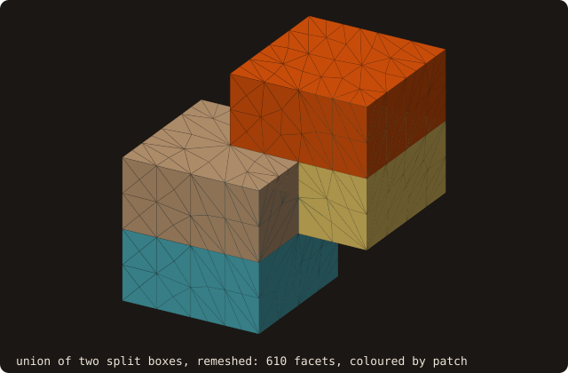

# Named patches

{.fossil-figure}

## What it does

A CFD body carries several boundary conditions: walls, inlets, outlets, porous or heated regions. Exporters write
them as named `solid <name> … endsolid` blocks of one ASCII STL, or as one STL file per patch. FOSSIL keeps them
(issue #66): every facet carries a patch id (`facet%patch`), an index into the surface's table of patch names.

## Reading and writing

- `load_from_file` reads one patch per `solid` block of an ASCII file, named after the block, in file order; blocks
  with the same name merge. A file with one block, or a binary file, is one patch named after the header.
- `load_from_files(file_names)` reads several files as one surface, one patch per file (or per block), named after
  the `solid` name or, when that is empty, the file name.
- `save_into_file(is_ascii=.true.)` writes one block per patch; a single-patch surface writes exactly the file it
  wrote before. Binary STL has no names: all patches go into one.
- `get_patches_number()`, `patch_name(i)`, `facet_patch(f)` read the table; `set_patch(facets, name)` moves facets
  to a named patch, created if new.

Before issue #66 the ASCII reader stopped with "malformed STL" at the first `endsolid` of a multi-solid file.

## Through the pipeline

The patch id travels with the facet, so every operation that keeps or copies facets keeps it:

- `sanitize`: degenerate and duplicate facets are removed with their ids; of two duplicates in different patches the
  first one in the file wins.
- `rotate`, `translate`, `mirror`, `resize` move vertices only.
- `clip` keeps the patch of every facet, and the remainder keeps the name table.
- `merge_solids(other)` maps `other`'s patches into the surface's table by name: equal names merge, new names are
  appended.
- `fill_holes` gives the new facets the patch of the hole's boundary when every boundary facet is in one patch, and a
  patch named `filled` otherwise (a hole across a wall/inlet edge has no single right answer; the caller can
  `set_patch` it).

## Through booleans

`boolean` and `resolve_self_intersections` keep the patch of every facet: a sub-triangle of the arrangement takes
its parent facet's patch, so the area of a patch in the result is the area of its parent patch outside (or inside) the
other body, as the operation selects. The other surface's patches join the table by name before the arrangement:
`A ∪ B` of a body with patches `low`, `high` and one with `b_low`, `b_high` has all four, and equal names merge (the
[Example](#example) measures it, through a remesh too).

## Through remeshing

Patch boundaries are kept where they are, like the sharp edges of [feature edges](/guide/advanced/feature-edges), and
every facet keeps a patch:

- `isotropic_remesh`: the vertices of the edges between two patches are locked (whatever `preserve_features` says),
  so those edges are never flipped or collapsed; a split facet's halves keep its patch, and a midpoint on a boundary
  edge becomes a boundary vertex.
- `decimate`: two boundary vertices never merge, and an interior vertex merges onto a boundary one at its place; the
  boundary vertices are the input ones exactly.
- `smooth`: the boundary vertices do not move.
- `alpha_wrap`: each facet of the wrap takes the patch of the input facet closest to its centroid.

## In the queries

{.fossil-figure}

`query_many(patches=)`, `query_many_device(patches=)`, `probe_many(patches=)` and `image_points(patches=)` return
the patch of the facet that holds each query's closest point: the boundary condition to apply at an image point or a
forcing point. The device path looks it up on the host from the facet ids the device returns, so it is bit-identical
to the CPU path (the GPU bench line `patch device vs serial mismatches` is 0).

## 2-D curves

A curve carries a patch per segment (segment i runs from vertex i to the next). In the loop format, a line
`# patch <name>` puts the segments starting at the vertices that follow in that patch; it does not end the loop. A
curve without directives has one unnamed patch and is written back without them. `repair` keeps every segment's
patch through joins, merges and reversals; `slice_surface` gives each segment the patch of the facet it is cut from,
and the curve takes the surface's names. `query_many(_device)(patches=)`, `probe_many(patches=)` and
`image_points(patches=)` return the patch of the closest segment (device: host lookup, bit-identical). API:
`get_patches_number`, `patch_name`, `segment_patch`, `set_patch`.

```text
# patch wall
0 0
1 0
1 1
# patch inlet
0 1
```

## Command line

`fossilizer -i body.stl --patches prefix_` prints the patches (facets and area each) and writes each one to
`prefix_<name>.stl`.

## Example

The cookbook recipe [wall, inlet and outlet from one STL](/manual/cookbook#wall-inlet-and-outlet-from-one-stl) tags
the faces of a box, writes them as three blocks, reads them back and queries the patch at three points. Here the
patches go through a boolean, a remesh and a section. Two unit boxes, each split at its mid-height into a lower and
an upper patch (the helper `split_box` of the program, which calls `set_patch` twice), the second moved by
(0.5, 0.5, 0.5), united:

<<< @/examples/snippets/ref_patches-boolean.f90

Then remeshed, and cut by the plane z = 0.75 (`areas` and `lengths` sum the facet areas and the segment lengths of
every patch):

<<< @/examples/snippets/ref_patches-remesh.f90

<<< @/examples/snippets/ref_patches-slice.f90

<<< @/examples/output/ref_patches.ansi{ansi}

- **Boolean.** The union's patches are the four input ones, merged into one table by name. Each keeps the area of its
  parent patch outside the other body: `low` and `b_high` lie wholly outside (area 3 each), while `high` and `b_low`
  lose the three quarter-faces inside the other box (3 − 0.75 = 2.25). The four sum to the union's area, 10.5.
- **Remesh.** 84 facets become 610, but each patch keeps its area to the printed digits: the patch boundaries, the
  mid-height lines and the intersection curve, are locked, so no facet crosses them.
- **Section.** The curve's segments take the patch of the facet they are cut from, and the curve takes the surface's
  names. At z = 0.75 the section meets `high` (A's upper half) and `b_low` (B's lower half), 3 each: the perimeter of
  each square outside the other.

{.fossil-figure}

## API

See [Patches](/guide/api/surface-stl-object#patches) in the API reference.
