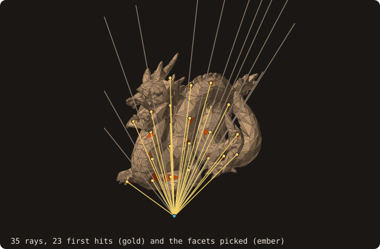
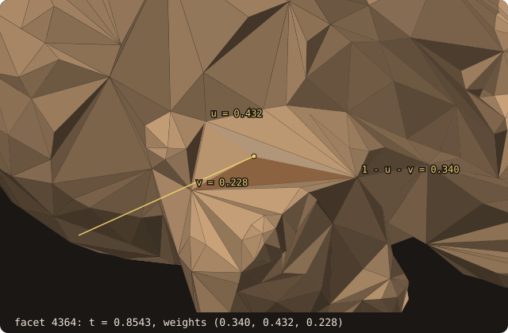
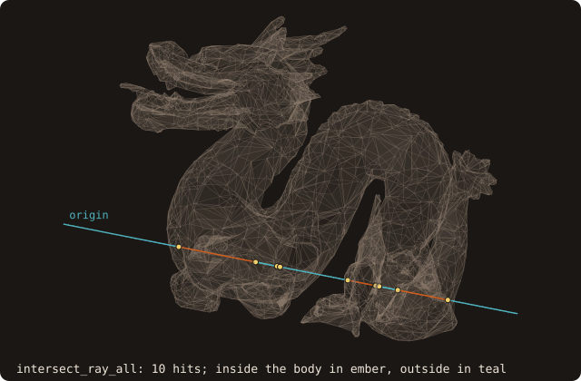

# Ray-mesh intersection queries

## What it does

Three TBPs that wrap the AABB-tree-accelerated **ray-versus-surface**
intersection in flavours that match the canonical use cases:

- **`intersect_ray_first`** — closest hit (best-first traversal with
  `t_best` pruning). For *picking* (which facet did the ray hit?).
- **`intersect_ray_all`** — every hit, sorted ascending by `t`. For
  *visibility* counting and inside / outside ray-cast tests.
- **`intersect_ray_any`** — early-exit "is there *any* hit within
  `max_t`?" For *shadow rays* and conservative inside-test
  rejection.

All three share one exact ray-facet test (issue #82) and the same AABB tree traversal pattern (the
`enumerate_children` dispatcher used by §1.4 and §1.2). Both SAH BVH and octree tree kinds are supported
transparently. Every hit is decided exactly, so a ray crosses the surface **once per crossing**: through a shared edge
or vertex it hits one of the facets there, and on a closed surface the parity of the hit count is the state of the
origin.

{.fossil-figure}

Picking: from an eye point in front of the dragon, 35 rays aimed at a grid over its box. 23 hit, and
`intersect_ray_first` returns the first hit of each (gold) and the facet it picked (ember); the other 12 miss. The
figure is drawn by `docs/examples/src/fig_ref_ray_queries_picking.f90`.

## Pipeline

For each query:

1. **Tree traversal**. Starting from the root, walk down to leaves
   whose AABB the ray pierces. The slab-test produces a `[t_near,
   t_far]` interval per box; subtree pruning uses `t_near` for
   ordering. The boxes are padded by 1e-9 of the ray's extent over the surface box (and, for the octree, by the
   facets' reach: an octree node holds the facets whose centroid it contains, which stick out of its box), so no
   crossing is lost to round-off at a box face.
2. **Per-leaf facet sweep**. For each owned facet, the exact test of `fossil_ray_query`. The ray is the line through
   the origin `o` and a far point `q = o + s·d` beyond the surface box (rounded once, the same for every facet).
   It crosses triangle ABC iff the three side tests `orient3d(o, q, A, B)`, `(o, q, B, C)`, `(o, q, C, A)` have one
   sign; a zero (the ray meets an edge's line) is settled by one symbolic perturbation of the ray, the same for every
   facet, so the two facets of an edge always see it on opposite sides. An axis-aligned ray takes the kernel of
   [`line_crossings`](/guide/advanced/cut-cells) instead (the global perturbation of issue #69), so it agrees with
   the line queries and the cut cells. The crossing is ahead iff `o` and `q` lie on opposite sides of the facet's
   plane (`orient3d`, exact); `t` itself is rounded, from the barycentric weights of the side tests.
3. **Per-flavour assembly**:
   - `_first` — keep the smallest `t ≥ 0`; prune any subtree whose
     `t_near ≥ t_best`.
   - `_all` — accumulate every hit with `t ≥ 0`; sort ascending.
   - `_any` — return on the first hit with `t ∈ [0, max_t]`; prune any
     subtree whose `t_near > max_t`.

A flat-O(N) fallback exists for surfaces without a built AABB tree;
it operates on `facet(:)` directly. Standard surfaces from
`load_from_file` always have a tree, so the fallback rarely fires.

{.fossil-figure}

One of those hits, seen through the per-facet Möller-Trumbore test `facet%intersect_ray` (the queries decide the hit
exactly, as step 2 says, but the parameter is the same): t = 0.8543 and (u, v), the weights (0.340, 0.432, 0.228) of
vertices 1, 2 and 3. Each weight is the area fraction of the sub-triangle opposite its vertex (shaded). The point at t
along the ray and the barycentric point agree with `hit%point` within 1e-12.

## API

### Closest hit

```fortran
call surface%intersect_ray_first(ray_origin, ray_direction, hit, has_hit, status, exclude)
   class(surface_stl_object), intent(in)            :: self
   type(vector_R8P),          intent(in)            :: ray_origin
   type(vector_R8P),          intent(in)            :: ray_direction  ! need not be unit
   type(ray_hit_t),           intent(out)           :: hit            ! valid iff has_hit
   logical,                   intent(out)           :: has_hit
   integer(I4P),              intent(out), optional :: status         ! RAY_STATUS_*
   integer(I4P),              intent(in),  optional :: exclude        ! facet to skip (issue #62)
```

`hit` carries `%facet_id`, `%t`, `%point` (= `ray_origin + t·ray_direction`).
**Always check `has_hit` first** — `hit` is undefined when `has_hit
= .false.`.

### All hits

```fortran
call surface%intersect_ray_all(ray_origin, ray_direction, hits, status, exclude)
   type(ray_hit_t), allocatable, intent(out)           :: hits(:)
   integer(I4P),                 intent(in),  optional :: exclude   ! facet to skip (issue #82)
```

`hits` is **always allocated** (zero-length if no hits found), **sorted ascending by `t`** (then by facet id), with
**one hit per crossing** of the surface. `exclude` drops one facet, as for `_first`: the facet a ray is cast from.

{.fossil-figure}

The ray above, along +x from (−14, −1.5, 7.857), passes through the dragon five times: 10 hits from t = 6.629 to
22.151, entries and exits alternating (the program tells them by the sign of the facet normal's x component). The
exit at t = 17.967 and the entry at t = 17.987 are 0.020 apart: a narrow gap between two parts of the body.

### Any hit (shadow ray)

```fortran
call surface%intersect_ray_any(ray_origin, ray_direction, max_t, found, status)
   real(R8P), intent(in), optional :: max_t      ! default MaxR8P
   logical,   intent(out)          :: found
```

Returns immediately on the first hit with `0 ≤ t ≤ max_t`. Default
`max_t` accepts any forward hit. Pass the Euclidean distance to a
target point (when direction is unit) to test occlusion of that
target.

{.fossil-figure}

Above, each of the 6860 cells of the ground casts one shadow ray towards the light, with no `max_t` (the light is at
infinity); 2267 are blocked. A blocked ray returns at its first hit, wherever it is in the tree.

## Example

The cookbook [casts one ray at the dragon](/manual/cookbook#cast-a-ray). This program runs the three queries on the
unit cube `cube-01.stl`, then the two cases where the surface's own edges matter:

<<< @/examples/snippets/ref_ray_queries-queries.f90

<<< @/examples/snippets/ref_ray_queries-edges.f90

<<< @/examples/output/ref_ray_queries.ansi{ansi}

- **`_first`** returns the facet, `t` and the point. With the direction `2 ex` the same point has `t = 0.5`: `t` is
  parametric, not a length.
- **`_all`** returns the entry at `t = 1` and the exit at `t = 2`, sorted. Which is which is not in the record: the
  sign of the hit facet's normal against the direction tells it.
- **`_any`** with `max_t = 1` finds the hit at exactly `t = 1`: the bound is inclusive.
- **An origin on the surface** is hit at `t = 0`: hits at `t = 0` are kept, by `_first`, `_all` and `_any` alike.
  The crossing is at the origin, so it is a hit; whether the ray then enters or leaves depends on the direction. To
  leave the facet the ray starts from, pass it as `exclude` (to `_first` or `_all`): the next hit is the far face at
  `t = 1`.
- **A ray through a shared edge** hits one of its two facets: 2 hits for 2 crossings. **Through the face centres**,
  where four facets meet at a vertex, it hits one of the four: 2 hits again (12 before issue #82). A parity count
  needs no merging: on a closed surface, an odd number of hits means the origin is inside, whatever edges and
  vertices the ray passes through, and a ray that only touches the surface at an edge or lies in a face plane counts
  0 or 2. The `fossil_test_ray_crossings` test checks it on rays along the grid lines of a marching-cubes sphere, the
  diagonals of the cube's faces and aimed at mesh vertices: parity equals `is_point_inside` on every one.

## Known limitations

- **Direction need not be unit.** `t` is the *parametric* position
  (`origin + t·direction`), not the Euclidean distance, when
  `direction` isn't unit. Normalize the direction yourself if you
  want `t` to mean Euclidean distance.
- **Hits exactly at `t = 0`** (origin on the surface) are returned
  by `_first`, `_all` and `_any`, as the example shows. For a ray cast
  from a facet, pass that facet as `exclude` to `_first` or `_all` (no
  origin offset needed); a ray from a point on an edge or vertex still
  hits one of the other facets there at `t = 0`.
- **`t` is rounded**, the hit decisions are exact: two crossings closer
  than round-off keep their order by facet id when their `t` are equal.
- **Boundary-touching cases at `t = max_t`** are *included* by
  `_any` (the contract is `t ≤ max_t`, inclusive).
- **Two latent slab-test bugs** in the underlying AABB ray test were
  fixed during the §2.5 implementation: a parallel-ray classifier
  that misread `EPS = 0.0` as "negative directions are parallel," and
  a slab-interval accumulator that took `max` of far-plane crossings
  instead of `min`. The pre-§2.5 ray-cast inside-test sign algorithm
  worked anyway — the bugs only inflated AABB-hit counts; the per-
  facet test downstream filtered correctly. The fix made the inside-
  test sign algorithm strictly faster and unblocked the new
  intersect_ray_* TBPs.

## See also

- [`facet%intersect_ray`](/guide/api/facet-object) — the per-facet
  Möller-Trumbore test, with barycentrics. Useful against a single
  triangle; the surface queries use the exact test instead (issue #82).
- [SDF segmentation](/guide/advanced/sdf-segmentation) — the
  cone-of-rays SDF query uses `intersect_ray_first` for every cone
  ray.
- [`ray_hit_t`](/guide/api/constants) — the record type returned by
  the queries.
- [Constants](/guide/api/constants) — `RAY_STATUS_*`.

## References

- Möller & Trumbore, *Fast, Minimum Storage Ray-Triangle
  Intersection*, Journal of Graphics Tools 2(1), 1997. `facet%intersect_ray`.
- Woop, Benthin & Wald, *Watertight Ray/Triangle Intersection*, Journal
  of Computer Graphics Techniques 2(1), 2013. The side tests, made exact
  here with `orient3d` and a symbolic perturbation.
- Smits, *Efficient Bounding Box Intersection*, Ray Tracing News
  15(1), 2002. The slab-based AABB ray test.
- Williams, Barrus, Morley & Shirley, *An Efficient and Robust
  Ray-Box Intersection Algorithm*, J. of Graphics Tools 10(1), 2005.
  Refinement of Smits' slab test that handles the parallel-ray
  case correctly (the formulation FOSSIL adopts after the §2.5
  fix).
