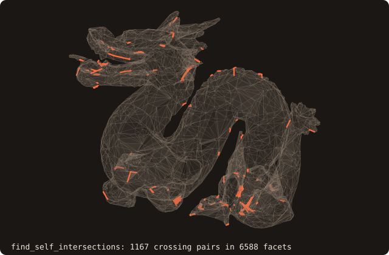

# Self-intersection detection and resolution

## What it does

Two TBPs that bracket the self-intersection problem:

- **`surface%find_self_intersections(pairs, status, include_touching)`** —
  *detection*. Returns the list of every facet pair `(a, b)` whose
  triangles cross or overlap in a common plane, decided exactly, with the
  kind of contact and the 3D segment endpoints of the intersection.
- **`surface%resolve_self_intersections(status)`** — *resolution*.
  Cleans the surface up by collapsing every self-crossing through a
  self-boolean union (`boolean(self, self, BOOL_UNION)`).

Real-world STL exports **routinely** have self-intersections. They
slip through `is_watertight()` (the topological-edge test is satisfied
even when triangles geometrically cross), so any downstream operation
that assumes a clean solid — booleans, signed distance, voxelization
for cut-cell — silently produces wrong answers. Detection is the first
step; resolution is what you reach for when sanitize alone can't fix
the input.

## Pipeline (detection)

1. **Tree-vs-tree broad phase.** Walk the AABB tree against itself,
   collecting every leaf-pair whose AABBs overlap. Reuses the existing
   `enumerate_children` dispatcher so SAH BVH and octree both share
   the traversal code.
2. **Pool-aware adjacency filter.** The shared vertices of the pair are
   counted by vertex-pool ID (exact coordinate equality when the pool is
   not in use). Two facets sharing an **edge** meet along it, as expected:
   skipped.
3. **Narrow phase.** No shared vertex (issue #69): the exact `pair_cut`
   of the boolean (`fossil_tritri_exact`, exact `orient3d` signs and
   implicit section points). A common segment of positive length is a
   crossing (`SELFINT_CROSSING`), reported with its endpoints rounded to
   doubles. A single common point is a touch (`SELFINT_TOUCHING`),
   reported only with `include_touching=.true.`. Two exactly coplanar
   triangles are compared in the projection that keeps them non-degenerate
   (exact `orient2d`, separating-axis test on the six edge lines):
   overlapping interiors are a defect (`SELFINT_COPLANAR`, `p` and `q`
   the two centroids), boundaries meeting without area a touch. Before
   #69 this was the floating Möller test, which never reported a coplanar
   overlap. One shared **vertex** (issue #46): the exact `pair_classify`
   (`orient3d`); a common segment of positive length is a crossing, the
   vertex alone is a touch and is not reported. Pairs whose other
   vertices lie strictly on one side of the other plane can only touch
   and are skipped. Exactly coplanar pairs sharing a vertex (issue #69;
   skipped to 1e-12 rad before, so crossings tilted by less went unseen)
   are decided in the projection: overlapping interiors are reported
   (`SELFINT_COPLANAR`), a common edge segment from the vertex is a touch
   (`include_touching`).

Not detected yet (issue #69, next step): two sheets crossing along a
**shared edge** (a non-manifold edge with four facets, e.g. two cubes
merged so that their face edges coincide), and a coplanar pair folded
over its shared edge.

## Pipeline (resolution)

`resolve_self_intersections` is a **one-line wrapper** over the
boolean engine:

```fortran
call self%boolean(other=self, op=BOOL_UNION, status=status)
```

The §1.1 arrangement code treats `self vs self` symmetrically: every
self-crossing becomes an arrangement segment, every input triangle
gets retriangulated, the per-sub-triangle winding-number tagging
keeps only the outer-manifold sub-triangles. Inherits §1.1's
[axis-aligned coplanar limitation](/guide/advanced/booleans#known-limitations).

## API

### Detection

```fortran
call surface%find_self_intersections(pairs=pairs, status=status, include_touching=touching)
   type(intersection_pair_t), allocatable, intent(out) :: pairs(:)
   integer(I4P),                           intent(out), optional :: status
   logical,                                intent(in),  optional :: include_touching ! default .false.
```

`pairs` is always allocated (zero-length if no intersections found).
Each record carries:

- `pairs(i)%a`, `pairs(i)%b` — facet IDs with `a < b`.
- `pairs(i)%kind` — `SELFINT_CROSSING` (a common segment of positive
  length), `SELFINT_COPLANAR` (coplanar, overlapping interiors) or, with
  `include_touching`, `SELFINT_TOUCHING` (one common point, or coplanar
  boundaries meeting without area).
- `pairs(i)%p`, `pairs(i)%q` — segment endpoints in world coordinates
  (the common point twice for a touch, the two centroids for a coplanar
  overlap).

### Resolution

```fortran
call surface%resolve_self_intersections(status=status)
   integer(I4P), intent(out), optional :: status  ! BOOL_STATUS_*
```

Mutates `self` in place. Output is self-intersection-free **modulo the
§1.1 coplanar limitation** — perturb the input by `~1e-6 * bbox_diag`
along each axis if you suspect coplanar self-overlaps.

## Example: detection

The dragon fixture in this repo is **known dirty** — it ships with
~1167 real self-intersections (759 before issue #46 added the pairs sharing one vertex) and is the regression workhorse for §1.2:

```fortran
program ex_find_self_intersections
use fossil
use penf,   only : I4P
implicit none

type(surface_stl_object)               :: dragon
type(intersection_pair_t), allocatable :: pairs(:)
integer(I4P)                           :: status

call dragon%load_from_file(file_name='src/tests/dragon.stl', guess_format=.true.)
call dragon%find_self_intersections(pairs=pairs, status=status)
print '(A,I0,A,I0)', 'dragon: ', dragon%get_facets_number(), &
      ' facets, ', size(pairs), ' self-intersection pairs'
endprogram ex_find_self_intersections
```

For a clean mesh (`cube.stl`, `bunny.stl`), the same call returns
`size(pairs) == 0` — the no-false-positive guarantee of the
adjacency filter (every shared edge and every fan around a vertex would
otherwise register as a pseudo-intersection).

## Example: resolution

```fortran
program ex_resolve_self_intersections
use fossil
use penf,   only : I4P
implicit none

type(surface_stl_object)               :: dragon
type(intersection_pair_t), allocatable :: pairs(:)
integer(I4P)                           :: status

call dragon%load_from_file(file_name='src/tests/dragon.stl', guess_format=.true.)
call dragon%find_self_intersections(pairs=pairs, status=status)
print '(A,I0)', 'before: ', size(pairs)

call dragon%resolve_self_intersections(status=status)

call dragon%find_self_intersections(pairs=pairs, status=status)
print '(A,I0,A,I0)', 'after:  ', size(pairs), '  status=', status
endprogram ex_resolve_self_intersections
```

## Visual reference

The dragon fixture (6588 facets), drawn translucent, with the segment
`p`–`q` of each of the 1167 crossing pairs `find_self_intersections`
reports:

{.fossil-figure}

Drawn opaque, the dragon looks fine: the crossings are small folds
the eye does not catch. That's the *whole point*
of `find_self_intersections` — these are the defects that escape eye
inspection and that `is_watertight()` doesn't catch.

## Known limitations

- **Resolution inherits §1.1's coplanar limitation**. Self-
  intersections that involve **coplanar facet pairs** (axis-aligned
  cases especially) may produce a `resolve` output with the same
  silent-wrong-volume behaviour documented for the boolean. Workaround
  is the same: perturb by `~1e-6 * bbox_diag`. Most real-world dirty
  STL has *generic-position* self-intersections (random angles, no
  coplanar overlap) and the resolution works cleanly.
- **`resolve_self_intersections` returns the topology of `BOOL_UNION`**
  applied to the surface against itself. Interior cavities formed by
  self-intersections are dropped, not re-meshed — if the input had
  meaningful interior structure, it's gone after resolve.
- **Detection is `O(n_pairs)` in the worst case**, where `n_pairs` is
  the number of overlapping leaf-pairs found in the broad phase. For
  the dragon fixture (~6.6k facets) this is ~10× faster than brute-
  force `O(n²)` pair enumeration; for cleaner meshes the speedup is
  much larger because few leaves overlap at all.

## See also

- [booleans](/guide/advanced/booleans) — the resolution path is a
  one-liner over the boolean engine; same coplanar limitation
  applies.
- [`surface%sanitize`](/guide/api/surface-stl-object#sanitize) — local
  defect repair (degenerate / duplicate facets, normal orientation).
  Run this *before* `find_self_intersections` to filter out
  intersection records that exist only because of degenerate-facet
  noise.
- [alpha wrapping](/guide/advanced/alpha-wrap) — the heavyweight
  alternative for inputs too dirty for `resolve` to handle (large
  holes, missing facets that aren't just self-intersection
  artifacts).

## References

- Möller, *A Fast Triangle-Triangle Intersection Test*, Journal of
  Graphics Tools 2(2), 1997. The narrow-phase test until issue #69,
  replaced by the exact `pair_cut` (see [booleans](/guide/advanced/booleans)).
- Zhou, Grinspun, Zorin & Jacobson, *Mesh Arrangements for Solid
  Geometry*, SIGGRAPH 2016. The reference algorithm for the §1.1
  boolean that `resolve_self_intersections` reuses.
- libigl `igl::SelfIntersectMesh` — the closest open-source
  reference; FOSSIL's detector matches its broad-phase + narrow-phase
  decomposition.
