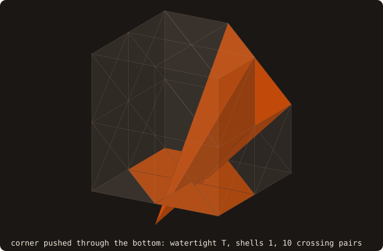
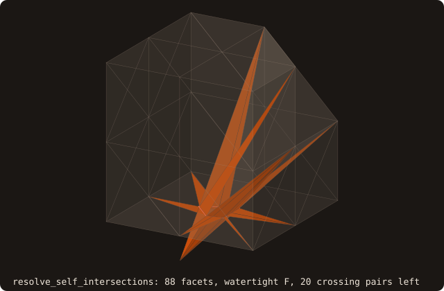
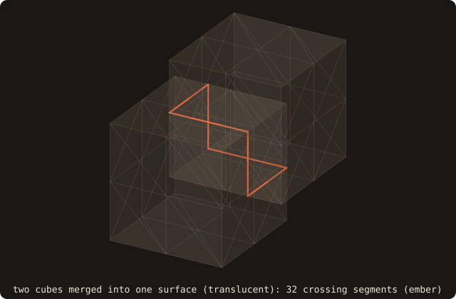

# Self-intersection detection and resolution

## What it does

Two TBPs that bracket the self-intersection problem:

- **`surface%find_self_intersections(pairs, status, include_touching)`** —
  *detection*. Returns the list of every facet pair `(a, b)` whose
  triangles cross or overlap in a common plane, decided exactly, with the
  kind of contact and the 3D segment endpoints of the intersection.
- **`surface%resolve_self_intersections(status)`** — *resolution*.
  Replaces a closed surface by the boundary of the region it winds
  around at least once: the self-union of the surface, built on the
  exact arrangement of the booleans (issue #78).

Real-world STL exports **routinely** have self-intersections. They
slip through `is_watertight()` (the topological-edge test is satisfied
even when triangles geometrically cross), so any downstream operation
that assumes a clean solid — booleans, signed distance, voxelization
for cut-cell — silently produces wrong answers. Detection is the first
step; resolution is what you reach for when sanitize alone can't fix
the input.

One closed shell that passes through itself: the unit cube with its
corner (1, 1, 1) pushed to (0.3, 0.35, −0.3), through its own bottom
face. It is watertight and one shell; `find_self_intersections` reports
10 crossing pairs:

{.fossil-figure}

## Pipeline (detection)

1. **Tree-vs-tree broad phase.** Walk the AABB tree against itself,
   collecting every leaf-pair whose AABBs overlap. Reuses the existing
   `enumerate_children` dispatcher so SAH BVH and octree both share
   the traversal code.
2. **Pool-aware adjacency filter.** The shared vertices of the pair are
   counted by vertex-pool ID (exact coordinate equality when the pool is
   not in use). Two facets sharing an **edge** meet along it, as expected;
   they are a defect only when exactly coplanar and folded over it (both
   free vertices on the same side of the edge, exact `orient2d`):
   `SELFINT_EDGE_FOLD` (issue #69).
3. **Narrow phase.** No shared vertex (issue #69): the exact `pair_cut`
   of the boolean (`fossil_tritri_exact`, exact `orient3d` signs and
   implicit section points). A common segment of positive length is a
   crossing (`SELFINT_CROSSING`), reported with its endpoints rounded to
   doubles. A single common point is a touch (`SELFINT_TOUCHING`),
   reported only with `include_touching=.true.`. Two exactly coplanar
   triangles are compared in the projection that keeps them non-degenerate
   (exact `orient2d`, separating-axis test on the six edge lines):
   overlapping interiors are a defect (`SELFINT_COPLANAR`, `p` and `q`
   the two centroids), boundaries meeting without area a touch. Before
   #69 this was the floating Möller test, which never reported a coplanar
   overlap. One shared **vertex** (issue #46): the exact `pair_classify`
   (`orient3d`); a common segment of positive length is a crossing, the
   vertex alone is a touch and is not reported. Pairs whose other
   vertices lie strictly on one side of the other plane can only touch
   and are skipped. Exactly coplanar pairs sharing a vertex (issue #69;
   skipped to 1e-12 rad before, so crossings tilted by less went unseen)
   are decided in the projection: overlapping interiors are reported
   (`SELFINT_COPLANAR`), a common edge segment from the vertex is a touch
   (`include_touching`).

4. **Non-manifold edges** (issue #69). Sheets crossing along a shared
   edge (e.g. two cubes merged so that one passes through the other along a
   common edge) meet only on the edge, so no pair test sees them. A pass
   over the edges with 4 or more facets orders the facets around each
   edge by the angle of their half-planes, exactly (`orient3d` on input
   vertices), and notes whether each traverses the edge forwards or
   backwards. Embedded oriented sheets alternate around the edge (the
   winding number of the wedges stays in {w, w + 1}); two adjacent facets
   with the same direction bound a wedge wound twice, where the sheets
   cross. Each such pair is reported as `SELFINT_SHEETS`, with the edge as
   `p`–`q`. Fans with unequal numbers of forward and backward facets (an
   orientation or boundary defect, not a crossing) and fans with two
   facets in the same half-plane (folds, reported pairwise) are skipped.
   The criterion assumes consistently oriented sheets: on a misoriented
   input a reported pair can be an orientation defect rather than a
   crossing (`sanitize` orients the normals first).

Not reported: duplicate facets (three shared vertices), which
`remove_duplicate_facets` handles.

Six pairs in one surface, each a triangle in the plane z = 0 and a
second one placed against it, with the kind reported for it
(`include_touching=.true.`):

{.fossil-figure}

## Pipeline (resolution)

`resolve_self_intersections` computes the self-union of Zhou et al.
(2016) on the exact machinery of the [booleans](/guide/advanced/booleans)
(issue #65), with the surface as its own and only operand:

1. **Arrangement of the surface with itself.** The pairs of
   `find_self_intersections` (crossings, coplanar overlaps, folds) are
   cut as the pairs of two bodies are: exact `pair_cut` /
   `coplanar_cut`, cut points as implicit points merged exactly, every
   cut facet triangulated by `cdt_facet` (exact `orient2d`). Pairs of
   sheets crossing along a non-manifold edge need no cut.
2. **Patches.** Sub-triangles connected across edges that are on no cut
   and shared by exactly two of them. The surface crosses itself only
   along cuts and non-manifold edges, so its winding number is constant
   on each side of a patch: some integer w on the side the normals point
   to, w + 1 behind it.
3. **Winding number per patch.** At the centroid c of a large
   sub-triangle the exact sum of the solid angles of every facet but the
   parent is w + 1/2: the parent's own term jumps by one across it, the
   others are continuous at c. Rounded to the nearest integer; of the
   three largest sub-triangles of the patch, the one whose sum is nearest
   to an integer + 1/2 decides.
4. **Selection.** A patch is kept iff w = 0: outside in front, inside
   behind. Interior walls (w ≥ 1 in front), doubly wound regions and
   inverted pockets (winding −1) go. A sub-triangle covered by coplanar
   facets of the surface is decided alone from the sum of their
   orientations, and kept once.
5. **Closure.** The selection must be closed (no boundary edge), else the
   status is `BOOL_STATUS_NOT_CLOSED` and the surface is left unchanged.

A surface with no self-intersection is returned unchanged.

On the pushed-corner cube above it returns `BOOL_STATUS_OK`: the dent
is cut at the bottom face, the pocket below it (wound −1) is dropped,
68 facets, watertight, no crossing pair left. The volume is the input's
signed volume plus the pocket's, 0.8604 + 0.0027
(`fossil_test_resolve_self` checks it to 1e-12):

{.fossil-figure}

## API

### Detection

```fortran
call surface%find_self_intersections(pairs=pairs, status=status, include_touching=touching)
   type(intersection_pair_t), allocatable, intent(out) :: pairs(:)
   integer(I4P),                           intent(out), optional :: status
   logical,                                intent(in),  optional :: include_touching ! default .false.
```

`pairs` is always allocated (zero-length if no intersections found).
Each record carries:

- `pairs(i)%a`, `pairs(i)%b` — facet IDs with `a < b`.
- `pairs(i)%kind` — `SELFINT_CROSSING` (a common segment of positive
  length), `SELFINT_COPLANAR` (coplanar, overlapping interiors),
  `SELFINT_EDGE_FOLD` (sharing an edge, coplanar, folded over it),
  `SELFINT_SHEETS` (adjacent around a non-manifold edge with the same
  direction: the sheets cross along the edge) or, with
  `include_touching`, `SELFINT_TOUCHING` (one common point, or coplanar
  boundaries meeting without area).
- `pairs(i)%p`, `pairs(i)%q` — segment endpoints in world coordinates
  (the common point twice for a touch, the two centroids for a coplanar
  overlap).

### Resolution

```fortran
call surface%resolve_self_intersections(status=status)
   integer(I4P), intent(out), optional :: status  ! BOOL_STATUS_*
```

Replaces `self` by its self-union when the status is `BOOL_STATUS_OK`,
and leaves it unchanged otherwise:

- `BOOL_STATUS_OK` — no self-intersection (nothing to do), or the
  self-union is closed;
- `BOOL_STATUS_CDT_FAILED` — the exact triangulation of a facet failed:
  a cut along the edge of a coplanar facet crosses another cut inside it
  (see [Known limitations](#known-limitations));
- `BOOL_STATUS_NOT_CLOSED` — the selection has boundary edges: the
  input is not closed, so its winding number is not an integer;
- `BOOL_STATUS_EMPTY_INPUT` — no facets.

## Example

Two unit cubes, the second moved by (0.3, 0.4, 0.45), merged into one
surface by `merge_solids`: each shell is closed, so the surface is
watertight, yet the shells pass through each other. Detection finds the
crossings, and `resolve_self_intersections` removes them (`report`
prints the facets, closure, shells, volume and remaining pairs):

<<< @/examples/snippets/ref_self_intersection-merge.f90

<<< @/examples/snippets/ref_self_intersection-detect.f90

<<< @/examples/snippets/ref_self_intersection-resolve.f90

<<< @/examples/output/ref_self_intersection.ansi{ansi}

- **Watertight is not enough.** The merged surface passes
  `is_watertight()` with two shells and volume 2, the overlap counted
  twice.
- **Detection.** 32 pairs, all `SELFINT_CROSSING`: no facets of the two
  cubes are coplanar at this offset. Their segments join into one closed
  curve, the seam where the two boundaries cross (figure below).
- **Removal.** The self-union is watertight, one shell, of volume
  1.7690 = 2 − 0.7 · 0.6 · 0.55, with no self-intersection left: the
  [boolean](/guide/advanced/booleans) union of the two shells as
  separate surfaces, from the one surface.

{.fossil-figure}

On the dragon fixture (6588 facets) the same call reports 1191 pairs:
1167 crossings and, since issue #69, 24 pairs of sheets crossing at its
non-manifold edges. For a clean mesh (`cube-01.stl`, `bunny.stl`) it
returns no pair: shared edges and the fans around shared vertices never
register as intersections.

## Visual reference

The dragon fixture (6588 facets), drawn translucent, with the segment
`p`–`q` of each of the 1191 pairs `find_self_intersections`
reports:

{.fossil-figure}

Drawn opaque, the dragon looks fine: the crossings are small folds
the eye does not catch. That's the *whole point*
of `find_self_intersections` — these are the defects that escape eye
inspection and that `is_watertight()` doesn't catch.

## Known limitations

- **Three facets crossing at one point** are handled since issue #91. In
  a facet crossed by two facets that also cross each other, the two cuts
  cross inside the facet, at the point common to the three planes. The
  arrangement constructs that point exactly (an implicit three-plane point,
  `IPK_TPI`: Cramer's rule on the three planes, each through three input
  vertices, with exact predicates), adds it to the three facets and splits
  both cuts there. Three unit cubes crossing pairwise, merged into one
  surface, resolve to their union (`fossil_test_resolve_self`, case 6).
  `dragon.stl` has such points (facet 36 is cut by facets 283, 6090, 6515
  and 6582, which cross each other in pairs; before issue #91, 138 facets
  failed the triangulation), and now resolves to
  `BOOL_STATUS_NOT_CLOSED`: it is not closed (61 non-manifold edges raw;
  boundary edges after `sanitize` removes 62 duplicates), so its winding
  number is not an integer and the self-union is not defined. Wrap such
  inputs with [`alpha_wrap`](/guide/advanced/alpha-wrap).
- **A coplanar cut crossing another cut.** A facet exactly coplanar with
  another is cut along the portions of the other's edges inside it; if
  such a cut crosses a cut by a transversal facet (or another coplanar
  cut) inside the facet, the crossing point (a line-plane or edge-edge
  point) is not constructed there, and the call returns
  `BOOL_STATUS_CDT_FAILED` with the surface unchanged.
- **Closed inputs only.** The selection reads the winding number,
  defined for a closed surface. On an open one the selection keeps its
  boundary edges and the call returns `BOOL_STATUS_NOT_CLOSED`.
- **Winding numbers by exact sums.** Each patch costs one solid-angle
  sum over every facet, O(patches × facets); the decision is a rounding
  of that sum (to the nearest integer + 1/2, the most decisive of three
  probes), not an exact predicate. The cuts and the triangulation are
  exact.
- **Detection is `O(n_pairs)` in the worst case**, where `n_pairs` is
  the number of overlapping leaf-pairs found in the broad phase. For
  the dragon fixture (~6.6k facets) this is ~10× faster than brute-
  force `O(n²)` pair enumeration; for cleaner meshes the speedup is
  much larger because few leaves overlap at all.

## See also

- [booleans](/guide/advanced/booleans) — the resolution reuses their
  exact arrangement (implicit points, `cdt_facet`) with the surface as
  its only operand.
- [`surface%sanitize`](/guide/api/surface-stl-object#sanitize) — local
  defect repair (degenerate / duplicate facets, normal orientation).
  Run this *before* `find_self_intersections` to filter out
  intersection records that exist only because of degenerate-facet
  noise.
- [alpha wrapping](/guide/advanced/alpha-wrap) — the heavyweight
  alternative for inputs too dirty for `resolve` to handle (large
  holes, missing facets that aren't just self-intersection
  artifacts).

## References

- Möller, *A Fast Triangle-Triangle Intersection Test*, Journal of
  Graphics Tools 2(2), 1997. The narrow-phase test until issue #69,
  replaced by the exact `pair_cut` (see [booleans](/guide/advanced/booleans)).
- Zhou, Grinspun, Zorin & Jacobson, *Mesh Arrangements for Solid
  Geometry*, SIGGRAPH 2016. The reference algorithm for the §1.1
  boolean, and the self-union (keep the faces with winding number 0 on
  one side and 1 on the other) of `resolve_self_intersections`.
- libigl `igl::SelfIntersectMesh` — the closest open-source
  reference; FOSSIL's detector matches its broad-phase + narrow-phase
  decomposition.
