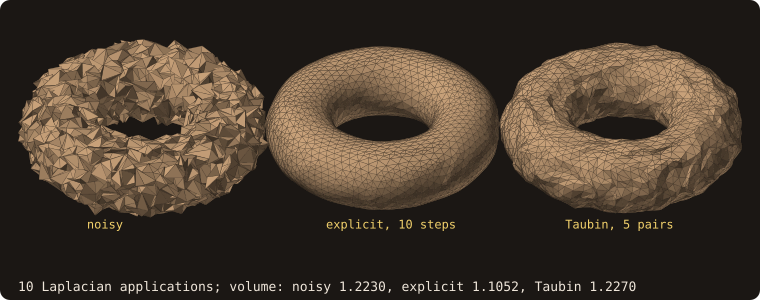
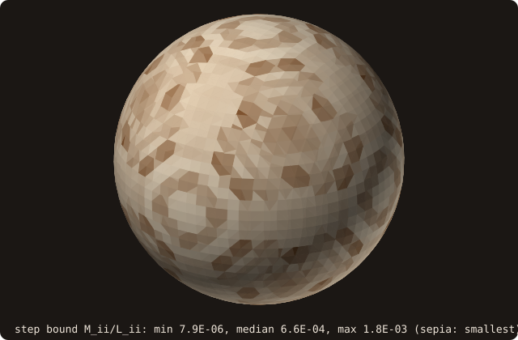
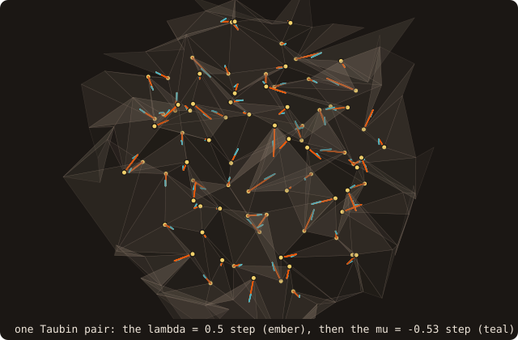
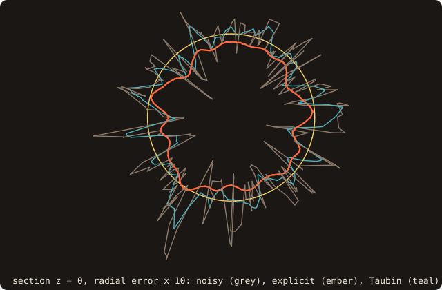
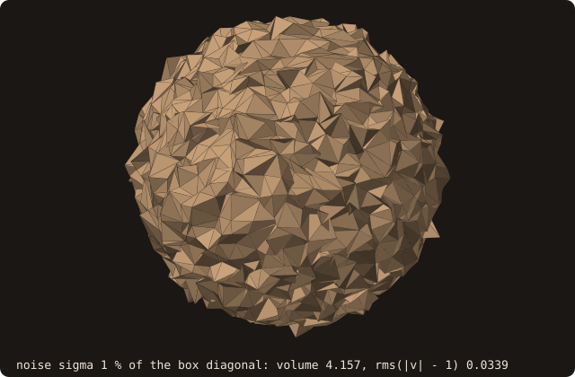
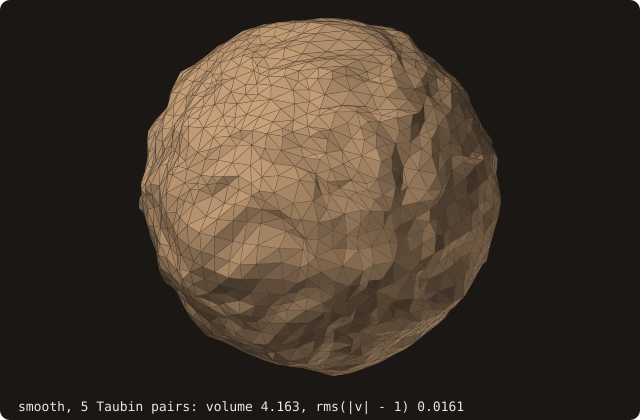

# Mesh smoothing (explicit Laplacian + Taubin)

## What it does

Attenuates high-frequency surface noise on a triangle mesh by moving
each vertex toward the average position of its mesh neighbours. Two
flavours are exposed today behind the same TBP, picked by a `method`
argument:

- **Explicit Laplacian** (`SMOOTH_METHOD_EXPLICIT`) — `iterations`
  single-step applications of `V_new = V + λ ΔV`, where `ΔV` is the
  uniform-weight Laplacian of the vertex field. **Shrinks the volume.**
  Cheap and useful as a building block, but the wrong primitive for
  production denoising of a closed solid.
- **Taubin λ\|μ** (`SMOOTH_METHOD_TAUBIN`, default) — alternates a
  positive `λ` smoothing step with a negative `μ` counter-shrinking step.
  Designed by Taubin (1995) to have a *band-pass* frequency response:
  high-frequency surface variation gets attenuated while the
  low-frequency volume stays nearly invariant. **The right choice for
  CFD-grade STL denoising.**

A third variant — **implicit Laplacian** (`(M − τL) V_new = M V`,
unconditionally stable at any step size, requires sparse SPD
factorisation) — is deferred until a sparse linear solver is bound to
FOSSIL. The public API is forward-compatible with it: when the solver
lands, the new variant ships as `SMOOTH_METHOD_IMPLICIT` and no
caller-side change is needed.

A torus (marching cubes) with Gaussian noise of σ = 0.03 on every
vertex, then the same 10 applications of the Laplacian as explicit
steps and as Taubin pairs: the explicit torus is smooth but its volume
falls from 1.2230 to 1.1052; the Taubin one keeps it (1.2270) and some of
the noise:

{.fossil-figure}

Over more iterations the difference grows: after 160 applications the
explicit torus has lost 77.9 % of its volume, the Taubin one has gained
4.4 %:

{.fossil-figure}

## Why uniform weights, not cotangent

A natural reading of the [cotangent Laplacian](/guide/advanced/cotangent-laplacian)
page and the Desbrun–Meyer–Schröder–Barr 1999 paper is that the *right*
Laplacian for explicit smoothing is the area-normalised cotangent
`M⁻¹ L`. FOSSIL ships the uniform-weight Laplacian instead,
deliberately. The reason:

- `M_ii` is small on dense triangulations (it's the *third of the
  incident triangle area* per vertex). On a 100k-facet bunny,
  `min(M_ii)` is of order `10⁻⁶`.
- For *explicit* time-stepping, the stability bound is roughly
  `λ ≤ 2 / λ_max(M⁻¹ L)`. With small `M_ii`, `λ_max(M⁻¹ L)` is huge, so
  any "meaningful" `λ` blows the iteration up.
- The uniform-weight Laplacian (`(1/|N(i)|) Σ_{j ∈ N(i)} (V_j − V_i)`)
  is unconditionally stable for any `λ ≤ 1`. It loses the discrete-
  geometry consistency of `M⁻¹ L` but is the right operator for
  *iterative noise filtering*, which is what `surface%smooth` is for.

The bound on the [Example](#example)'s sphere (marching cubes, 41³
samples), from `cotangent_laplacian`: `M_ii / L_ii` ranges from 7.9e-6
to 1.8e-3, median 6.6e-4. The explicit cotangent step is limited by the
smallest, two decades below the median, at the vertices that marching
cubes surrounds with slivers:

{.fossil-figure}

If you need the area-normalised mean-curvature flow (e.g. for
implicit-fairing experiments), build `(L, M)` via the
[cotangent Laplacian](/guide/advanced/cotangent-laplacian) TBP and
time-step it yourself once the solver lands. The shipped TBP is the
production-grade denoiser.

## Pipeline

Per smoothing step (one for explicit, two — `λ` then `μ` — for Taubin):

1. **Per-triangle edge accumulation.** For each triangle, each of its
   three edges contributes to the `(V_j − V_i)` accumulator of both
   endpoints and to both endpoints' neighbour-count accumulator. No
   adjacency list is materialised — every edge is implicitly visited
   twice (once per incident triangle), which double-counts both the
   accumulator and the count *symmetrically*, so the per-vertex
   division cancels the factor and the result is the correct uniform-
   weight Laplacian.

2. **Per-vertex update.**

   $$V_i^{\text{new}} = V_i + \lambda \, \frac{1}{|N(i)|} \sum_{j \in N(i)} (V_j - V_i)$$

3. **Taubin band-pass guard.** For `SMOOTH_METHOD_TAUBIN`, the second
   step uses `μ < −λ`. This is the band-pass condition from Taubin
   1995: without it, the iteration is still a low-pass filter (it just
   shrinks more slowly), which is almost certainly not what the caller
   wants. The TBP **rejects with `SMOOTH_STATUS_BAD_INPUT`** when
   `μ ≥ −λ` rather than silently doing the wrong thing.

4. **Re-adopt after the last iteration.** Smoothing mutates the
   per-facet vertex caches in place. After return the TBP calls
   `adopt_facets` so the vertex pool, connectivity, AABB tree, and
   pseudo-normals are coherent with the smoothed positions. No further
   user action is needed before calling `distance`, `winding_number`,
   `mean_curvature`, etc.

One Taubin pair on the noisy sphere of the [Example](#example), zoomed:
from each vertex, its λ = 0.5 step towards the centroid of its
neighbours, then the μ = −0.53 step, which moves it back out by a little
more than the low-frequency part of the first:

{.fossil-figure}

## API

```fortran
call surface%smooth(method, lambda, mu, iterations, status)
   class(surface_stl_object), intent(inout)         :: self
   integer(I4P),              intent(in),  optional :: method        ! SMOOTH_METHOD_*
   real(R8P),                 intent(in),  optional :: lambda
   real(R8P),                 intent(in),  optional :: mu            ! TAUBIN only
   integer(I4P),              intent(in),  optional :: iterations
   integer(I4P),              intent(out), optional :: status        ! SMOOTH_STATUS_*
```

Defaults:

| Argument     | Default                       |
|--------------|-------------------------------|
| `method`     | `SMOOTH_METHOD_TAUBIN`        |
| `lambda`     | `SMOOTH_DEFAULT_LAMBDA = 0.5` |
| `mu`         | `SMOOTH_DEFAULT_MU = −0.53`   |
| `iterations` | `SMOOTH_DEFAULT_ITERATIONS = 5` |

Notes on `iterations`:

- For `SMOOTH_METHOD_EXPLICIT`, `iterations` is the number of `λ`-steps
  applied. `mu` is silently ignored.
- For `SMOOTH_METHOD_TAUBIN`, `iterations` is the number of *complete
  `(λ, μ)` pairs*. The default value of 5 thus produces 10 Laplacian
  applications.

Status codes:

- `SMOOTH_STATUS_OK` — smoothing completed normally.
- `SMOOTH_STATUS_BAD_INPUT` — empty surface, `iterations ≤ 0`, unknown
  `method`, or Taubin called with `μ ≥ −λ`.
- `SMOOTH_STATUS_DEGENERATE` — at least one triangle had area below
  tolerance during the per-step Laplacian assembly; the iteration
  proceeded on the rest. The surface is still re-adopted at the end.

## Example

Explicit against Taubin, at the same cost. A unit sphere by
[marching cubes](/guide/advanced/marching-cubes) (41³ samples), every
vertex moved by Gaussian noise of σ = 0.035 (a deterministic function of
its coordinates, the `noise` helper of the program):

<<< @/examples/snippets/ref_smoothing-noisy.f90

Smoothed by 10 explicit steps and by 5 Taubin pairs, both 10
applications of the Laplacian; `report` prints the mean and rms of
`|v| - 1` over the vertices, and the volume change:

<<< @/examples/snippets/ref_smoothing-smooth.f90

The band-pass condition, checked before anything moves:

<<< @/examples/snippets/ref_smoothing-reject.f90

<<< @/examples/output/ref_smoothing.ansi{ansi}

- **Explicit.** The smoothest result (rms 0.0131), but the mean radius
  falls to 0.9885 and the volume by 3.56 %: every step pulls every
  vertex towards the centroid of its neighbours, which on a convex
  surface lies inside.
- **Taubin.** The rms error halves (0.0356 → 0.0162) and the volume
  stays within 0.05 %: the negative μ step undoes the shrinkage of the λ
  step at low frequencies.
- **Rejected input.** `mu = -0.4` with `lambda = 0.5` gives
  `SMOOTH_STATUS_BAD_INPUT` and leaves the surface as it was: with
  `μ ≥ −λ` the transfer function $(1 - \lambda k)(1 - \mu k)$ is below 1
  at every low frequency $k$: no pass band, the filter shrinks like the
  explicit one.

The section z = 0 of the three surfaces, with the radial error
magnified ten times so that a 1 % shrinkage shows:

{.fossil-figure}

The explicit section lies inside the circle all the way round; the
Taubin section stays on it, with a low-frequency waviness that five
pairs do not remove.

## Visual reference

A marching-cubes unit sphere (3608 facets straight from the extraction;
the 69k-facet bunny is too heavy for an inline figure) with deterministic
per-vertex Gaussian noise of σ = 1 % of the bounding-box diagonal
(0.035, a third of the 0.1 grid spacing), then after 5 Taubin `(λ, μ)`
pairs at the defaults (`λ = 0.5`, `μ = -0.53`):

<div class="fossil-pair">





</div>

The high-frequency surface "fuzz" is attenuated (the rms radial error
halves, 0.0338 → 0.0161) while the volume stays put (4.157 → 4.163,
+0.12 %): the band-pass response Taubin is designed for, without the
global shrinkage that plain explicit Laplacian smoothing would cause.
Five pairs do not remove noise this strong (σ is a third of the grid
spacing): a low-frequency waviness remains. On this input `smooth`
returns `SMOOTH_STATUS_DEGENERATE`: the sanitized extraction keeps a
zero-area facet (smallest edge 5.5e-18), which is skipped while the
rest is smoothed. The figures are
computed by `docs/examples/src/fig_ref_smoothing.f90` (the noise is a
function of the vertex coordinates, so the figures are byte-stable
across rebuilds).

## Known limitations

- **Implicit variant not yet shipped.** The third method from the §2.3
  spec — `(M − τL) V_new = M V`, unconditionally stable at any `τ`,
  requires a sparse SPD solver. Deferred until a sparse linear solver
  (SuiteSparse or alternative) is bound to FOSSIL. The public API is
  forward-compatible: when the solver arrives, the new variant ships
  as `SMOOTH_METHOD_IMPLICIT` and no caller-side change is needed.
- **Sharp-feature blunting.** Both explicit and Taubin treat every
  vertex uniformly. Vertices on a sharp edge (e.g. cube corners) get
  pulled inward by neighbour averaging and the feature blurs. If
  feature preservation matters, run [§1.7 isotropic
  remeshing](/guide/advanced/isotropic-remesh) (which has a built-in
  dihedral-angle feature lock) instead, or restrict smoothing to a
  feature-aware vertex mask externally before calling `smooth`.
- **Boundary vertices on open meshes** lose neighbours on the boundary
  side, so the uniform-weight Laplacian pulls them inward toward the
  interior centroid. This is rarely an issue for FOSSIL's target
  workload (closed solids from CAD STL) but matters if you smooth an
  open shell.
- **Degenerate-triangle skip.** Triangles below the area tolerance are
  skipped during Laplacian assembly. Their incident vertices simply
  receive less averaging that step; they aren't *removed*. Run [§1.3
  decimation](/guide/advanced/decimate) or `sanitize` before `smooth`
  if degenerate triangles dominate the input.
- **The cube test of `fossil_test_smoothing`** confirms only that the
  degenerate-input case (corner-only mesh, no flat interior) returns
  `SMOOTH_STATUS_OK` without crashing — the cube geometry collapses
  under uniform-weight smoothing because every corner is pulled toward
  the face centroid. Use Taubin's parameters for production inputs;
  the cube is a "doesn't crash on a pathological input" guard, not a
  recommended use case.

## See also

- [cotangent Laplacian](/guide/advanced/cotangent-laplacian) — the
  prerequisite that the *future* implicit smoothing variant depends
  on. The shipped explicit + Taubin variants use a different Laplacian
  (uniform weights, not cotangent) for stability — see "Why uniform
  weights, not cotangent" above.
- [per-vertex curvature](/guide/advanced/curvature) — running a
  few Taubin passes before `mean_curvature` gives noticeably cleaner
  curvature fields without volume loss.
- [isotropic remeshing](/guide/advanced/isotropic-remesh) — has
  built-in feature-preserving tangential relaxation. Use it instead of
  smoothing when sharp edges matter.
- [Constants](/guide/api/constants) — `SMOOTH_STATUS_*`,
  `SMOOTH_METHOD_*`, `SMOOTH_DEFAULT_LAMBDA`, `SMOOTH_DEFAULT_MU`,
  `SMOOTH_DEFAULT_ITERATIONS`.

## References

- Taubin, *A signal-processing approach to fair surface design*,
  SIGGRAPH 1995. The reference paper for the `λ\|μ` non-shrinking
  alternation that FOSSIL ships as the default.
- Desbrun, Meyer, Schröder & Barr, *Implicit fairing of irregular
  meshes using diffusion and curvature flow*, SIGGRAPH 1999. The
  reference for the *implicit* variant deferred until a sparse solver
  is bound; also explains why area-normalised cotangent smoothing is
  unstable on dense meshes for explicit time-stepping (Section 3.2).
- Botsch, Kobbelt, Pauly, Alliez & Lévy, *Polygon Mesh Processing*,
  A K Peters 2010, Chapter 4. Book-length treatment of mesh smoothing
  including the feature-preservation extensions that motivate falling
  back to [isotropic remeshing](/guide/advanced/isotropic-remesh)
  for sharp-feature inputs.
