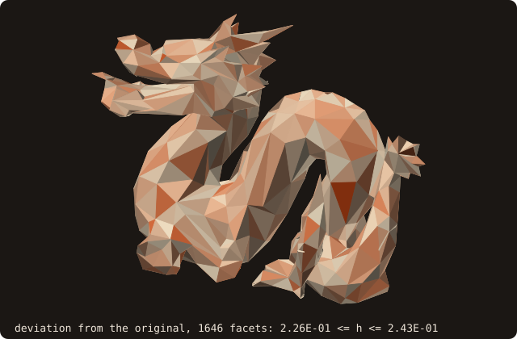

# Surface deviation (Hausdorff distance)

## What it does

Measures how far one surface lies from another (issue #60, roadmap #58):

- the **one-sided deviation** $h(A, B) = \sup_{x \in A} d(x, B)$: how far the farthest point of A is from B;
- the **Hausdorff distance** $H(A, B) = \max\big(h(A, B), h(B, A)\big)$;
- the **mean** and **rms** of $d(x, B)$ over A, and $d$ at every vertex of A.

The two one-sided deviations differ in general: a small body inside a large one is close to it ($h$ = the gap), while
the large body's far corners are far from the small one.

Remeshing, decimation, smoothing, hole filling, alpha wrapping and booleans all move a surface. The deviation measures
by how much, so a test or a user can bound it instead of trusting it.

## Method

$d(x, B)$ comes from B's bounding-volume hierarchy (`distance_many`): exact closest-point distances, bit-identical
across tree kinds and thread counts.

**Lower bound.** A is sampled deterministically:

- every vertex;
- every edge midpoint;
- the centroids of the $n_f^2$ sub-triangles of a regular subdivision of each facet f, with
  $n_f = \lceil \sqrt{\text{area}_f \cdot \text{samples\_per\_area}} \rceil$. The default density is 4 samples per
  mean facet area, about 4 per facet.

The largest sampled distance is a **lower bound** of $h(A, B)$: the true maximum can only be larger.

**Mean and rms.** The sub-triangle centroids, each weighted by $\text{area}_f / n_f^2$, are a quadrature over A: the
centroid rule on each sub-triangle, exact for a function linear over it. The mean and rms of $d$ are therefore
**estimates**, exact when $d$ is constant (two parallel planes) and converging as the density grows.

## Certified upper bound

The samples can miss the maximum, which may lie anywhere inside a facet. The upper bound comes from three facts about
$d(\cdot, B)$ on a triangle T of A, with corners $c_k$, their distances $d_k = d(c_k, B)$ and their closest points
$q_k$ on B:

1. **Lipschitz.** $d(x, B) \le d_k + |x - c_k|$ for every k, since d is 1-Lipschitz. With the nearest corner,
   $\sup_T d \le \max_k d_k + \rho_T$, where $\rho_T = \max_{x \in T} \min_k |x - c_k|$.
2. **Convexity.** $d(x, B) \le |x - q_k|$, because $q_k$ is a point of B. $|x - q_k|$ is convex in x, so its maximum
   over T is at a corner: $\sup_T d \le \min_k \max_j |c_j - q_k|$.
3. **One facet.** If the three closest points lie on the same facet F of B, then for $x = \sum_k \lambda_k c_k$ the
   point $y = \sum_k \lambda_k q_k$ lies in F (a triangle is convex), so $d(x, B) \le |x - y| \le \sum_k \lambda_k
   |c_k - q_k|$, and $\sup_T d \le \max_k d_k$.

The bound $U_T$ is the smallest of the three. The third settles at once every triangle that faces a single facet of B:
coincident or parallel surfaces, where the first two would refine the whole surface down to the tolerance. Of the other two, the first decreases linearly as T shrinks. The second decreases
quadratically where d is smooth: on a flat region at constant distance δ it is $\sqrt{\delta^2 + e^2} - \delta \approx
e^2 / 2\delta$ above δ, for T of size e.

**ρ_T.** For a triangle with no obtuse angle, the circumcentre lies in T and $\rho_T$ is the circumradius. For a
triangle obtuse at c, the farthest point from every corner lies on the opposite side ab, where the perpendicular
bisectors of ca and cb cross it: $\rho_T = \max(|ca| / 2\cos A, |cb| / 2\cos B)$. Both are capped by the longest
side. On 2000 random triangles the bound is never exceeded on a 60 × 60 lattice, and is reached to within 2 %.

**Branch and bound.**

- Every facet starts with its bound. A facet with $U_T \le$ `lower` + `tolerance` is settled.
- Each remaining one is split into four at its edge midpoints. The midpoints are evaluated in one batched query, and
  their distances raise `lower`.
- `upper` is the largest bound left when no triangle remains, so $\text{lower} \le h \le \text{upper}$ and
  upper − lower ≤ tolerance.
- When `max_triangles` triangles have been created first, the run stops with `DEV_STATUS_NOT_CONVERGED`. The bounds
  are still valid, only wider.

{.fossil-figure}

The dragon decimated to a quarter of its facets, each facet coloured by the distance of its centroid to the original
(ember the largest). Quadric decimation keeps the vertices close to the surface, so the deviation peaks inside the
facets that bridge concave parts. The certified bounds are in the caption.

{.fossil-figure}

The animation repeats the decimation down to 204 facets, with the certified bounds of each level. Each bound converged
to the default tolerance (1e-3 of the bounding-box diagonal) in at most 155 000 triangles; the whole sweep takes
1.5 s.

## API

```fortran
call surface%deviation(other, lower, upper, mean, rms, per_vertex, tolerance, samples_per_area, max_triangles, &
                       samples, triangles, status)
   class(surface_stl_object), intent(in)            :: self             ! A
   type(surface_stl_object),  intent(in)            :: other            ! B
   real(R8P),                 intent(out), optional :: lower            ! lower bound of h(A, B)
   real(R8P),                 intent(out), optional :: upper            ! certified upper bound (runs the branch and bound)
   real(R8P),                 intent(out), optional :: mean, rms        ! estimates of d over A
   real(R8P), allocatable,    intent(out), optional :: per_vertex(:)    ! d at the vertex-pool vertices of A
   real(R8P),                 intent(in),  optional :: tolerance        ! upper - lower target, default 1e-3 of the
                                                                        ! larger bounding-box diagonal
   real(R8P),                 intent(in),  optional :: samples_per_area ! default 4 / mean facet area of A
   integer(I4P),              intent(in),  optional :: max_triangles    ! work cap, default 2 000 000
   integer(I4P),              intent(out), optional :: samples          ! points sampled
   integer(I4P),              intent(out), optional :: triangles        ! triangles of the branch and bound
   integer(I4P),              intent(out), optional :: status           ! DEV_STATUS_OK, _BAD_INPUT, _NOT_CONVERGED

call surface%hausdorff(other, lower, upper, tolerance, samples_per_area, max_triangles, status) ! H(A, B)
```

- `status = DEV_STATUS_BAD_INPUT` when either surface is empty, `DEV_STATUS_NOT_CONVERGED` when the work cap stopped
  the branch and bound (the bounds are valid).
- Without `upper` the branch and bound does not run: `lower`, `mean`, `rms` and `per_vertex` cost one batched query.
- Neither surface needs to be closed: the deviation is defined for any triangle soup.
- The work is one batched closest-point query (`query_many`) for the samples, plus one per round of the branch and
  bound. The result does not depend on the thread count: the queries are independent, and the maximum, the sums and
  the rounds run in a fixed order.

## Example: how far did the repair move the dragon?

<<< @/examples/snippets/ck_deviation.f90

<<< @/examples/output/ck_deviation.ansi{ansi}

- **Repaired against original:** between 0.094 and 0.119. The 54 hole patches span the holes, and their middles are
  that far from the original surface. The samples alone gave 0.076: the maximum lies between them.
- **Original against repaired:** between 3.0e-3 and 0.030, at the facets `sanitize` removed (degenerate and duplicate
  ones). The bracket is as wide as the default tolerance (1e-3 of the 26.7 diagonal); pass `tolerance=` to narrow it.
- The means are tiny: almost every point of either surface lies on the other.

## Validation

`src/tests/fossil_test_deviation.f90`:

| Case | Checked | Measured |
|---|---|---|
| `cube-02` against itself | 0 at the vertices, round-off inside | 2.8e-17 |
| `cube-02` against itself translated by 0.3 along x | h = 0.3 both ways (attained at vertices) | exact |
| Marching-cubes unit sphere against itself scaled by 1.05 | 0.98 · 0.05 ≤ h ≤ 0.05 | 0.04995 |
| The cube [0.4, 0.6]³ inside the unit cube | h(small, unit) = 0.4, h(unit, small) = 0.4√3, H = 0.4√3 | exact |
| Two parallel unit squares 0.3 apart | lower, mean, rms = 0.3 | exact |
| 1 and 4 OpenMP threads (`tests-gnu-openmp`) | lower, mean, per-vertex bit for bit | identical |
| An empty surface | `DEV_STATUS_BAD_INPUT` | |
| Certified bounds on the translated cube, the nested cubes, the parallel squares (tolerance 1e-4) | lower ≤ h ≤ upper, upper − lower ≤ 1e-4 | 5.1e-5 (30 904 triangles; 208 256 without the one-facet bound), 1e-4, 2.5e-5 |
| Acute triangle against tiny triangles at its corners: the maximum at the circumcentre | sampled bound misses it by > 1e-3; certified bounds bracket R = 1.72413 | sampled 1.6008; 1.72403 ≤ h ≤ 1.72413 |
| The same with `max_triangles = 8` | `DEV_STATUS_NOT_CONVERGED`, valid bounds | 1.6008 ≤ h ≤ 2.3585 |
| `triangle_rho`, 2000 random triangles | lattice maximum ≤ ρ, ≥ 0.98 ρ | |

A negative control: with $\rho_T = 0$ (the corner distances alone) the "upper" bound of the acute triangle is 1.6008,
below the true 1.7241, and the test fails.

## See also

- [Mass properties](/guide/advanced/mass-properties), [decimation](/guide/advanced/decimate),
  [isotropic remeshing](/guide/advanced/isotropic-remesh): operations whose result the deviation bounds.
- [`surface_stl_object`](/guide/api/surface-stl-object): `distance_many`, the query behind it.

## References

- M. Tang, M. Lee, Y. J. Kim, *Interactive Hausdorff distance computation for general polygonal models*, ACM SIGGRAPH
  2009.
- P. Cignoni, C. Rocchini, R. Scopigno, *Metro: measuring error on simplified surfaces*, Computer Graphics Forum 17(2),
  1998.
