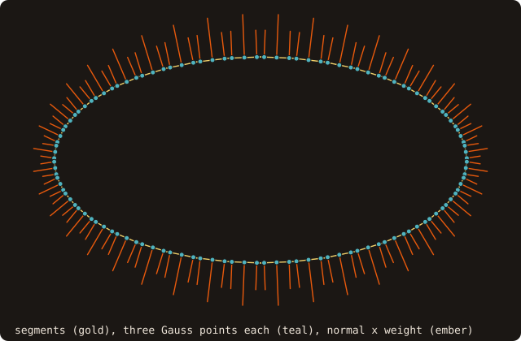

# Surface loads

## What it does

A flow solver gets the force and the moment on a body from integrals over its wall. FOSSIL gives the geometry of those
integrals, on the faceted wall itself: quadrature points on every facet (segment in 2-D) with their weights and normals,
and probe points along the normal where the solver reads its flow. The solver evaluates the pressure p and the viscous
traction τ at the samples; FOSSIL never interpolates the flow. With p and τ given, FOSSIL sums the force and the moment,
per patch and per body too, the same bits on the CPU and on the device.

| Query | 3-D (`surface_stl_object`) | 2-D (`curve_object`) |
|---|---|---|
| Quadrature points, weights, normals, element, patch, body of every facet / segment | `load_samples_3d(surface, samples=s)` | `load_samples_2d(curve, samples=s)` |
| Probes along the normal: points, visibility, enclosing cells on the solver's lines | `load_samples_3d(surface, x, y, z, s, lengths=)` | `load_samples_2d(curve, x, y, s, lengths=)` |
| The body at a pose; the same on the device bit for bit, or left resident there | `pose=`, `device=.true.`, `resident=.true.` | same |
| Several bodies at their poses: the samples of each in body order, probes visible against every body, the clearance to the nearest other body | `load_samples_3d_bodies(surfaces, samples=s, poses=)` | `load_samples_2d_bodies(curves, samples=s, poses=)` |
| Force, moment (2-D: its z component), per patch and per body, wetted area, from the solver's p and τ | `integrate_loads(s, force, moment, pressure=, shear=)` | same, a scalar moment |
| A wall field (per vertex or facet) at the closure's feet and ILW crossings, at the samples, at any point on a facet; values at the samples back to the vertices | `transfer_to_closure`, `transfer_to_samples`, `transfer_field_3d`, `samples_to_vertices` | the same generics, `transfer_field_2d` |

{.fossil-figure}

Three Gauss points per segment carry weights that sum to the segment's length; all of them sum to the perimeter. The
figure program prints the counts of every figure on this page:

<<< @/examples/output/figref-surface-loads.ansi{ansi}

## Conventions

The samples follow three conventions, which the load integration (`integrate_loads`, [below](#forces-and-moments))
keeps:

- **L1, the integrand.** The force on the body is F = ∫ (−p n + τ) dA over its wall, n the outward normal of the body,
  into the fluid; the moment about c is M = ∫ (x − c) × (−p n + τ) dA. τ is the viscous part of the wall traction (a
  3-vector, a 2-vector in 2-D, per unit depth), supplied by the solver.
- **L2, the quadrature.** Each facet (segment) is integrated on its own plane by a rule of order 1, 2 or 3, with the
  facet's normal from its vertices, not the pseudo-normal: for the faceted wall the facet normal is exact. The weights
  include the facet area (segment length).
- **L3, the flow.** The solver evaluates p and τ. FOSSIL gives the probe points along the facet normal at the caller's
  signed lengths (+ into the fluid), whether each is visible from its sample, and its enclosing cell on the solver's
  lines (the low-side rule); no interpolation weights, as in the
  [closure table](/guide/advanced/fd-closure#the-closure-table).

{.fossil-figure}

The normal is (v2 − v1) × (v3 − v1) / |…| of the facet's vertices: the vertex winding, outward on a surface that
`sanitize` has oriented. In 2-D it is (dv, −du) / |…| of the segment i → next(i), the solid on its left: away from the
centre on an outer loop, towards it on a hole.

## The rules

| Order | 3-D points (barycentric) | 3-D exact to degree | 2-D points (on [0, 1]) | 2-D exact to degree |
|---|---|---|---|---|
| 1 | the centroid | 1 | 1/2 | 1 |
| 2 | (2/3, 1/6, 1/6) and its permutations, weights 1/3 | 2 | 1/2 ∓ √3/6 (Gauss–Legendre) | 3 |
| 3 | Dunavant's 6 points (a, a, 1 − 2a) for two values of a | 4 | 1/2, 1/2 ∓ √15/10 | 5 |

{.fossil-figure}

- The order-3 rule is the 6-point rule of Dunavant (1985), exact for degree 4 with positive weights and interior
  points (the 4-point rule of degree 3 has a negative weight); its constants are solved to 40 digits from the moment
  equations, then rounded.
- The weight of a sample is the rule's weight times the facet area (segment length), so the weights of a facet sum to
  its area to round-off. The samples of element e are s = (e − 1) q + 1 … e q, q = `samples%q` (1, 3, 6 in 3-D; 1, 2, 3
  in 2-D; `load_rule_size(order, dims)`).
- A **degenerate element** (zero area or length; in 2-D also the missing segment at the end of an open polyline) gets
  zero weights and a zero normal; its probes sit at the sample and are not visible.
- A pressure linear in x is integrated exactly by every order (the centroid rule is exact for degree 1 on a flat
  facet): the buoyancy force of a closed body comes out to round-off. Its moment has a quadratic integrand, (x − c) p,
  exact from order 2 ([below](#forces-and-moments)).

## Probes, visibility and cells

With `lengths(m)` each sample gets m probes `probe(:, k, s) = points(:, s) + lengths(k) normal(:, s)`: absolute,
signed lengths (+ into the fluid), the same for every sample; a zero length gives the sample point itself.

{.fossil-figure}

- **Visibility** (`visible(k, s)`): the open segment from the sample to the probe crosses no element. The kernels are
  those of `probe_many` (`fossil_segment_visibility`): in 3-D the exact ray–facet crossings, a crossing counted above
  10⁻⁹ of the surface's box diagonal (the sample's own facet, crossed at 0, is ignored); in 2-D the exact segment test,
  the sample's own segment excluded. The probes need the SAH BVH (the default tree): on an octree surface they are
  refused.
- **Cells** (`probe_cell(a, k, s)`), when the solver's lines x, y[, z] are given: the low-side rule, x(i) < p ≤ x(i+1)
  gives i, outside the lines (or on the first one) 0, as in the closure table. Without the lines the samples have no
  cells (`with_cells = .false.`).
- A probe into the solid (a negative length) is allowed; it is blocked as soon as it crosses the opposite wall.

## How a solver fills p and tau

The solver evaluates p and τ at the samples, by its own means: at the wall from its closure, or from the flow at the
probes (an image line, a wall model), interpolated in the cells FOSSIL gives. The force is then a sum over the samples,
which `integrate_loads` does for it ([below](#forces-and-moments)); written out:

```fortran
force = 0._R8P
do s = 1, ls%n
   force = force + (-p(s) * ls%normal(:, s) + tau(:, s)) * ls%weight(s)
enddo
```

{.fossil-figure}

In p = 1 − v the force is the buoyancy, (0, area) per unit depth: one sample per segment gives it to round-off (the
last line of the figure program's output). The weights and normals are the facet's, so the sum is the integral over
the faceted wall; how close it is to the smooth body's depends on the facets, not on the rule.

## Forces and moments

`integrate_loads(samples, force, moment, pressure=p, shear=tau)` sums the loads of the samples with the solver's
pressure p(n) and viscous traction τ(d, n) at the samples (either or both):

- **The integrand (L1).** Each sample contributes f = w (−p n + τ), n the outward normal, into the fluid; its moment
  about c (`about`, default the origin) is (x − c) × f. The force on the body is F = Σ f, the moment M = Σ (x − c) × f.
  In 2-D both are per unit depth and the moment is its component along the plane's normal axis, a scalar
  r_u f_v − r_v f_u.
- **The sums (L4).** Compensated (Neumaier) sums in sample order, so in facet (segment) order: deterministic, and their
  error is that of the terms, not of their number. The same sums per patch (`per_patch_force`, `per_patch_moment`) and
  per body (`per_body_force`, `per_body_moment`), sized by the largest patch and body ids of the samples; the wetted area
  (2-D length) Σ w as `area`.

{.fossil-figure}

The two sides of the airfoil are two patches; their forces add up to the buoyancy (0, A), A the enclosed area, and their
moments about the leading edge to that of the buoyancy at the centroid, A (x_c − c) × (0, 1):

<<< @/examples/output/figref-surface-loads-forces.ansi{ansi}

**The exactness check: buoyancy.** In a linear pressure p = p0 + g · x with τ = 0 the divergence theorem gives, on any
closed faceted body of volume V (2-D: area A) and centroid x_c,

F = −g V,   M = V (x_c − c) × (−g).

The force's integrand p n is linear on a flat facet, integrated exactly by every rule; the moment's, (x − c) p, is
quadratic, integrated exactly from order 2 (the centroid rule misses it: 5·10⁻³ of the moment on an irregular
tetrahedron, nothing on a body symmetric enough to cancel it). The tests `fossil_test_integrate_loads_3d` and `_2d`
check both identities on cube-01, an icosphere at a pose, two boxes (per body too), an irregular tetrahedron, a
64-gon, a disc with a hole, a NACA 0012 polygon unposed and posed and two discs, against V and x_c from
`mass_properties`: every component within ε times the sum of the absolute terms (Σ w |p| + V |g|, for the moment
Σ w |p| |x − c| + V |g| |x_c − c|); the largest error measured is 0.34 of that bound.

**Host and device.** Each sample's contribution comes from one kernel (`load_force_3d_oac`, `load_force_2d_oac`), in a
loop that runs on the device with `device=.true.`: the samples, p and τ are read on the device where they are mapped
(resident samples, a pressure the solver mapped itself), else copied in. The contributions then come back and are summed
on the host in sample order, by the same code for both paths, so the totals agree bit for bit (`loads device vs serial
mismatches` in the benches). On the host path the host arrays are read: call `update_host` on resident samples first.

<<< @/examples/snippets/ref_surface_loads_forces-loads.f90

<<< @/examples/output/ref_surface_loads_forces.ansi{ansi}

The [cookbook](/manual/cookbook#integrate-the-pressure-force-on-a-body) integrates the pressure and a uniform shear on
the unit cube.

## Moving fields between the wall and the grid

A solver keeps fields on the wall, per vertex or per facet (a wall temperature, the displacement of a deforming wall),
and needs their values where its closure and its loads look at the wall; and it computes fields at points of the wall
(a wall stress at the load samples) that it wants back on the wall. `fossil_field_transfer` does both, on the geometry
FOSSIL already has: every point carries the element it lies on.

- **Wall to points (L5).** `transfer_field_3d(surface, facets, points, values, vertex_field=)`: for points on (or
  projected onto) the facets `facets(n)`, a per-vertex field `vertex_field(ncomp, nv)` (the vertices of the surface's
  vertex pool) interpolated with the barycentric weights (1 − s − t, s, t) of the point's closest point on its facet,
  the (s, t) of `triangle_closest_st`, the solve of every distance query. A linear field is reproduced at any point of
  the facet to round-off; a point equal to a vertex takes that vertex's value bit for bit; a point off the facet takes
  the value of its closest point. `facet_field=(ncomp, nf)` instead: piecewise constant, copied. `ncomp` components:
  a scalar or a vector. An id outside 1..nf gives zeros. In 2-D, `transfer_field_2d(curve, segments, points, values,
  vertex_field= | segment_field=)` with (1 − s, s) of the clamped projection on the segment.
- **At the closure table and the load samples.** `transfer_to_closure(surface, closure, values, vertex_field=,
  ilw_values=)` reads the field at the feet (`closure%element`) and, with `ilw_values(ncomp, 2d, n)`, at the ILW
  crossings: the ghost's coordinates with the slot's axis set to `ilw_t`, on `ilw_element`; a slot without a crossing
  gives zeros. `transfer_to_samples(surface, samples, values, vertex_field=)` reads it at the load samples with the
  rule's own barycentric coordinates, the ones that placed them (no closest point, no pose).
- **Poses.** With `pose=` the points are in the world and the body at the pose, as in a posed closure table: each point
  is taken to the body frame (`to_body`) before its weights, so the field stays attached to the body's vertices.
- **Points to wall.** `samples_to_vertices(surface, samples, values, field)`: values at the load samples to a per-vertex
  field, the direction a solver needs for a wall stress it computes at its samples (the wall-modelled setting of van
  Noordt et al. 2022). Per element, a linear fit of its q values in the barycentric coordinates (weighted least squares
  with the rule's weights; order 1: the constant; `linear=.false.`: the weighted mean), evaluated at each of its
  vertices; per vertex, the average of those values over its incident elements weighted by their areas (2-D lengths),
  in increasing element order with Neumaier sums. **A smoothing projection, not an interpolation**: a constant comes
  back exactly; values linear on every element (a field linear in space, on any mesh, or any vertex field brought to
  the samples by `transfer_to_samples`) come back at every vertex to round-off from order 2; anything else is fitted
  per element and averaged over the vertex's ring, its noise smoothed with it.

{.fossil-figure}

The figure's vertex field is cos 2θ at 24 vertices: linear along each segment, read at the feet of 80 ghost points.
Back through the load samples, the same field returns unchanged (it is linear on every segment); cos 2θ evaluated at
the samples themselves comes back to the vertices with the projection's error:

<<< @/examples/output/figref-surface-loads-transfer.ansi{ansi}

**Host and device.** Every value comes from one kernel per point (`transfer_weights_3d_oac`, `transfer_weights_2d_oac`,
the rule kernels of the samples), per element and per vertex for the projection, in loops that run on the device with
`device=.true.`: the inputs are read on the device where they are mapped (a resident closure table or load samples, a
field the solver mapped itself), else copied in; the output is written on the device where the solver mapped it (then
`!$acc update host`), else copied back. The per-vertex sums run one thread per vertex in its fixed order, so the two
paths agree bit for bit (`field transfer device vs serial mismatches` in the benches; tests
`fossil_test_field_transfer_3d`, `_2d`). The facet vertex ids (2-D the curve's vertices) are gathered on the host per
call and copied in.

<<< @/examples/snippets/ref_surface_loads_transfer-transfer.f90

<<< @/examples/snippets/ref_surface_loads_transfer-back.f90

<<< @/examples/output/ref_surface_loads_transfer.ansi{ansi}

```text
call transfer_field_3d(surface, facets, points, values [, status] [, vertex_field | facet_field] [, pose] [, device])
call transfer_field_2d(curve, segments, points, values [, status] [, vertex_field | segment_field] [, pose] [, device])
call transfer_to_closure(surface | curve, closure, values [, status] [, vertex_field | facet_field | segment_field]
                         [, ilw_values] [, pose] [, device])
call transfer_to_samples(surface | curve, samples, values [, status] [, vertex_field | facet_field | segment_field]
                         [, device])
call samples_to_vertices(surface | curve, samples, values, field [, status] [, linear] [, device])
```

`status = STATUS_INVALID_INPUT` (a stderr message, the outputs zero) on no field or both, a size that differs, a table
or samples of the other dimension (or not of this surface or curve), `ilw_values` from a table without ILW. The
[cookbook](/manual/cookbook#move-a-wall-field-to-the-closure-and-back) has the shortest program.

## Several bodies

Two bodies in one flow share its probes: an image line out of one wall may enter the other body, and a wall that faces
another across a narrow gap carries a load that depends on the gap. `load_samples_3d_bodies(surfaces, x, y, z,
samples)` and `load_samples_2d_bodies(curves, x, y, samples)` sample an array of bodies, body b at `poses(b)`, in one
set:

- **Each body as alone, in body order.** The samples of body b are those `load_samples_3d` (`_2d`) gives it at its
  pose, the same kernels, placed after those of bodies 1 … b − 1; `element` is the facet (segment) of its own surface,
  `body` the index of the surface in the array, `sub_body` the element's `facet_body` (loop body).
- **Visibility is against every body.** A probe is visible when the segment sample–probe crosses no element of its own
  body (as for one body) and no element of any other body, tested in that body's frame (the closure's test of
  [several bodies](/guide/advanced/fd-closure#several-bodies)).
- **Clearance.** `clearance(s)` is the unsigned distance from the sample point to the nearest other body
  (`second_body`, `second_foot`: its closest point); huge without one. In a gap of width δ the facing samples have
  clearance δ: a lubrication or wall model reads it there; FOSSIL decides nothing.
- **Loads per body.** `integrate_loads` sums `per_body_force` and `per_body_moment` by the samples' `body`: the
  surfaces of the array here, the `facet_body` shells of a single-body set.

| Field | Shape | Meaning |
|---|---|---|
| `body`, `sub_body` | `[n]` | The body's index in the array; the element's `facet_body` |
| `clearance`, `second_body`, `second_foot` | `[n]`, `[n]`, `[d, n]` | Distance from the sample point to the nearest other body, that body, its closest point |
| `with_bodies`, `bodies` | scalars | A bodies set; the number of bodies |

A single-body set has these arrays with a zero last extent. With one body the bodies set equals the single-body set bit
for bit in every other field (on a surface of one `facet_body`), and for bodies farther apart than the probes the
samples of every body are its single-body set bit for bit (`fossil_test_load_samples_bodies_3d`, `_2d`).

{.fossil-figure}

<<< @/examples/output/figref-surface-loads-bodies.ansi{ansi}

<<< @/examples/snippets/ref_surface_loads_bodies-2d.f90

<<< @/examples/snippets/ref_surface_loads_bodies-3d.f90

<<< @/examples/output/ref_surface_loads_bodies.ansi{ansi}

- The two discs, 0.03 apart, have 400 samples each (order 2). Their 44 blocked probes are the ones that cross the gap;
  disc 1 alone blocks none (a convex body).
- The least clearance is the gap, 0.0300; the sample of least clearance sees its first probe (0.02, inside the gap) and
  not its second (0.04, across the other wall).
- The buoyancy of each disc in p = −v is its area (F = −∮ p n dA = A ∇v): each body's integral is exact for a linear
  pressure, whatever the other body.
- The balls are 0.1 apart: the least clearance is 0.1018 (the marching-cubes facets lie inside the sphere), and the
  device path returns the same samples.

The device path runs the single-body pipeline once per body into a work set, copies the sets into one, then per other
body the clearance query (the sample points in that body's frame) and the visibility test: copies, comparisons and the
shared query kernels, so host and device agree bit for bit (bench lines `load samples bodies device vs serial
mismatches`). Map the array's elements themselves (`call bodies(b)%enter_device`): a copy of a mapped surface is not
mapped.

## Example

The ellipse at a pose on cell-centred lines, three Gauss points per segment and two probes; then a sphere, the samples
left resident on the device.

<<< @/examples/snippets/ref_surface_loads-2d.f90

<<< @/examples/snippets/ref_surface_loads-3d.f90

<<< @/examples/output/ref_surface_loads.ansi{ansi}

The [cookbook](/manual/cookbook#sample-a-wall-for-the-surface-loads) has the shortest program.

## Design: poses, host and device paths

- **Poses** (`pose=`): the body at the pose, every output in the world frame. As the probes of the closure table, the
  samples, the probes and their visibility are computed in the body frame on the given geometry and its tree, then the
  points and probes are mapped by `to_world` and the normals by `rotate`; the cells are those of the world probes. No
  decision is taken on the moved geometry, so there is no moved copy and no refitted tree; the weights and the
  visibility are those of the unposed body, bit for bit.
- **One set of loops, two paths** (`fossil_surface_loads`, free routines). Each stage is one `!$acc parallel loop`
  with `if(device)`: one thread per sample (the rule's point, `load_point_3d_oac` / `load_point_2d_oac`, the shared
  `!$acc routine seq` kernels), then one per (sample, probe) (the visibility kernel, then the world probe), then one per
  probe for the cells (`fd_cell_index_oac`). In 2-D the device visibility runs through `curve%probes_present`, the host
  one through `curve%path_visible`: the same kernel. The host runs the loops in order; built without OpenACC so does
  the device path, and the tests compare the two bit for bit (`fossil_test_load_samples_3d`, `_2d`; bench lines `load
  samples device vs serial mismatches`).
- **Resident** (`resident=.true.`): the resident pattern of the closure table: `on_device`, `device_key`,
  `enter_device` / `update_host` / `exit_device`, `load_samples_reset`; every writer takes the samples
  `intent(inout)` and releases them first.
- **Several bodies** (`load_samples_*_bodies`): each body's samples from the single-body run, then one query and one
  segment test per sample (probe) and other body, the merges in body order with ties to the lower index; the
  clearance and visibility stages are those of the closure of several bodies (`merge_clear`, `blocked_3d`,
  `blocked_2d` of `fossil_fd_closure`). A body costs one single-body set plus one query of every other body's samples.
- **Loads** (`integrate_loads`, a generic over the 3-D and the 2-D form, told apart by the moment's rank): one thread per
  sample writes its contribution (force, moment, weight) and its patch and body ids; the reduction stays on the host,
  in sample order, compensated, the same code for both paths. A sum in a fixed order on the host costs a copy of the
  contributions and ids (64 bytes per sample in 3-D, 40 in 2-D) and needs no device reduction, whose order would differ.

## API

```text
call load_samples_3d(surface [, x, y, z], samples [, status] [, order] [, lengths] [, pose] [, device] [, resident])
call load_samples_2d(curve [, x, y], samples [, status] [, order] [, lengths] [, pose] [, device] [, resident])
call load_samples_3d_bodies(surfaces [, x, y, z], samples [, status] [, poses] [, order] [, lengths] [, device] [, resident])
call load_samples_2d_bodies(curves [, x, y], samples [, status] [, poses] [, order] [, lengths] [, device] [, resident])
call samples%enter_device ; call samples%update_host ; call samples%exit_device ; call load_samples_reset(samples)
n = load_samples_mismatches(a, b) ; q = load_rule_size(order, dims)
call integrate_loads(samples, force, moment [, status] [, pressure] [, shear] [, about] [, per_patch_force]
                     [, per_patch_moment] [, per_body_force] [, per_body_moment] [, area] [, device])
```

| Field of `load_samples_t` | Shape | Meaning |
|---|---|---|
| `n`, `dims`, `order`, `q`, `ne`, `m` | | Samples (q per element), 3 or 2, the rule's order, points per element, elements, probes per sample |
| `points`, `weight`, `normal` | `[d, n]`, `[n]`, `[d, n]` | Sample point, weight (rule weight × area / length), the element's outward unit normal |
| `element`, `patch`, `body` | `[n]` | Facet (2-D segment, by its first vertex), its patch and body |
| `lengths`, `probe`, `visible` | `[m]`, `[d, m, n]`, `[m, n]` | Probe lengths; probe points; the segment sample–probe crosses no element |
| `ni`, `nj`, `nk`, `with_cells`, `probe_cell` | `[d, m, n]` | The lines' sizes (0 without lines); the enclosing cell per axis (0 outside) |
| `with_bodies`, `bodies`, `sub_body`, `clearance`, `second_body`, `second_foot` | `[n]`, `[d, n]` | A bodies set ([Several bodies](#several-bodies)); zero-size in a single-body set |

| Argument | Meaning |
|---|---|
| `x(:)`, `y(:)`[, `z(:)`] | The solver's lines, all or none, strictly increasing, at least two points each (2-D: u, v) |
| `order` | 1, 2 or 3 (default 2) |
| `lengths(m)` | Probe lengths, absolute, + outward (default: no probe) |
| `pose` | `rigid_pose_t` (2-D `rigid_pose_2d_t`): the body at the pose |
| `device`, `resident` | Device path (the surface or curve mapped by `enter_device`); leave the samples mapped (implies `device`) |
| `surfaces(nb)`, `curves(nb)`, `poses(nb)` | The bodies and their poses ([Several bodies](#several-bodies); absent poses: no body posed); every non-empty surface needs its SAH BVH |
| `status` | `STATUS_OK`; `STATUS_INVALID_INPUT` (and no sample) on a bad order, lines in part, short or not increasing, probes on an octree surface, or on the device path a surface or curve not mapped (a stderr message); `load_samples_*_bodies` also on no body, `size(poses)` other than the bodies', or (3-D) a surface with an octree |

A surface without facets or a curve without vertices has no sample. The routines are free procedures of the module
`fossil_surface_loads`, re-exported by `use fossil`.

| Argument of `integrate_loads` | Meaning |
|---|---|
| `samples` | Load samples, 3-D or 2-D (the form of the call must match) |
| `force(d)`, `moment` | Totals: F, and M about `about`: `moment(3)` in 3-D, a scalar in 2-D |
| `pressure(n)`, `shear(d, n)` | The solver's p and τ at the samples; at least one |
| `about(d)` | Point of the moments (default the origin) |
| `per_patch_force(d, np)`, `per_patch_moment` | Per patch (allocatable; 3-D `(3, np)`, 2-D `(np)`); np the largest patch id |
| `per_body_force(d, nb)`, `per_body_moment` | Per body, the same layout, by the samples' `body` (the `facet_body`; a bodies set: the surface index); a sample with an id below 1 enters the totals only |
| `area` | Σ w: the wetted area (2-D length) |
| `device` | Contributions on the device (the samples, p, τ read there when mapped); the same bits |
| `status` | `STATUS_OK`; `STATUS_INVALID_INPUT` (zero outputs, per-patch / per-body arrays of size 0, a stderr message) if the samples are of the other dimension, neither p nor τ is given, or a size differs |

## Limitations

- **The faceted wall.** The samples integrate over the facets, with the facet normals: the force on a coarse
  tessellation of a smooth body is the force on the tessellation. Refine the facets, not the rule, to approach the
  smooth body: the error falls as the square of the facet size ([what accuracy to expect](#what-accuracy-to-expect)).
- **Probes need the SAH BVH.** An octree surface gets its samples without probes; with `lengths` it is refused.
- **No interpolation.** FOSSIL gives the cells, not the weights: the solver interpolates with its own stencil and
  decides what to do with a probe that is not visible.
- **All facets.** Every facet (segment) is sampled; a solver that wants some patches only selects the samples by
  `patch` (or reads `per_patch_force`).
- **Several bodies: the shells of one surface are one body.** The clearance and the visibility against the other
  bodies look at the other surfaces of the array, not at the other shells of a sample's own surface (whose visibility
  is the single-body test): pass bodies that may come close as separate surfaces. Overlapping bodies are sampled as
  they are (a sample inside the other body has the clearance to its wall; the closure's `overlap` flag tells).
- **The moment of a linear pressure needs order 2.** The centroid rule integrates the force of a linear p exactly, not
  its moment.

## Loads from the cut cells

A finite-volume solver on [cut cells](/guide/advanced/cut-cells) has its pressure per cut cell (per fluid piece), not
at quadrature points on the facets. Its force on the body is the sum over the cells' wall terms, which the cut already
returns: `cut_cells_3d(..., walls=)` gives one term per (cell, facet) with its vector area A_w (solid to fluid: the
body's outward normal times the area), its area |A_w|, its centroid x_w, its piece and its facet; in 2-D
`cut_walls_2d(cut, walls)` lists the wall segments of the pieces' oriented boundaries
(`curve%cut_cells(..., boundaries=.true.)`, the fluid on the left, cell-edge segments left out) with their piece, their
curve segment (`piece_seg_src`), their end points, A_w = (−Δv, Δu) and their midpoint. Then `cut_loads_3d` /
`cut_loads_2d` sum, with the conventions of the samples (L1, L4):

f_w = −p_w A_w + τ_w |A_w|,   F = Σ f_w,   M = Σ (x_w − c) × f_w,

p_w the pressure at the wall's centroid (`pressure(n)`), or one value per piece spread to its walls
(`pressure_per_piece(np)`), τ_w the viscous traction (`shear(d, n)`); compensated sums in wall order, per patch and per
body through the facet (segment) of each wall, given the surface (curve).

{.fossil-figure}

<<< @/examples/output/figref-surface-loads-cut.ansi{ansi}

**Exact moments.** The walls are flat, so the value at the centroid integrates a linear pressure exactly for the force:
in p = p0 + g · x the force on a body inside the grid is −g V to round-off. The moment's integrand (x − c) p is then
quadratic, and the centroid value misses the term ∫ (x − x_w)(x − x_w)ᵀ dA g = |A_w| K_w g of each wall (2.4·10⁻⁶ on a
moment of 0.032 in the figure). With the pressure's gradient on each wall (`gradient(d, n)`) the sums add −(K_w g_w) × A_w and
the moment is exact for a pressure linear on each wall: in 2-D K_w = d dᵀ / 12 from the segment d, in 3-D from
`cut_walls_gyration(walls, surface, x, y, z, gyration)`, which clips each term's polygon again with the cut's own clip
(`cut_wall_polygon_3d`, the same polygon bit for bit) and sums its fans' exact second moments about the stored centroid.
Without `gradient` the pressure is constant on each wall, a cell value, whose moment the centroid gives exactly too.

**The checks** (`fossil_test_cut_loads_3d`, `_2d`): bodies inside the grid (cube-01 on a grid through its faces and on
one off them, an icosphere moved to a pose, two boxes, an irregular tetrahedron; a 64-gon, a disc with a hole, a NACA
0012 polygon plain and turned, two discs):

- buoyancy through the cut: F = −g V and, with the gradient, M = V (x_c − c) × (−g), within ε times the sum of the
  absolute terms (largest 0.10 / 0.05 of it in 3-D, 0.07 / 0.06 in 2-D); the centroid values alone miss the moment by
  7·10⁻⁵ (3-D) and 2·10⁻⁶ (2-D) of that sum;
- a uniform pressure: the vector areas sum to 0;
- the walls of each piece sum to its `piece_wet_normal`: bit for bit on every 2-D piece and on 1128 of 1602 3-D
  pieces; on the others the cut adds the fans in another association, and the sums agree within 1.7 ε times the piece's
  wall area;
- FD and FV agree: the same linear p by `integrate_loads` on samples of order 2 and by the cut walls gives the same
  force and moment, within ε times the two sums of absolute terms (largest 0.18);
- a uniform shear gives τ times the area; per patch and per body sums add up, each box (disc) its own buoyancy.

<<< @/examples/snippets/ref_surface_loads_cut-cutloads.f90

<<< @/examples/output/ref_surface_loads_cut.ansi{ansi}

The last line takes one pressure per fluid piece, at the piece's fluid centroid, as a cell-centred solver stores it: the
force is then that of a piecewise-constant field, off by 3 % on 24³ cells. The value a wall needs is the one at the
wall: reconstruct it (the cell value plus the gradient times x_w − x_cell) before the sum; FOSSIL does not.

```text
call cut_cells_3d(surface, x, y, z, cut [, status], walls=walls)
call cut_walls_gyration(walls, surface, x, y, z, gyration [, status])
call cut_loads_3d(walls, force, moment [, status] [, pressure | pressure_per_piece] [, shear] [, gradient, gyration]
                  [, about] [, surface] [, per_patch_force] [, per_patch_moment] [, per_body_force] [, per_body_moment]
                  [, area] [, unassigned])
call curve%cut_cells(x, y, cut2 [, status], boundaries=.true.) ; call cut_walls_2d(cut2, walls2 [, status])
call cut_loads_2d(walls2, force, moment [, status] [, pressure | pressure_per_piece] [, shear] [, gradient] [, about]
                  [, curve] [, per_patch_force] [, per_patch_moment] [, per_body_force] [, per_body_moment] [, area])
p = cut_loads_linear_pressure(points, p0, gradient)
```

- **The walls inside the grid only.** The terms cover the body where it lies in the grid's box: a body that leaves it
  loses those loads.
- **Terms of no piece.** In a cell without trusted pieces (3-D `pieces = -1`, an open surface) a term has piece 0: with
  `pressure_per_piece` it takes no pressure, and `unassigned` counts it (one stderr line). Give such walls a pressure of
  their own through `pressure`.
- **Refusals** (`STATUS_INVALID_INPUT`, zero outputs, per-patch / per-body arrays of size 0, a stderr line): no pressure
  and no shear, both pressures, a size that differs, `gradient` without `gyration` (3-D) or without a pressure, per patch
  or per body without the surface (curve); `cut_walls_2d` on a cut without boundaries; `cut_walls_gyration` on another
  grid or surface.
- **CPU only**, free routines of `fossil_cut_loads`, re-exported by `use fossil`. The device computes the wall terms
  (`cut_cells_3d_device(..., walls=)`); copy them back (`update_host`) before the sum.

## What accuracy to expect

Both paths integrate over the faceted wall, so two questions decide what a solver gets: are the sums exact where the
mathematics says they should be, and how fast does the faceted wall's force approach the smooth body's? The validation
program `fossil_val_surface_loads` (a quadrature study, no flow solve: the pressure is given in closed form) answers
both, through the load samples (`integrate_loads`, the FD path) and the cut walls (`cut_loads_2d` / `_3d`, the FV path).

**Buoyancy on large meshes.** In p = p0 + g · x the force is −g V and the moment V (x_c − c) × (−g) on any closed
faceted body, V and x_c from `mass_properties`. The error, in units of ε times the sum of the absolute terms (as in the
tests), on an icosphere of 81 920 facets with its vertices moved along the sphere (no symmetry) at a pose, a
marching-cubes torus of 37 440 facets at a pose, a NACA 0012 of 4 000 segments and an ellipse of 8 192 (FV: 64³ cells,
2-D 512², with the gradient and, in 3-D, the walls' gyration):

| Body | Elements | FD q = 1, F | q = 2, F | q = 2, M | q = 3, F | q = 3, M | FV, F | FV, M |
|---|---|---|---|---|---|---|---|---|
| icosphere, stretched, posed | 81 920 | 0.04 | 0.04 | 0.03 | 0.04 | 0.02 | 0.04 | 0.02 |
| marching-cubes torus, posed | 37 440 | 0.03 | 0.03 | 0.04 | 0.03 | 0.07 | 0.03 | 0.07 |
| NACA 0012, 10° | 4 000 | 0.01 | 0.01 | 0.01 | 0.01 | 0.01 | 0.01 | 0.02 |
| ellipse 0.6 × 0.25, turned | 8 192 | 0.29 | 0.29 | 0.23 | 0.29 | 0.23 | 0.29 | 0.23 |

The sums stay exact to round-off at any size: the compensated sums keep the error of the terms, not of their number.
The order-1 moment and the FV moment without the gradient are not exact (a quadratic integrand): off by 8·10⁻⁸ and
5·10⁻⁸ of the sum on the icosphere. The bunny, the dragon and dragon-fine are not watertight: they have no volume to
compare with and are skipped.

**Potential flow.** A cylinder of radius R = 0.5 in a uniform flow U = 1 with circulation Γ = −0.8 (2π U R) has zero
drag (d'Alembert) and lift −ρ U Γ (Kutta–Joukowski); a sphere in a uniform flow has zero force. The pressure is
p = p∞ + ρ (U² − |u|²) / 2 with u the exact velocity **on the true wall at the point nearest the sample** (the radial
projection), the convention of the [closure's validation](/guide/advanced/fd-closure#what-accuracy-to-expect): the
solver imposes the smooth body's data on the faceted wall, so the error is that of the facets and of the rule alone.
The walls are polygons and icospheres with their vertices on the circle and the sphere, moved along them towards a point
so that no symmetry cancels the drag. The figure: the cylinder through both paths, the FD path with samples of order 2,
the FV path on N/2 cells per axis:

{.fossil-figure}

<<< @/examples/snippets/fig_ref_surface_loads_accuracy-loads.f90

<<< @/examples/output/figref-surface-loads-accuracy.ansi{ansi}

From the validation (errors |F_x| / (ρ U² R), |F_y − L| / |L| in 2-D, |F| / (ρ U² π R² / 2) in 3-D; h_s the longest
segment or edge; the observed order of the two finest levels in the last row):

| N | h_s | drag, q = 1 | q = 2 | q = 3 | lift, q = 1 | q = 2 | q = 3 |
|---|---|---|---|---|---|---|---|
| 32 | 1.4e-1 | 1.6e-3 | 4.3e-3 | 4.3e-3 | 1.8e-3 | 2.8e-3 | 2.8e-3 |
| 256 | 1.8e-2 | 2.6e-5 | 6.7e-5 | 6.7e-5 | 2.9e-5 | 4.4e-5 | 4.4e-5 |
| 4 096 | 1.1e-3 | 1.0e-7 | 2.6e-7 | 2.6e-7 | 1.1e-7 | 1.7e-7 | 1.7e-7 |
| order | | 2.00 | 2.00 | 2.00 | 2.00 | 2.00 | 2.00 |

| Icosphere level | Facets | h_s | q = 1 | q = 2 | q = 3 |
|---|---|---|---|---|---|
| 1 | 80 | 4.2e-1 | 2.8e-2 | 4.0e-2 | 3.9e-2 |
| 4 | 5 120 | 5.8e-2 | 4.7e-4 | 6.9e-4 | 6.9e-4 |
| 6 | 81 920 | 1.5e-2 | 2.9e-5 | 4.3e-5 | 4.3e-5 |
| order | | | 2.01 | 2.01 | 2.01 |

| FV | Cells | h | Drag (2-D) / force (3-D) | Lift | FD (q = 3) − FV |
|---|---|---|---|---|---|
| cylinder, N = 2 n | 64² | 2.5e-2 | 2.1e-4 | 1.4e-4 | 1.7e-4 |
| | 1 024² | 1.6e-3 | 7.5e-7 | 5.5e-7 | 7.0e-7 |
| | order | | 1.99 | 2.00 | 1.99 |
| sphere, level 1 + log₂(n/4) | 16³ | 1.0e-1 | 2.4e-3 | | 3.7e-4 |
| | 64³ | 2.5e-2 | 1.5e-4 | | 2.8e-5 |
| | order | | 1.98 | | 2.08 |

- **Second order in the facet size, set by the facets.** Every error falls as h_s², through both paths, in 2-D and 3-D:
  the faceted wall's normals and areas carry an O(h_s²) error of the force.
- **The rule is not the limit.** Orders 2 and 3 agree to three digits: their own quadrature error is far below the
  facets'. Order 1 comes out 1.4–2.6 times smaller, because its O(h_s²) rule error happens to cancel part of the facets'
  here; a cancellation, not a property to count on. Refine the facets, not the rule ([Limitations](#limitations)).
- **FD and FV agree to the discretisation error.** On the same faceted wall the FD path with order 3 is the facets'
  exact integral to O(h_s⁶); the FV path takes the value at the centroid of each wall fragment, a midpoint rule, so their
  difference is that rule's error, of order 2 (1.99 in 2-D, 2.08 in 3-D): of the size of either path's error to the
  smooth body in 2-D, a fifth of it in 3-D.
- **Which flow at the sample.** The flow continued analytically to the sample point, inside the true body, gives the
  same order with another constant (cylinder at N = 4 096: drag 6.6·10⁻⁷, lift 7.8·10⁻⁸; sphere at level 6:
  1.2·10⁻⁴); a solver has no flow there, so the validation uses the true wall's.

Pass criteria of `fossil_val_surface_loads` (it prints `Are all tests passed? T` iff all hold, about 4 s at -O2, 0.4 GB):
the buoyancy force within 1 (units of ε times the sum of the absolute terms) on every body, path and rule order, the
moment within 1 where it is exact (FD from order 2, FV with the gradient and the gyration); the d'Alembert and
Kutta–Joukowski errors and the FD − FV difference decreasing at an observed order of at least 1.8 over the two finest
levels, for every rule order and on the cut walls.
