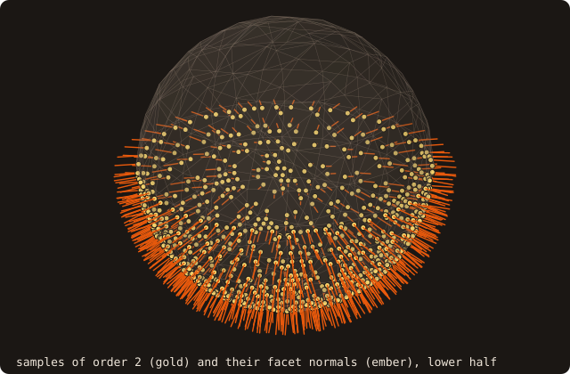
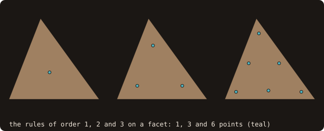
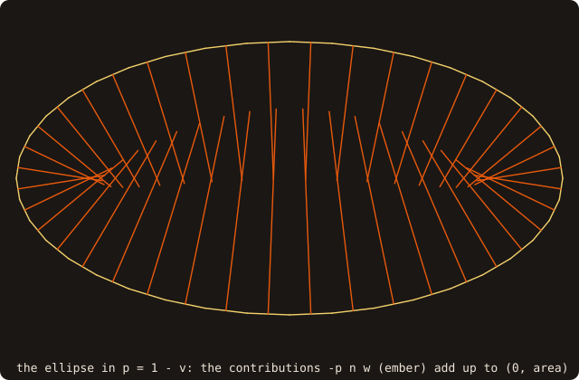

# Surface loads

## What it does

A flow solver gets the force and the moment on a body from integrals over its wall. FOSSIL gives the geometry of those
integrals, on the faceted wall itself: quadrature points on every facet (segment in 2-D) with their weights and normals,
and probe points along the normal where the solver reads its flow. The solver evaluates the pressure p and the viscous
traction τ at the samples; FOSSIL never interpolates the flow.

| Query | 3-D (`surface_stl_object`) | 2-D (`curve_object`) |
|---|---|---|
| Quadrature points, weights, normals, element, patch, body of every facet / segment | `load_samples_3d(surface, samples=s)` | `load_samples_2d(curve, samples=s)` |
| Probes along the normal: points, visibility, enclosing cells on the solver's lines | `load_samples_3d(surface, x, y, z, s, lengths=)` | `load_samples_2d(curve, x, y, s, lengths=)` |
| The body at a pose; the same on the device bit for bit, or left resident there | `pose=`, `device=.true.`, `resident=.true.` | same |

{.fossil-figure}

Three Gauss points per segment carry weights that sum to the segment's length; all of them sum to the perimeter. The
figure program prints the counts of every figure on this page:

<<< @/examples/output/figref-surface-loads.ansi{ansi}

## Conventions

The samples follow three conventions, which the later load integration (force, moment, per patch and body) keeps:

- **L1, the integrand.** The force on the body is F = ∫ (−p n + τ) dA over its wall, n the outward normal of the body,
  into the fluid; the moment about c is M = ∫ (x − c) × (−p n + τ) dA. τ is the viscous part of the wall traction (a
  3-vector, a 2-vector in 2-D, per unit depth), supplied by the solver.
- **L2, the quadrature.** Each facet (segment) is integrated on its own plane by a rule of order 1, 2 or 3, with the
  facet's normal from its vertices, not the pseudo-normal: for the faceted wall the facet normal is exact. The weights
  include the facet area (segment length).
- **L3, the flow.** The solver evaluates p and τ. FOSSIL gives the probe points along the facet normal at the caller's
  signed lengths (+ into the fluid), whether each is visible from its sample, and its enclosing cell on the solver's
  lines (the low-side rule); no interpolation weights, as in the
  [closure table](/guide/advanced/fd-closure#the-closure-table).

{.fossil-figure}

The normal is (v2 − v1) × (v3 − v1) / |…| of the facet's vertices: the vertex winding, outward on a surface that
`sanitize` has oriented. In 2-D it is (dv, −du) / |…| of the segment i → next(i), the solid on its left: away from the
centre on an outer loop, towards it on a hole.

## The rules

| Order | 3-D points (barycentric) | 3-D exact to degree | 2-D points (on [0, 1]) | 2-D exact to degree |
|---|---|---|---|---|
| 1 | the centroid | 1 | 1/2 | 1 |
| 2 | (2/3, 1/6, 1/6) and its permutations, weights 1/3 | 2 | 1/2 ∓ √3/6 (Gauss–Legendre) | 3 |
| 3 | Dunavant's 6 points (a, a, 1 − 2a) for two values of a | 4 | 1/2, 1/2 ∓ √15/10 | 5 |

{.fossil-figure}

- The order-3 rule is the 6-point rule of Dunavant (1985), exact for degree 4 with positive weights and interior
  points (the 4-point rule of degree 3 has a negative weight); its constants are solved to 40 digits from the moment
  equations, then rounded.
- The weight of a sample is the rule's weight times the facet area (segment length), so the weights of a facet sum to
  its area to round-off. The samples of element e are s = (e − 1) q + 1 … e q, q = `samples%q` (1, 3, 6 in 3-D; 1, 2, 3
  in 2-D; `load_rule_size(order, dims)`).
- A **degenerate element** (zero area or length; in 2-D also the missing segment at the end of an open polyline) gets
  zero weights and a zero normal; its probes sit at the sample and are not visible.
- A pressure linear in x is integrated exactly by every order (the centroid rule is exact for degree 1 on a flat
  facet): the buoyancy of a closed body comes out to round-off ([below](#how-a-solver-fills-p-and-tau)).

## Probes, visibility and cells

With `lengths(m)` each sample gets m probes `probe(:, k, s) = points(:, s) + lengths(k) normal(:, s)`: absolute,
signed lengths (+ into the fluid), the same for every sample; a zero length gives the sample point itself.

{.fossil-figure}

- **Visibility** (`visible(k, s)`): the open segment from the sample to the probe crosses no element. The kernels are
  those of `probe_many` (`fossil_segment_visibility`): in 3-D the exact ray–facet crossings, a crossing counted above
  10⁻⁹ of the surface's box diagonal (the sample's own facet, crossed at 0, is ignored); in 2-D the exact segment test,
  the sample's own segment excluded. The probes need the SAH BVH (the default tree): on an octree surface they are
  refused.
- **Cells** (`probe_cell(a, k, s)`), when the solver's lines x, y[, z] are given: the low-side rule, x(i) < p ≤ x(i+1)
  gives i, outside the lines (or on the first one) 0, as in the closure table. Without the lines the samples have no
  cells (`with_cells = .false.`).
- A probe into the solid (a negative length) is allowed; it is blocked as soon as it crosses the opposite wall.

## How a solver fills p and tau

The solver evaluates p and τ at the samples, by its own means: at the wall from its closure, or from the flow at the
probes (an image line, a wall model), interpolated in the cells FOSSIL gives. The force is then a plain sum:

```fortran
force = 0._R8P
do s = 1, ls%n
   force = force + (-p(s) * ls%normal(:, s) + tau(:, s)) * ls%weight(s)
enddo
```

{.fossil-figure}

In p = 1 − v the force is the buoyancy, (0, area) per unit depth: one sample per segment gives it to round-off (the
last line of the figure program's output). The weights and normals are the facet's, so the sum is the integral over
the faceted wall; how close it is to the smooth body's depends on the facets, not on the rule.

## Example

The ellipse at a pose on cell-centred lines, three Gauss points per segment and two probes; then a sphere, the samples
left resident on the device.

<<< @/examples/snippets/ref_surface_loads-2d.f90

<<< @/examples/snippets/ref_surface_loads-3d.f90

<<< @/examples/output/ref_surface_loads.ansi{ansi}

The [cookbook](/manual/cookbook#sample-a-wall-for-the-surface-loads) has the shortest program.

## Design: poses, host and device paths

- **Poses** (`pose=`): the body at the pose, every output in the world frame. As the probes of the closure table, the
  samples, the probes and their visibility are computed in the body frame on the given geometry and its tree, then the
  points and probes are mapped by `to_world` and the normals by `rotate`; the cells are those of the world probes. No
  decision is taken on the moved geometry, so there is no moved copy and no refitted tree; the weights and the
  visibility are those of the unposed body, bit for bit.
- **One set of loops, two paths** (`fossil_surface_loads`, free routines). Each stage is one `!$acc parallel loop`
  with `if(device)`: one thread per sample (the rule's point, `load_point_3d_oac` / `load_point_2d_oac`, the shared
  `!$acc routine seq` kernels), then one per (sample, probe) (the visibility kernel, then the world probe), then one per
  probe for the cells (`fd_cell_index_oac`). In 2-D the device visibility runs through `curve%probes_present`, the host
  one through `curve%path_visible`: the same kernel. The host runs the loops in order; built without OpenACC so does
  the device path, and the tests compare the two bit for bit (`fossil_test_load_samples_3d`, `_2d`; bench lines `load
  samples device vs serial mismatches`).
- **Resident** (`resident=.true.`): the resident pattern of the closure table: `on_device`, `device_key`,
  `enter_device` / `update_host` / `exit_device`, `load_samples_reset`; every writer takes the samples
  `intent(inout)` and releases them first.

## API

```text
call load_samples_3d(surface [, x, y, z], samples [, status] [, order] [, lengths] [, pose] [, device] [, resident])
call load_samples_2d(curve [, x, y], samples [, status] [, order] [, lengths] [, pose] [, device] [, resident])
call samples%enter_device ; call samples%update_host ; call samples%exit_device ; call load_samples_reset(samples)
n = load_samples_mismatches(a, b) ; q = load_rule_size(order, dims)
```

| Field of `load_samples_t` | Shape | Meaning |
|---|---|---|
| `n`, `dims`, `order`, `q`, `ne`, `m` | | Samples (q per element), 3 or 2, the rule's order, points per element, elements, probes per sample |
| `points`, `weight`, `normal` | `[d, n]`, `[n]`, `[d, n]` | Sample point, weight (rule weight × area / length), the element's outward unit normal |
| `element`, `patch`, `body` | `[n]` | Facet (2-D segment, by its first vertex), its patch and body |
| `lengths`, `probe`, `visible` | `[m]`, `[d, m, n]`, `[m, n]` | Probe lengths; probe points; the segment sample–probe crosses no element |
| `ni`, `nj`, `nk`, `with_cells`, `probe_cell` | `[d, m, n]` | The lines' sizes (0 without lines); the enclosing cell per axis (0 outside) |

| Argument | Meaning |
|---|---|
| `x(:)`, `y(:)`[, `z(:)`] | The solver's lines, all or none, strictly increasing, at least two points each (2-D: u, v) |
| `order` | 1, 2 or 3 (default 2) |
| `lengths(m)` | Probe lengths, absolute, + outward (default: no probe) |
| `pose` | `rigid_pose_t` (2-D `rigid_pose_2d_t`): the body at the pose |
| `device`, `resident` | Device path (the surface or curve mapped by `enter_device`); leave the samples mapped (implies `device`) |
| `status` | `STATUS_OK`; `STATUS_INVALID_INPUT` (and no sample) on a bad order, lines in part, short or not increasing, probes on an octree surface, or on the device path a surface or curve not mapped (a stderr message) |

A surface without facets or a curve without vertices has no sample. The routines are free procedures of the module
`fossil_surface_loads`, re-exported by `use fossil`.

## Limitations

- **The faceted wall.** The samples integrate over the facets, with the facet normals: the force on a coarse
  tessellation of a smooth body is the force on the tessellation. Refine the facets, not the rule, to approach the
  smooth body.
- **Probes need the SAH BVH.** An octree surface gets its samples without probes; with `lengths` it is refused.
- **No interpolation.** FOSSIL gives the cells, not the weights: the solver interpolates with its own stencil and
  decides what to do with a probe that is not visible.
- **All facets.** Every facet (segment) is sampled; a solver that wants some patches only selects the samples by
  `patch`.
