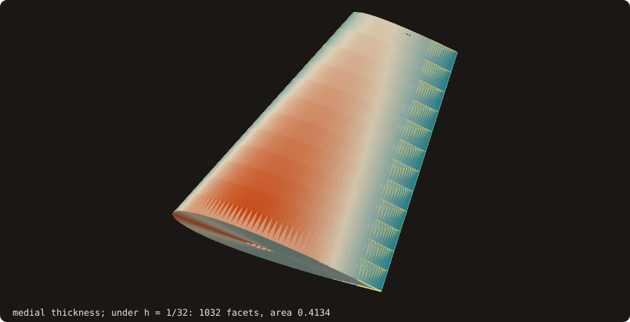
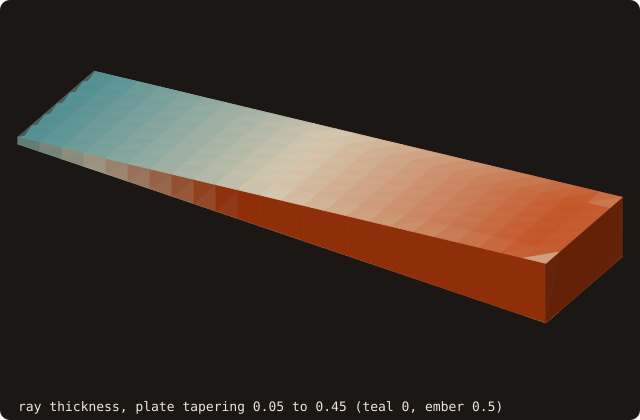
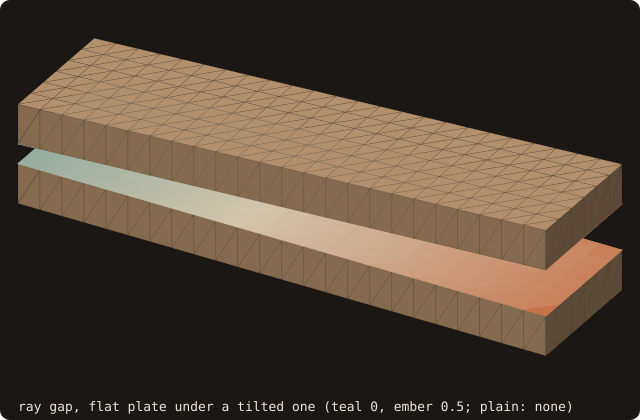
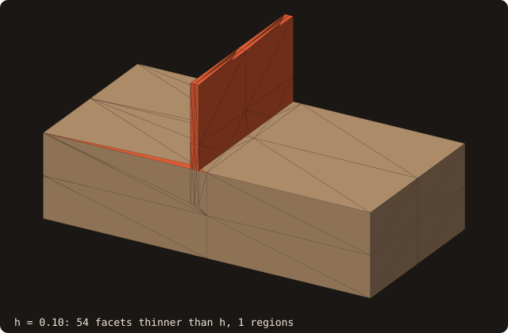
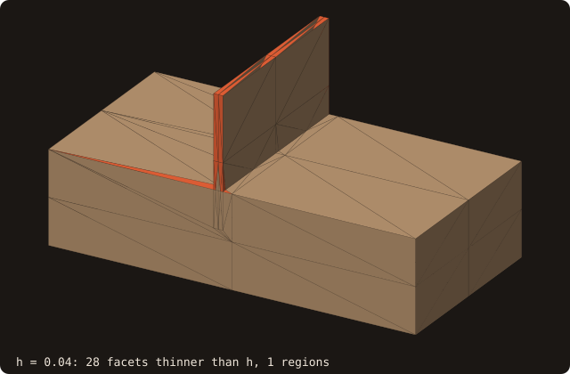
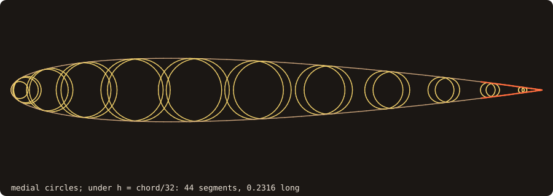

# Thickness and gaps

## What it does

Measures, for every facet of a closed surface (issue #62, roadmap #58):

- the **thickness**: how thick the body is behind the facet;
- the **gap**: how far the next wall is in front of the facet, which is the clearance between two parts of a body or
  between two bodies merged into one surface. It is `huge` when nothing is in front.

On real geometry, immersed-boundary methods fail where a wall or a gap is thinner than the cell. Such a wall gives
the wrong sign, cells with no fluid, and image points that land across the wall. The
[ambiguous foot points](/guide/advanced/ib-queries) of a query find that afterwards, point by point. Thickness and gap
find it before the grid exists, for the whole surface.

{.fossil-figure}

{.fossil-figure}

On the wing the strip under h = 1/32 runs along the trailing edge and widens towards the tip, where the chord is
shorter. The leading edge is in it too: its radius of curvature (0.016 of the chord for NACA 0012) bounds the inscribed
ball there. As h halves, the strip shrinks to the trailing edge, whose thickness tends to zero, so it is never resolved.

{.fossil-figure}

{.fossil-figure}

## Ray method

The ray method is the *shape diameter function* of Shapira, Shamir and Cohen-Or (2008), measured rather than used
for segmentation.

- **Rays.** From the facet centroid, `rays` rays (default 31) inside a cone of full aperture `cone_angle` (default
  60°), around $-n$ for the thickness and $+n$ for the gap. The directions are fixed: ray 1 is the axis, and ray $k$
  has the polar cosine
  $\cos\theta_k = 1 - (1 - \cos\tfrac{\alpha}{2})\,\tfrac{k-1}{m-1}$ (equal-area steps up to the rim) and the
  azimuth $(k-1)$ golden angles. No random numbers, so the same facet gives the same value on every run.
- **The source facet is excluded**, not stepped over: `intersect_ray_first(exclude=f)` skips it, so no origin offset
  enters the lengths.
- **Thickness rays** count when their first hit **leaves** the solid ($n_\text{hit}\cdot d > 0$). A miss, or a hit
  through a facet facing the wrong way, does not count.
- **Gap rays** count when their first hit **enters** the solid ($n_\text{hit}\cdot d < 0$), and when they miss, with
  length $\infty$.
- **Value.** The lower median of the counted lengths. A facet with fewer than half of its rays counted gets `huge`
  and is counted in `invalid`: an open or misoriented surface is reported, never silently averaged. A gap whose
  median is a miss is `huge` but valid: nothing is in front.
- **Vertex fields** (`vertex_thickness`, `vertex_gap`) are area-weighted averages of the finite values of the
  incident facets.
- **Parallel.** OpenMP over the facets. Each facet is computed on its own, so the result does not depend on the
  thread count.

### Bias of the cone

A cone measures oblique lengths, and the median keeps that bias. On a plate and a sphere it is known in closed form:

| Body | Ray thickness | Default (60°, 31 rays) | Shapira's 120° |
|---|---|---|---|
| plate of thickness $t$ | $t \cdot \mathrm{median}(1/\cos\theta_k)$ | $1.072\,t$ | $1.333\,t$ |
| sphere of radius $R$ | $2R \cdot \mathrm{median}(\cos\theta_k)$ | $0.933 \cdot 2R$ | $0.750 \cdot 2R$ |
| any, `rays=1` | the axial chord | $t$, $2R$ | |

The default cone is narrower than Shapira's 120°, which serves segmentation. For a measurement it would overestimate
a plate by a third. A cone still matters: one axial ray can graze an edge, while the median of 31 rays does not
depend on any single one.

[`segment_sdf`](/guide/advanced/sdf-segmentation) keeps its own shape diameter (120°, an origin offset, no
orientation test), unchanged: it is a segmentation feature, not a measurement.

## Medial method

The medial method is the *shrinking ball* of Ma, Bae and Choi (2012). The thickness at a facet is the
diameter $2r$ of the largest ball tangent to the facet at its centroid $p$, on the side of $-n$, with no surface point
inside. The gap is the same ball on the side of $+n$. It is the local feature size, the distance to the medial axis:
the definition that does not depend on a cone.

{.fossil-figure}

- **Start.** $r = \min(R_0, t_\text{axis}/2)$, with $R_0$ the bounding-box diagonal and $t_\text{axis}$ the first hit
  of the axial ray. This is an upper bound: the ball's diameter along the axis cannot pass the first wall it meets. So
  **the medial value never exceeds the axial chord**.
- **Shrink.** The ball centred at $c = p - r\,n$ (or $p + r\,n$ for the gap). If the closest surface point $q$ to $c$
  is inside it, the ball becomes the one through $p$ and $q$, tangent at $p$:
  $r \leftarrow |p - q|^2 / \big(2\,a\cdot(q - p)\big)$, with $a$ the unit direction from $p$ to the centre
  (`ball_radius` in `fossil_thickness`). The radius strictly decreases.
- **Stop.** When $q$ is on the sphere ($|c - q| \ge r(1 - 10^{-12})$). Or when the new ball would see $p$ and $q$
  under a separation angle below `separation_angle` (default 30°, the feature-edge threshold). This is Ma et al.'s
  denoising test. Below that angle $q$ is a tessellation neighbour on the same smooth sheet, or a bump of a scanned
  mesh, not an opposite wall, and the ball keeps its radius.
- **Batched.** Each iteration is one `query_many` over the facets not yet converged, OpenMP-parallel and
  deterministic. A facet still moving after 64 iterations is `huge` and counted in `invalid`. A gap ball still at
  $R_0$ has nothing in front: `huge`.

### Ray and medial compared

| Body | Ray (default cone) | Ray, `rays=1` | Medial |
|---|---|---|---|
| plate of thickness $t$ | $1.072\,t$ | $t$ | $t$, exact |
| faceted sphere, radius 1, 1280 facets | $0.933 \cdot 2$, to 0.6 % | $2$, to 0.45 % | $2$, 4.8 % below; 1.8 % on 5120 facets |
| NACA 0012, $0.1 < x < 0.9$ | | | $2 y_t\sqrt{1 + y_t'^2}$ to 7.3e-4 |
| two boxes 0.2 apart, gap | $0.2/\cos\theta_{16}$ | $0.2$ | $0.2$, exact |

On a faceted sphere the medial value converges as O(h), from below. The ball is tangent at the facet centroid,
which is offset from the circumcentre, so its centre misses the sphere's centre by O(h), and the polyhedron's facets
stop it there.

On a blobby body the two methods measure different things. The ray gives the chord along the normal, and the medial
the local feature size, which curvature bounds well below the chord. `src/tests/validation/fossil_val_thickness.f90`
on the Stanford bunny (69 451 facets, not watertight), with the ratio ray / medial over the facets where both are
finite:

| `separation_angle` | thickness ratio, quantiles 5 / 50 / 95 % | facets with a medial gap | medial time (-O2) |
|---|---|---|---|
| 30° (default) | 1.10 / 2.46 / 8.81 | 50 109 | 10.3 s |
| 60° | 1.08 / 1.65 / 5.72 | 32 652 | 8.0 s |
| 90° | 1.02 / 1.36 / 4.50 | 18 025 | 5.9 s |

The ray method takes 11.3 s there (31 rays per side). Its 401 invalid facets are where the bunny's holes let the
rays escape. A larger separation angle keeps only contacts with walls facing away from $p$. That is closer to "the
wall opposite", at the price of the corner-limited local feature size. The medial gap is finite on most facets of a
non-convex body: it is the exterior local feature size, of the body's own scale away from narrow passages.

## Under-resolution report

`thin_regions` answers "where is this body thinner than my cell?" before any grid exists. A facet is thin when its
local size, min(thickness, gap), is below `factor * h`. The thin facets are grouped into regions connected through
shared edges (union-find over the facet connectivity), sorted by decreasing area, ties broken by the lowest facet id.
The arrays are inputs, so a sweep over h, or one call per AMR level, does not recompute the thickness, which is the
expensive part.

{.fossil-figure}

{.fossil-figure}

The fin is 0.05 thick, built with [`boolean`](/guide/advanced/booleans) as the union of two boxes. For h = 0.1 it is
one region. For h = 0.04 its sides drop out, since their local size is exactly 0.05, but its cap and end faces stay.
A ball tangent to the cap away from its centre line meets the side walls first, so the local feature size there is
below the fin thickness. The edges of a thin wall are its thinnest part.

## AMR criterion

```fortran
call surface%build_thin(thickness=thickness, gap=gap)                  ! store min(thickness, gap) in the BVH
call surface%tag_block(x, y, z, band, tags, thin_factor=1._R8P, thin_band=1, thin_tags=thin_tags)
call surface%box_thin_many(lo, hi, factor, touched)                    ! any boxes; box_thin_many_device too
```

- **Criterion.** A box is thin-touched when it meets a facet whose local size is below `factor` times the box's
  largest side. The box-triangle separating-axis test runs on the box inflated by `box_tolerance`, so it never misses
  a contact. Each AMR block uses its own h, and refinement stops where the cells are fine enough.
- **Pruning.** `build_thin` stores the local size of every SAH BVH payload triangle and its minimum over every node.
  `bvh_box_thin_oac` prunes a subtree whose minimum is above the threshold, as well as one whose box misses the cell.
- **Lifetime.** `analyze` drops the stored sizes, because the facet ids change. `move` keeps them, because a rigid
  motion changes neither the thickness nor the tree topology.
- **Device.** `box_thin_many_device` runs the same routine in an OpenACC loop. `enter_device` maps the two arrays
  when they are built. The bench line `thin device vs serial mismatches` of `fossil_test_distance_bench` must be 0.
- **Tags.** `tag_block(thin_factor=, thin_band=, thin_tags=)` gives the Chebyshev cell distance to the nearest
  thin-touched cell, capped at `thin_band + 1`, through `cell_bands`, as the [feature tags](/guide/advanced/feature-edges)
  do.

## 2-D curves

`curve%thickness` is the twin for curves. It measures from the midpoint of every segment along its outward normal.
The ray method casts a fan in the curve's plane: ray 1 on the axis, then pairs at $\pm\theta_j$ with
$\theta_j = \tfrac{\alpha}{2}\,j/\lfloor m/2 \rfloor$. The first hits come from the segment tree, with the source
segment excluded. The medial method shrinks a disc, started at half the axial chord and stopped by the same
separation angle. The missing closing segment of an open loop gets `huge`.

{.fossil-figure}

- `curve%thin_regions(thickness, gap, h, factor, region, region_length)` groups the thin segments into runs along
  each loop (a closed loop wraps around), sorted by decreasing length.
- `curve%build_thin`, `box_thin_many(_device)` and `tag_block(..., thin_factor, thin_band, thin_tags)` give the AMR
  criterion. The box-segment test is exact (`box_segment_overlap_2d`), and `curve_box_thin_oac` is shared by the CPU
  and the device. The bench line `thin device vs serial mismatches` of `fossil_test_curve_bench` must be 0.
- On a NACA 0012 section, the thin regions shrink towards the trailing edge as h decreases, and the trailing edge
  stays thin at every h: its thickness tends to zero.

## Output for inspection

```fortran
call surface%save_thickness_into_file(file_name, thickness, gap, region, status)
```

The file is legacy ASCII VTK `POLYDATA`, which ParaView opens directly: the vertex pool as `POINTS`, every facet as a
triangle in `POLYGONS`, and the cell scalars given. `thickness` and `gap` are written as doubles, -1 where undefined or
where nothing is in front, and `region` as an int.

From the command line:

```bash
fossilizer -i part.stl --thickness part-thickness.vtk [--thickness_method ray|medial] [--h 0.01 --thin_factor 1]
```

```text
thickness and gaps, medial method
  facets 48  invalid 0
  thinnest wall   3.333333333333333E-01
  narrowest gap  none (nothing in front of any facet)
  under  1.00000E+00: facets 48  regions 1
  largest region area   6.000000000000000E+00
  written to part-thickness.vtk
```

(the output for `cube-01.stl` with `--h 1`). `src/tests/fossil_test_thickness_cli.f90` checks the summary against the
library on the same file, and reads the VTK file back: every thickness bit for bit, every gap -1, every region.

## API

```fortran
call surface%thickness(thickness, gap, method, cone_angle, rays, vertex_thickness, vertex_gap, invalid, status, &
                       separation_angle)
!  thickness(nf), gap(nf)         per facet, huge where undefined or nothing is in front
!  method                         THICKNESS_RAY (default) or THICKNESS_MEDIAL
!  cone_angle, rays               ray method: full aperture [degrees] (default 60), rays per facet (default 31)
!  separation_angle               medial method: denoising angle [degrees] (default 30)
!  vertex_thickness, vertex_gap   per vertex of the vertex pool
!  invalid                        facets whose rays gave no value
```

Every argument is optional, and at least one output is required. The constants `THICKNESS_RAY`, `THICKNESS_MEDIAL`,
`THICKNESS_DEFAULT_CONE`, `THICKNESS_DEFAULT_RAYS` and `THICKNESS_DEFAULT_SEPARATION` come from `use fossil`.

## Example

The cookbook's [Find walls too thin for my grid](/manual/cookbook#find-walls-too-thin-for-my-grid)
sweeps `thin_regions` over h on the wing. Here the two methods on the case whose answer is known: a plate
1 × 1 × 0.1 (`cube-01.stl` resized), measured on the facets of its two large faces (the `flat` mask; `show` prints
the minimum and maximum over them):

<<< @/examples/snippets/ref_thickness-plate.f90

A second plate 0.2 above the first, merged into the same surface: the gap is measured from the two facing faces.

<<< @/examples/snippets/ref_thickness-gap.f90

<<< @/examples/output/ref_thickness.ansi{ansi}

- **Cone bias.** The default ray thickness is 0.10718 = 1.072 t on every facet: the lower median of the 31 oblique
  lengths $t/\cos\theta_k$, the closed form of [Bias of the cone](#bias-of-the-cone). With `rays=1` only the axial
  chord counts, and the value is t.
- **Medial.** The shrinking ball stops at the opposite face: t exactly, with no cone to bias it.
- **Gap.** On a single plate nothing is in front of any facet: every gap is `huge`, and none of them is invalid. With
  the second plate, the facing faces see it at 0.2.

## Validation

`src/tests/fossil_test_thickness_ray.f90`:

| Case | Result |
|---|---|
| a plate 10 × 10 × 0.1, facets of the large faces | $t/\cos\theta_{16}$ to 1.4e-16; with `rays=1`, $t$ to 2.8e-16; gap `huge` everywhere |
| a faceted unit sphere (1280 facets) | $2\cos\theta_{16}$ to 6.1e-3, axial $2$ to 4.5e-3: the faceting |
| two unit boxes 0.2 apart | gap $0.2/\cos\theta_{16}$ on the facing faces to 2.8e-16, `huge` on the others |
| a box without one face | the facets whose rays escape are `invalid`, thickness `huge` there |
| `exclude` | equal, facet and $t$ bit for bit, to the first other hit of `intersect_ray_all` |
| 1 and 4 OpenMP threads | bit-identical |

`src/tests/fossil_test_thickness_medial.f90`:

| Case | Result |
|---|---|
| the plate | $t$ to 2.8e-16, equal to the axial ray |
| the faceted sphere | $2$ from below, 4.8e-2 (O(h)), never above the axial chord |
| an extruded NACA 0012 (100 points per side), mid-span facets with $0.1 < x < 0.9$ | the closed form $2 y_t\sqrt{1 + y_t'^2}$ (the circle centred on the chord, tangent at $(x, \pm y_t)$) to 7.3e-4 |
| two unit boxes 0.2 apart | gap $0.2$ to 2.8e-16 on the facing faces, `huge` on the others |
| 1 and 4 OpenMP threads | bit-identical |

`src/tests/fossil_test_thin_regions.f90`, on the plate with the fin (medial thickness):

| Case | Result |
|---|---|
| `thin_regions`, h = 0.1 | every fin side in region 1, nothing below the plate top, region 1 of area ≥ the two fin sides |
| h sweep | the thin area never grows as h decreases, and is empty below min(local size) |
| before `build_thin` | `STATUS_INVALID_INPUT` |
| `box_thin_many`, 16³ cells, factor 2 | equal to a brute force over every facet with the same predicate; `thin_tags` equal to `cell_bands` of it |
| `box_thin_many_device` | equal to the CPU |
| after `move` / after `analyze` | kept, and equal to the brute force on the moved facets / dropped |

`src/tests/fossil_test_curve_thickness.f90`:

| Case | Result |
|---|---|
| NACA 0012, 100 points per side, segments with $0.1 < x < 0.9$ | medial against $2 y_t\sqrt{1 + y_t'^2}$ at the midpoint to 4.0e-4; never above the axial chord |
| an annulus, radii 1 (256 sides) and 0.5 (128 sides) | medial thickness 0.5 to 1.9e-5; hole gap 1 to 3.0e-4; outer gap `huge`; ray thickness against the exact median chord $R\cos\theta - \sqrt{r^2 - R^2\sin^2\theta}$ to 5.6e-5 |
| h decreasing on the section | thin length never grows; the two trailing-edge segments thin at every h |
| tagging, 32 × 32 cells, factor 2 | refused before `build_thin`; equal to a brute force over every segment; `thin_tags` equal to `cell_bands` of it; device equal |

## Limits

- **An estimate.** Ray thickness carries the cone bias above. The medial value is exact on flat walls and converges as
  O(h) on curved ones.
- **Separation angle.** It decides what counts as an opposite wall. See the bunny sweep above.
- **Creases.** The medial value is the local feature size, and the medial axis reaches every convex crease sharper
  than the separation angle. A facet next to such a crease, or a sliver, gets a small value even on a thick body. With
  the default, tagging and `thin_regions` mark sharp creases as well as thin walls.
- **Closed, outward-oriented input.** Rays escape from open surfaces and hit misoriented facets from the wrong side.
  Both are counted in `invalid`.

## References

- J. Ma, S. W. Bae, S. Choi, *3D medial axis point approximation using nearest neighbors and the normal field*, The
  Visual Computer 28 (2012). The shrinking ball and its separation-angle denoising.
- L. Shapira, A. Shamir, D. Cohen-Or, *Consistent mesh partitioning and skeletonisation using the shape diameter
  function*, The Visual Computer 24 (2008).

## See also

- [Ray queries](/guide/advanced/ray-queries): the first-hit traversal the rays use.
- [Immersed-boundary queries](/guide/advanced/ib-queries): ambiguous foot points, the per-query symptom of a thin wall.
