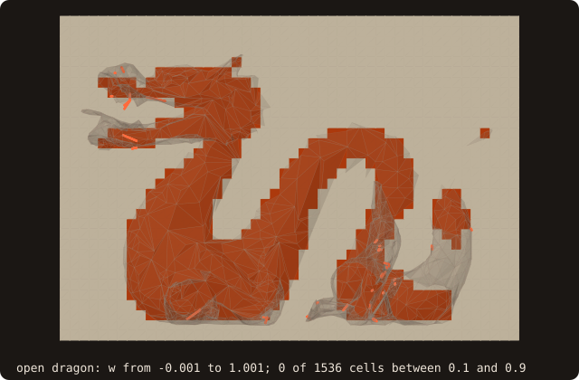
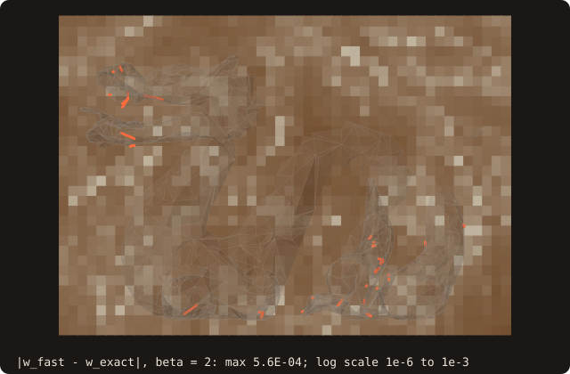

# Generalized / fast winding number

## What it does

Returns a continuous scalar `w(q)` that measures **how many times the
input surface wraps around a query point** `q`. For a closed,
outward-oriented surface:

- `w(q) ≈ 1.0` strictly inside the volume
- `w(q) ≈ 0.0` strictly outside
- intermediate values on the surface boundary

The point of the *generalized* winding number is what happens **when the
surface isn't watertight**: holes, missing facets, near-coincident
duplicate triangles, mixed-orientation patches. The legacy sign
algorithms in FOSSIL (`SIGN_RAY_INTERSECTIONS`, `SIGN_SOLID_ANGLE`,
`SIGN_PSEUDO_NORMAL`) all degrade unpredictably on dirty input — they'll
report some points as inside when they shouldn't be, or oscillate near
holes. The generalized winding number degrades **gracefully**: a query
point on the symmetry plane of a cube-with-one-face-deleted returns
~0.5 (half-wrapped), not garbage.

This is the *highest-leverage* of FOSSIL's advanced primitives. It directly fixes a
known correctness gap in FOSSIL's existing signed-distance API on the
dirty STLs that motivate `sanitize` in the first place.

{.fossil-figure}

On the dragon as it is, holes included: on a plane through the body w ranges from -0.001 to 1.001, and none of the
1536 cells lies between 0.1 and 0.9: holes this small do not blur the inside. The figures are drawn by
`docs/examples/src/fig_ref_winding_number_field.f90`.

## Pipeline

The exact formulation is

$$
w(q) = \frac{1}{4\pi} \sum_{f \in F} \Omega_f(q)
$$

where $\Omega_f(q)$ is the *signed solid angle* subtended by triangle
$f$ at point $q$ (Van Oosterom & Strackee 1983). The sum is over all
facets in the surface.

For a query at $q$:

1. **Brute force** (`beta ≤ 0`): evaluate the per-facet solid angle
   directly. O(N) per query, exact within floating-point precision.
2. **Hierarchical Barnes-Hut** (default, `beta = 2.0`):
   - Each AABB tree node carries its **dipole**
     $D = \sum_f \mathrm{area}_f \, \hat{n}_f$ and **second moment**
     $C = \sum_f \mathrm{area}_f \, \hat{n}_f \, (x_f - c)^T$ about the box
     centre $c$.
   - If the query point is far from the node (distance > `beta` × node
     diagonal), the subtree contributes its Taylor expansion, with
     $r' = c - q$:
     $$\Omega \approx \frac{D \cdot r'}{|r'|^3} - \frac{3\, r'^T C\, r' - |r'|^2 \operatorname{tr} C}{|r'|^5}$$
   - Otherwise the traversal descends, and leaves sum their facets'
     exact solid angles.

The per-node data is built **once**, by `analyze` (`surface%wn_payload`),
and reused by every query.
- **SAH BVH:** an iterative, GPU-ready traversal
  (`bvh_winding_number_oac`).
- **Octree:** the same expansion over up to 8 children. The octree stores
  each facet once per level, so facets are summed at leaves only.

On bunny (69451 facets) a query takes about 13 µs.

| Mesh | β = 2 | β = 4 |
|---|---|---|
| bunny | 8.7e-3 | 1.7e-3 |
| dragon-fine | 9.8e-4 | 7.2e-5 |

*Measured max |w_fast − w_exact| on 12³ grids.*

{.fossil-figure}

The error of the default β = 2 against the exact sum (`beta=-1`) on that plane: at most 5.6e-4, spread over the whole
plane rather than gathered at the surface.

::: warning Fixed in issue #29
Before issue #29 the fast path rebuilt its cache on every call: about 1.1 ms
per query on bunny. It also had the far-field term's sign inverted, giving
errors up to 2 wherever the far field was used, and on octrees it counted every
facet once per tree level. Results from earlier versions that relied on
`beta > 0` should be recomputed.
:::

## API

```fortran
real(R8P) function surface%winding_number(point, beta)
   type(vector_R8P), intent(in)           :: point  ! query point
   real(R8P),        intent(in), optional :: beta   ! Barnes-Hut admissibility (default 2.0)
```

- **`point`** is the 3D query position.
- **`beta`** controls the multipole admissibility ratio. Larger β
  means stricter admissibility (more recursion, more accuracy, slower).
  Default `beta = 2.0` is a balanced setting; production use rarely
  needs tuning. `beta ≤ 0` forces the exact O(N) sum.

The returned `w` is the unrounded scalar. To use it as an
inside/outside test, threshold at `0.5`:

```fortran
inside = surface%winding_number(point=q) > 0.5_R8P
```

## Example

On `cube-01.stl` (the unit cube, 8 facets per face), at the centre, on
a face, on an edge, at a corner and outside:

<<< @/examples/snippets/ref_winding_number-cube.f90

The same cube without its top face (8 facets dropped), so not closed:

<<< @/examples/snippets/ref_winding_number-holed.f90

The fast evaluation against the exact sum (`beta = -1`, or any
non-positive value) on the dragon, at 125 points spread over its box:

<<< @/examples/snippets/ref_winding_number-beta.f90

<<< @/examples/output/ref_winding_number.ansi{ansi}

- **Closed cube.** `w` is the fraction of the full solid angle the
  surface covers seen from the point: 1 inside, 1/2 on a face, 1/4 on
  an edge, 1/8 at a corner, 0 outside, all to the printed digits.
- **Open box.** At the centre each face subtends 1/6 of the sphere;
  without the top, `w` = 5/6 = 0.8333. Below the opening, at z = 0.9,
  it is still 0.5886: above the 0.5 threshold, so the point stays
  inside, where the ray parity of an open mesh has no answer. The
  [slice below](#cube-reference) shows the whole field.
- **Fast against exact.** At the default β = 2 the multipole
  approximation differs from the exact sum by at most 3.27e-4 over the
  125 points; β = 4 brings that to 3.67e-5, at the price of more
  recursion. Both are far below what the 0.5 threshold can feel, except
  for points within that distance of `w = 0.5`.

## Cube reference

The cube is the simplest test case: 12 facets, three orthogonal
diagonal-split faces, axis-aligned. A query at the centroid `(0.5, 0.5,
0.5)` returns `w = 1.0` to floating-point precision; a query at a
corner returns `w = 0.125` (one octant of the full $4\pi$ solid angle,
which is what you should expect from this formulation at a vertex
singularity), and one on a face `w = 0.5`.

Open the cube and the field stays meaningful. Below, the cube without
its top (clipped at `z = 0.9`) and `winding_number` on the slice
`y = 0.5`: `w` reaches 0.95 deep inside (0.851 at the centre of the box),
fades smoothly through the opening, and is 0 far outside. Just outside
the walls below the rim it dips to −0.19, where the missing top is seen
from its inner side; at the 0.5 threshold of `SIGN_FAST_WINDING_NUMBER`
every cell of the slice below the rim is on the right side, and the
inside bulges through the opening by under 0.1 (the cells with
`w > 0.5` above `z = 0.9` reach `z = 0.98`), where inside is a
matter of definition.

{.fossil-figure}

## Known limitations

- **The fast path is an approximation.** At β = 2 the error is up to about
  1e-2 (table above): ample for the inside/outside decision at 0.5, which
  is how `SIGN_FAST_WINDING_NUMBER` uses it, but not a substitute for the
  exact value. Raise β to tighten it, or force the exact sum (`beta ≤ 0`)
  for ground-truth tests.
- **β is a per-call choice.** The per-node cache does not depend on it, so
  `winding_number(point, beta)` can use any β without a rebuild. The
  `SIGN_FAST_WINDING_NUMBER` sign algorithm always uses β = 2.
- **At surface vertices and edges**, `w` returns the local solid-angle
  fraction (e.g. 1/8 at a cube corner), not 0 or 1. This is **the
  correct mathematical answer** — the "inside vs. outside" question is
  ill-posed exactly on the surface. Threshold at 0.5 to get a clean
  binary classifier; query a small offset away from the surface if you
  need a definite answer at a known vertex.
- **Non-watertight inputs return values in (0, 1)** — that's the whole
  point, but if your downstream code assumed `w ∈ {0, 1}` it'll need
  updating. Threshold at 0.5 to recover the binary classifier.

## See also

- [`distance` and the `SIGN_*` constants](/guide/api/surface-stl-object#distance) —
  legacy sign algorithms (kept for back-compat; prefer winding number on
  dirty input).
- [Constants](/guide/api/constants) — `SIGN_PSEUDO_NORMAL` is FOSSIL's
  default for `distance`'s sign; winding number is its own scalar query
  with no constant needed.
- [`aabb_tree_object`](/guide/api/aabb-tree-object) — the acceleration
  structure that carries the per-node dipole moments used by the
  hierarchical traversal.

## References

- Jacobson, Kavan & Sorkine-Hornung, *Robust Inside-Outside Segmentation
  Using Generalized Winding Numbers*, SIGGRAPH 2013. The original
  algorithm — the formulation FOSSIL implements.
- Barill, Dickson, Schmidt, Levin & Jacobson, *Fast Winding Numbers for
  Soups and Clouds*, SIGGRAPH 2018. The Barnes-Hut hierarchical
  evaluation that makes large meshes tractable.
- Van Oosterom & Strackee, *The solid angle of a plane triangle*, IEEE
  TBME 30(2), 1983. The closed-form per-facet solid angle.
