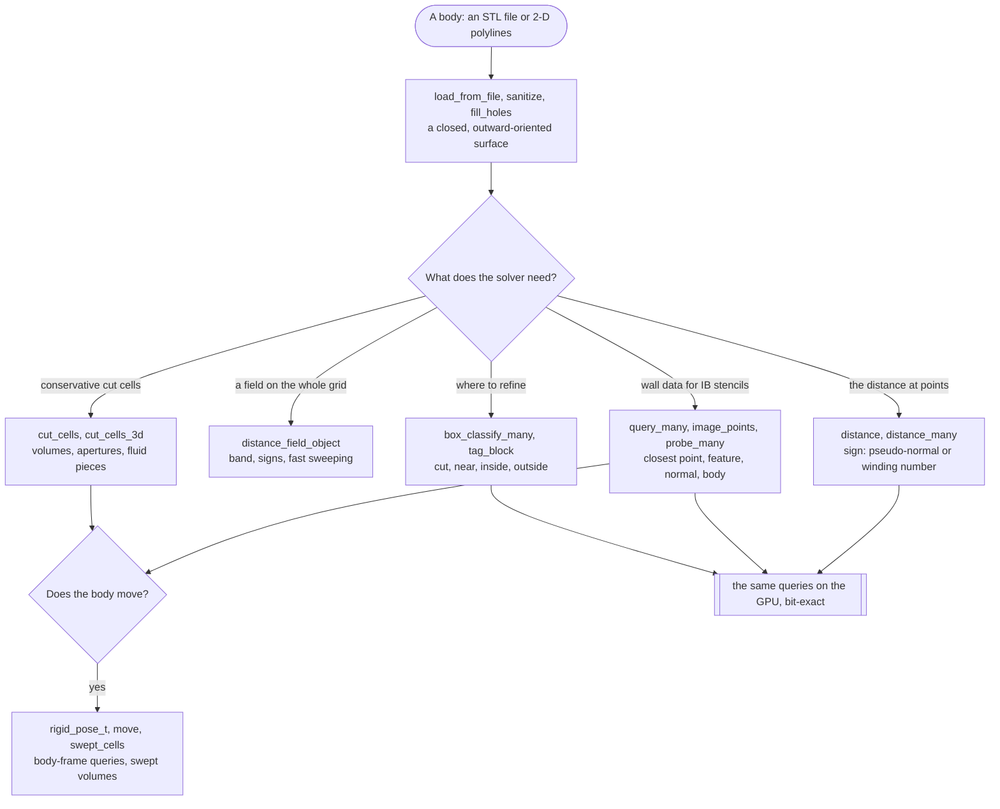

# About FOSSIL

FOSSIL (FOrtran Surfaces, Solids, Immersed boundaries and Level sets) is a pure Fortran library for the geometry of
complex bodies in simulation codes. It reads a body as a triangulated surface (STL) or, in 2-D, as a set of
polylines, repairs it, and answers the questions a solver asks of it on a grid: how far, which side, which point of
the wall, which cells it cuts and how much of each cell is fluid, and how all of that changes as the body moves.

| Type | For |
|---|---|
| `surface_stl_object` | a 3-D body: STL I/O, repair, processing, distance and sign, rich and batched queries, AMR tagging, motion, the GPU |
| `curve_object` | a 2-D body: closed or open polylines in an axis-aligned plane, with the same queries as the surface |
| `distance_field_object` | a signed-distance field (a level set) on a rectilinear, possibly stretched grid, from a surface or a curve |
| `facet_object` | one triangle of a surface: vertices, normal, connectivity |

The cut cells of a grid come from `curve%cut_cells` in 2-D and from `cut_cells_3d` (module `fossil_cut_cells_3d`) in
3-D; poses and swept geometry from `fossil_rigid_pose` and `fossil_swept_cells`.

What a solver typically needs, and where it comes from:

FOSSIL targets CFD codes on Cartesian, AMR and octree or quadtree grids, and immersed-boundary methods above all. It is
standard Fortran 2003+, with no C bindings. The library uses small libraries by the same author: PENF for the kinds,
VecFor for vectors and VTKFortran for VTK output (with their own dependencies, FACE, BeFoR64, FoXy and StringiFor);
the `fossilizer` CLI also uses FLAP. `fobis fetch` and fpm download them.

This documentation reads in order, and each page links to the next one:

1. [Installation](./installation): get FOSSIL into your project.
2. The [tutorial](/manual/): twelve short chapters that put a body into a simulation grid, step by step.
3. The [cookbook](/manual/cookbook): short recipes, one for each "how do I ...?".
4. The reference, from the [feature map](./features) on: every capability, its arguments, its limits.

The [API](/api/) documents the source itself. Every code sample of the tutorial and of the cookbook is part of a
program that is compiled and run to produce the output shown (see
[`docs/examples`](https://github.com/szaghi/FOSSIL/tree/master/docs/examples)).

## Authors

**[Stefano Zaghi](https://github.com/szaghi)** · stefano.zaghi@cnr.it
> *Chief Yak Shaver, Accidental Research Scientist, and HPC Farmer* — CFD researcher who decided that one more day debugging Fortran build systems was one day too many, opened a Python REPL "just to prototype," and now finds himself maintaining a meshing library, a chimera assembler, an MPI load balancer, and the seven blog tabs he keeps meaning to read.

**[Claude](https://claude.ai)** (Anthropic)
> *Omniscient Code Oracle & Tireless Rubber Duck* — AI pair programmer, responsible for writing the boring parts so humans don't have to.

Contributions are welcome — see the [Contributing](./contributing) page.

## Copyrights

FOSSIL is distributed under a multi-licensing system:

- for FOSS projects: [GPL v3](http://www.gnu.org/licenses/gpl-3.0.html);
- for closed-source or commercial projects: [BSD 2-Clause](http://opensource.org/licenses/BSD-2-Clause),
  [BSD 3-Clause](http://opensource.org/licenses/BSD-3-Clause) or [MIT](http://opensource.org/licenses/MIT).

Next: [Installation](./installation).
