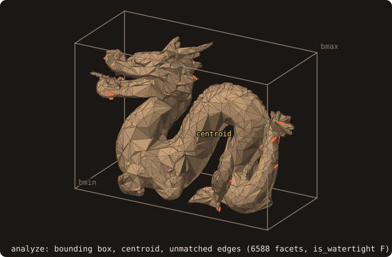
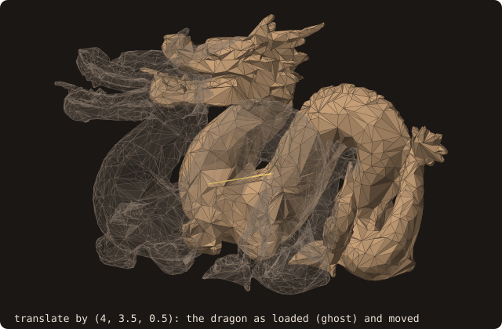
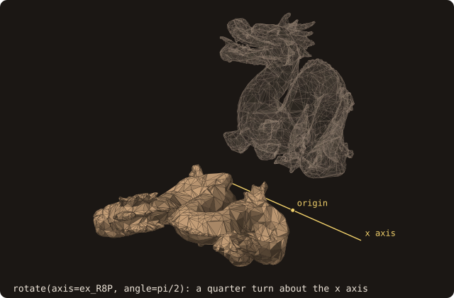
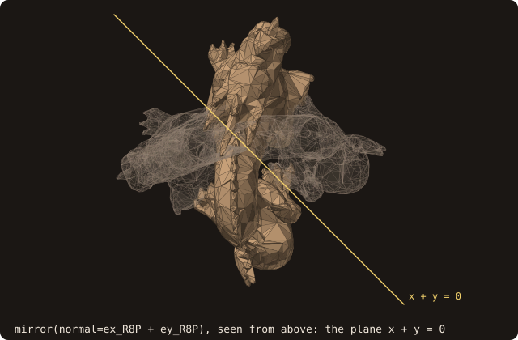
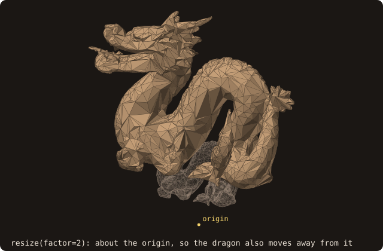
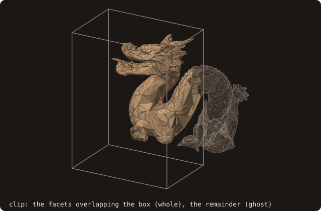
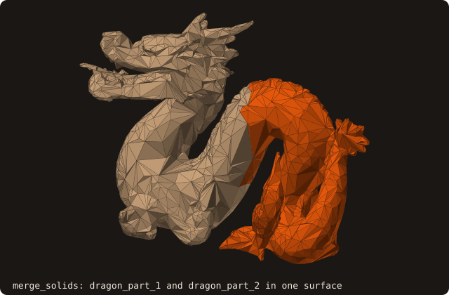
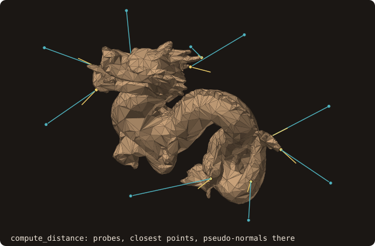

# Usage

All examples use `use fossil` which re-exports `surface_stl_object` and `facet_object`, plus the constants for sign algorithms (`SIGN_PSEUDO_NORMAL`, `SIGN_RAY_INTERSECTIONS`, `SIGN_SOLID_ANGLE`, `SIGN_FAST_WINDING_NUMBER`), tree kinds (`AABB_TREE_SAH_BVH`, `AABB_TREE_OCTREE`), and status codes (`STATUS_OK`, `STATUS_INVALID_INPUT`, …).

Numeric kinds (`I4P`, `R8P`) come from [PENF](https://github.com/szaghi/PENF); 3D vectors and unit versors (`ex_R8P`, `ey_R8P`, `ez_R8P`) come from [VecFor](https://github.com/szaghi/VecFor).

Every block on this page is a region of a program in `docs/examples/src/` (`ref_usage_*.f90`), compiled and run when
the site is built; the outputs shown are those runs. The bodies are the test fixtures `dragon.stl` (6588 facets, not
watertight), `cube-01.stl` (the unit cube) and `naca0012-ascii.stl`.

## Loading an STL file

### Auto-detect format

Pass `guess_format=.true.` to let FOSSIL determine whether the file is ASCII or binary automatically.

<<< @/examples/snippets/ref_usage_io-load.f90

`load_from_file` runs `analyze` internally — bounding box, connectivity, volume, centroid, AABB tree, and pseudo-normals are all populated before it returns. You typically call `sanitize` next to repair common STL defects.

{.fossil-figure}

### Explicit format

<<< @/examples/snippets/ref_usage_io-explicit.f90

`is_ascii` defaults to `.true.` when `guess_format` is absent or `.false.`.

### Load with on-the-fly clipping

Only the facets that overlap the box are loaded, without a separate clip pass; a facet crossing the box is kept whole,
so the loaded surface can reach out of it:

<<< @/examples/snippets/ref_usage_io-clipped.f90

### Rejecting bad input

If any vertex coordinate is `NaN` or `Inf`, `load_from_file` refuses the file via the optional `status` argument rather than letting the bad value propagate:

<<< @/examples/snippets/ref_usage_io-reject.f90

The run of the loading blocks (and of the save block below, which writes `dragon-out-binary.stl`): the clipped load
keeps 3811 of the 6588 facets, and its x range ends at 1.2261, past the box face x = 0, because the facets crossing
that face are kept whole.

<<< @/examples/output/ref-usage-io.ansi{ansi}

---

## Printing statistics

<<< @/examples/snippets/ref_usage_analysis-statistics.f90

The output for the cube fixture, post-sanitize:

<<< @/examples/output/ref-usage-statistics.ansi{ansi}

The last line is the depth of the octree; the default SAH BVH has no levels and reports `AABB_AUTO_REFINEMENT` (-1).

::: tip
Volume is positive for a closed body with outward-pointing normals (the standard divergence-theorem convention; `sanitize` produces this state). If you see a negative volume after sanitize, the mesh is probably non-watertight — check the non-manifold-edge and disconnected-edge counts.
:::

---

## Saving an STL file

<<< @/examples/snippets/ref_usage_io-save.f90

`is_ascii` defaults to `.true.`: pass `is_ascii=.false.` for a binary file. A surface with several patches is written as
one `solid` block per patch in ASCII.

---

## Sanitize (the full repair pipeline)

`sanitize` is the orchestrator. It runs every repair pass in the right order and prints one stderr warning per defect class detected.

<<< @/examples/snippets/ref_usage_repair-sanitize.f90

On the dragon it removes 62 duplicate facets and reports what it cannot repair: facets with disconnected edges (the
holes) and 54 non-manifold edges remain.

<<< @/examples/output/ref-usage-sanitize.ansi{ansi}

The passes that run inside `sanitize`:

1. `remove_degenerate_facets` — drop zero-area / sliver triangles before their NaN normals contaminate downstream queries.
2. `connect_nearby_vertices` (if disconnected edges were detected) — union-find vertex deduplication on a tolerance.
3. `analyze` — rebuild metrix, connectivity, vertex occurrences.
4. `remove_duplicate_facets` — drop literal duplicates, including reversed-orientation ones.
5. `analyze` — rebuild after duplicate removal (only if any duplicates were dropped).
6. `sanitize_normals` — BFS-propagate winding consistency, then global flip so volume > 0.
7. `fill_holes` — only with `sanitize(fill_holes=.true.)`: close the boundary loops with minimum-weight patches
   (`refine_holes` and `fair_holes` refine and fair the patches; see [Hole filling](./advanced/hole-filling.md)).

Each individual pass is also callable directly if you want fine-grained control.

---

## Validity predicates

After `sanitize`, three named predicates summarise the mesh state:

<<< @/examples/snippets/ref_usage_analysis-validity.f90

| Predicate | True iff |
|---|---|
| `is_watertight` | Every edge has exactly 2 incident facets |
| `is_manifold`   | No non-manifold edges (boundary edges allowed) |
| `is_volume`     | watertight AND volume > 0 AND finite centroid |

The block run on the dragon as loaded, then on the cube after `sanitize`:

<<< @/examples/output/ref-usage-validity.ansi{ansi}

---

::: warning Call analyze after transforming
`translate`, `rotate`, `mirror` and `resize` move the vertices only. The
centroid, volume, bounding box, AABB tree and pseudo-normals stay as they were
until `call surface%analyze`, so getters and distance queries return stale
values until then. One `analyze` after the last transform of a batch is enough.
See [After a transform](/guide/api/surface-stl-object#after-a-transform).
:::

The blocks below start each operation from a copy of the dragon as loaded (`surface = dragon`), declared as:

<<< @/examples/snippets/ref_usage_manipulation-declarations.f90

## Translate

Move the surface by a vectorial delta or by individual axis components (`delta` and `x`/`y`/`z` together are
ambiguous: `status = STATUS_AMBIGUOUS_ARGS`, or an error stop without `status`):

<<< @/examples/snippets/ref_usage_manipulation-translate.f90

{.fossil-figure}

---

## Rotate

Rotate around an arbitrary axis by an angle in radians; the pivot is the origin:

<<< @/examples/snippets/ref_usage_manipulation-rotate.f90

Alternatively, provide a pre-built rotation matrix:

<<< @/examples/snippets/ref_usage_manipulation-rotate_matrix.f90

Both forms take an optional `center`, the pivot of the rotation:

<<< @/examples/snippets/ref_usage_manipulation-rotate_center.f90

{.fossil-figure}

---

## Mirror

Mirror with respect to a plane through the origin, defined by its normal (normalised inside):

<<< @/examples/snippets/ref_usage_manipulation-mirror.f90

<<< @/examples/snippets/ref_usage_manipulation-mirror_oblique.f90

Or by a pre-built mirror matrix:

<<< @/examples/snippets/ref_usage_manipulation-mirror_matrix.f90

{.fossil-figure}

The facet winding is reversed together with the reflection, so an outward
surface stays outward (the same holds for `resize` with an odd number of
negative factors): the volumes of the mirrored dragons in the run below stay
+465.929. As for every transform, call `surface%analyze` before queries.

---

## Resize (scale)

Scale all facets by a uniform or per-axis factor (`factor` and `x`/`y`/`z` together are ambiguous, as for
`translate`). The default pivot is the origin:

<<< @/examples/snippets/ref_usage_manipulation-resize.f90

<<< @/examples/snippets/ref_usage_manipulation-resize_axes.f90

Pass `respect_centroid=.true.` to scale about the surface centroid instead (the centroid of the last `analyze`):

<<< @/examples/snippets/ref_usage_manipulation-resize_centroid.f90

{.fossil-figure}

---

## Clip

Keep only the facets that overlap a given axis-aligned bounding box (a facet crossing the box is kept whole). The removed facets can be captured as a separate surface:

<<< @/examples/snippets/ref_usage_manipulation-clip.f90

{.fossil-figure}

---

## Merge

Combine two surfaces into one. The result is stored in the first surface; here the two parts are the clip and its
remainder, saved and loaded back:

<<< @/examples/snippets/ref_usage_manipulation-merge.f90

{.fossil-figure}

The run of every block of the manipulation sections: the box and the volume that `analyze` computes after each
operation. Rotations, mirrors and translations keep the volume 465.929; the uniform factor 2 multiplies it by 8
(3727.429), the factors (0.5, 1, 1.2) by 0.6 (279.557). The merge gives back the 6588 facets and the box of the
dragon.

<<< @/examples/output/ref-usage-manipulation.ansi{ansi}

---

## Distance queries

The first blocks query the unit cube `cube-01.stl`:

<<< @/examples/snippets/ref_usage_distance-load.f90

### Unsigned distance (squared, default)

<<< @/examples/snippets/ref_usage_distance-unsigned.f90

### Euclidean (non-squared) distance

<<< @/examples/snippets/ref_usage_distance-euclidean.f90

### Signed distance

Negative inside, positive outside. Default sign algorithm is `SIGN_PSEUDO_NORMAL` (Bærentzen–Aanæs); pass `sign_algorithm=` to override.

<<< @/examples/snippets/ref_usage_distance-signed.f90

### Point-in-polyhedron test

<<< @/examples/snippets/ref_usage_distance-inside.f90

### Closest point and normal

`compute_distance` returns the distance together with the closest facet, the local edge (0 if the closest point is not on
an edge) and the local vertex (0 if it is not on a vertex) of that facet, the closest point and the pseudo-normal there:

<<< @/examples/snippets/ref_usage_distance-closest.f90

{.fossil-figure}

### Batched distances

`distance_many` is a loop of `distance` over a point array, OpenMP-parallel, with the same options for every point;
`distances` is allocated by the caller, and a size mismatch returns `STATUS_INVALID_INPUT`:

<<< @/examples/snippets/ref_usage_distance-batched.f90

### Choosing the AABB tree kind

The default `AABB_TREE_SAH_BVH` is faster on every measured mesh (see [AABB tree](./api/aabb-tree-object.md) and
[tutorial 5](/manual/tutorial/05-batched)). The legacy octree is still selectable:

<<< @/examples/snippets/ref_usage_distance-tree_kind.f90

Both kinds produce bit-exact distance results — the difference is purely query speed. The run of the distance blocks:

<<< @/examples/output/ref-usage-distance.ansi{ansi}

---

## Connect nearby vertices (repair)

`sanitize` calls this internally when needed; you only invoke it directly if you want to repair a surface without
running the full pipeline. The surface here is the cube with its first facet shifted by 1e-4 along x, which
disconnects its three edges from the neighbours:

<<< @/examples/snippets/ref_usage_repair-crack.f90

<<< @/examples/snippets/ref_usage_repair-connect.f90

Each group of nearby vertices is replaced by its centroid, so the crack closes (no disconnected edges after) but the
merged vertices sit between the old positions: the volume moves from 0.9999958 to 0.9999948.

<<< @/examples/output/ref-usage-connect.ansi{ansi}

---

## Full workflow example

<<< @/examples/snippets/ref_usage_workflow.f90

<<< @/examples/output/ref-usage-workflow.ansi{ansi}
