## In a nutshell

Load a body, read what FOSSIL computed about it, save it (the first chapter of the
[tutorial](/manual/tutorial/01-first-surface)):

<<< @/examples/snippets/tut01_first_surface.f90

<<< @/examples/output/tut01.ansi{ansi}

The dragon is neither watertight nor manifold as loaded: [chapter 2](/manual/tutorial/02-repair) repairs it. Start
with the [tutorial](/manual/tutorial/01-first-surface), or look up a task in the [cookbook](/manual/cookbook).

## See it run

A NACA 0012 section pitching and translating through a Cartesian grid, every frame computed by FOSSIL
([`anim_airfoil.f90`](https://github.com/szaghi/FOSSIL/blob/master/docs/examples/src/anim_airfoil.f90)): on the
left the exact cut cells, shaded by their solid fraction ([chapter 10](/manual/tutorial/10-cut-cells)); on the right
the level sets of the signed distance ([chapter 6](/manual/tutorial/06-distance-field)), with the body's pose passed to
the query instead of rebuilding its tree ([chapter 11](/manual/tutorial/11-moving-bodies)).

The tutorial programs, run one after the other on the dragon test body:

Every program of the tutorial and of the cookbook is compiled and run by
[`scripts/docs_examples.sh`](https://github.com/szaghi/FOSSIL/blob/master/scripts/docs_examples.sh): the outputs above
are captured, not typed.

## Authors

- Stefano Zaghi — [@szaghi](https://github.com/szaghi)

## Copyrights

FOSSIL is distributed under a multi-licensing system: [GPL v3](http://www.gnu.org/licenses/gpl-3.0.html) for FOSS
projects, [BSD 2-Clause](http://opensource.org/licenses/BSD-2-Clause),
[BSD 3-Clause](http://opensource.org/licenses/BSD-3-Clause) or [MIT](http://opensource.org/licenses/MIT) for
closed-source or commercial ones.
