# Cookbook

Short answers to "how do I ...?". Each recipe is a complete program with its real output; the
[reference](/guide/api/) has the details. The programs read the test bodies of the repository, `dragon.stl` (binary,
6588 facets, with holes), `cube-01.stl` (the unit cube, binary) and `naca0012-ascii.stl` (a wing section, ASCII),
which are in [`src/tests`](https://github.com/szaghi/FOSSIL/tree/master/src/tests). The [tutorial](./index) builds
the same calls up step by step.

[[toc]]

## Files

### Read an STL file, ASCII or binary

<<< @/examples/snippets/ck_read_any.f90

<<< @/examples/output/ck_read_any.ansi{ansi}

`guess_format=.true.` tells the formats apart by the file size: a binary STL of `n` facets is `84 + 50 n` bytes. See
[`surface_stl_object`](/guide/api/surface-stl-object).

### Reject a file with NaN or Inf coordinates

<<< @/examples/snippets/ck_reject_nan.f90

<<< @/examples/output/ck_reject_nan.ansi{ansi}

With `status=` present the load returns `STATUS_INVALID_INPUT` (5) instead of stopping, and the surface stays empty.
The codes are listed in [constants](/guide/api/constants#status-codes).

### Save as ASCII or binary

<<< @/examples/snippets/ck_save_formats.f90

<<< @/examples/output/ck_save_formats.ansi{ansi}

`is_ascii` defaults to `.true.`. The binary file of the 48-facet cube is `84 + 50 x 48 = 2484` bytes.

### Wall, inlet and outlet from one STL

<<< @/examples/snippets/ck_patches.f90

<<< @/examples/output/ck_patches.ansi{ansi}

Each `solid <name>` block of an ASCII STL is a named patch, kept on every facet; `load_from_files` reads one file per
patch. The query outputs `patches=` give the boundary condition at each point: the patch of its closest facet. The
patch travels through repair, booleans and remeshing. See [named patches](/guide/advanced/patches).

### Load only a region of a large file

<<< @/examples/snippets/ck_load_clipped.f90

<<< @/examples/output/ck_load_clipped.ansi{ansi}

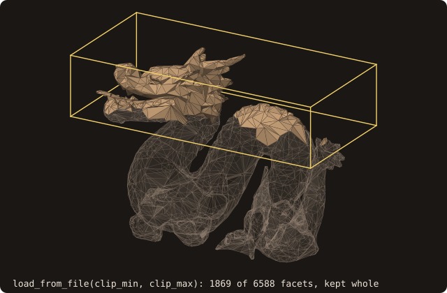{.fossil-figure}

A facet is kept whole when it overlaps the box, so the loaded part reaches below the box (z 13.6403 for a box
starting at 15). To cut the facets themselves, use [`clip`](/guide/api/surface-stl-object#clip) after the load.

## Repair

### Close the holes of a surface

<<< @/examples/snippets/ck_watertight.f90

<<< @/examples/output/ck_watertight.ansi{ansi}

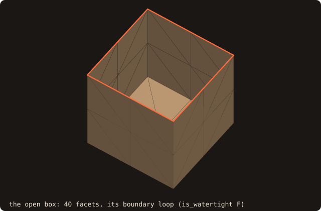

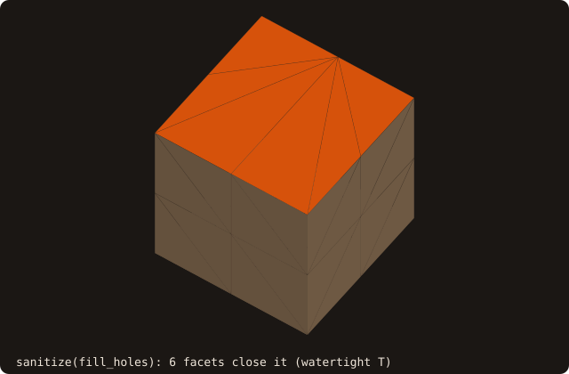

`fill_holes=.true.` closes the boundary loops that pass two limits: `max_hole_edges` (default 200) and
`max_hole_size`, the loop's bounding-box diagonal over the surface's (default 0.1). The missing face is a large hole,
so the recipe raises the size limit to 1. `sanitize` reports each defect class on standard error. See
[hole filling](/guide/advanced/hole-filling).

### Check that a surface is valid

<<< @/examples/snippets/ck_validity.f90

<<< @/examples/output/ck_validity.ansi{ansi}

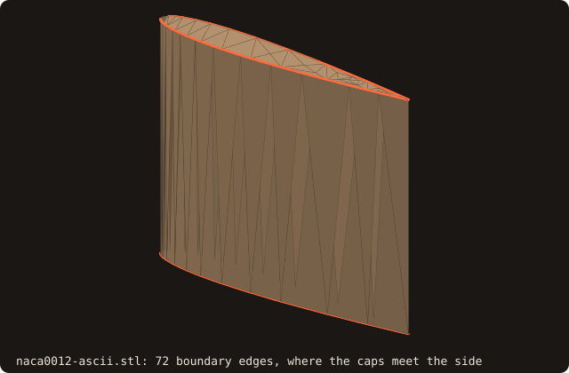{.fossil-figure}

`is_watertight` asks for two facets on every edge, `is_manifold` only for no edge with three or more, and `is_volume`
for a watertight surface with a positive volume. The wing has edges with a single facet and none with three:
manifold, not watertight. See
[getters and predicates](/guide/api/surface-stl-object#getters-and-predicates).

### Fix an inside-out surface

<<< @/examples/snippets/ck_flip.f90

<<< @/examples/output/ck_flip.ansi{ansi}

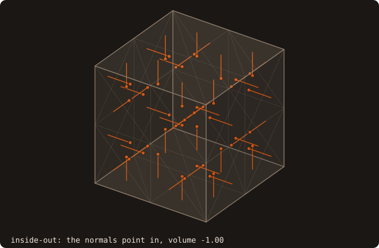

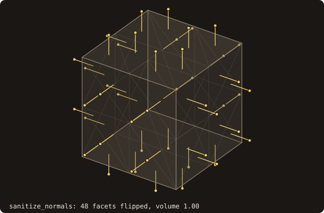

`sanitize_normals` makes the windings consistent and points them outward; `analyze` then recomputes the volume.
`sanitize` runs both. See the [repair pipeline](/guide/api/surface-stl-object#repair-pipeline).

## Queries

### Tell whether a point is inside

<<< @/examples/snippets/ck_point_inside.f90

<<< @/examples/output/ck_point_inside.ansi{ansi}

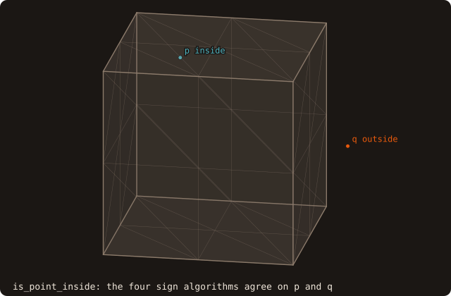{.fossil-figure}

On a watertight surface the four sign algorithms agree. The default is `SIGN_PSEUDO_NORMAL`, the cheapest; see
[sign algorithms](/guide/api/constants#sign-algorithms).

### Find the closest point and its normal

<<< @/examples/snippets/ck_closest_point.f90

<<< @/examples/output/ck_closest_point.ansi{ansi}

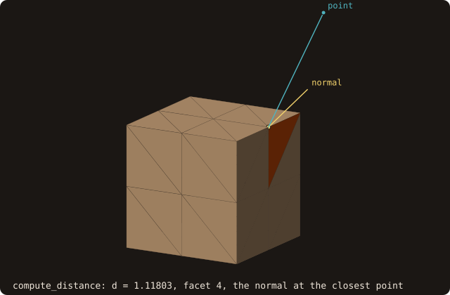{.fossil-figure}

The closest point is on the edge between the faces x = 1 and z = 1, so the normal is the edge pseudo-normal, the
angle-weighted mean of the two face normals. See
[distance and inside queries](/guide/api/surface-stl-object#distance-and-inside-queries).

### Get a reliable sign on a mesh with holes

<<< @/examples/snippets/ck_sign_holes.f90

<<< @/examples/output/ck_sign_holes.ansi{ansi}

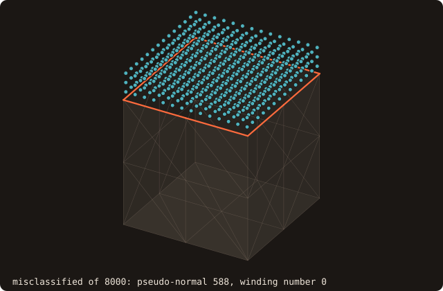{.fossil-figure}

The pseudo-normal sign is local: near an open boundary it misclassifies 588 of the 8000 points. The fast winding
number counts how much of the surface surrounds the point and misclassifies none. See
[winding number](/guide/advanced/winding-number).

### Cast a ray

<<< @/examples/snippets/ck_ray_hit.f90

<<< @/examples/output/ck_ray_hit.ansi{ansi}

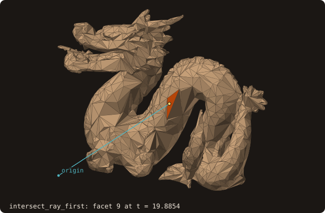{.fossil-figure}

`t` is the parameter along the ray, `point = origin + t direction`; the direction need not be a unit vector.
`intersect_ray_all` returns every hit and `intersect_ray_any` stops at the first one. See
[ray queries](/guide/advanced/ray-queries).

## Grids

### Compute the signed distance on a whole grid

<<< @/examples/snippets/ck_grid_distance.f90

<<< @/examples/output/ck_grid_distance.ansi{ansi}

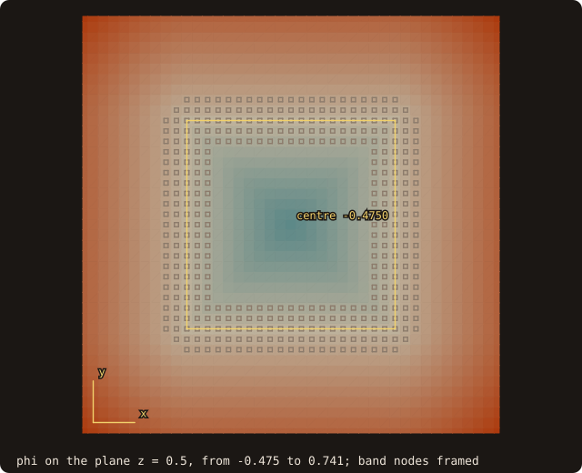{.fossil-figure}

The cells near the surface (the band) get exact distances; fast sweeping fills the others with a first-order
solution, -0.4750 at the centre where the exact value is -0.5. For exact values at a few points use `distance_many`.
See [distance field](/guide/advanced/distance-field).

### Compute the wall distance up to a cutoff

<<< @/examples/snippets/ck_wall_distance.f90

<<< @/examples/output/ck_wall_distance.ansi{ansi}

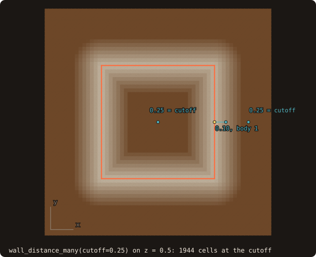{.fossil-figure}

The distance is unsigned. A point with no wall closer than the cutoff gets the cutoff and body 0, the centre of the
cube included; the traversal stops early for it. See
[wall distance](/guide/advanced/ib-queries#wall-distance-and-field-diagnostic).

### Tag the cells near the wall

<<< @/examples/snippets/ck_tag_cells.f90

<<< @/examples/output/ck_tag_cells.ansi{ansi}

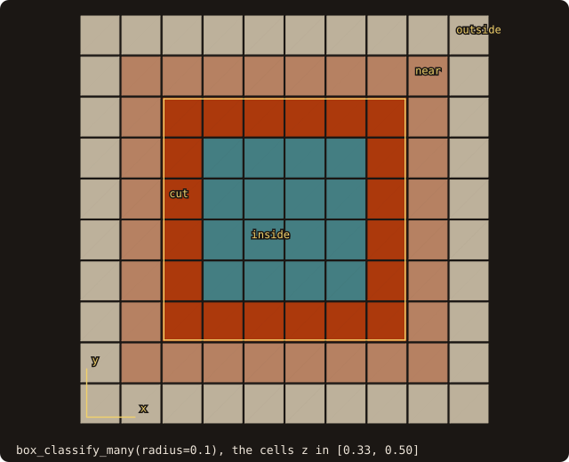{.fossil-figure}

A box is cut when it meets the surface, near when it is within `radius` of it, otherwise inside or outside by the
sign at its centre (fast winding number by default). The 152 cut cells are the shell between the 6^3 and 4^3 blocks
that contain the cube's faces. See [AMR tagging](/guide/advanced/amr-tagging).

### Neighbourhoods for a small-cell cure

<<< @/examples/snippets/ck_cut_solver.f90

<<< @/examples/output/ck_cut_solver.ansi{ansi}

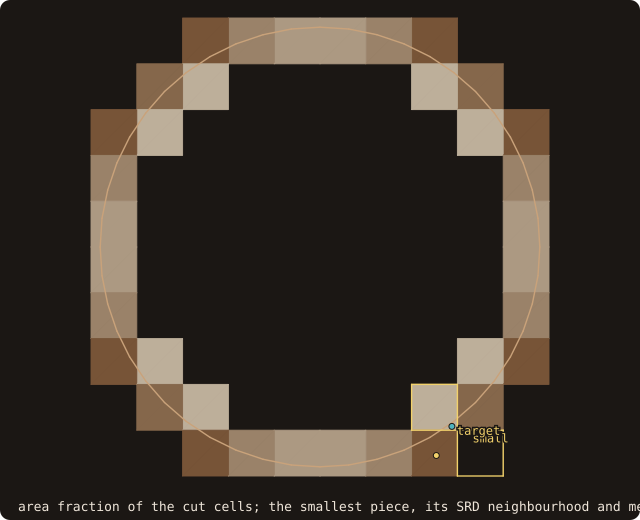{.fossil-figure}

`cut_links_2d` (3-D: `cut_cells_3d(..., links=)`) links the pieces of neighbouring cells; the solver support builds
on it. The smallest piece holds 4.5 % of its cell. Its state-redistribution neighbourhood grows along its wall
normal (0.58, −0.81) until it holds half a cell: the diagonal piece (+1, −1) comes first, reached through the links
inside the 3 × 3 tile. Its single merge target is the linked face neighbour that best faces the normal. The
weighted factor η^nb = 0.45 is the share it hands to its neighbour. The moments are those of the piece in its
cell's scaled coordinates. See [Cut cells: solver support](/guide/advanced/cut-solver).

### Locate a point in a curvilinear block

<<< @/examples/snippets/ck_block_locate.f90

<<< @/examples/output/ck_block_locate.ansi{ansi}

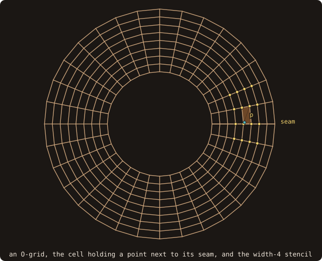{.fossil-figure}

`detect_topology_2d` finds the seam the grid writes exactly (faces 1 and 2 abut each other); `validity` certifies
every cell, exactly in 2-D. `locate_many` returns the cell and its local coordinates: the point lies in the first cell
after the seam. The width-4 stencil reaches across the seam through the record (vertex columns 32, 1, 2, 3), and its
weights use the order-matched ξ, so the interpolation is fourth order on the curved grid. 3-D blocks
(`curvilinear_block_t`) work the same way. See [Curvilinear blocks](/guide/advanced/curvilinear-blocks).

### Assemble an overset grid

<<< @/examples/snippets/ck_overset.f90

<<< @/examples/output/ck_overset.ansi{ansi}

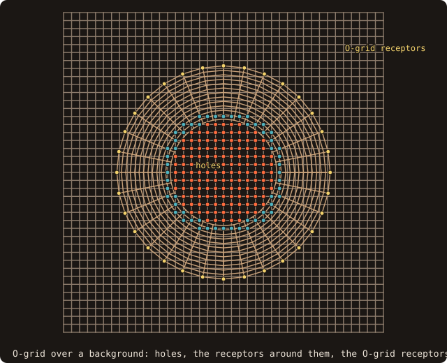{.fossil-figure}

The O-grid's wall becomes the cutter, which blanks the background vertices inside the cylinder (the O-grid itself is
not cut: `cuts`). Every vertex is located in the other block, and `classify_2d` picks the donors: the ring of
background vertices next to the holes and the O-grid's `overlap` boundary receive, from stencils of width 3 that hold
no hole and no receptor. No vertex is left an orphan; `build_connectivity` lists the 89 receptors with their donor
cells and local coordinates, as a flow solver reads them. FOSSIL does not choose the assembly policy: the rule, the
stencil width and the fringe depth are the caller's. See [Overset assembly](/guide/advanced/overset).

### Put a block face on a body with sharp edges

<<< @/examples/snippets/ck_project_face.f90

<<< @/examples/output/ck_project_face.ansi{ansi}

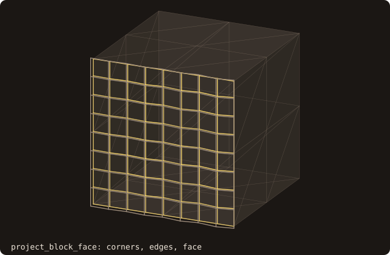{.fossil-figure}

`projection_target` collects the body's patches, its feature edges and patch boundaries (as curves between corners)
and its corners, once. `project_block_face` tags each vertex of the face by its distance to them (`tolerance`): the
face's corners go to the cube's corners, its edge lines to the cube's edges, its interior to the face. A plain closest
point would pull grid lines across the edges. See [body-fitted grid support](/guide/advanced/body-fitted).

### Extrude an O-grid and check its wall spacing

<<< @/examples/snippets/ck_wall_spacing.f90

<<< @/examples/output/ck_wall_spacing.ansi{ansi}

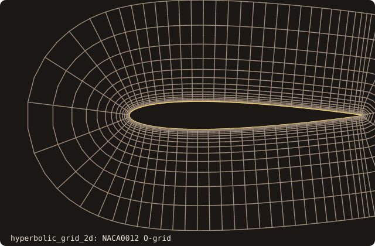{.fossil-figure}

`hyperbolic_grid_2d` marches layers normal to the section, with heights from `geometric_spacing`. The first one is set
for y₁⁺ = 1 with the given u_τ. `block_report_2d` measures what the grid gives: y₁⁺ at every wall vertex, from the
true distance to the wall, the growth ratio along the grid lines, and WP2's quality. See
[body-fitted grid support](/guide/advanced/body-fitted).
## Curves

### Cut a 2-D section of an STL

<<< @/examples/snippets/ck_slice.f90

<<< @/examples/output/ck_slice.ansi{ansi}

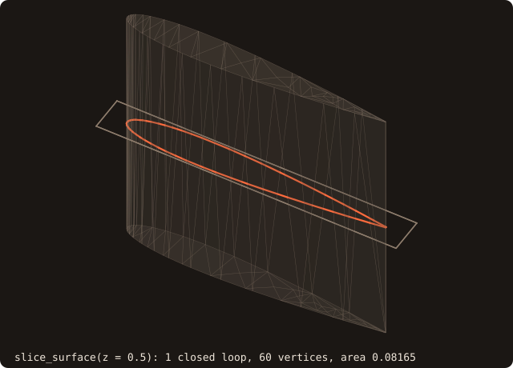{.fossil-figure}

`slice_surface(surface, normal_axis, level, curve)` cuts by an axis-aligned plane and returns a `curve_object`; the
section of the NACA 0012 wing is one closed loop of 60 vertices with area 0.08165. See
[2-D geometry](/guide/advanced/2d-geometry).

### Compute the signed distance to a polygon

<<< @/examples/snippets/ck_polygon_distance.f90

<<< @/examples/output/ck_polygon_distance.ansi{ansi}

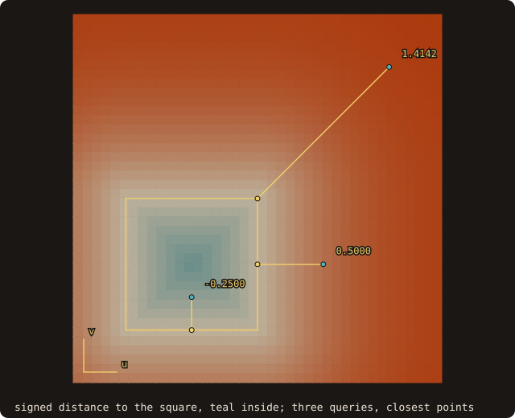{.fossil-figure}

Outer loops run counter-clockwise and holes clockwise; the distance is negative inside. See
[`curve_object`](/guide/api/curve-object).

### Second moments of area of a section

<<< @/examples/snippets/ck_mass_properties_2d.f90

<<< @/examples/output/ck_mass_properties_2d.ansi{ansi}

The hole is wound clockwise, so it subtracts. `second_moments(2)`, the integral of v², is the second moment of area
for bending about the u axis, here (b h³ − b′h′³)/12. See [mass properties](/guide/advanced/mass-properties#2-d-curves).

## Geometry processing

### Measure how far a repair moved the surface

<<< @/examples/snippets/ck_deviation.f90

<<< @/examples/output/ck_deviation.ansi{ansi}

The two directions differ: the hole patches are far from the original (they span the holes), while the original lies on
the repaired surface except where `sanitize` removed facets. `lower <= h <= upper` brackets the one-sided Hausdorff
distance (certified, to 1e-3 of the bounding-box diagonal by default); `mean` and `rms` are estimates. See
[surface deviation](/guide/advanced/surface-deviation).

### Find the sharp edges of a part

<<< @/examples/snippets/ck_feature_edges.f90

<<< @/examples/output/ck_feature_edges.ansi{ansi}

`feature_edges` reports sharp edges (30 degrees by default), boundary and non-manifold edges, with their corners and
polylines as vertex-pool ids. See [feature edges](/guide/advanced/feature-edges).

### Find walls too thin for my grid

<<< @/examples/snippets/ck_thin_walls.f90

<<< @/examples/output/ck_thin_walls.ansi{ansi}

`thickness(method=THICKNESS_MEDIAL)` gives each facet the diameter of the largest ball tangent to it inside the body
(and outside, for `gap`). `thin_regions` groups the facets thinner than `factor * h` into connected regions. The
thickness is computed once; each cell size is one cheap call. On this NACA 0012 section, the thin facets shrink towards
the trailing edge as h decreases. For AMR, `build_thin` and `tag_block(thin_factor=, thin_band=, thin_tags=)` turn the
same values into refinement tags. See [thickness and gaps](/guide/advanced/thickness).

### Decimate a mesh

<<< @/examples/snippets/ck_decimate.f90

<<< @/examples/output/ck_decimate.ansi{ansi}

{.fossil-figure}

Quadric edge collapses remove two facets each, so the result stops at or just below the target (1646 for 1647). See
[decimation](/guide/advanced/decimate).

### Unite two bodies

<<< @/examples/snippets/ck_union.f90

<<< @/examples/output/ck_union.ansi{ansi}

{.fossil-figure}

Two unit cubes overlapping on a cube of side 0.5 give 2 - 0.125 = 1.875. `BOOL_INTERSECT`, `BOOL_DIFFERENCE` and
`BOOL_SYMDIFF` work the same way. See [booleans](/guide/advanced/booleans).

### Remesh to a uniform edge length

<<< @/examples/snippets/ck_remesh.f90

<<< @/examples/output/ck_remesh.ansi{ansi}

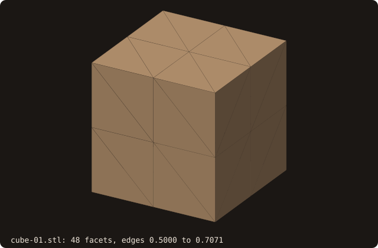

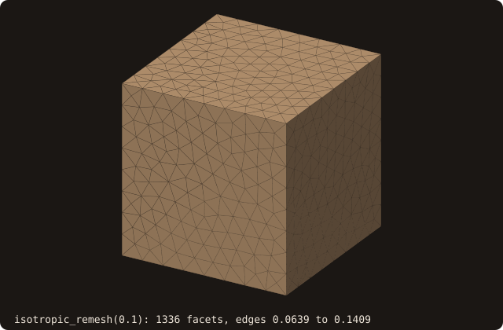

`preserve_features=.true.` keeps the twelve sharp edges of the cube, so the volume stays 1. After 10 iterations the
edges are between 0.0282 and 0.1352 for a target of 0.1. See [isotropic remeshing](/guide/advanced/isotropic-remesh).

### Measure the curvature at a point

<<< @/examples/snippets/ck_curvature.f90

<<< @/examples/output/ck_curvature.ansi{ansi}

{.fossil-figure}

`curvatures=` returns the mean and Gaussian curvature at the foot point, by a cubic fit over the two rings of
vertices around it: on this unit sphere of 6632 facets, H = 0.9944 and K = 0.9892. It runs on the CPU only. See
[curvature at the foot point](/guide/advanced/ib-queries#curvature-at-the-foot-point).

## Moving bodies

### Mass and inertia of a body

<<< @/examples/snippets/ck_mass_properties.f90

<<< @/examples/output/ck_mass_properties.ansi{ansi}

The body must be closed (`status` says so otherwise). The tensor is about the centre of mass unless `about=` names another
point; the principal moments are sorted ascending, here the block's three diagonal entries. See
[mass properties](/guide/advanced/mass-properties).

### How close are my two bodies?

<<< @/examples/snippets/ck_body_distance.f90

<<< @/examples/output/ck_body_distance.ansi{ansi}

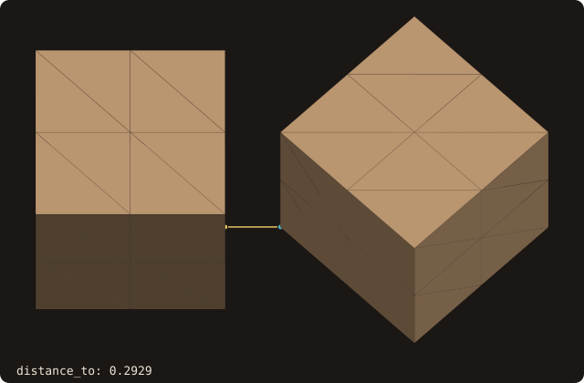{.fossil-figure}

`distance_to` returns the least distance over all pairs of facets, the two facets and the points that realize it, and
`intersecting` when the bodies touch or cross (0, decided exactly). `pose_other=` places the second body without
moving it or rebuilding its tree, here the corner of the turned cube at x = 2 − sqrt(2)/2. For many bodies,
`proximity_pairs(cutoff=)` lists the pairs closer than the cutoff. See [body–body distance](/guide/advanced/body-distance).

### When do my moving bodies first touch?

<<< @/examples/snippets/ck_ccd.f90

<<< @/examples/output/ck_ccd.ansi{ansi}

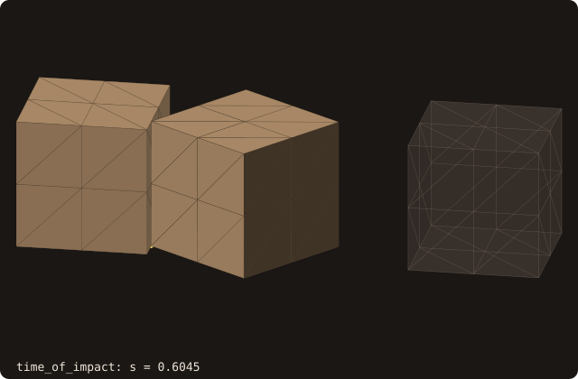{.fossil-figure}

`time_of_impact` moves each body from its pose at s = 0 to its pose at s = 1 (the motion of `pose_interpolate`: the
rotation about the body's own origin, angle and translation linear in s) and returns the first s at which they come
within the tolerance (default 1e-6 of the larger box diagonal), never later than the true contact: a plate 1e-3 thick
crossed within one step, apart at both ends, is still caught. `first_impact` gives the earliest contact among several
bodies. See [continuous collision detection](/guide/advanced/collision).

### Query a rotated body without rebuilding it

<<< @/examples/snippets/ck_pose.f90

<<< @/examples/output/ck_pose.ansi{ansi}

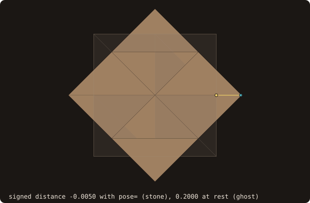{.fossil-figure}

With `pose=` the world-frame point is mapped into the body frame, and the tree built at load time serves every pose.
`pose_from_axis_angle` rotates about the origin, so the translation sets the pivot. A corner of the rotated cube reaches x = 0.5 +
sqrt(2)/2, so the point is inside it, 0.0050 from a face. See [moving bodies](/guide/advanced/moving-bodies).
