# Cookbook

Short answers to "how do I ...?". Each recipe is a complete program with its real output; the
[reference](/guide/api/) has the details. Most programs read the test bodies of the repository, `dragon.stl` (binary,
6588 facets, with holes), `cube-01.stl` (the unit cube, binary) and `naca0012-ascii.stl` (a wing section, ASCII),
which are in [`src/tests`](https://github.com/szaghi/FOSSIL/tree/master/src/tests); the others build their geometry in
code. The [tutorial](./index) builds the same calls up step by step.

[[toc]]

## Files

### Read an STL file, ASCII or binary

<<< @/examples/snippets/ck_read_any.f90

<<< @/examples/output/ck_read_any.ansi{ansi}

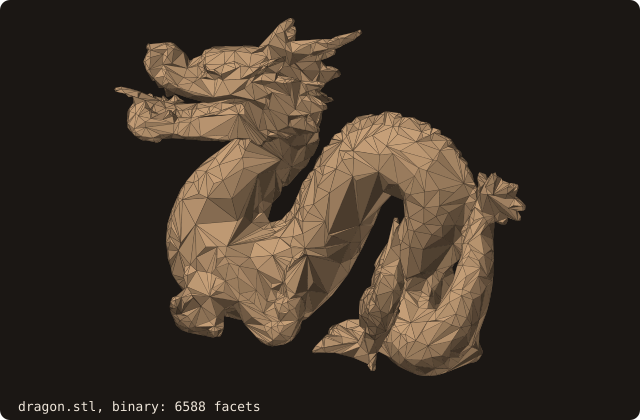

`guess_format=.true.` tells the formats apart by the file size: a binary STL of `n` facets is `84 + 50 n` bytes. See
[`surface_stl_object`](/guide/api/surface-stl-object).

### Reject a file with NaN or Inf coordinates

<<< @/examples/snippets/ck_reject_nan.f90

<<< @/examples/output/ck_reject_nan.ansi{ansi}

With `status=` present the load returns `STATUS_INVALID_INPUT` (5) instead of stopping, and the surface stays empty.
The codes are listed in [constants](/guide/api/constants#status-codes).

### Save as ASCII or binary

<<< @/examples/snippets/ck_save_formats.f90

<<< @/examples/output/ck_save_formats.ansi{ansi}

`is_ascii` defaults to `.true.`. The binary file of the 48-facet cube is `84 + 50 x 48 = 2484` bytes.

### Wall, inlet and outlet from one STL

<<< @/examples/snippets/ck_patches.f90

<<< @/examples/output/ck_patches.ansi{ansi}

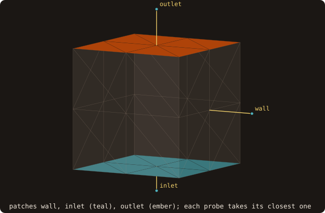{.fossil-figure}

Each `solid <name>` block of an ASCII STL is a named patch, kept on every facet; `load_from_files` reads one file per
patch. The query outputs `patches=` give the boundary condition at each point: the patch of its closest facet. The
patch travels through repair, booleans and remeshing. See [named patches](/guide/advanced/patches).

### Load only a region of a large file

<<< @/examples/snippets/ck_load_clipped.f90

<<< @/examples/output/ck_load_clipped.ansi{ansi}

{.fossil-figure}

A facet is kept whole when it overlaps the box, so the loaded part reaches below the box (z 13.6403 for a box
starting at 15). To cut the facets themselves, use [`clip`](/guide/api/surface-stl-object#clip) after the load.

## Repair

### Close the holes of a surface

<<< @/examples/snippets/ck_watertight.f90

<<< @/examples/output/ck_watertight.ansi{ansi}

`fill_holes=.true.` closes the boundary loops that pass two limits: `max_hole_edges` (default 200) and
`max_hole_size`, the loop's bounding-box diagonal over the surface's (default 0.1). The missing face is a large hole,
so the recipe raises the size limit to 1. `sanitize` reports each defect class on standard error. See
[hole filling](/guide/advanced/hole-filling).

### Check that a surface is valid

<<< @/examples/snippets/ck_validity.f90

<<< @/examples/output/ck_validity.ansi{ansi}

{.fossil-figure}

`is_watertight` asks for two facets on every edge, `is_manifold` only for no edge with three or more, and `is_volume`
for a watertight surface with a positive volume. The wing has edges with a single facet and none with three:
manifold, not watertight. See
[getters and predicates](/guide/api/surface-stl-object#getters-and-predicates).

### Fix an inside-out surface

<<< @/examples/snippets/ck_flip.f90

<<< @/examples/output/ck_flip.ansi{ansi}

`sanitize_normals` makes the windings consistent and points them outward; `analyze` then recomputes the volume.
`sanitize` runs both. See the [repair pipeline](/guide/api/surface-stl-object#repair-pipeline).

### Find self-intersections and remove them

<<< @/examples/snippets/ck_self_intersections.f90

<<< @/examples/output/ck_self_intersections.ansi{ansi}

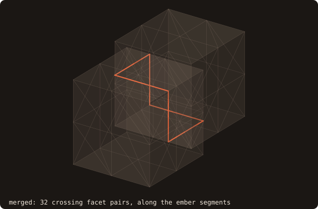

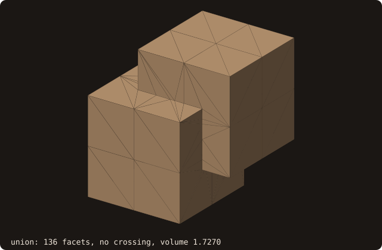

`find_self_intersections` lists every pair of facets that cross, with the segment they share: here 32 pairs along one
closed curve where the walls of the two cubes meet. To remove them, unite the crossing bodies with
`boolean(BOOL_UNION)`: the result keeps only the outer surface, watertight, no crossing pair left, volume
1.7270 = 2 − 0.7 × 0.65 × 0.6. See [self-intersection](/guide/advanced/self-intersection).

### Wrap a triangle soup into a closed surface

<<< @/examples/snippets/ck_alpha_wrap.f90

<<< @/examples/output/ck_alpha_wrap.ansi{ansi}

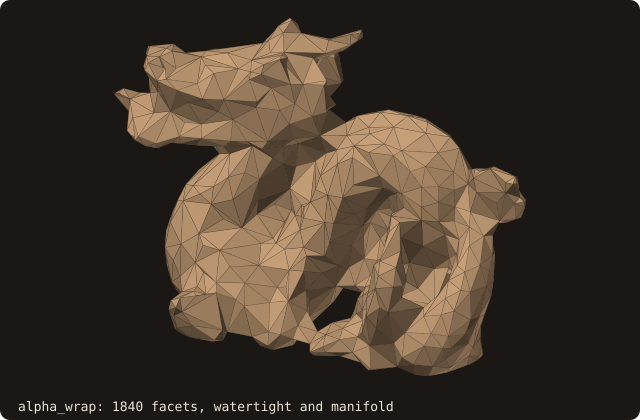

`alpha_wrap` returns a new surface, watertight and manifold by construction whatever the input: holes, duplicates and
non-manifold edges included. `alpha` is the diameter of the ball that carves the wrap from outside: gaps narrower than
about alpha + 2 offset are closed. Here alpha is 1/20 of the box diagonal and the wrap has 1840 facets; a smaller
alpha follows the input more closely and costs more. See [alpha wrap](/guide/advanced/alpha-wrap).

## Queries

### Tell whether a point is inside

<<< @/examples/snippets/ck_point_inside.f90

<<< @/examples/output/ck_point_inside.ansi{ansi}

{.fossil-figure}

On a watertight surface the four sign algorithms agree. The default is `SIGN_PSEUDO_NORMAL`, the cheapest; see
[sign algorithms](/guide/api/constants#sign-algorithms).

### Find the closest point and its normal

<<< @/examples/snippets/ck_closest_point.f90

<<< @/examples/output/ck_closest_point.ansi{ansi}

{.fossil-figure}

The closest point is on the edge between the faces x = 1 and z = 1, so the normal is the edge pseudo-normal, the
angle-weighted mean of the two face normals. See
[distance and inside queries](/guide/api/surface-stl-object#distance-and-inside-queries).

### Get a reliable sign on a mesh with holes

<<< @/examples/snippets/ck_sign_holes.f90

<<< @/examples/output/ck_sign_holes.ansi{ansi}

{.fossil-figure}

The pseudo-normal sign is local: near an open boundary it misclassifies 588 of the 8000 points. The fast winding
number counts how much of the surface surrounds the point and misclassifies none. See
[winding number](/guide/advanced/winding-number).

### Measure how much of a surface surrounds a point

<<< @/examples/snippets/ck_winding_number.f90

<<< @/examples/output/ck_winding_number.ansi{ansi}

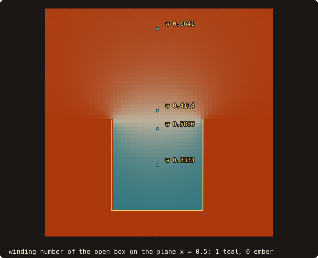{.fossil-figure}

The generalized winding number w is the solid angle the surface subtends at the point over 4π: 1 inside a closed
surface, 0 outside, and smooth on an open one. At the centre of the box without a lid w = 0.83333333 = 5/6, the five
faces' share. Across the opening it passes through 1/2 (0.5886 just below, 0.4114 just above), so `w > 0.5` stays a
sensible inside test. `beta=-1` gives the exact O(N) sum; the default Barnes–Hut evaluation agrees with it to the
digits shown. See [winding number](/guide/advanced/winding-number).

### Cast a ray

<<< @/examples/snippets/ck_ray_hit.f90

<<< @/examples/output/ck_ray_hit.ansi{ansi}

{.fossil-figure}

`t` is the parameter along the ray, `point = origin + t direction`; the direction need not be a unit vector.
`intersect_ray_all` returns every hit and `intersect_ray_any` stops at the first one. See
[ray queries](/guide/advanced/ray-queries).

### Run a batch of queries on the GPU

<<< @/examples/snippets/ck_device.f90

<<< @/examples/output/ck_device.ansi{ansi}

`enter_device` copies the BVH arrays to the device once, `query_many_device` takes the same arguments as
`query_many`, and `exit_device` releases the copies. The device kernels are the CPU ones (`_oac` routines), so the
results are bit-identical: 0 mismatches over 8000 points, in distances, facets and foot points. This page is built
with gfortran without OpenACC, so here the device routines run on the host; build with the `tests-nvidia` mode for the
GPU (see the [GPU chapter of the tutorial](./tutorial/16-gpu)). See [device distance](/guide/advanced/device-distance).

## Grids

### Compute the signed distance on a whole grid

<<< @/examples/snippets/ck_grid_distance.f90

<<< @/examples/output/ck_grid_distance.ansi{ansi}

{.fossil-figure}

The cells near the surface (the band) get exact distances; fast sweeping fills the others with a first-order
solution, -0.4750 at the centre where the exact value is -0.5. For exact values at a few points use `distance_many`.
See [distance field](/guide/advanced/distance-field).

### Check a distance field by the eikonal diagnostic

<<< @/examples/snippets/ck_eikonal.f90

<<< @/examples/output/ck_eikonal.ansi{ansi}

{.fossil-figure}

`gradient_diagnostic` measures how far the field is from a distance, q = |1 − |∇φ||, by central differences at every
node, and flags the nodes where q > 0.05: 5983 of 68921 here. Inside the cube they lie on the medial axis, where φ has
a kink and q reaches 1.0000: not an error, mask those nodes. The 3352 flagged outside, with q at most 0.1480, show the
first-order error of fast sweeping off the corners. See
[wall distance and field diagnostic](/guide/advanced/ib-queries#wall-distance-and-field-diagnostic).

### Compute the wall distance up to a cutoff

<<< @/examples/snippets/ck_wall_distance.f90

<<< @/examples/output/ck_wall_distance.ansi{ansi}

{.fossil-figure}

The distance is unsigned. A point with no wall closer than the cutoff gets the cutoff and body 0, the centre of the
cube included; the traversal stops early for it. See
[wall distance](/guide/advanced/ib-queries#wall-distance-and-field-diagnostic).

### Tag the cells near the wall

<<< @/examples/snippets/ck_tag_cells.f90

<<< @/examples/output/ck_tag_cells.ansi{ansi}

{.fossil-figure}

A box is cut when it meets the surface, near when it is within `radius` of it, otherwise inside or outside by the
sign at its centre (fast winding number by default). The 152 cut cells are the shell between the 6^3 and 4^3 blocks
that contain the cube's faces. See [AMR tagging](/guide/advanced/amr-tagging).

### Tag refinement bands on a block

<<< @/examples/snippets/ck_tag_block.f90

<<< @/examples/output/ck_tag_block.ansi{ansi}

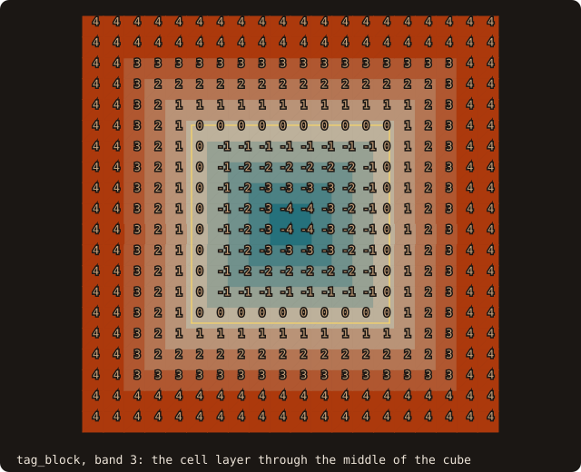{.fossil-figure}

`tag_block` gives every cell of a block its Chebyshev cell distance to the nearest cut cell: 0 on the 488 cut cells,
negative inside, positive outside, capped at band + 1 = 4. Each AMR level refines where |tag| ≤ its band. For a list
of boxes rather than a block, use `box_classify_many` ([above](#tag-the-cells-near-the-wall)). See
[AMR tagging](/guide/advanced/amr-tagging#definitions).

## Immersed boundaries

### Image points and probes for a ghost-cell method

<<< @/examples/snippets/ck_image_points.f90

<<< @/examples/output/ck_image_points.ansi{ansi}

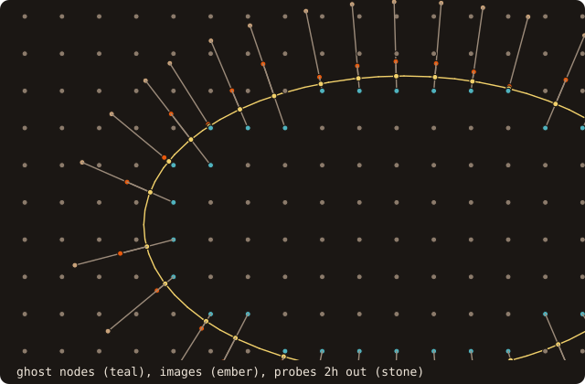{.fossil-figure}

The ghost points are the grid nodes inside the body within one spacing of the wall, 31 here. `image_points` mirrors
each ghost through its foot point; `probe_many` places a point at a given length along the normal from the foot. Both
say whether the segment from the foot crosses the wall anywhere else (`visible`): on this convex ellipse all 31 are
visible, next to a thin wall or a narrow gap some are not. `surface_stl_object` has the same calls. See
[IB queries](/guide/advanced/ib-queries#definitions).

### Place Lagrangian markers for an IB method

<<< @/examples/snippets/ck_markers.f90

<<< @/examples/output/ck_markers.ansi{ansi}

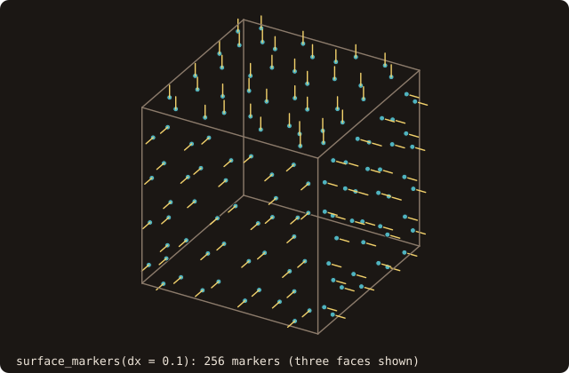{.fossil-figure}

`surface_markers` remeshes a copy of the surface to an edge length of sqrt(3) dx and returns the facet centroids,
areas and normals. The 288 areas add up to 6.000000, the cube's area. Direct forcing wants the markers dx apart:
0.8125 of the spacings lie within [0.8, 1.2] dx. `curve_markers` is the 2-D twin, exact along the arc length. See
[grid-adapted markers](/guide/advanced/ib-queries#grid-adapted-markers).

## Cut cells

### Find where a grid line crosses a curve

<<< @/examples/snippets/ck_line_crossings.f90

<<< @/examples/output/ck_line_crossings.ansi{ansi}

`line_crossings` returns the crossings of one grid line with the curve, sorted, each with its segment and whether the
line enters the solid there. The side test is exact, with a symbolic tie-break for points on the line: a grid point
belongs to the low side of the line. The diamond's bottom vertex lies on v = 0, so that line enters and leaves at
u = 0.5 (two crossings, parity kept); its top vertex lies on v = 1, which then misses it (no crossing). Every cell
edge sees the same decision, so fractions and inside flags never disagree. 3-D: `surface%line_crossings`. See
[cut-cell geometry](/guide/advanced/cut-cells).

### Moments and quadrature of cut cells

<<< @/examples/snippets/ck_cut_moments.f90

<<< @/examples/output/ck_cut_moments.ansi{ansi}

{.fossil-figure}

`moments_order=` returns the moments of every fluid piece in its cell's scaled coordinates, in the order of
`mono_exponents` (index 4 is X²). `quadrature=.true.` returns a rule per piece, exact for polynomials: the weights add
up to the piece areas within 3.69E-17, and ∫x² over the fluid comes out at 0.2565237066412, 1/3 minus the disc's
moment. The rule uses signed triangles from the cell centre, so a point can fall in the solid with a negative weight.
3-D: `cut_cells_3d(..., moments_order=, quadrature=.true.)`. See
[moments and quadrature](/guide/advanced/cut-solver#moments-and-quadrature).

### Neighbourhoods for a small-cell cure

<<< @/examples/snippets/ck_cut_solver.f90

<<< @/examples/output/ck_cut_solver.ansi{ansi}

{.fossil-figure}

`cut_links_2d` (3-D: `cut_cells_3d(..., links=)`) links the pieces of neighbouring cells; the solver support builds
on it. The smallest piece holds 4.5 % of its cell. Its state-redistribution neighbourhood grows along its wall
normal (0.58, −0.81) until it holds half a cell: the diagonal piece (+1, −1) comes first, reached through the links
inside the 3 × 3 tile. Its single merge target is the linked face neighbour that best faces the normal. The
weighted factor η^nb = 0.45 is the share it hands to its neighbour. The moments are those of the piece in its
cell's scaled coordinates. See [Cut cells: solver support](/guide/advanced/cut-solver).

### Coarsen cut cells

<<< @/examples/snippets/ck_cut_coarsen.f90

<<< @/examples/output/ck_cut_coarsen.ansi{ansi}

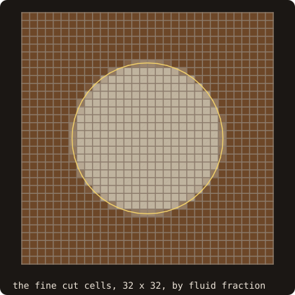

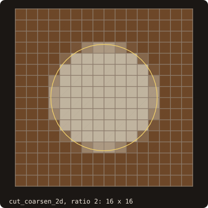

`cut_coarsen_2d` builds the coarse level of an AMR hierarchy from the fine cut cells and their links, without cutting
the geometry again: the same 204 pieces and 720 links as cutting the 16 x 16 grid directly, the fractions equal to
1.42E-14 and the apertures exactly. A coarse piece is a set of fine pieces linked inside the coarse cell;
`fine_to_coarse` maps each fine piece to it. 3-D: `cut_coarsen_3d`. See
[coarsening](/guide/advanced/cut-solver#coarsening).

## Structured and overset grids

### Locate a point in a curvilinear block

<<< @/examples/snippets/ck_block_locate.f90

<<< @/examples/output/ck_block_locate.ansi{ansi}

{.fossil-figure}

`detect_topology_2d` finds the seam the grid writes exactly (faces 1 and 2 abut each other); `validity` certifies
every cell, exactly in 2-D. `locate_many` returns the cell and its local coordinates: the point lies in the first cell
after the seam. The width-4 stencil reaches across the seam through the record (vertex columns 32, 1, 2, 3), and its
weights use the order-matched ξ, so the interpolation is fourth order on the curved grid. 3-D blocks
(`curvilinear_block_t`) work the same way. See [Curvilinear blocks](/guide/advanced/curvilinear-blocks).

### Check a block's validity and quality

<<< @/examples/snippets/ck_block_quality.f90

<<< @/examples/output/ck_block_quality.ansi{ansi}

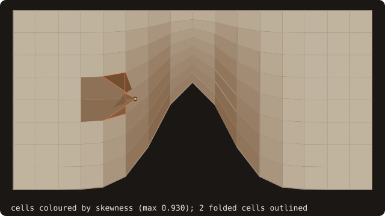{.fossil-figure}

`validity` decides the sign of det J in every cell exactly (in 2-D, by orient2d at the corners). Dragging one vertex
past its neighbour folds the two cells next to it: 126 valid, 2 invalid. `quality` measures the rest per cell:
skewness up to 0.930, orthogonality down to −0.978 and scaled min J down to −9.930, the last two negative only in the
folded cells. Skewness alone does not detect a fold: the folded cell (5, 4) has 0.799. 3-D blocks
(`curvilinear_block_t`) also return the warp of each face. See
[cell validity](/guide/advanced/curvilinear-blocks#cell-validity) and [quality metrics](/guide/advanced/curvilinear-blocks#quality-metrics).

### Find how blocks connect

<<< @/examples/snippets/ck_topology.f90

<<< @/examples/output/ck_topology.ansi{ansi}

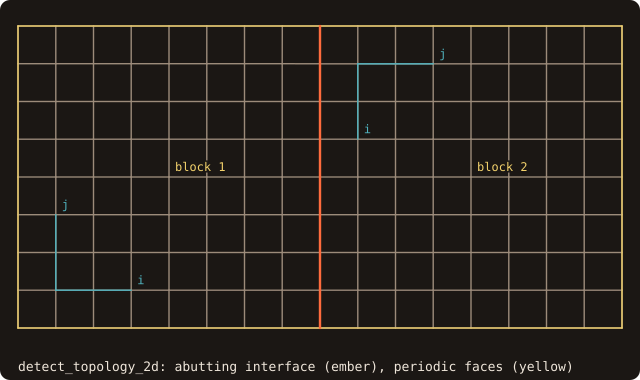{.fossil-figure}

`detect_topology_2d` compares the faces of every block with every other, its own included, and appends a record
wherever the vertices coincide exactly (`tolerance=` relaxes this). With `translations=` it also matches faces that
coincide after a period, here (0, 1) and (2, 0). The two blocks get eight records: the shared interface, whose
transform (2, −1) maps block 1's i to block 2's j and its j to block 2's −i, and three periodic pairs. See
[topology records](/guide/advanced/curvilinear-blocks#topology-records).

### Assemble an overset grid

<<< @/examples/snippets/ck_overset.f90

<<< @/examples/output/ck_overset.ansi{ansi}

{.fossil-figure}

The O-grid's wall becomes the cutter, which blanks the background vertices inside the cylinder (the O-grid itself is
not cut: `cuts`). Every vertex is located in the other block, and `classify_2d` picks the donors: the ring of
background vertices next to the holes and the O-grid's `overlap` boundary receive, from stencils of width 3 that hold
no hole and no receptor. No vertex is left an orphan; `build_connectivity` lists the 89 receptors with their donor
cells and local coordinates, as a flow solver reads them. FOSSIL does not choose the assembly policy: the rule, the
stencil width and the fringe depth are the caller's. See [Overset assembly](/guide/advanced/overset).

### Cut holes with a hole map or X-rays

<<< @/examples/snippets/ck_hole_map.f90

<<< @/examples/output/ck_hole_map.ansi{ansi}

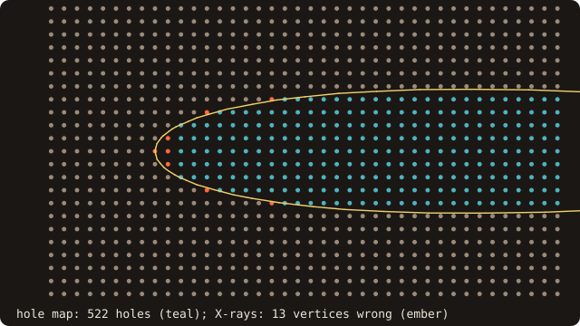{.fossil-figure}

The cutter is a closed curve, the airfoil section, and the background a plain block. `hole_flags_2d` blanks the
vertices whose signed distance (by the winding number) is negative: 522 holes. `hole_map_2d` paints a 16 × 16 map
from its cut elements and settles the vertices in cut elements by the exact crossing parity: the same 522 holes, none
unresolved. `xray_flags_2d` takes the parity on the nearest of 33 rays and gets 13 vertices next to the wall wrong,
all within the ray spacing. See [hole cutting](/guide/advanced/overset#hole-cutting).

### Write the overset connectivity for a flow solver

<<< @/examples/snippets/ck_save_connectivity.f90

<<< @/examples/output/ck_save_connectivity.ansi{ansi}

The assembly is the one of [Assemble an overset grid](#assemble-an-overset-grid). `save_connectivity` writes it as
plain text. The header gives each block's field, hole, receptor and orphan counts. Each of the 89 following lines is
one receptor: receptor block and vertex (linear index, i fastest), donor block, donor cell corner (i, j, k), local
coordinates ξ, stencil widths, a low-order flag and the donor quality. See [connectivity output](/guide/advanced/overset#connectivity-output).

### Put a block face on a body with sharp edges

<<< @/examples/snippets/ck_project_face.f90

<<< @/examples/output/ck_project_face.ansi{ansi}

{.fossil-figure}

`projection_target` collects the body's patches, its feature edges and patch boundaries (as curves between corners)
and its corners, once. `project_block_face` tags each vertex of the face by its distance to them (`tolerance`): the
face's corners go to the cube's corners, its edge lines to the cube's edges, its interior to the face. A plain closest
point would pull grid lines across the edges. See [body-fitted grid support](/guide/advanced/body-fitted).

### Extrude an O-grid and check its wall spacing

<<< @/examples/snippets/ck_wall_spacing.f90

<<< @/examples/output/ck_wall_spacing.ansi{ansi}

{.fossil-figure}

`hyperbolic_grid_2d` marches layers normal to the section, with heights from `geometric_spacing`. The first one is set
for y₁⁺ = 1 with the given u_τ. `block_report_2d` measures what the grid gives: y₁⁺ at every wall vertex, from the
true distance to the wall, the growth ratio along the grid lines, and WP2's quality. See
[body-fitted grid support](/guide/advanced/body-fitted).

### Save the wall-spacing report of a grid

<<< @/examples/snippets/ck_save_report.f90

<<< @/examples/output/ck_save_report.ansi{ansi}

The grid and the report are those of
[Extrude an O-grid and check its wall spacing](#extrude-an-o-grid-and-check-its-wall-spacing). `save_block_report`
writes the totals as `#` lines, then one line per wall point: indices, face, the first spacing along the grid line and
to the wall, y₁⁺ and the growth ratio. The 130 wall points reach y₁⁺ between 1.000 and 1.478, the largest at the
trailing-edge vertex (1, 1). The fraction above the target is 1.0000 because y₁⁺ comes out at 1.00000001, a round-off
over the target of 1. See [the wall-spacing report](/guide/advanced/body-fitted#the-wall-spacing-report).

## Curves

### Cut a 2-D section of an STL

<<< @/examples/snippets/ck_slice.f90

<<< @/examples/output/ck_slice.ansi{ansi}

{.fossil-figure}

`slice_surface(surface, normal_axis, level, curve)` cuts by an axis-aligned plane and returns a `curve_object`; the
section of the NACA 0012 wing is one closed loop of 60 vertices with area 0.08165. See
[2-D geometry](/guide/advanced/2d-geometry).

### Compute the signed distance to a polygon

<<< @/examples/snippets/ck_polygon_distance.f90

<<< @/examples/output/ck_polygon_distance.ansi{ansi}

{.fossil-figure}

Outer loops run counter-clockwise and holes clockwise; the distance is negative inside. See
[`curve_object`](/guide/api/curve-object).

### Second moments of area of a section

<<< @/examples/snippets/ck_mass_properties_2d.f90

<<< @/examples/output/ck_mass_properties_2d.ansi{ansi}

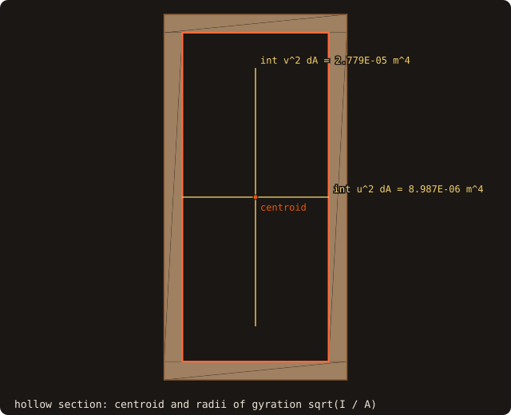{.fossil-figure}

The hole is wound clockwise, so it subtracts. `second_moments(2)`, the integral of v², is the second moment of area
for bending about the u axis, here (b h³ − b′h′³)/12. See [mass properties](/guide/advanced/mass-properties#2-d-curves).

## Geometry processing

### Measure how far a repair moved the surface

<<< @/examples/snippets/ck_deviation.f90

<<< @/examples/output/ck_deviation.ansi{ansi}

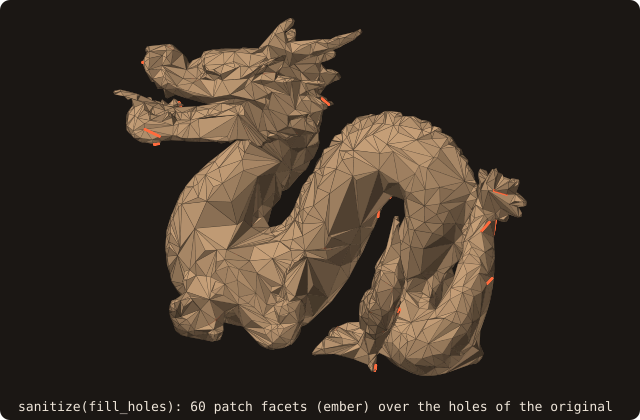{.fossil-figure}

The two directions differ: the hole patches are far from the original (they span the holes), while the original lies on
the repaired surface except where `sanitize` removed facets. `lower <= h <= upper` brackets the one-sided Hausdorff
distance (certified, to 1e-3 of the bounding-box diagonal by default); `mean` and `rms` are estimates. See
[surface deviation](/guide/advanced/surface-deviation).

### Find the sharp edges of a part

<<< @/examples/snippets/ck_feature_edges.f90

<<< @/examples/output/ck_feature_edges.ansi{ansi}

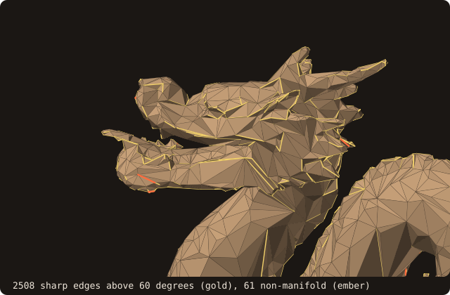{.fossil-figure}

`feature_edges` reports sharp edges (30 degrees by default), boundary and non-manifold edges, with their corners and
polylines as vertex-pool ids. See [feature edges](/guide/advanced/feature-edges).

### Find walls too thin for my grid

<<< @/examples/snippets/ck_thin_walls.f90

<<< @/examples/output/ck_thin_walls.ansi{ansi}

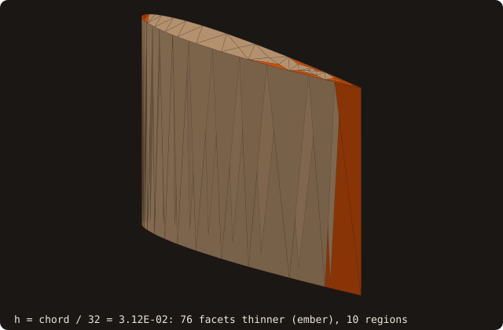{.fossil-figure}

`thickness(method=THICKNESS_MEDIAL)` gives each facet the diameter of the largest ball tangent to it inside the body
(and outside, for `gap`). `thin_regions` groups the facets thinner than `factor * h` into connected regions. The
thickness is computed once; each cell size is one cheap call. On this NACA 0012 section, the thin facets shrink towards
the trailing edge as h decreases. For AMR, `build_thin` and `tag_block(thin_factor=, thin_band=, thin_tags=)` turn the
same values into refinement tags. See [thickness and gaps](/guide/advanced/thickness).

### Decimate a mesh

<<< @/examples/snippets/ck_decimate.f90

<<< @/examples/output/ck_decimate.ansi{ansi}

{.fossil-figure}

Quadric edge collapses remove two facets each, so the result stops at or just below the target (1646 for 1647). See
[decimation](/guide/advanced/decimate).

### Unite two bodies

<<< @/examples/snippets/ck_union.f90

<<< @/examples/output/ck_union.ansi{ansi}

{.fossil-figure}

Two unit cubes overlapping on a cube of side 0.5 give 2 - 0.125 = 1.875. `BOOL_INTERSECT`, `BOOL_DIFFERENCE` and
`BOOL_SYMDIFF` work the same way. See [booleans](/guide/advanced/booleans).

### Remesh to a uniform edge length

<<< @/examples/snippets/ck_remesh.f90

<<< @/examples/output/ck_remesh.ansi{ansi}

`preserve_features=.true.` keeps the twelve sharp edges of the cube, so the volume stays 1. After 10 iterations the
edges are between 0.0282 and 0.1352 for a target of 0.1. See [isotropic remeshing](/guide/advanced/isotropic-remesh).

### Measure the curvature at a point

<<< @/examples/snippets/ck_curvature.f90

<<< @/examples/output/ck_curvature.ansi{ansi}

{.fossil-figure}

`curvatures=` returns the mean and Gaussian curvature at the foot point, by a cubic fit over the two rings of
vertices around it: on this unit sphere of 6632 facets, H = 0.9944 and K = 0.9892. It runs on the CPU only. See
[curvature at the foot point](/guide/advanced/ib-queries#curvature-at-the-foot-point).

### Assemble the cotangent Laplacian of a surface

<<< @/examples/snippets/ck_laplacian.f90

<<< @/examples/output/ck_laplacian.ansi{ansi}

`cotangent_laplacian` builds the cotangent Laplacian `L` and the barycentric mass matrix `M` over the surface's
unique vertices, as CSR matrices. Constants are in the kernel of `L` (here exactly: max |L 1| = 0), and the masses add
up to the surface area. FOSSIL provides the matrices; the solve (implicit smoothing, heat-method geodesics) is the
caller's. See [cotangent Laplacian](/guide/advanced/cotangent-laplacian).

### Smooth a noisy surface

<<< @/examples/snippets/ck_smooth.f90

<<< @/examples/output/ck_smooth.ansi{ansi}

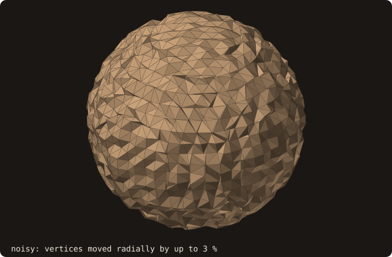

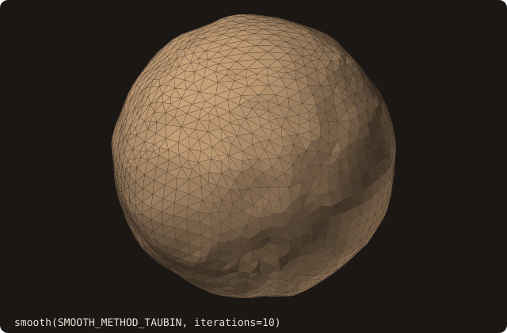

Taubin smoothing alternates a shrinking step (λ) and an inflating one (μ), so it removes noise without shrinking the
body. Ten pairs bring the rms radial error from 0.02077 to 0.00796 and the area from 14.428 back towards the sphere's
12.566 (12.613); the volume moves by 0.3 %. `smooth` skips the near-degenerate facets marching cubes leaves (status
`SMOOTH_STATUS_DEGENERATE`, not an error). See [smoothing](/guide/advanced/smoothing).

### Extract an isosurface from a sampled field

<<< @/examples/snippets/ck_isosurface.f90

<<< @/examples/output/ck_isosurface.ansi{ansi}

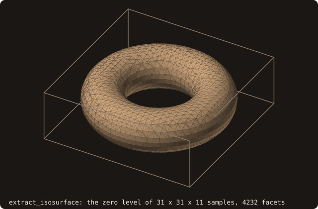{.fossil-figure}

`extract_isosurface` runs marching cubes on values sampled at the nodes of a uniform grid between `bmin` and `bmax`
and returns facets for `adopt_facets`; the result is watertight. At spacing 0.1 for a tube radius 0.4 the volume is
1.25 % short of 2π²Rr² (3.11864 for 3.15827): the facets cut the curved surface as chords. Any field works: a
distance, a density, a level set. See [marching cubes](/guide/advanced/marching-cubes).

### Segment a part by its shape diameter

<<< @/examples/snippets/ck_segment.f90

<<< @/examples/output/ck_segment.ansi{ansi}

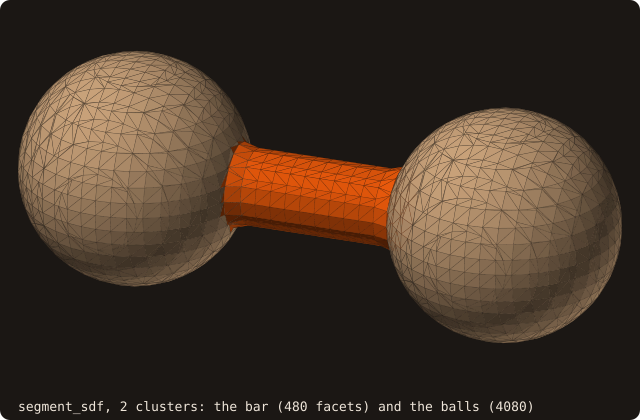{.fossil-figure}

`segment_sdf` measures at each facet the shape diameter (the median length of a cone of rays cast inward) and clusters
the values; label 1 is the thinnest cluster. The bar of diameter 0.4 gets a mean of 0.4551, raised by its junctions
with the balls; the balls of diameter 1.2 get 0.9027, since the cone's off-axis rays are chords shorter than the
diameter. Facets whose rays find no opposite wall get label 0 (none here). See
[SDF segmentation](/guide/advanced/sdf-segmentation).

## Moving bodies

### Mass and inertia of a body

<<< @/examples/snippets/ck_mass_properties.f90

<<< @/examples/output/ck_mass_properties.ansi{ansi}

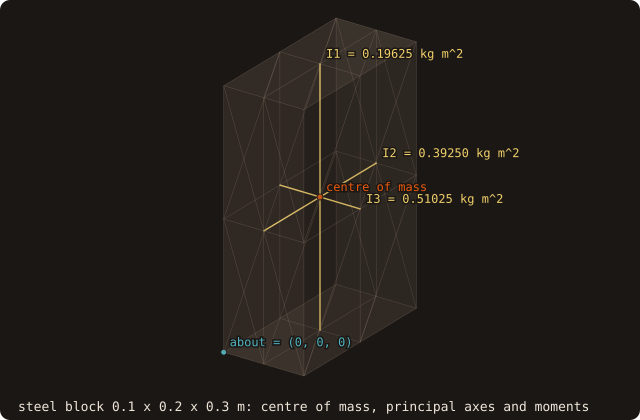{.fossil-figure}

The body must be closed (`status` says so otherwise). The tensor is about the centre of mass unless `about=` names another
point; the principal moments are sorted ascending, here the block's three diagonal entries. See
[mass properties](/guide/advanced/mass-properties).

### How close are my two bodies?

<<< @/examples/snippets/ck_body_distance.f90

<<< @/examples/output/ck_body_distance.ansi{ansi}

{.fossil-figure}

`distance_to` returns the least distance over all pairs of facets, the two facets and the points that realize it, and
`intersecting` when the bodies touch or cross (0, decided exactly). `pose_other=` places the second body without
moving it or rebuilding its tree, here the corner of the turned cube at x = 2 − sqrt(2)/2. For many bodies,
`proximity_pairs(cutoff=)` lists the pairs closer than the cutoff. See [body–body distance](/guide/advanced/body-distance).

### When do my moving bodies first touch?

<<< @/examples/snippets/ck_ccd.f90

<<< @/examples/output/ck_ccd.ansi{ansi}

{.fossil-figure}

`time_of_impact` moves each body from its pose at s = 0 to its pose at s = 1 (the motion of `pose_interpolate`: the
rotation about the body's own origin, angle and translation linear in s) and returns the first s at which they come
within the tolerance (default 1e-6 of the larger box diagonal), never later than the true contact: a plate 1e-3 thick
crossed within one step, apart at both ends, is still caught. `first_impact` gives the earliest contact among several
bodies. See [continuous collision detection](/guide/advanced/collision).

### Query a rotated body without rebuilding it

<<< @/examples/snippets/ck_pose.f90

<<< @/examples/output/ck_pose.ansi{ansi}

{.fossil-figure}

With `pose=` the world-frame point is mapped into the body frame, and the tree built at load time serves every pose.
`pose_from_axis_angle` rotates about the origin, so the translation sets the pivot. A corner of the rotated cube reaches x = 0.5 +
sqrt(2)/2, so the point is inside it, 0.0050 from a face. See [moving bodies](/guide/advanced/moving-bodies).

### Swept volume of a moving body on a grid

<<< @/examples/snippets/ck_swept_cells.f90

<<< @/examples/output/ck_swept_cells.ansi{ansi}

{.fossil-figure}

`swept_cells_2d` moves the body from `pose0` to `pose1` by screw motion and returns, per cell, the fluid area change,
the time-averaged face apertures and wall, and the cells cleared or covered, integrated exactly for translation and
rotation alike. The body keeps its area, so the 0.01827 gained equals the 0.01827 lost (sum −2.33E-17); the volume
balance residual, at most 3.28E-17, checks that the faces and the swept areas agree. 3-D:
`swept_cells_3d(surface, ...)`. See [swept geometry](/guide/advanced/moving-bodies#swept-geometry).
