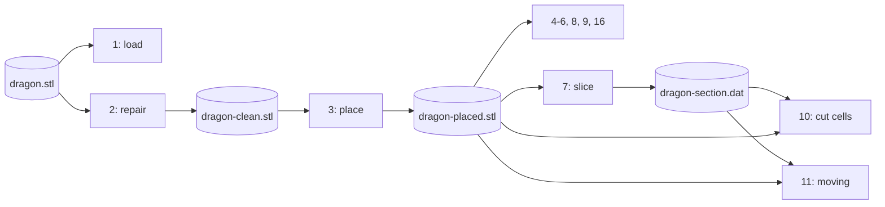

# The tutorial

The tutorial teaches FOSSIL by following one body, from its STL file into a simulation grid. It is for the author of
a solver, or of a grid generator, who needs geometry from a triangulated surface: distances, signs, wall points, tags,
cut cells. It assumes Fortran 2003 and the basics of immersed-boundary or cut-cell methods; it does not assume
any knowledge of FOSSIL. The [guide](/guide/) explains the algorithms and the [reference](/guide/api/) lists every
method and argument.

## The chapters

The body is `dragon.stl`, a real mesh with real defects: it is not watertight, and repairing it does not make it so.
The tutorial keeps it that way on purpose, so that it shows where an open surface changes the answer and which
queries tolerate it. Chapters 1 to 3 load, repair and place the dragon in the domain [-0.6, 0.6]³; chapters 4 to 6
compute its signed distance, point by point, in batches and as a field; chapter 7 goes to 2-D with a section of it;
chapters 8 to 11 answer what an immersed-boundary or cut-cell solver asks, for a fixed and then a moving body.
Chapters 12 to 15 widen the scope: processing and analysing a surface, structured blocks and overset grids, contact
between bodies, and body-fitted grids; they build their own geometry and need no file from the earlier chapters.
Chapter 16 moves the batch to the GPU.

| Chapter | You learn |
|---|---|
| [1. A first surface](./tutorial/01-first-surface) | `load_from_file`, what `analyze` computes, accessors, `is_watertight`, `is_manifold`, `save_into_file` |
| [2. Repairing the surface](./tutorial/02-repair) | `sanitize`, `fill_holes=`, the stderr report, `is_volume` |
| [3. Placing the body](./tutorial/03-manipulation) | `translate`, `rotate`, `resize`, `analyze` after a transformation, `clip`, `mirror`, `merge_solids` |
| [4. Signed distance](./tutorial/04-distance) | `distance`, `is_point_inside`, `compute_distance`; the sign algorithms |
| [5. Batched queries](./tutorial/05-batched) | `distance_many`, SAH BVH and octree, pseudo-normal and fast winding number on an open surface |
| [6. A distance field](./tutorial/06-distance-field) | `distance_field_object` on a stretched grid: band, signs, fast sweeping |
| [7. Curves in 2-D](./tutorial/07-curves) | `slice_surface`, `curve_object`, 2-D distance and 2-D field |
| [8. Immersed-boundary queries](./tutorial/08-ib-queries) | `query_many`: wall point, feature, normal, body; `image_points`, `probe_many` |
| [9. AMR tagging](./tutorial/09-amr-tagging) | `box_classify_many` (cut, near, inside, outside), `tag_block` |
| [10. Cut cells](./tutorial/10-cut-cells) | `curve%cut_cells` and `cut_cells_3d`: fractions, apertures, fluid pieces, flagged cells |
| [11. Moving bodies](./tutorial/11-moving-bodies) | poses, `pose=` queries, `move`, `state_changes`, `swept_cells_2d` |
| [12. Geometry processing and analysis](./tutorial/12-geometry) | `boolean`, `set_patch`, `isotropic_remesh`, `deviation`, `feature_edges`, `thickness`, `thin_regions`, `mass_properties` |
| [13. Structured blocks and overset grids](./tutorial/13-blocks-overset) | `curvilinear_block_2d_t`, `detect_topology_2d`, `validity`, `quality`, `locate_many`, `stencils`; `wall_cutter_2d`, `hole_flags_2d`, `donor_candidates_2d`, `classify_2d`, orphans, `save_connectivity` |
| [14. Contact: distance and collision](./tutorial/14-contact) | `distance_to` with poses, `time_of_impact` (plain and `directional=`), `first_impact`; `curve%time_of_impact`, `first_impact_2d` |
| [15. Body-fitted grids](./tutorial/15-body-fitted) | `projection_target`, `classify_points`, `project_points`, `project_block_face`, `geometric_spacing`, `hyperbolic_grid_2d`, `block_report_2d`, `save_block_report` |
| [16. On the GPU](./tutorial/16-gpu) | `enter_device`, `distance_many_device`, `exit_device`; the nvfortran build |

The chapters pass files to each other, so run them in order:



## How the examples are made

Every snippet in these pages is part of a real program in
[`docs/examples/src`](https://github.com/szaghi/FOSSIL/tree/master/docs/examples/src), one per chapter
(`tutNN_<name>.f90`), and every output shown is what that program printed: captured, not typed. Comment markers in
the sources (`!region NAME` ... `!endregion NAME`) cut the programs into the parts the pages show. The programs print
with explicit formats only, so their output does not depend on the compiler.

`bash scripts/docs_examples.sh` rebuilds the library (`fobis build --mode static-gnu`), builds every program, runs
them in order in one scratch directory holding `dragon.stl`, `cube-01.stl` and `naca0012-ascii.stl`, and regenerates
the snippets and outputs these pages include. To build one chapter by hand, with the library built in `static/`:

```bash
gfortran -I static/mod docs/examples/src/tut01_first_surface.f90 static/libfossil.a -o tut01
cp src/tests/dragon.stl . && ./tut01
```
