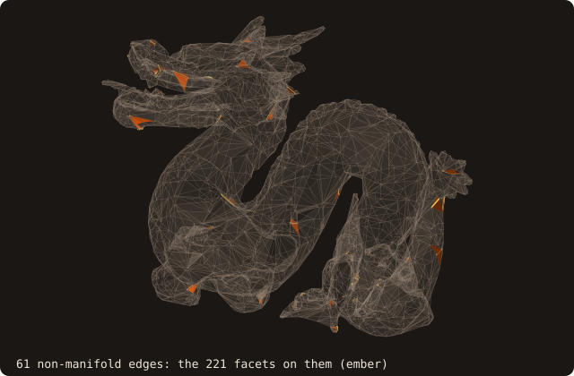
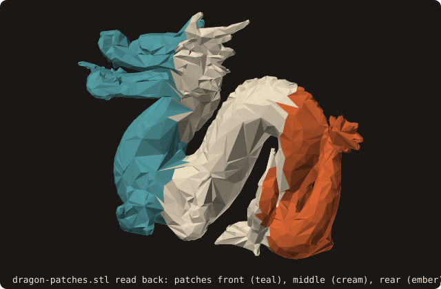

# 1. A first surface

The tutorial puts a body into a simulation grid. The body is `dragon.stl`, a binary STL of 6588 facets. This chapter
loads it, reads what FOSSIL computed on loading, finds out why it is not a closed surface, and writes it back, once as
one solid and once split into named patches. Three short programs, run one after the other.

## Load, read, save

<<< @/examples/snippets/tut01_first_surface-load.f90

- `use fossil` gives the four public types (`surface_stl_object`, `facet_object`, `distance_field_object`,
  `curve_object`) and the named constants. Kinds come from PENF (`I4P`, `R8P`), vectors from VecFor (`vector_R8P`).
- `load_from_file(file_name=, guess_format=.true.)` reads an ASCII or a binary STL: with `guess_format` the format is
  detected from the file size. Without it the file is read as ASCII unless `is_ascii=.false.`. The optional `status`
  is `STATUS_FILE_NOT_FOUND` for a missing file and `STATUS_INVALID_INPUT` for NaN or Inf coordinates.
- Loading runs `analyze`: bounding box, volume, centroid, facet connectivity, the AABB tree (a SAH BVH by default)
  and the pseudo-normals the signed distance needs. Every later query relies on it.

<<< @/examples/snippets/tut01_first_surface-inspect.f90

- The components of `surface_stl_object` are private. They are read through accessors: `get_facets_number`,
  `get_bmin`, `get_bmax`, `get_volume`, `get_centroid`, `get_non_manifold_edges_number`, and `facet_at(i)` for one
  facet.
- `is_watertight()` is true when every edge has exactly two facets, `is_manifold()` when the surface is also free of
  edges with three or more facets.

<<< @/examples/snippets/tut01_first_surface-save.f90

- `save_into_file(file_name=, is_ascii=)` writes the surface, as ASCII by default (`is_ascii=.false.` writes binary).
  `status` reports `STATUS_FILE_OPEN_FAIL` when the file cannot be created.

<<< @/examples/output/tut01.ansi{ansi}

The dragon spans about 20.5 × 9.1 × 14.5 CAD units and encloses a volume of 465.93. It is neither watertight nor
manifold.

{.fossil-figure}

The bounding box is axis-aligned and belongs to the facets as they are: `analyze` recomputes it after any change.
The animation turns the dragon about the vertical axis through the centre of its box, 30 degrees per frame, and
analyzes it again each time. The box changes from 20.47 × 9.14 to 9.14 × 20.47 at a quarter turn and back; the volume
stays 465.93.

{.fossil-figure}

## Why it is not closed

A facet knows its neighbours: `fcon_edge(e)` is the facet across edge e (edge 1 runs from vertex 1 to vertex 2,
edge 2 from 2 to 3, edge 3 from 3 to 1), or 0 when the edge has no single neighbour. The second program reads one
facet, then counts the edges that make the surface open or non-manifold.

<<< @/examples/snippets/tut01_open_edges-facet.f90

<<< @/examples/snippets/tut01_open_edges-edges.f90

- `facet_at(i)` returns a pointer to facet i (`null()` out of range). Its public components are the data `analyze`
  filled: `vertex(3)`, `normal`, `centroid`, `fcon_edge(3)`, the pseudo-normals. Read them; change the surface only
  through its procedures.
- `feature_edges(edges=, kinds=, angle=)` lists the feature edges by kind. With `angle=180` no edge counts as sharp,
  so the list holds the boundary edges (`FEATURE_EDGE_BOUNDARY`, one facet) and the non-manifold edges
  (`FEATURE_EDGE_NONMANIFOLD`, three or more facets). Chapter 12 uses the same routine for sharp edges.
- `get_shells_number()` counts the edge-connected sets of facets, `get_bodies_number()` the bodies (an outer shell
  with the cavities inside it).

<<< @/examples/output/tut01-open.ansi{ansi}

The dragon has no boundary edge: it is not open. It fails `is_watertight` because of 61 non-manifold edges, where
221 facets meet three or four at an edge, and it is 83 overlapping shells grouped into 40 bodies. Chapter 2 shows
where these defects come from and how many of them `sanitize` removes.

{.fossil-figure}

## Several solids in one file

An ASCII STL can hold several `solid <name> … endsolid` blocks: exporters write one per boundary condition (wall,
inlet, outlet). FOSSIL keeps them as named patches. The third program names three parts of the dragon by the x of the
facet centroids, writes them as three blocks and reads the file back.

<<< @/examples/snippets/tut01_patches-name.f90

<<< @/examples/snippets/tut01_patches-read.f90

- `set_patch(facets=, name=)` assigns facets to the patch `name`, created if new. Every facet starts in patch 1,
  named after the file header; a patch left without facets writes no block.
- `save_into_file(is_ascii=.true.)` writes one `solid` block per patch. A binary STL has no place for names: it
  is read as one patch.
- `load_from_file` opens a patch per block: `get_patches_number`, `patch_name(i)` and `facet_patch(i)` read them back.
  `load_from_files` reads one file per patch. The patch of each facet then travels through the queries of chapter 8
  (`query_many(patches=)`).

<<< @/examples/output/tut01-patches.ansi{ansi}

{.fossil-figure}

See the cookbook recipe [wall, inlet and outlet from one STL](../cookbook#wall-inlet-and-outlet-from-one-stl) and
the reference page [Named patches](/guide/advanced/patches).

::: tip What you learned
`load_from_file` reads an STL and analyzes it; accessors, `facet_at` and the validity predicates tell what kind of
surface you have; `feature_edges` finds where it is open or non-manifold; `set_patch` and the ASCII writer keep named
patches. Reference: [surface_stl_object](/guide/api/surface-stl-object).
:::

Next: [2. Repairing the surface](./02-repair).
