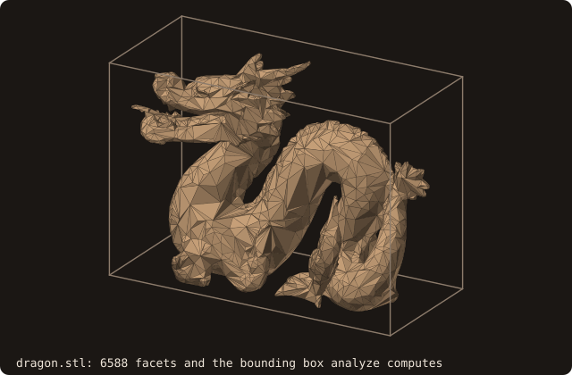

# 1. A first surface

The tutorial puts a body into a simulation grid. The body is `dragon.stl`, a binary STL of 6588 facets. The first
program loads it, reads what FOSSIL computed on loading, and writes it back as ASCII.

<<< @/examples/snippets/tut01_first_surface-load.f90

- `use fossil` gives the four public types (`surface_stl_object`, `facet_object`, `distance_field_object`,
  `curve_object`) and the named constants. Kinds come from PENF (`I4P`, `R8P`), vectors from VecFor (`vector_R8P`).
- `load_from_file(file_name=, guess_format=.true.)` reads an ASCII or a binary STL: with `guess_format` the format is
  detected from the file size. Without it the file is read as ASCII unless `is_ascii=.false.`. The optional `status`
  is `STATUS_FILE_NOT_FOUND` for a missing file and `STATUS_INVALID_INPUT` for NaN or Inf coordinates.
- Loading runs `analyze`: bounding box, volume, centroid, facet connectivity, the AABB tree (a SAH BVH by default)
  and the pseudo-normals the signed distance needs. Every later query relies on it.

{.fossil-figure}

<<< @/examples/snippets/tut01_first_surface-inspect.f90

- The components of `surface_stl_object` are private. They are read through accessors: `get_facets_number`,
  `get_bmin`, `get_bmax`, `get_volume`, `get_centroid`, `get_non_manifold_edges_number`, and `facet_at(i)` for one
  facet.
- `is_watertight()` is true when every edge has exactly two facets, `is_manifold()` when the surface is also free of
  edges with three or more facets. The dragon is neither: as it comes, it is not a closed surface. Chapter 2 repairs
  what can be repaired.

<<< @/examples/snippets/tut01_first_surface-save.f90

- `save_into_file(file_name=, is_ascii=)` writes the surface, as ASCII by default (`is_ascii=.false.` writes binary).
  `status` reports `STATUS_FILE_OPEN_FAIL` when the file cannot be created.

## Running it

<<< @/examples/output/tut01.ansi{ansi}

::: tip What you learned
`load_from_file` reads an STL and analyzes it; accessors and the validity predicates tell what kind of surface you
have. Reference: [surface_stl_object](/guide/api/surface-stl-object).
:::

Next: [2. Repairing the surface](./02-repair).
