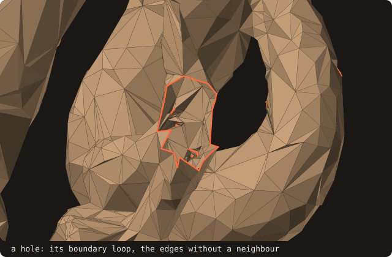
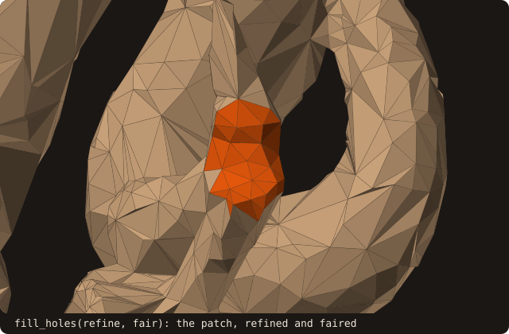
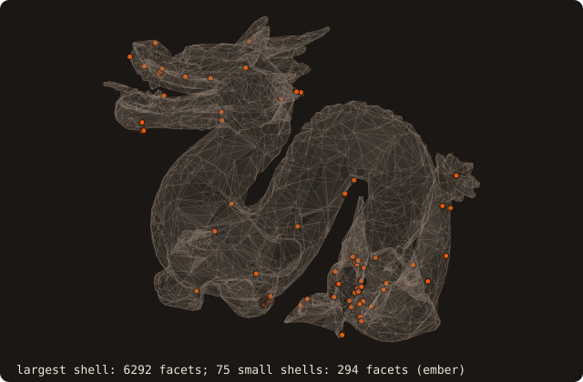
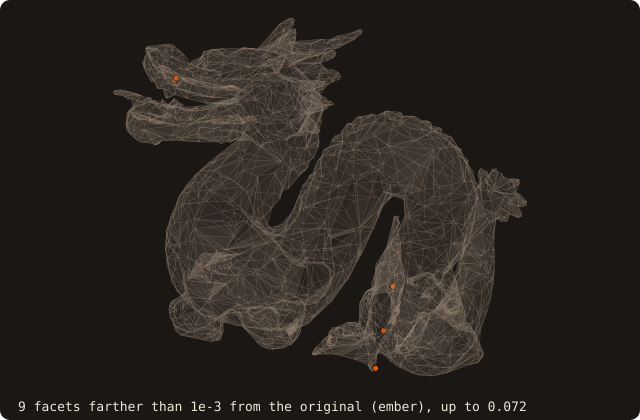

# 2. Repairing the surface

Chapter 1 found that the dragon is neither watertight nor manifold: 61 non-manifold edges, 83 shells. Before it goes
into a grid, `sanitize` repairs what can be repaired. This chapter runs it, watches its passes one by one, looks at
what it leaves, and measures how far the repair moved the surface.

## Sanitize

<<< @/examples/snippets/tut02_a_repair-load.f90

<<< @/examples/snippets/tut02_a_repair-sanitize.f90

- `sanitize` runs the repair passes in order: `remove_degenerate_facets` (zero-area and sliver facets),
  `connect_nearby_vertices` (only when facets have disconnected edges), `analyze`, `remove_duplicate_facets` (the
  same triangle twice, in any winding), then `sanitize_normals` (consistent winding, outward by the sign of the
  volume). The surface is analyzed again after every pass that changes it.
- `fill_holes=.true.` adds `fill_holes` after the orientation pass (the default is `fill_holes=.false.`); the next
  section shows it.
- Each defect class left or removed is reported once on stderr, as a `WARNING: sanitize:` line.

<<< @/examples/snippets/tut02_a_repair-check.f90

- `get_degenerate_facets_removed` and `get_duplicate_facets_removed` count what the last passes dropped.
- `is_volume()` is true when the surface is manifold, its signed volume positive and its centroid finite: the
  condition for the pseudo-normal sign of chapter 4 to be exact.
- `save_into_file` without `is_ascii` writes ASCII. `dragon-clean.stl` is the input of chapter 3.

<<< @/examples/output/tut02.ansi{ansi}

The passes are public procedures, so they can be run one at a time. The animation does that on `dragon.stl` and draws
what each pass found or changed. Removing the 62 duplicate facets opens 128 boundary edges. `sanitize_normals` flips
91 facets to a consistent winding. `fill_holes` closes the 54 holes with 60 facets and leaves no boundary edge; 54
non-manifold edges remain.

{.fossil-figure}

## Closing holes

A hole is a loop of boundary edges, the facet edges without a neighbour (`fcon_edge == 0`). `fill_holes` closes every
loop of at most `max_hole_edges` edges (default 200) whose bounding-box diagonal is at most `max_hole_size` times the
surface's (default 0.1) by a minimum-weight triangulation. Larger loops stay open, so a genuine opening (an inlet, a
symmetry cut) survives. `refine_holes=.true.` and `fair_holes=.true.` (`refine=` and `fair=` on `fill_holes`) refine
the patches to the density of the loop and fair them to a smooth surface.

The holes of the dragon are slivers of one or two facets. To see a patch, the figures cut a round hole into the
repaired dragon and close it again.

`max_hole_size` decides which loops are holes and which are openings. On a sphere with four round holes of different
sizes, each frame raises it past one more loop:

{.fossil-figure}

## What sanitize leaves

The second program reads `dragon-clean.stl` back and lists what is still wrong with it.

<<< @/examples/snippets/tut02_b_left-left.f90

<<< @/examples/output/tut02-left.ansi{ansi}

- The repaired dragon has no boundary edge, and `sanitize` reports none left open. Every facet edge without a single
  neighbour, 216 of them, lies on one of the 54 non-manifold edges, four facets to an edge: they are not holes, and
  the last warning of the first run says so.
- It is still 76 shells in 37 bodies. One shell holds 6292 of the 6586 facets; the other 75 are small pieces that
  overlap it, the source of the non-manifold edges.

{.fossil-figure}

`sanitize` fixes local defects; it does not rebuild a surface. The rest of the tutorial uses this cleaned but
non-manifold dragon on purpose: it shows where the choice of sign algorithm matters (chapters 4 and 5) and which cut
cells cannot be trusted (chapter 10). For a closed surrogate of a broken surface see
[Alpha wrapping](/guide/advanced/alpha-wrap); chapter 8 measures thin walls on one.

## How far the repair moved it

<<< @/examples/snippets/tut02_c_deviation-deviation.f90

- `deviation(other, lower=, upper=)` brackets the one-sided Hausdorff distance h(self, other): how far the farthest
  point of self is from other. The bracket is certified, to 1e-3 of the bounding-box diagonal by default.
- The two directions differ: h(repaired, original) measures what the repair added, h(original, repaired) what it
  removed or moved. See [surface deviation](/guide/advanced/surface-deviation).

<<< @/examples/output/tut02-deviation.ansi{ansi}

The repaired dragon departs from the original by at most 0.119, the original from the repaired one by at most 0.030
(the dragon spans 20.5). The added material is in the hole patches: the 9 facets whose centroid lies farther than
1e-3 from the original are all patch facets, the farthest at 0.072.

{.fossil-figure}

::: tip What you learned
`sanitize` (with `fill_holes=.true.` for small holes) repairs local defects and reports them on stderr; its passes
can also run one by one. `is_watertight`, `is_manifold`, `is_volume` and `feature_edges` tell what is left, and
`deviation` how far the repair moved the surface. Reference: [Hole filling](/guide/advanced/hole-filling),
[Surface deviation](/guide/advanced/surface-deviation).
:::

Next: [3. Placing the body](./03-manipulation).
