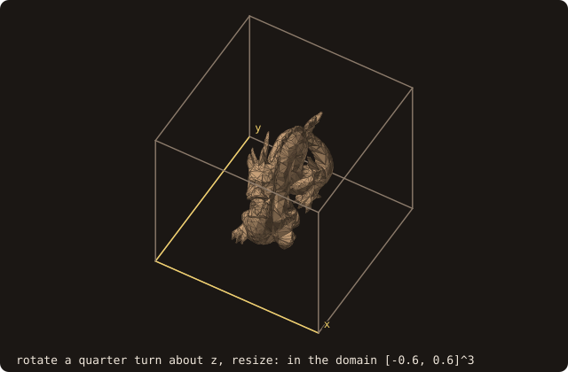
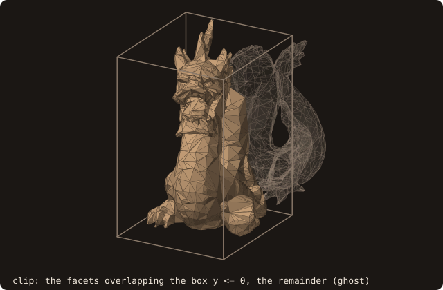
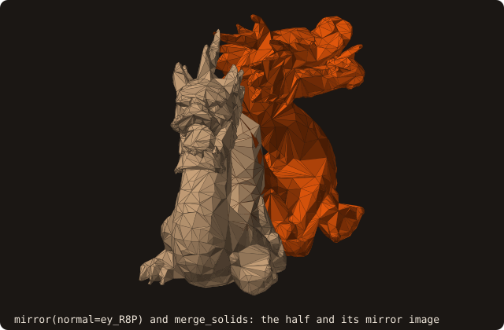

# 3. Placing the body

The repaired dragon is in its own CAD units, about 20 long, floating 12 units above the origin. The simulation
domain of the next chapters is the cube [-0.6, 0.6]³, so the dragon is centred, turned and scaled to a longest side
of 1, then saved for the chapters that follow. A second program splits it by a box, mirrors one half and merges the
two.

## Centring, turning, scaling

<<< @/examples/snippets/tut03_a_place-place.f90

- `translate(delta=)` moves every facet by a vector; `x=`, `y=`, `z=` give the components one by one. Passing both
  forms is ambiguous: `status` is then `STATUS_AMBIGUOUS_ARGS` (without `status` the program stops). The centre of the
  bounding box is used here, not `get_centroid()`: the centroid is a volume integral, meaningful only on a closed
  surface.
- `rotate(axis=, angle=)` turns the facets by `angle` radians about `axis`, through the origin; `center=` pivots
  about another point. `rotate(matrix=)` takes a rotation matrix instead.
- `resize(x=, y=, z=)` (or `factor=`, a vector) scales about the origin, or about the centroid with
  `respect_centroid=.true.`.
- The transformations move the facets and nothing else: bounding box, volume and AABB tree are stale until `analyze`
  runs. Here `analyze` runs after the turn, because the scale needs the new box, and after the last transformation,
  before any query.
- `save_into_file` writes `dragon-placed.stl`, the body of the chapters that follow.

<<< @/examples/output/tut03.ansi{ansi}

Every transformation acts about the fixed world origin, so the order matters: the box centre goes to the origin
first, and the turn and the scale then leave it there. The animation applies the calls of the program one at a time,
in CAD units, with the world x and y axes drawn through the origin.

{.fossil-figure}

The last frame is the dragon of the rest of the tutorial, too small to see at the CAD scale. In domain units it
spans [-0.2232, 0.2232] × [-0.5, 0.5] × [-0.3531, 0.3531], with volume 0.054283: the volume of chapter 2 times the
cube of the scale.

{.fossil-figure}

## Clipping

<<< @/examples/snippets/tut03_b_clip-clip.f90

- `clip(bmin=, bmax=)` keeps the facets that overlap the box and drops the others, whole: no facet is cut. With
  `remainder=` the dropped facets go into a second surface, so the two parts add up to the original. Both are analyzed.

{.fossil-figure}

## Mirroring and merging

<<< @/examples/snippets/tut03_b_clip-merge.f90

- `mirror(normal=)` reflects the facets through the plane through the origin with that normal (`mirror(matrix=)` takes
  the matrix). The facet winding is kept outward.
- `merge_solids(other=)` appends the facets of `other` and analyzes the result.

<<< @/examples/output/tut03-clip.ansi{ansi}

The clip keeps 3738 facets, the remainder has 2848: together the 6586 facets of chapter 2. The merged surface has
twice the half, 7476 facets, and its box is symmetric in y.

{.fossil-figure}

::: tip What you learned
`translate`, `rotate`, `resize` and `mirror` move facets about the world origin; `analyze` brings the derived data up
to date; `clip` and `merge_solids` split and join surfaces. Reference: [surface_stl_object](/guide/api/surface-stl-object).
:::

Next: [4. Signed distance](./04-distance).
