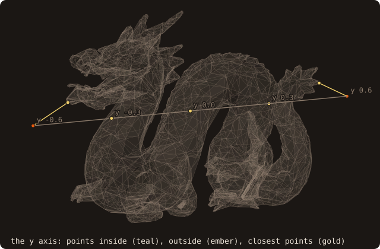
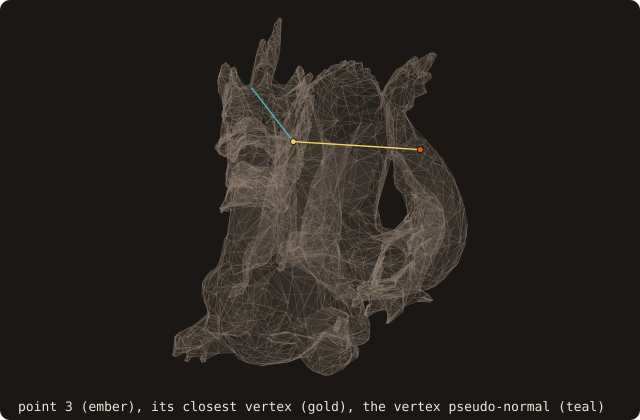
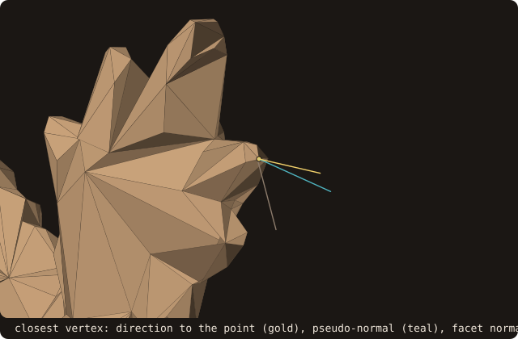

# 4. Signed distance

With the dragon placed in the domain, the first question a grid asks is how far each point is from the wall, and on
which side. This chapter queries single points: five on an axis, three with every sign algorithm, one in full detail.

## The distance of a point

<<< @/examples/snippets/tut04_a_distance-distance.f90

- `distance(point=)` returns the distance from a point to the closest facet, found by a best-first traversal of the
  AABB tree. The defaults are unsigned and **squared**: pass `is_square_root=.true.` for the distance itself and
  `is_signed=.true.` for a sign, negative inside.
- `sign_algorithm=` chooses how the sign is decided (next section); the default is `SIGN_PSEUDO_NORMAL`.
- `is_point_inside(point=, sign_algorithm=)` returns the inside test alone, with the same algorithms and the same
  default.

<<< @/examples/output/tut04.ansi{ansi}

The five points on the y axis go from outside (0.150398) through the body to outside again (0.114892). The three
inner points are inside by 0.000289, 0.015419 and 0.002330: along this axis the body is thin, and the point at
y = -0.3 lies almost on the wall. The two sign algorithms agree at these points.

{.fossil-figure}

A probe moved around the body shows the two answers together. In the animation it travels an ellipse in the plane
x = 0; the segment joins it to its closest point, and its colour gives the side.

{.fossil-figure}

## Inside or outside: four algorithms

The sign is a separate question from the distance, and FOSSIL answers it four ways:

- `SIGN_PSEUDO_NORMAL` (the default): the angle-weighted pseudo-normal of the closest face, edge or vertex, read in
  the same traversal. Exact on a closed, outward-oriented, manifold surface.
- `SIGN_FAST_WINDING_NUMBER`: inside when the winding number of the surface around the point exceeds 0.5, evaluated
  hierarchically on the tree. It tolerates holes and gaps.
- `SIGN_RAY_INTERSECTIONS` and `SIGN_SOLID_ANGLE`: ray parity and the solid-angle sum, O(N) per query.

<<< @/examples/snippets/tut04_b_signs-signs.f90

<<< @/examples/output/tut04-signs.ansi{ansi}

The origin is inside and the point beyond the head outside by every algorithm. Point 3, (0.36, -0.2, 0.2), lies
0.2833 outside the dragon by three of them, and inside by the pseudo-normal. Its closest feature is a vertex, and the
pseudo-normal of that vertex, (-0.6886, -0.0309, 0.7245), points away from the point: the dragon is still not a
closed manifold after chapter 2, and a sign read from one feature inherits its defects. The winding number and the
two O(N) methods look at the whole surface instead. Chapter 5 counts how often this happens on a grid.

{.fossil-figure}

## The closest feature

<<< @/examples/snippets/tut04_c_closest-rich.f90

- `compute_distance` is the subroutine form with the details of the closest feature: `facet_index`, the local
  `edge_index` (1 to 3, 0 when not on an edge) and `vertex_index` (1 to 3, 0 when not at a vertex), the
  `closest_point` and the pseudo-normal `normal` of that feature. Chapter 8 gets the same for many points at once.

<<< @/examples/output/tut04-closest.ansi{ansi}

The point (0, 0.6, 0) is closest to vertex 3 of facet 1289, at the tip of the tail, so its normal is the vertex
pseudo-normal (-0.0142, 0.8246, -0.5655), not the normal of facet 1289, (-0.4301, -0.0714, -0.9000). The pseudo-normal
is the angle-weighted mean of the normals of every facet at the vertex; it points nearly at the query point, which is
why the sign it gives is right on a closed surface.

{.fossil-figure}

::: tip What you learned
`distance` is unsigned and squared unless asked otherwise; `sign_algorithm` picks the inside test, and the
pseudo-normal one needs a closed manifold; `compute_distance` adds the closest facet, feature, point and normal.
Reference: [Generalized winding number](/guide/advanced/winding-number),
[Sign algorithms at sharp features](/guide/advanced/sign-benchmark).
:::

Next: [5. Batched queries](./05-batched).
