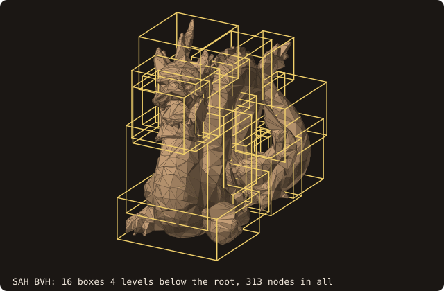
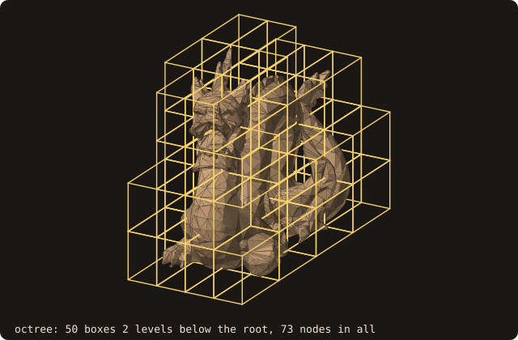
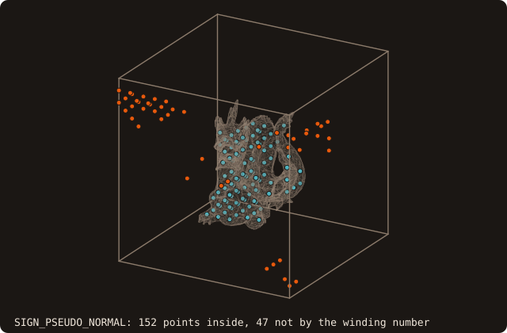
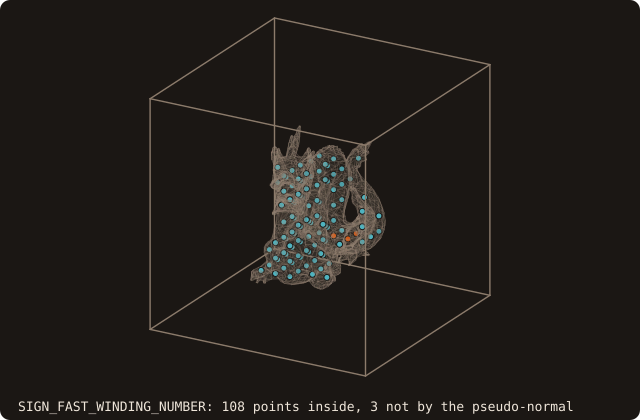

# 5. Batched queries

A grid asks for the distance of every one of its points, not of five. `distance_many` takes the whole batch in one
call. This chapter runs it on 16³ points over the domain, then on both kinds of AABB tree, then with both
device-ready sign algorithms.

## A grid in one call

<<< @/examples/snippets/tut05_a_grid-grid.f90

- `distance_many(points=, distances=)` is a loop of `compute_distance` over `points`, with the same `is_signed`,
  `sign_algorithm` and `is_square_root` for every point (unsigned and squared by default, as `distance`).
  `distances` is allocated by the caller, with the size of `points`; a size mismatch gives
  `status = STATUS_INVALID_INPUT` and leaves `distances` untouched.
- The loop is an OpenMP `parallel do`: the tree is read-only and each iteration writes its own slot. Built with
  `-fopenmp` it runs on all threads, without it serially, with the same results.
- The open dragon needs `SIGN_FAST_WINDING_NUMBER` (chapter 4); the last section shows why on this grid.

<<< @/examples/output/tut05.ansi{ansi}

108 of the 4096 points are inside, the deepest 0.069887 from the wall; the farthest point is 0.776508 away. The
animation walks the batch plane by plane, each point drawn as a small square coloured by its distance.

{.fossil-figure}

## Two kinds of tree

`aabb_tree_kind=` on `load_from_file` (also on `analyze` and `adopt_facets`) selects the tree that every query
traverses:

- `AABB_TREE_SAH_BVH` (the default): a binary tree built by splitting the *facets*, at each node, where the
  surface-area heuristic says a traversal is cheapest. Its boxes are tight and overlap.
- `AABB_TREE_OCTREE`: the older 8-way partition of *space* into equal cubes, to the depth `refinement_levels` sets.
  It is kept for comparison; the BVH is the faster one and the only one with a device path (chapter 16).

<<< @/examples/snippets/tut05_b_trees-trees.f90

<<< @/examples/output/tut05-trees.ansi{ansi}

The two trees give the same distance magnitudes bit for bit: the traversal never prunes the true closest facet. One
sign differs. At that point several facets are equally close, the trees report different ones, and on a
non-manifold surface their pseudo-normals disagree.

The trees are private to the surface. The figures build them again over the same facets with
`fossil_aabb_tree_object`, as `analyze` does, and draw their boxes:

The timing is not printed: it depends on the machine. The figures are in
[GPU distance queries](/guide/advanced/device-distance) (the BVH is about 110 times faster than the octree on a mesh
of 24k facets).

## Pseudo-normal or winding number

<<< @/examples/snippets/tut05_c_signs-signs.f90

<<< @/examples/output/tut05-signs.ansi{ansi}

The two sign algorithms give the same magnitudes and different signs at 50 of the 4096 points. The pseudo-normal
sign puts 152 points inside, one of them at d = -0.647, deeper than the dragon is wide: a sign read from the closest
feature is wrong where the surface is not a closed manifold. The fast winding number puts 108 points inside, none
deeper than 0.070. On a surface that is not closed, use `SIGN_FAST_WINDING_NUMBER`; the rest of the tutorial does.

Most ember points of the left figure lie far from the body, near the corners of the domain. Each of the 47 takes its
sign from the pseudo-normal of a vertex or an edge of the dragon, like point 3 of chapter 4; one wrong pseudo-normal
flips every point whose closest feature it is.

::: tip What you learned
`distance_many` answers a whole grid in one OpenMP call; the SAH BVH splits facets, the octree splits space, and
they agree on the distances; the pseudo-normal sign needs a closed surface, the fast winding number does not.
Reference: [surface_stl_object](/guide/api/surface-stl-object).
:::

Next: [6. A distance field](./06-distance-field).
