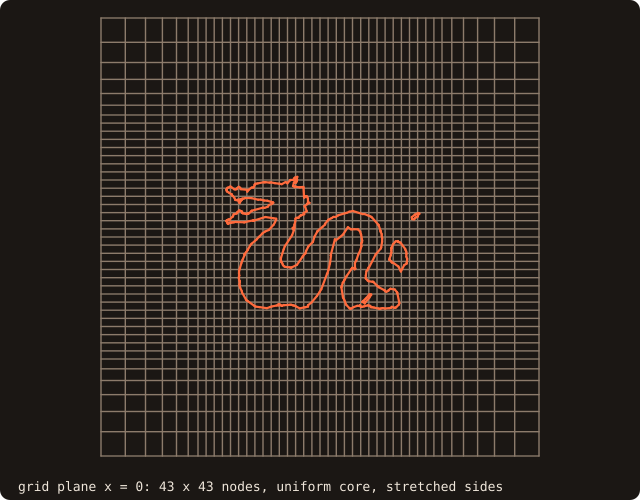
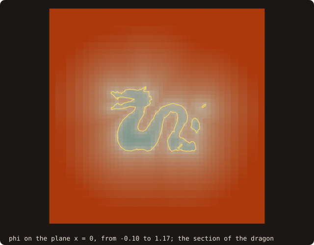
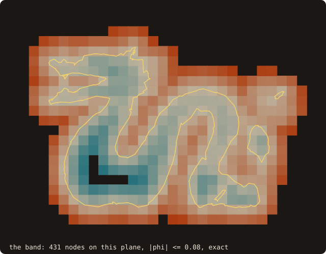
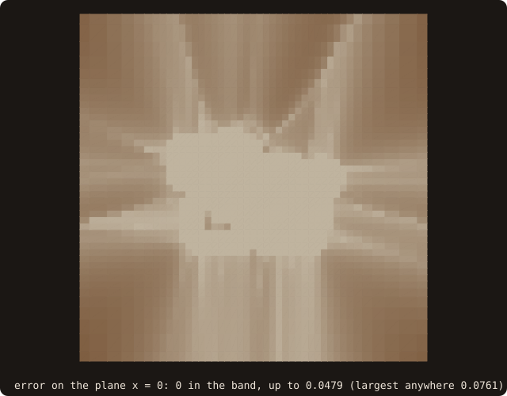

# 6. A distance field

Chapter 5 computed the exact distance at every point. A solver usually wants the signed distance at every node of its
grid, as an array, and does not need the last digit far from the body. `distance_field_object` builds that field on
a rectilinear grid, stretched toward the far field as solver grids are. Four programs: the grid, the field in one
call, the same field stage by stage, and a check against the exact distance.

## The grid

<<< @/examples/snippets/tut06_a_grid-grid.f90

- `initialize(x=, y=, z=)` takes the three node coordinate arrays, strictly increasing, so each axis may be stretched.
  Here each axis has a uniform core of 31 points with spacing 0.04 over [-0.6, 0.6] and 6 more points per side, the
  spacing growing by 1.2. `ng=` declares halo layers for a block decomposition (default 0). A coordinate array that
  is not strictly increasing gives `status = STATUS_INVALID_INPUT`.

<<< @/examples/output/tut06-grid.ansi{ansi}

{.fossil-figure}

## The field in one call

<<< @/examples/snippets/tut06_b_field-compute.f90

- `compute(surface=)` runs three stages, also callable one by one:
  - `compute_band`: exact signed distances, by one `distance_many` batch, on the nodes within the band of the
    surface. `band=` is the half-width; the default is twice the largest grid spacing around the surface.
  - `compute_signs`: the signs outside the band, by a flood fill over the components of non-band nodes. A component
    whose sign cannot be read from the band gets one point query per node; `fallback_cells` counts them.
  - `sweep`: the magnitudes outside the band by the Fast Sweeping Method, which solves |∇φ| = 1 outward from the band.
    Band values stay fixed. `tol` (default 1e-12, relative to the domain diagonal) and `max_sweeps` (default 400)
    stop it; `sweeps` returns the directional sweeps done.
- `sign_algorithm=` is passed to the band and point queries (default `SIGN_PSEUDO_NORMAL`); the open dragon needs
  `SIGN_FAST_WINDING_NUMBER` (chapter 5).
- The result is the public array `field%phi(i, j, k)`, the signed distance at `(x(i), y(j), z(k))`, negative inside.
  `field%in_band` marks the band nodes. `get_dims`, `get_band_width` and `get_band_cells` describe the field.

<<< @/examples/output/tut06.ansi{ansi}

- The band has half-width 0.08, twice the core spacing, and holds 3667 of the 79507 nodes.
- No node needed a point query for its sign, and 32 directional sweeps (4 cycles of 8 directions) converged.
- 849 nodes are inside. With 0.04³ per node that is a volume of 0.054, the volume of the dragon from chapter 3.

Each node is drawn as its dual cell. Left, the colour is sign(φ)·√(|φ| / 0.6), so the thin inside shows; right,
it is φ / 0.08, the band half-width.

## Stage by stage

The third program calls the stages itself. It then sweeps copies of the signed field for 1, 4 and 8 directional
sweeps only, and counts the nodes still without a magnitude and the largest difference from the converged field over
the others ("error").

<<< @/examples/snippets/tut06_c_sweep-stages.f90

<<< @/examples/output/tut06-sweep.ansi{ansi}

- A directional sweep visits the nodes from one corner of the grid to the opposite one, so after one sweep only the
  nodes downstream of the band in that direction have a magnitude: 44910 of the 79507 nodes have none yet.
- After the first cycle of 8 directions every node has one; the next cycles correct it. After 8 sweeps the largest
  difference from the converged field is 4.7e-4, and the stop test needs 4 cycles.
- A caller with a block decomposition alternates halo exchanges with `sweep(max_sweeps=8)` until the global
  `max_change` is below its tolerance.

{.fossil-figure}

## Checking the field

The last program compares every node with the exact distance of chapter 4, separately in and out of the band.

<<< @/examples/snippets/tut06_d_check-check.f90

<<< @/examples/output/tut06-check.ansi{ansi}

- The band values are the exact distances, bit for bit.
- Outside the band the sweeping is a first-order approximation of the distance: the largest error is 0.076, on the
  far nodes of the stretched grid. A solver that needs exact values farther out widens `band`.

{.fossil-figure}

::: tip What you learned
`distance_field_object` fills a rectilinear grid with the signed distance: exact in a band, signed by flood fill,
swept beyond; the stages can run one by one. Reference: [Signed-distance field](/guide/advanced/distance-field).
:::

Next: [7. Curves in 2-D](./07-curves).
