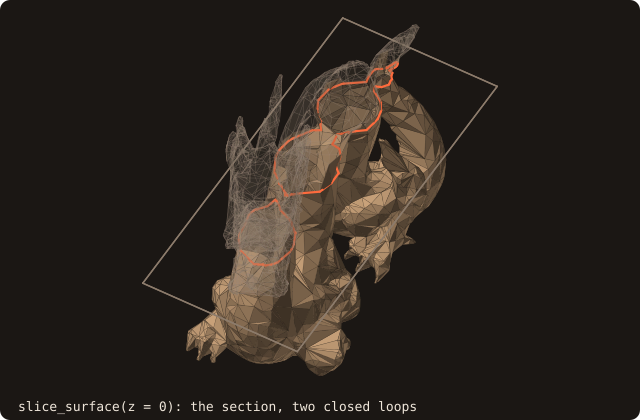
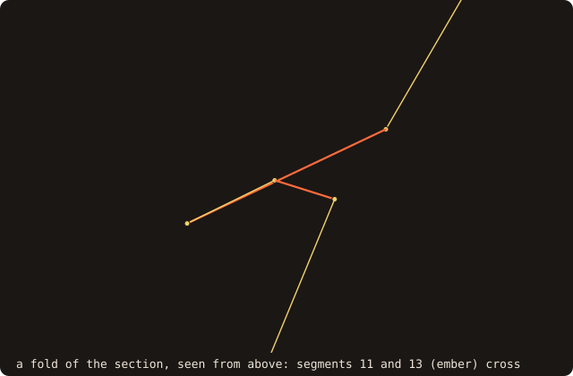
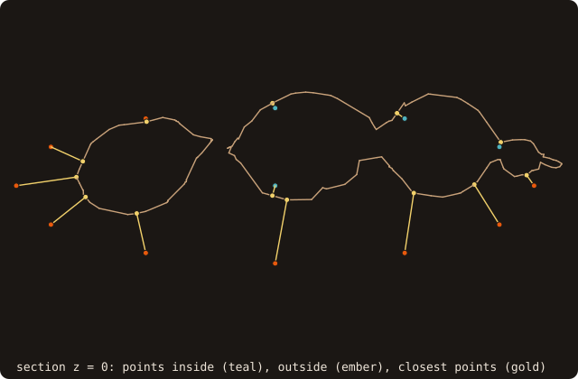

# 7. Curves in 2-D

A 2-D run of the same case needs the body as a curve in a plane, not as triangles. `slice_surface` cuts the dragon
by a plane, and the section is a `curve_object` with the same queries as a surface, in two dimensions. This chapter
slices, queries the section and builds its distance field.

## Slicing the surface

<<< @/examples/snippets/tut07_a_slice-slice.f90

- `slice_surface(surface, normal_axis, level, curve)` cuts by the plane normal to axis `normal_axis` (1, 2, 3) at
  coordinate `level`. The curve lives in that plane with in-plane coordinates (u, v), the other two axes in cyclic
  order: for `normal_axis = 3` they are (x, y). The crossings are exact constructions, with no tolerance: a vertex on
  the plane counts as above it.
- `merge_collinear=.true.` drops vertices between collinear segments. `open_loops` counts the chains that did not
  close, as happens on a surface with holes; such a curve can be closed by `repair(tolerance=)`.
- The solid is on the left of every segment: outer loops run counter-clockwise, holes clockwise. `check_validity()`
  returns `CURVE_VALID` or the first defect found (`CURVE_OPEN_LOOP`, `CURVE_WRONG_ORIENTATION`, ...).
- `get_area` and `get_perimeter` are the 2-D metrics. `save_into_file` writes the ASCII loop format, one `u v` per
  line, read back by `load_from_file`. Chapters 10 and 11 read `dragon-section.dat`.
- A curve can also be built from arrays: `adopt_loops(u=, v=, loop_sizes=)`.

<<< @/examples/output/tut07.ansi{ansi}

The section has two closed loops, 152 vertices and an area of 0.072609.

{.fossil-figure}

Each level gives another curve. The second program slices the dragon by 13 planes, from z = -0.30 to 0.30:

<<< @/examples/output/tut07-planes.ansi{ansi}

{.fossil-figure}

No section is open: `sanitize` left no boundary edge (chapter 2). The areas, summed times the spacing 0.05, give
0.053, close to the volume 0.054283 of chapter 3.

## A fold of the section

`check_validity()` does not look for crossings by default; `check_validity(check_self_intersections=.true.)` does
(`CURVE_SELF_INTERSECTING`), and `self_intersections(pairs, n)` returns the pairs of segments that cross, touch or
overlap, decided exactly. The section at z = 0 is valid and still crosses itself once, at a fold of the non-manifold
dragon: segment 12 doubles back along segment 11, and 13 crosses 11.

{.fossil-figure}

The distance queries do not mind the fold; the cut cells and the swept geometry do ([chapter 11](./11-moving-bodies)
shows how the swept-geometry residual detects it).

## Distance to a curve

<<< @/examples/snippets/tut07_c_query-query.f90

- Points are `p = [u, v]`. `compute_distance` returns the signed distance, negative inside. Unlike the surface
  queries, curve distances are signed and not squared by default (`is_signed=.false.` for the unsigned one). It
  comes with the closest point, `closest_segment`, and `closest_vertex` (0 when the closest point is inside a
  segment).
- `distance(p)` and `is_point_inside(p)` are the short forms. `distance_many(points=, distances=)` is the batch, with
  the points as columns of a `(2, n)` array.

<<< @/examples/output/tut07-query.ansi{ansi}

The origin is inside, 0.015933 from the wall, its closest point inside segment 20. Three of the twelve points of the
ellipse are inside too.

{.fossil-figure}

## A 2-D field

<<< @/examples/snippets/tut07_d_field-field.f90

- `initialize(x=, y=)` without `z` makes a 2-D field; `compute(curve=)` runs the same band, sign and sweep stages as
  in chapter 6.

<<< @/examples/output/tut07-field.ansi{ansi}

The 2-D field has 327 nodes inside on a spacing of 0.015, an area of 0.0736, against 0.0726 for the curve.

{.fossil-figure}

The colour saturates beyond about 0.1 from the wall; the field itself runs to the edges of the domain.

::: tip What you learned
`slice_surface` turns a surface into a `curve_object`; curves have the signed distance, the inside test and the
distance field of surfaces, in (u, v) coordinates, and `self_intersections` finds where a section folds. Reference:
[2-D geometry (curves)](/guide/advanced/2d-geometry), [curve_object](/guide/api/curve-object).
:::

Next: [8. Immersed-boundary queries](./08-ib-queries).
