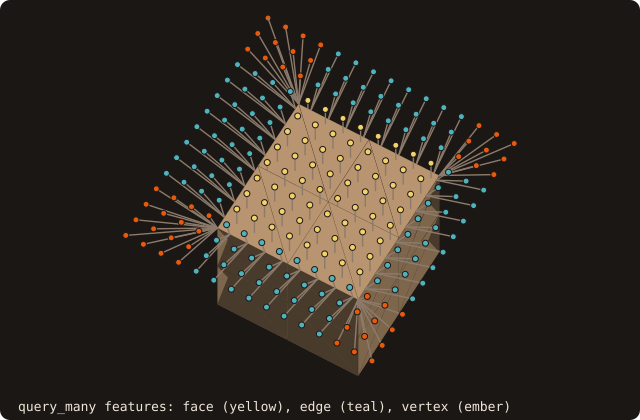
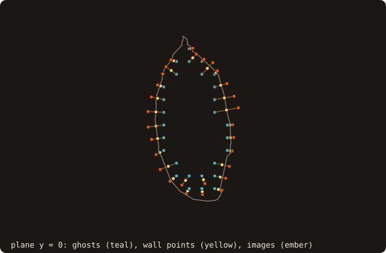

# 8. Immersed-boundary queries

An immersed-boundary solver needs more than the sign of each cell. For every ghost point, a solid node next to the
fluid, it needs the wall point, the wall normal, the body it belongs to and an image point in the fluid. This chapter
finds the ghost points of a 41³ grid and asks for all of that in one batch.

<<< @/examples/snippets/tut08_ib_queries-ghosts.f90

- The ghost points are the grid points inside the dragon and within one spacing of the wall, selected from one
  `distance_many` batch with the fast winding number sign (chapter 5).

<<< @/examples/snippets/tut08_ib_queries-query.f90

- `query_many(points=, distances=)` is the rich batch. Every output after `distances` is optional and caller-allocated:
  `closest_points(3, n)`, `normals(3, n)`, and `facets(n)`, `features(n)`, `feature_indexes(n)`, `bodies(n)`. Unlike
  `distance_many`, it is signed and not squared by default (`is_signed=.true.`).
- `features` tells where the wall point lies on its facet: `FEATURE_FACE` (inside it), `FEATURE_EDGE` or
  `FEATURE_VERTEX`, with the local edge or vertex index in `feature_indexes`. The normal is the pseudo-normal of that
  feature: the facet normal on a face, an angle-weighted average on an edge or at a vertex.
- `bodies` is the body of the closest facet. `analyze` groups the facets into shells (edge-connected sets) and the
  shells into bodies (an outer shell with its cavities); `get_shells_number()` and `get_bodies_number()` count them.
- `ambiguous(n)` flags the points with a second foot point, on another facet, as close as the first within a relative
  1e-6: points on the medial axis, or in a thin gap. `second_foot_points` returns it; the caller decides what to do.
- `query_point` is the one-point form; `query_many_device` runs the batch on the device (chapter 12).

{.fossil-figure}

The features are easiest to see on a cube: the same call on a sheet of points above it splits them into the face,
edge and vertex regions.

<<< @/examples/snippets/tut08_ib_queries-images.f90

- `image_points(points=, images=)` mirrors each point through its wall point, 2·foot − x. `visible(n)` is true when
  the segment from the wall point to the image crosses no facet, that is when the image is a usable fluid point.
- `probe_many(points=, lengths=, probe_points=, visible=)` places probes at a given distance along the normal from
  the wall point (positive outward), with the same visibility test.

{.fossil-figure}

The view is along y: the wall points are the closest points in 3-D, so some lie off the plane and project off the
section, and an image point can project inside it.

## Running it

<<< @/examples/output/tut08.ansi{ansi}

- 1368 grid points are ghost points. For 1051 of them the wall point is inside a facet, for 303 on an edge, for 14 at
  a vertex. Two have an ambiguous wall point.
- `analyze` finds 37 bodies, not one: the open, non-manifold dragon splits into 76 edge-connected shells. On a clean
  closed mesh of one solid there is one body.
- The image of 1330 ghost points is visible from its wall point. The other 38 images lie behind another part of the
  surface, and a stencil there needs another closure.

::: tip What you learned
`query_many` gives the wall point, feature, normal and body of every point in one call; `image_points` and
`probe_many` build the fluid-side points with a visibility test. Reference:
[Immersed-boundary queries](/guide/advanced/ib-queries).
:::

Next: [9. AMR tagging](./09-amr-tagging).
