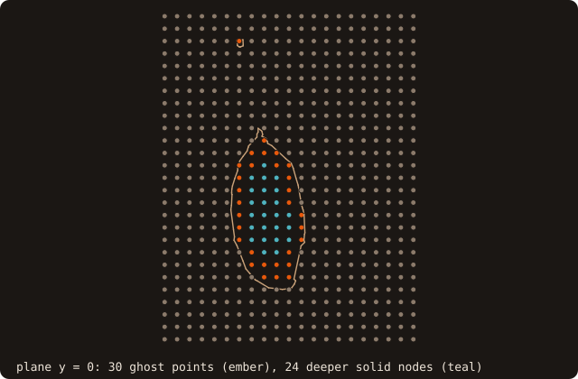
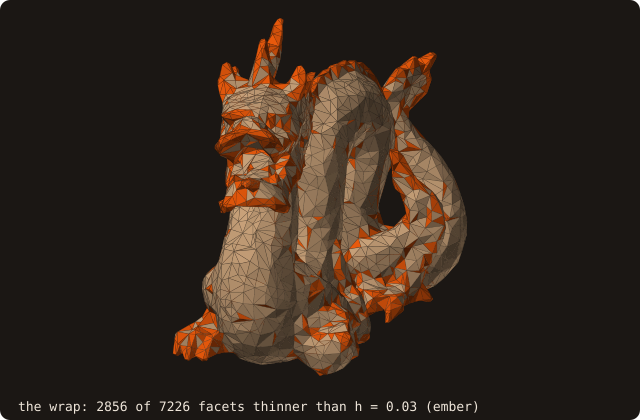

# 8. Immersed-boundary queries

An immersed-boundary solver needs more than the sign of each cell. For every ghost point, a solid node next to the
fluid, it needs the wall point, the wall normal, the body it belongs to and an image point in the fluid. This chapter
finds the ghost points of a 41³ grid, asks for all of that in one batch, follows one ghost point after another, and
looks for the walls too thin for the grid.

## Ghost points

<<< @/examples/snippets/tut08_a_ghosts-ghosts.f90

- The ghost points are the grid points inside the dragon and within one spacing of the wall, selected from one
  `distance_many` batch with the fast winding number sign (chapter 5).

<<< @/examples/output/tut08-ghosts.ansi{ansi}

2013 of the 68921 grid points are inside, and 1368 of them, two thirds, are ghost points: on a spacing of 0.03 most
of the dragon's solid nodes are next to the fluid.

{.fossil-figure}

## Wall point, feature, normal, body

<<< @/examples/snippets/tut08_b_query-query.f90

- `query_many(points=, distances=)` is the rich batch. Every output after `distances` is optional and caller-allocated:
  `closest_points(3, n)`, `normals(3, n)`, and `facets(n)`, `features(n)`, `feature_indexes(n)`, `bodies(n)`. Unlike
  `distance_many`, it is signed and not squared by default (`is_signed=.true.`).
- `features` tells where the wall point lies on its facet: `FEATURE_FACE` (inside it), `FEATURE_EDGE` or
  `FEATURE_VERTEX`, with the local edge or vertex index in `feature_indexes`. The normal is the pseudo-normal of that
  feature: the facet normal on a face, an angle-weighted average on an edge or at a vertex.
- `bodies` is the body of the closest facet. `analyze` groups the facets into shells (edge-connected sets) and the
  shells into bodies (an outer shell with its cavities); `get_shells_number()` and `get_bodies_number()` count them.
- `ambiguous(n)` flags the points with a second foot point, on another facet, as close as the first within a relative
  1e-6: points on the medial axis, or in a thin gap. `second_foot_points` returns it; the caller decides what to do.
- `query_point` is the one-point form; `query_many_device` runs the batch on the device (chapter 16).

The features are easiest to see on a cube: the same call on a sheet of points above it splits them into the face,
edge and vertex regions.

{.fossil-figure}

## Image points and probes

<<< @/examples/snippets/tut08_b_query-images.f90

- `image_points(points=, images=)` mirrors each point through its wall point, 2·foot − x. `visible(n)` is true when
  the segment from the wall point to the image crosses no facet, that is when the image is a usable fluid point.
- `probe_many(points=, lengths=, probe_points=, visible=)` places probes at a given distance along the normal from
  the wall point (positive outward), with the same visibility test. Here the probes are two grid spacings out.

<<< @/examples/output/tut08.ansi{ansi}

- For 1051 of the 1368 ghost points the wall point is inside a facet, for 303 on an edge, for 14 at a vertex. Two
  have an ambiguous wall point.
- `analyze` finds 37 bodies, not one: the non-manifold dragon is 76 edge-connected shells (chapter 2). On a clean
  closed mesh of one solid there is one body.
- The image of 1330 ghost points is visible from its wall point. The other 38 images lie behind another part of the
  surface, and a stencil there needs another closure. Probes two spacings out are blocked more often: 1281 visible.

{.fossil-figure}

The view is along y: the wall points are the closest points in 3-D, so some lie off the plane and project off the
section, and an image point can project inside it. The animation takes the same 30 ghost points one at a time, around
the section, with the probe as well:

{.fossil-figure}

With [named patches](/guide/advanced/patches) (chapter 1), `query_many(patches=)`, `probe_many(patches=)` and
`image_points(patches=)` also give the patch of each wall point: which boundary condition the ghost point closes.

## Thin walls and gaps

A wall or a gap thinner than a cell is where an immersed boundary goes wrong: ghost points with an ambiguous wall
point, image points behind another wall. The last program measures them before any grid.

<<< @/examples/snippets/tut08_d_thin-thin.f90

- The dragon is first wrapped into one closed surface (`alpha_wrap`, see [Alpha wrapping](/guide/advanced/alpha-wrap)).
  The repaired file is 76 overlapping shells, and a ball inside it would stop on the inner shells.
- `thickness(method=THICKNESS_MEDIAL)` measures the diameter of the largest ball tangent to each facet inside the
  body (`thickness`) and outside (`gap`).
- `thin_regions(h=, factor=)` groups the facets thinner than `factor * h` into connected regions, largest first. For
  AMR, `build_thin` and `tag_block(thin_factor=, ...)` turn the same values into refinement tags (chapter 9).

<<< @/examples/output/tut08-thin.ansi{ansi}

On the wrap, 2856 of 7226 facets are thinner than one grid spacing (h = 0.03), in 305 regions: the legs, the tail
and the creases of a coarse 41³ grid. Those are the places to refine before trusting the ghost points there.

{.fossil-figure}

::: tip What you learned
`query_many` gives the wall point, feature, normal and body of every point in one call; `image_points` and
`probe_many` build the fluid-side points with a visibility test; `thickness` and `thin_regions` find, before any
grid, where the grid will be too coarse. Reference: [Immersed-boundary queries](/guide/advanced/ib-queries),
[Thickness](/guide/advanced/thickness).
:::

Next: [9. AMR tagging](./09-amr-tagging).
