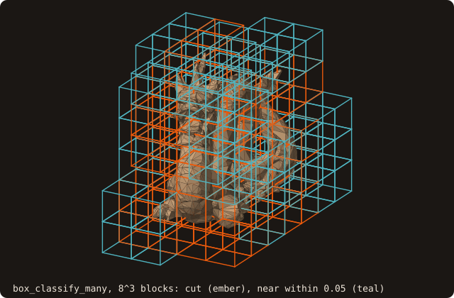

# 9. AMR tagging

An adaptive grid decides where to refine before any field exists. FOSSIL answers the tagging questions from the BVH
alone: does a block meet the wall, does the wall come near it, and if neither, is it inside or outside. This chapter
classifies the blocks of an 8³ partition of the domain, then tags the cells of a 32³ block.

<<< @/examples/snippets/tut09_amr_tagging-classify.f90

- `box_classify_many(lo=, hi=, codes=)` classifies n boxes given their corners `lo(3, n)` and `hi(3, n)`:
  - `BOX_CUT`: the box meets the surface, by a separating-axis test against each candidate triangle, run on the box
    inflated by 1e-12 of the problem size. The test never misses a contact; a box closer than that may count as cut.
  - `BOX_NEAR` (only with `radius=` > 0): not cut, but a triangle comes within `radius` of the box.
  - `BOX_INSIDE` / `BOX_OUTSIDE`: neither; one point query at the box centre decides the side.
- The centre query uses `sign_algorithm=`, whose default here is `SIGN_FAST_WINDING_NUMBER`, not the pseudo-normal of
  the point queries. `inside(n)` optionally returns the centre side of every box, near boxes included.
- `box_intersects_surface(lo, hi)` answers for one box; `box_classify_many_device` runs the batch on the device.

{.fossil-figure}

<<< @/examples/snippets/tut09_amr_tagging-tag.f90

- `tag_block(x=, y=, z=, band=, tags=)` takes the cell edges of a rectilinear block (stretched allowed) and returns
  one tag per cell: 0 on a cut cell, otherwise the Chebyshev cell distance to the nearest cut cell, capped at
  `band + 1`, negative inside and positive outside. `band = 4` gives the cut, neighbour, extension and
  reinitialisation rings an IB solver tags.
- Each connected group of uncut cells is signed by one point query, with the same default sign algorithm.
- The block sees only itself: a cut cell in a neighbouring block does not count, so a band that must cross block
  faces needs the block padded with ghost cells.

{.fossil-figure}

A cell is cut if the wall crosses it anywhere in its height, so the cut cells follow the wall over the whole layer,
not only the section at its mid-plane.

Sharp edges need finer cells than the smooth wall. After `call surface%build_features()`, the same call takes
`feature_band=` and `feature_tags=`: a second field, the cell distance to the nearest cell crossed by a sharp,
boundary or non-manifold edge. Refine where either field is small. See
[feature edges](/guide/advanced/feature-edges#refinement-along-the-features).

## Running it

<<< @/examples/output/tut09.ansi{ansi}

- Of the 512 blocks, 87 meet the dragon and 62 more are within 0.05 of it. No block of side 0.15 fits inside the
  thin dragon, so none is inside.
- In the 32³ block, 1689 cells are cut. Inside, no cell is more than 2 cells from a cut cell: the dragon is at most
  a few cells thick at this spacing. Outside, the cells beyond the band of 4 are capped at +5.

::: tip What you learned
`box_classify_many` sorts blocks into cut, near, inside and outside from the tree alone; `tag_block` gives signed
distance-to-cut bands on a block of cells. Reference: [AMR tagging](/guide/advanced/amr-tagging).
:::

Next: [10. Cut cells](./10-cut-cells).
